# История LightPollution
> Дата создания: 2026-11-09

Проект начинается с вопроса: как выглядит звёздное небо **из точки наблюдения**,
если в разных направлениях находятся города? Здесь сохраняются модели,
результаты, неудачные предположения и следующие открытые вопросы. Актуальная
теория — в [README](README.md), подробные изменения кода — в
[журнале](docs/CODE_CHANGELOG.md). История дополняется при изменении модели
или появлении содержательного результата; она не заменяет журнал кода.

## 11 ноября 2026: исследование изображения перед камерой

Пользователь заметил пятна городской засветки и слабые различия яркости/
цвета звёзд. Численный аудит разделил причины: фон PNG содержит только
три уровня серого 20/21/22, все пиксели поля монохромны, при уменьшении
Lanczos до 390 px максимум падает с 164 до 48. Это диагноз представления,
не измерение Telegram или доказательство ошибки пространственной физики.

Изучены работы о тональном переносе, адаптации, LMSR и оптике глаза;
проверены открытые таблицы CIE. Предложено сначала исправить квантование
и проверить угловую сетку, затем перейти к яркости/PSF и цвету.
Исчезновение слабых звёзд сохраняется как отдельный количественный порог;
цвет и надпороговая яркость не выводятся из него автоматически.

Физическая модель и отправленные изображения 0.6 не менялись; камера
отложена. [Исследование и предлагаемый план](docs/EYE_VISUALIZATION_RESEARCH.md),
[воспроизводимые числа](artifacts/eye-visualization-research-20261111/README.md).

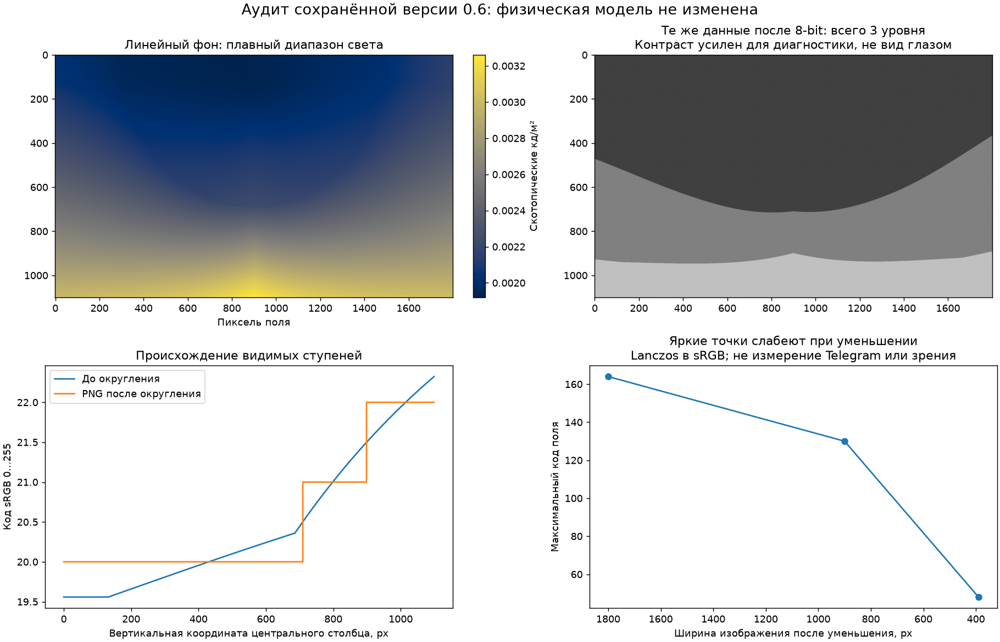

## 11 ноября 2026: первый ограниченный режим невооружённого глаза (0.6)

Порог видимости теперь вычисляется по лабораторной точечной модели
Blackwell/Crumey, с приведением спектра звезды и фона к ночной
чувствительности. Атмосфера ослабляет звёздный поток один раз; параметр
наблюдателя её не содержит. Это первый количественный eye-слой поверх
переноса, а не новая длительная экспозиция.

Пример: 60,300° N, 30,315° E, глаза на 2 м над DSM, 11 ноября 21:00 UTC.
Небо астрономически тёмное, Луна под горизонтом, атмосфера/лампы сценарные.
NASA — годовой композит 2025, не измерение именно этой ночи. В выбранном
поле 60°, центр на юге/высоте 75°, выше порога 220 из 537 каталожных
звёзд. При условном отключении города в той же точке — 429 из 537.
Геометрия, звёздные потоки, атмосфера и экранный масштаб одинаковы.

Сначала был проверен широкий вид 90°, центр на высоте 50°: только около
57% площади попадали в принятую скотопическую область. Неподдерживаемая
часть была заштрихована. Основной кадр направлен выше; коэффициенты
порога не подгонялись ради картинки. Мезопическое зрение/блики требуют
следующей модели. Независимых визуальных наблюдателей пока 0.

Картинка монохромная, с явно условной передачей яркости. Она показывает
результат пороговой классификации, не калиброванное субъективное восприятие
и не фотографию. Яркие звёзды могут иметь цвет; этот эффект ещё не реализован.
Нативная панель KStars умеет открыть вычисленный PNG в собственном Qt-окне.

[Формальная теория](docs/EYE_MODEL.md) ·
[Отчёт, числа и воспроизведение](artifacts/eye-model-20261111/README.md).

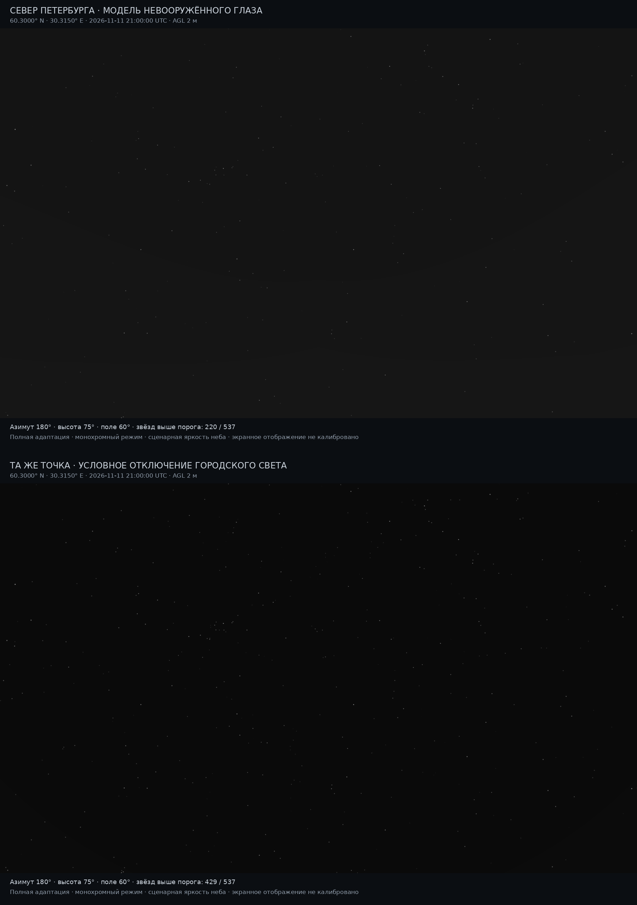

## 11 ноября 2026: рельеф, ближний свет и нативная панель KStars (0.5)

Развитие интерфейса и моделей теперь идёт совместно. Нативная C++/Qt-панель
берёт место, виртуальный UTC и направление из KStars, использует его
Artificial Horizon и отправляет атомарный снимок в наше численное ядро.
Это следующий шаг после исторического `--dump` и внешнего наложения.
Штатный рисунок планетария сам по себе не превращается в физический вид глазом.

Ближайшие 3 км больше не обязательно исключать: включённый `near_field`
интегрирует конечные светящиеся ячейки VIIRS при неизменной общей мощности.
Аналитическая проверка нашла 3,57% отклонения для грубой квадратуры у глаза
на высоте 2 м. Defaults уточнены до 2 м/порядка 3, отклонение 0,0057%.
Дробление пикселя — способ вычислить интеграл, не открытие отдельных фонарей.

Получены 29 тайлов Copernicus DSM GLO-90. Модель поднимает источники и
наблюдателя на реальную поверхность, отличает AGL от MSL, заслоняет оба
пути городского рассеяния и отбрасывает закрытые звёзды. В трёх зенитных
опытах возврат ближних ячеек увеличил сырой отклик относительно прежнего
исключения примерно в 3,35 / 1,27 / 2,32 раза. Изменение самого DSM включает
геометрию, высотную плотность атмосферы и тень, а не только последний эффект.
Сравнения не перенормируют C заново. Независимых контрольных ночей нового
компонента пока 0, поэтому полевую точность по этим числам оценить нельзя.

Живая проверка обнаружила особенность KStars 3.6.2: `setGPSLocation`
использует часовой пояс ближайшего города вместо переданного нуля.
Native snapshot правильно считал фактическое UTC; исправлен проверочный
скрипт назначения местного времени, а не физическая модель.

KStars 3.6.2 действительно собран и запущен: по два холодных и повторных
расчёта на реальных источниках/DSM. Повтор той же сцены занял около 1,6 с
против 192,7/83,8 с первых двух запросов. Полный Python-контроль — 190/190.
Qt6, управление устройствами и физическая камера остаются следующими задачами.

[Полный отчёт и снимки приложения](artifacts/kstars-terrain-near-20261111/README.md) ·
[Теория рельефа и ближних площадок](docs/TOPOGRAPHY_AND_NEAR_FIELD.md) ·
[Контракт интеграции и полезные алгоритмы KStars](docs/KSTARS_INTEGRATION.md).

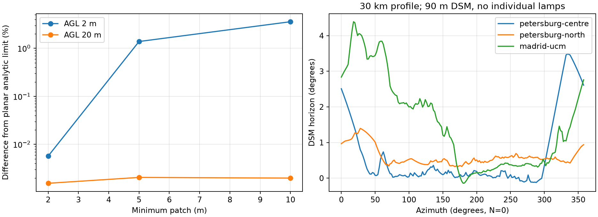

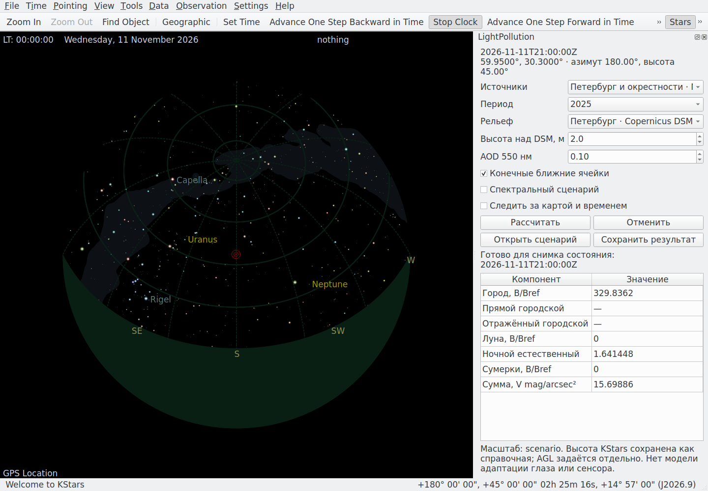

## 11 ноября 2026: естественное небо, белые ночи и снег (0.4)

Этапы 3–4 получили ограниченные численные модели. Постоянный фон теперь
можно разделить на сферический слой airglow и диффузный остаток. Высота
взгляда меняет толщину светящегося слоя и прямое ослабление; карты Млечного
Пути/ZL и рассеяние слоя в луч остаются следующей задачей.

Сумерки используют опубликованную V-регрессию Patat 2006. Она уже содержит
ночной свет, поэтому вычитается её ночной уровень, а затем добавляется наш
ночной сценарий. Для Петербурга 21 июня Солнце в выбранный момент −6,265°;
шаблон применяется только возле зенита. Вне проверенного диапазона сумма
остаётся неизвестной. Это позволяет изучать белую ночь, не называя Paranal
измерением нашего северного неба.

Снег оказался задачей граничного условия. Snow-Free карта содержит отражение
бесснежной земли; отделены прямой поток ламп и первое отражение. В одном
региональном сценарии со снегом городской фон усилился в 2,74–2,86 раза
при неизменной мощности ламп. Число зависит от заданных альбедо/долей,
оно не является найденным универсальным зимним коэффициентом.

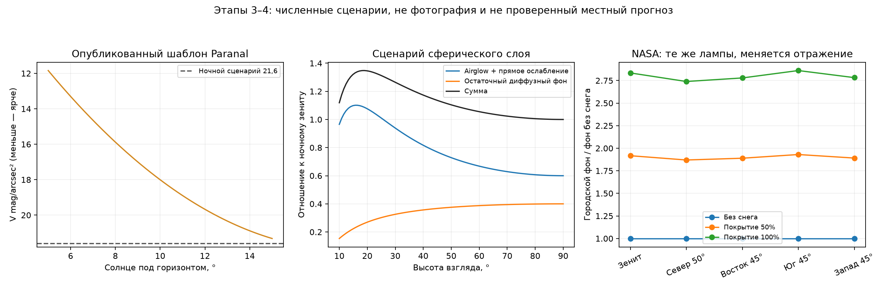

165/165 тестов и 3/3 браузерных расчётов проходят. Проверены энергетический
баланс и предельные случаи. Независимых местных снежных/сумеречных контрольных
ночей пока 0; физическая погрешность не назначается. Подробный вывод с
определений — [новая теория](docs/NATURAL_TWILIGHT_SNOW.md), входы/цифры/QA
и найденные проблемы — [отчёт](artifacts/natural-twilight-snow-20261111/README.md).

## 9 ноября 2026: сначала отделить источники от неба

Спутник видит свет поверхности, но наблюдатель смотрит на атмосферу. Между
этими изображениями нужен расчёт переноса: источник → точка рассеяния → глаз.
Одна карта Бортля или одно число яркости зенита не описывают разные направления.

Первый независимый решатель получил сферическую Землю, распределённые
ламбертовские источники, экспоненциальную атмосферу, молекулярное и аэрозольное
рассеяние, поглощение аэрозолями и ослабление на обоих участках пути.
Рассеяние однократное; топография и облака пока отсутствуют.
[Вывод первой модели](docs/MODEL.md).

### Проверка на двух искусственных городах

До работы со спутником использовалась заданная сцена: город в 40 км к югу,
второй — в 25 км к востоку. Она проверяла геометрию, знак угла рассеяния и
возникновение разных световых куполов. Это синтетический эксперимент, не
восстановленная фотография Петербурга.

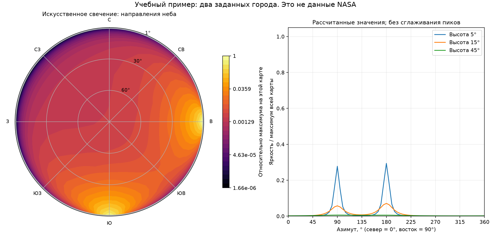

На десяти контрольных лучах численная сходимость проверялась отдельно от
физической достоверности. Малое отличие двух квадратур не означает такой же
точности прогноза реального неба.

### Реальные измерения NASA

После настройки доступа получены четыре тайла VNP46A4.002 за 2025 год.
Извлечены 345 600 ячеек Петербурга и окрестностей; NearNadir проходит политику
качества у 331 809/345 600 (96,01%). Найдены яркие участки с большим разбросом.
Они не удалены произвольным порогом и не объявлены безошибочными.
[Аудит данных](docs/DATA_AUDIT.md).

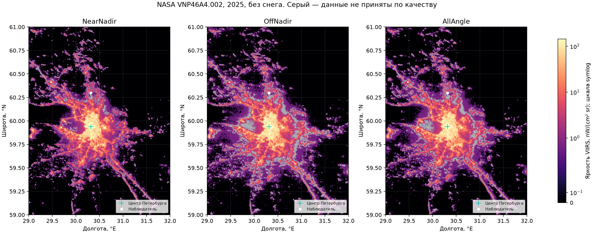

Значения спутника не стали ваттами городского освещения. Для первой модели
введены **относительные** веса, пропорциональные радиансу и площади ячейки.
Спектр и угловую диаграмму нельзя однозначно восстановить по одной полосе.

### Небо из конкретной точки

Следующий результат — купол из 60,300° N, 30,315° E, высота 20 м. Звёзды
BSC5/HEASARC пересчитаны для 10 ноября 2026, 00:00 МСК. Слева условный
естественный фон, справа добавлен расчёт городского свечения.

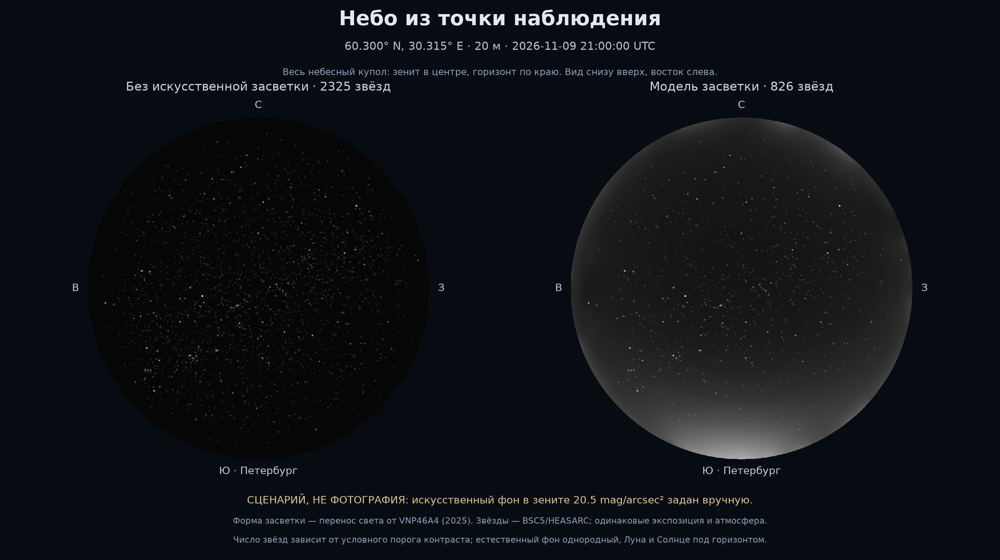

Масштаб искусственного фона в зените **20,5 mag/arcsec² задан как сценарий**.
Это не измерение и не восстановленный из NASA прогноз. Естественный фон
однороден; Млечный Путь ещё отсутствует. Число показанных звёзд определяется
условным правилом контраста, а не измеренной чувствительностью человека.

Первый реальный расчёт обнаружил проблему возле горизонта: замена блока
источников 8 × 8 на 4 × 4 меняла один контрольный луч на 150,70%. Крупный
удалённый город нельзя заменять точкой непосредственно под низким лучом.
Добавлено измельчение возле луча. На тех же восьми контролях различие после
уточнения — до 0,5034%; это не граница ошибки всего неба.

### Попытка интеграции с KStars

KStars 3.6.2 действительно запущен, звёздное изображение экспортировано.
Наше поле наложено на его растр с общей проекцией. Это внешний прототип;
встроенной интерактивной функции в KStars ещё нет.

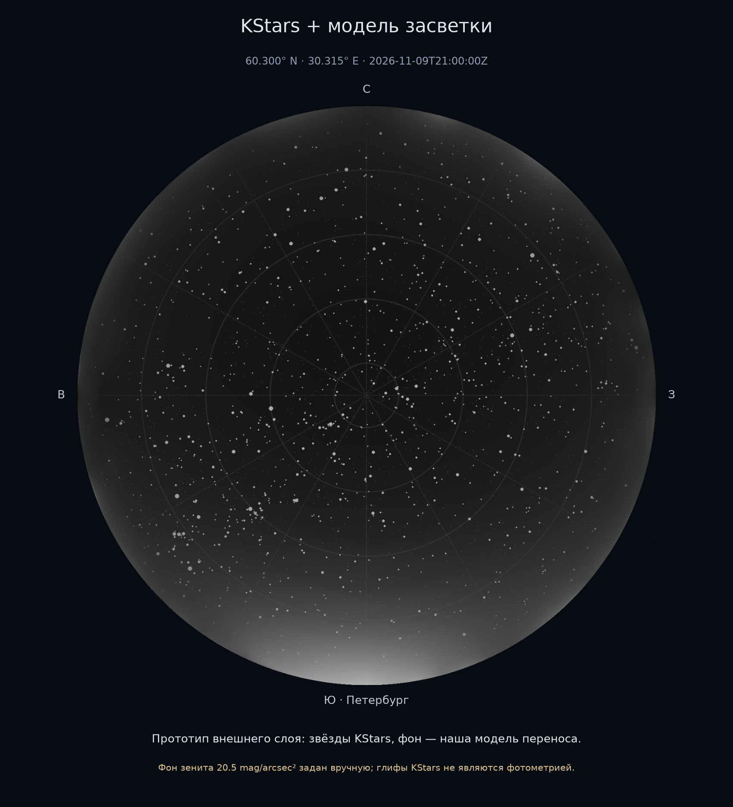

[Параметры звёздной сцены и пределы рендера](docs/OBSERVER_VIEW.md).
Результат этого этапа сохранён коммитом `4b3a691`; 49/49 тестов прошли.

## 9 ноября 2026: сопоставление с фотографиями

Уточнение пользователя: звёзды глазом часто выглядят белыми, а засветка —
цветной. Это важное различие. Белые точки и серый фон прежнего рендера не
означают, что физическое небо бесцветно. До этого момента модель вычисляла
одну условную полосу около 550 нм и показывала её монохромно.

### Что не так с произвольной красивой фотографией

Длинная выдержка регистрирует больше слабых звёзд и цвета, чем глаз. Баланс
белого, насыщенность, шумоподавление и тоновая кривая меняют вид JPEG.
Свечение облаков, природный airglow и остаточные сумерки нельзя автоматически
приписать городам. Поэтому фотография может быть хорошим примером явления,
но недостаточной проверкой численной модели.

Подобраны реальные снимки с авторами и лицензиями. Они не генерировались
нашей моделью и не подвергались перекрашиванию. Для некоторых сделаны только
уменьшенные копии; изменения указаны в
[источниках фотографий](artifacts/photo-comparison/references/sources.json).

### Отбор примеров

- **Galactic**, Nicholas A. Tonelli, Пенсильвания, 2012. Обычная компактная
  камера: 20 с, f/3, ISO 3200. Хорошо видны звёзды, Млечный Путь и подсветка
  горизонта. Но при местном времени из EXIF Солнце около −17°: пограничные
  сумерки. Полученные данные NASA 2012 и этот пример не объявляются строгой
  проверкой полного ночного фона.
- **Sweet spot**, Christian Reimer, 49,532563° N, 6,549911° E. Визуально ясное
  небо, звёзды и заметный градиент засветки. Координаты опубликованы. Солнце и
  Луна ниже границ применимости для предполагаемых дат. Это основной пример
  для нового расчёта из точки.
- **Luhasoo**, Martin Mark, 2015. Показательный цветной астрофотоснимок с
  несколькими световыми куполами. У него нет опубликованной точной точки
  камеры; он используется для иллюстрации, не для количественной проверки.
- **Orange Skies**, Timo Newton-Syms, Рука, 2013. Подсвеченные низкие облака,
  снег и прожекторы лыжных склонов. Полезный контрпример: такую сцену нельзя
  подставлять в проверку модели без облаков и снега.

### Почему выбран Sweet spot и что остаётся неизвестным

Для опубликованной точки загружен отдельный NASA VNP46A4.002 **за 2014 год**,
совпадающий с годом фото. Это не петербургская карта 2025 года, перенесённая
на другое место. Проверяются исходные HDF5 и качество региональных ячеек;
тот же физический решатель рассчитывает новый небесный купол.

Но дата на Commons/Flickr — 14 сентября, а EXIF исходного файла говорит
22 сентября. Часовой пояс не записан; UTC+2 — обоснованное, но не подтверждённое
допущение. Совпадение года не решает различие конкретных ночей. Высота камеры,
точная атмосфера, спектры светильников и фотометрическая обработка неизвестны.
Источник времени и обе версии сохранены в
[параметрах опыта](artifacts/photo-comparison/case.json).

### Полученный результат

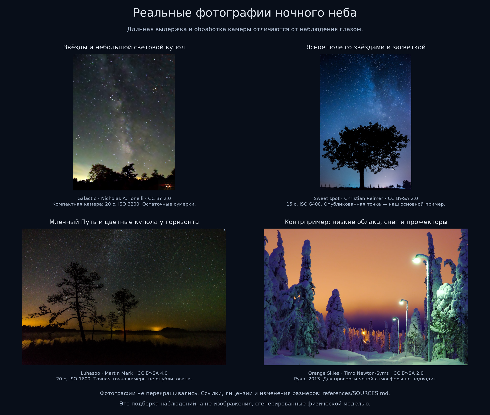

Авторы и условия каждого примера разобраны в
[источниках](artifacts/photo-comparison/references/SOURCES.md).

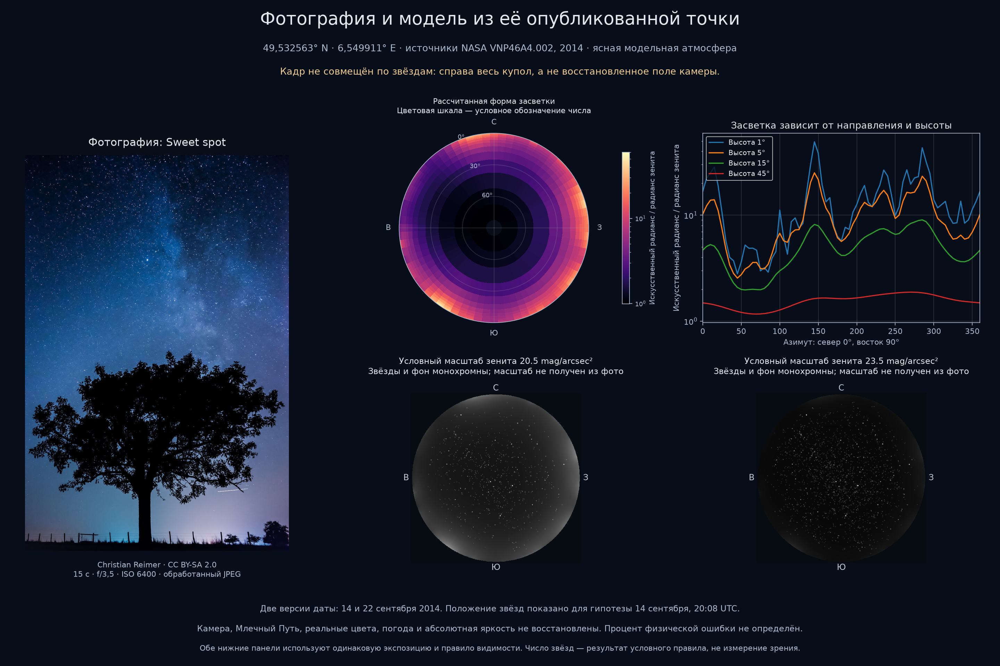

Новый регион содержит 518 400 ячеек; принятая политика NearNadir проходит у
518 265/518 400 (99,974%). Медиана числа исходных наблюдений — 31. При этом
302 465/518 265 принятых ячеек имеют нулевой радианс: QA=0 не означает
идеальную чувствительность к слабому свету. Различия композитов и Std
сохранены в [аудите](artifacts/photo-comparison/saarland-2014/audit.json).

Рассчитаны 1080 значений, 1009 независимых лучей. Базовых источников — 3253,
после измельчения возле низкого луча — до 7618. При высоте 1° максимум на
пятиградусной сетке расположен у азимута 145°: искусственная составляющая
около 49,19 собственного зенитного значения. При 15° максимум уже у 285°.
Это относительная форма **искусственного** света, не отношение полного
небесного фона и не измерение по фотографии.

На четырёх новых контрольных лучах уточнение интегрирования 192/24 → 384/48
даёт максимум 0,0261% различия; уменьшение блока источников 12 → 6 —
0,4700%. Проверены в том числе максимумы при 1° и 15°. Это локальные
численные проверки, не граница ошибки всего неба и не физическая точность.
[Полные числа](artifacts/photo-comparison/saarland-2014/numerical-check.json).

Астрометрическое совмещение кадра не установлено: попытки Astroalign и
Tetra3 не дали надёжного решения. [Условия последней попытки](artifacts/photo-comparison/registration-attempts.json).
Поэтому справа показан весь купол в опубликованной точке, а не якобы тот же
участок кадра. Ни совпадение конкретных куполов с пикселями снимка, ни
фотометрическая точность не заявляются.

**Что выявлено:** в фотографии есть Млечный Путь, цвет и сложный фон, которых
текущая модель не воспроизводит. Общий рост фона к низким высотам совместим
с результатом решателя, но без ориентации кадра это слабая качественная
проверка. Параметры яркости/атмосферы к фотографии не подгонялись. Два масштаба
искусственного зенита — 20,5 и 23,5 mag/arcsec² — заданы для демонстрации
неопределённости. Они дают 744 и 1830 показанных звёзд по условному правилу
контраста; это не подсчёт звёзд на фото и не прогноз возможностей глаза.

Обе версии времени удовлетворяют ограничению полной ночи и Луны под
горизонтом: 14 сентября Солнце −21,80°, Луна −7,49°; 22 сентября −24,83°
и −30,23°. Однако различие дат меняет звёздные направления. Визуализация
использует первую гипотезу. [Машиночитаемый результат](artifacts/photo-comparison/comparison.json).

Расчёт возобновлён после остановки на 770/1009 лучей. Оставшиеся 239 лучей
заняли 106,76 с в двух процессах; это не время всей кампании. Полное время
с учётом первого остановленного прохода не зафиксировано. Контрольный запуск
успешно прочитал все 1009 сохранённых лучей. Проверки кода: 52/52 прошли.

**Статус:** иллюстративное сравнение и отдельный расчёт готовы; подтверждённое
совмещение кадра, физический цвет и абсолютная фотометрия остаются открытыми.

### Что действительно меняется в свете звёзд

Собственный спектр звезды зависит от её физических характеристик; переменные
звёзды меняют яркость, а иногда и цвет. Быстрое видимое мерцание обычно
создаёт турбулентная атмосфера. Длинный путь возле горизонта меняет пропускание
и может менять наблюдаемый цвет. Сейчас каталог задаёт постоянные V-величины;
вариабельность, мерцание и спектральная экстинкция не реализованы.

При слабом свете цвет различается хуже: палочки не дают такого же цветового
восприятия, как колбочки. Поэтому большинство слабых звёзд кажется белыми
или бесцветными. Это не делает их физические спектры одинаковыми. У ярких
звёзд некоторые наблюдатели различают оттенки. Фотография с длинной выдержкой
не является прямой моделью такого наблюдения.

Городской фон тоже не обязан быть белым. Имеют значение спектры натриевых,
ртутных, LED и других источников, спектральное рассеяние и поглощение.
Природный airglow может давать цвет без городов. По одному цвету JPEG нельзя
надёжно определить тип фонарей или всю долю искусственного свечения.

### Открытые задачи после сравнения

1. Разделить проверяемые режимы «камера» и «наблюдатель». В первом нужны
   параметры оптики, сенсора, экспозиции и обработки; во втором — пороги
   видимости и ночное/сумеречное цветовое восприятие.
2. Ввести спектральные сценарии источников и атмосферный перенос по длинам
   волн. Простое окрашивание серой карты в оранжевый не восстановит спектр.
3. Сопоставить несколько дат/сезонов: годовой композит — устойчивый исходный
   слой, а не погода и режим освещения конкретной ночи. Для этого исследовать
   месячные/суточные данные и наземные измерения.
4. Подтвердить пространственную форму и масштаб независимой калиброванной
   съёмкой с координатами, временем, ориентацией, RAW и измерениями атмосферы.

Это ещё не реализованные направления работы; выбранные примеры не выдают
их за выполненную валидацию.

## 10 ноября 2026: вернуться к обычному наблюдателю

Пользователь уточнил: нужны примеры, приближенные к обычному взгляду, а
предыдущая подборка 15–20-секундных экспозиций этого не обеспечивает.
Новые расчёты в точках пока не запускать. В этом этапе выполнены только поиск,
чтение метаданных и исследование назначения KStars; прежние расчёты сохранены
как история, их ограничения не сняты.

Найдены короткие экспозиции с опубликованными координатами. Наиболее полезный
кандидат со звёздами и городским горизонтом — **Оденсе**, 55,410° N, 10,386° E,
1/4 с, ISO 800. Обработка Lightroom известна, совпадение с восприятием глаза
не подтверждено.

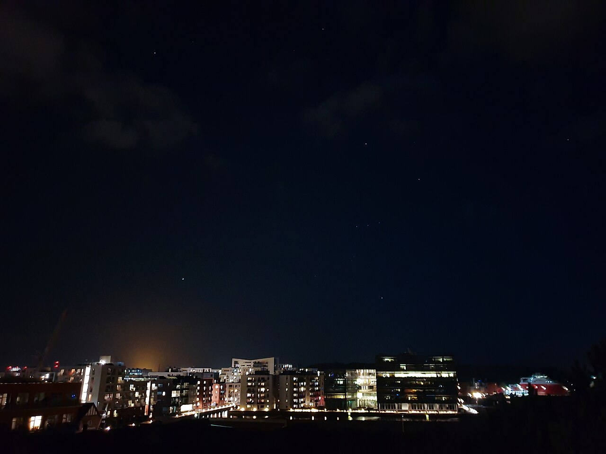

Автор Askeuhd, CC BY-SA 4.0. Ещё сохранены Паттайя (1/2 с), Варанаси
(1/2 с, Луна/облака) и Москва зимой (1/25 с). Лайлай сохранён отдельно:
автор показывает предполагаемый вид глазами во вставке, но большой кадр
15-секундный; это свидетельство автора, не калибровка зрения.
[Все снимки, лицензии, координаты и ограничения](artifacts/visual-reference-search-20261110/README.md).

Короткая выдержка сама по себе не исключает сложение кадров телефоном,
тоновые преобразования и различия чувствительности. Подтверждённый эталон
тёмного безоблачного неба «точно как глазами» в этом поиске не установлен.

Проверка официального описания и исходников KStars уточнила роль интеграции:
его основная карта поддерживает разные способы отображения; яркость, размер
значков и предельная звёздная величина зависят от настроек и масштаба.
Вид окуляра и реальная съёмка Ekos — отдельные инструменты. Нельзя принять
произвольный экспорт KStars за готовую модель человеческого восприятия.
[Разбор с первоисточниками и закреплённой версией кода](docs/OBSERVER_VIEW.md#что-обещает-kstars-проверка-10-ноября-2026).

## 10 ноября 2026: два способа наблюдать одно физическое небо

Пользователь принял направление дополнения KStars: приближённый вид
невооружённым глазом и более обоснованный прогноз съёмки камерой. Описание
проекта обновлено. Улучшение готовых снимков обработкой не обещается:
ближайшая задача камеры — фон, электроны, шум, насыщение и планирование.

Проверка KStars и INDI исправила предположение о полном отсутствии
засветки. В INDI уже есть **Sky Glow**, в Ekos — калькулятор экспозиции,
включающий яркость неба, шум считывания, QE и размер пикселя. В исследованном
звёздном симуляторе фон задаётся одним уровнем и профилем на сенсоре,
а не переносом от географических источников. Поэтому отличие формулируется
по пространственной модели и двум видам наблюдения; превосходство по
точности пока не установлено.

Изучены дополнительные основания: пороги Crumey; адаптация Ferwerda и
соавторов; спектральная фотометрия CIE и Bará и соавторов; естественное небо
Jensen и соавторов; линейная камера EMVA 1288; калиброванная all-sky методика.
Главный вывод: физический поток, порог обнаружения и экранный вид нужно
проверять отдельно. В частности, модель порогов не даёт готового ночного цвета.

Сохранены [аудит исходников](docs/KSTARS_CAMERA_AUDIT.md),
[аннотированная литература](docs/LITERATURE.md),
[теория, дополнительные данные и план](docs/OBSERVATION_PLAN.md),
[манифест и отчёт этапа](artifacts/research-20261110/README.md).
В плане зафиксированы калибровка, отдельные baseline, независимые проверочные
ночи и отчёты с параметрами, метриками, изображениями и ограничениями.

**Результат этого этапа документальный.** Яркость прежних опытов не стала
измеренной, новых атмосферных прогонов и реализаций режимов нет. Код и тесты
не менялись, тестовый набор повторно не запускался. Следующий шаг — входные
данные и калибровочный случай; кнопка интеграции следует за проверкой расчёта.

## 10 ноября 2026: перейти к данным и техническому ядру

Пользователь уточнил приоритет: проверить существование пригодных численных
баз, отложить визуализацию при недостатке калибровки, объяснить физику с основ,
учесть Луну и сезонные источники. Прежняя ветка целиком перенесена в `main`
без переписывания истории; дальнейшая работа идёт там.

Скачаны и проверены два набора Zenodo: **Madrid AstMon** (452 321 запись
в B/V/R) и **Galicia** (6 668 098 записей 14 площадок). Для обоих совпали
опубликованные MD5. Получен и прочитан небольшой XLSX NPS. Базы полезны,
но в двух крупных файлах отсутствуют явные маски ясного/безлунного неба;
зенитный ряд нельзя выдать за полный эталон углового распределения и цвета.
[Подробный разбор пригодности](docs/DATA_SOURCES.md).

Код получил месячные периоды A3 и проверку продукта/календаря, раздельную
арифметику фотометрических полос, аудит реальных наземных рядов и офлайн-
геометрию Солнца/Луны. Каталоги января и июля 2025 подтверждают 8 региональных
файлов; сами месячные HDF5 этим этапом не скачаны. Лунный спектральный перенос
и общий сезонный масштаб пока не реализованы. Все 64 автотеста прошли.

Написан отдельный [путеводитель по физике и математике](docs/PHYSICS_AND_MATH_GUIDE.md):
в каждом разделе теория, задача и решение. «Серый вид» объяснён как прежняя
пробная иллюстрация, а не описание всего ночного зрения, и снят из ближайших
результатов. Сохраняются численные отчёты; новых изображений неба нет.
[Артефакты, источники, лицензии и воспроизведение](artifacts/data-audit-20261110/README.md).

## 10 ноября 2026: сначала относительные компоненты ясного неба

Уточнены границы: по умолчанию без облаков, но с молекулярной и аэрозольной
атмосферой. Новый экранный рендер, точные цвета и субъективная яркость
отложены; ближайший результат — численные относительные потоки и фон.
Все складываемые фоновые компоненты требуют одной полосы и общего масштаба:
независимые нормировки Луны и городов не сохраняют их отношение.

Датированный режим должен принимать также час/часовой пояс и место:
геометрия звёзд, Солнца и Луны предсказуема, будущая погода — отдельный
сценарий. Без даты остаётся условная сцена; положение/фаза Луны задаются
явно либо выбирается безлунный случай. Новые режимы ввода пока требования,
а не завершённые функции. Годовая смена видимых созвездий уже следует из
существующей астрометрии, не требует нового «осеннего» каталога.

Однополосный baseline Krisciunas–Schaefer перенесён в ближайший технический
этап до глаза и камеры. В [плане](docs/OBSERVATION_PLAN.md) разделены
сложность кода и неизвестные свойства реального неба; в
[путеводителе](docs/PHYSICS_AND_MATH_GUIDE.md) пояснены спектральный отклик,
атмосферные условия, сезонная видимость и общая шкала. Это документальное
уточнение: код, прежние расчёты и изображения не изменены. Снимок документов
и проверка PDF — [в отчёте](artifacts/clear-sky-scope-20261110/README.md).

## 10 ноября 2026: первые три этапа стали численным инструментом

Команда `observe` получила явную датированную/условную сцену, общую V-опору,
раздельные компоненты и лунный фон Krisciunas–Schaefer. Коэффициент связи
с городским полем остаётся сценарием или предоставленной калибровкой;
он не вычисляется однозначно из DNB. Привязка формы 550 нм к V названа
эффективным серым приближением, не восстановленным спектром.

Проверка воспроизвела **16/16** значений таблицы 2 статьи в пределах её
округления: наибольшая разность 0,409 нЛ. Полный набор — **88/88** автотестов.
Выполнены семь случаев, включая будущую дату: 66/70 направлений поддержаны,
4/70 намеренно исключены как слишком близкие к Луне. Звёзды с датой имеют
координаты, экстинкцию и относительные потоки; это не подтверждение видимости
глазом. Дата без часа и отсутствие явного лунного сценария не принимаются.

Формальные определения, физические принципы, формулы, единицы и границы —
[OBSERVATION_MODEL.md](docs/OBSERVATION_MODEL.md). Расчёты, исходные сцены,
табличное сравнение и PDF — [в отчёте](artifacts/observation-core-20261110/README.md).
Новый рендер не создавался; полевая ошибка пока не измерена.

## 10 ноября 2026: параметры, месяцы и первые ясные наземные интервалы

По уточнению пользователя атмосфера пока задаётся параметрами с базовыми
значениями; эти значения не объявляются наиболее вероятной погодой места.
Автоматический сбор атмосферных измерений отложен. Для выбора следующих
физических расширений подготовлены [65 факторов исходной версии](https://github.com/WarriorOfTea/LightPollution/blob/ba8bfe5/docs/LIGHT_FACTORS.md)
и таблица приоритетов пользователя.

Загружены 16 настоящих месячных HDF5 NASA. Для Петербурга январь/июль 2025
сравнение отклонено: общее подходящее QA-покрытие нулевое. Пропуски не
превратились в тёмные источники. Для Мадрида подготовлены две пары месяцев:
2015-01/07 и 2017-03/11. Общая маска и один источниковый знаменатель
сохраняют амплитуду между месяцами, общий V-якорь не стирает её повторно.

В AstMon нет облачных флагов, но в первичной статье найдены графики с
авторскими отметками ясных интервалов 19 марта и 19 ноября 2017 года.
В каждом выбран час 22:00–23:00 UTC, девять наблюдений. Первый задаёт один
масштаб, второй проверяет его без подгонки: остаток −0,13585 mag, фон модели
примерно на 13,3% выше измеренного. Это одна контрольная ночь в одной точке,
а не гарантия точности. Более широкая выборка 2015 года с неизвестной
облачностью даёт MAE 0,622 mag на восьми контрольных ночах; причины остатка
по имеющимся данным разделить нельзя.

Прошли 96/96 автотестов. Формулы, допущения и происхождение ручной разметки —
[в методике](docs/SEASONAL_CALIBRATION.md), численные данные и отчёт —
[в артефактах](artifacts/seasonal-ground-20261110/README.md).

## Первоисточники

- [NASA: продукты и качество Black Marble](https://ladsweb.modaps.eosdis.nasa.gov/missions-and-measurements/products/VNP46A4).
- [NASA: цвет, порог зрения и атмосферные эффекты](https://science.gsfc.nasa.gov/attic/cosmicopia.gsfc.nasa.gov/qa_star.html).
- [NASA: почему звёзды мерцают](https://starchild.gsfc.nasa.gov/docs/StarChild/questions/question26.html).
- [NPS: методика измерения ночного неба](https://www.nps.gov/subjects/nightskies/methods.htm).
- [Jechow, Kyba, Hölker: измерение яркости и цвета ясного и облачного неба](https://arxiv.org/abs/2202.08258).
- [Реальные фотографии и лицензии](artifacts/photo-comparison/references/sources.json).

## 10 ноября 2026: сократить рабочий перечень до полезного прогноза

По уточнению пользователя 65 эффектов заменены [12 группами](docs/LIGHT_FACTORS.md).
Из выбора исключены пожары, случайный транспорт, ветер, погодные события
и второстепенные специальные эффекты. Обычный сценарий — ясная ночь;
атмосфера и состояние поверхности задаются как известные условия либо сценарий.
Снег, Луна, сезонная темнота, городские источники, глаз и камера сохранены.
Калибровка и качество данных остаются обязательными требованиями.
Это изменение постановки и документации; физическое ядро не менялось.

## 10 ноября 2026: план MVP и границы архитектуры

По поручению пользователя подготовлен [план ближайшего MVP](artifacts/mvp-plan-20261110/README.md):
локальный численный планировщик, шесть последовательных поставок,
разделение физики, прикладного сценария, данных и интерфейса. Уточнены
контракты величин, область калибровки, согласованность высот, задания и кэш.
Глаз, камера, спектры и интеграция KStars имеют отдельный путь развития.
Границы первой версии предложены для обсуждения; реализация новых этапов
этим обращением не выполнялась. Согласованная цель — MVP с расширяемой архитектурой.

## 11 ноября 2026: рабочий технический MVP 0.2

Выполнены шесть поставок плана: единый запрос, чистая сцена и адаптеры,
подготовка региональных данных, фиксированный масштаб источников, задания
с отменой/восстановлением лучей, кэш, локальная форма, сравнение и экспорт.
Старые численные сценарии и команды сохранены. Высота нового MVP задаётся
над общей условной поверхностью; историческая мадридская калибровка
на 650 м автоматически не переносится. Это сценарный планировщик,
а не завершённая модель глаза или камеры.

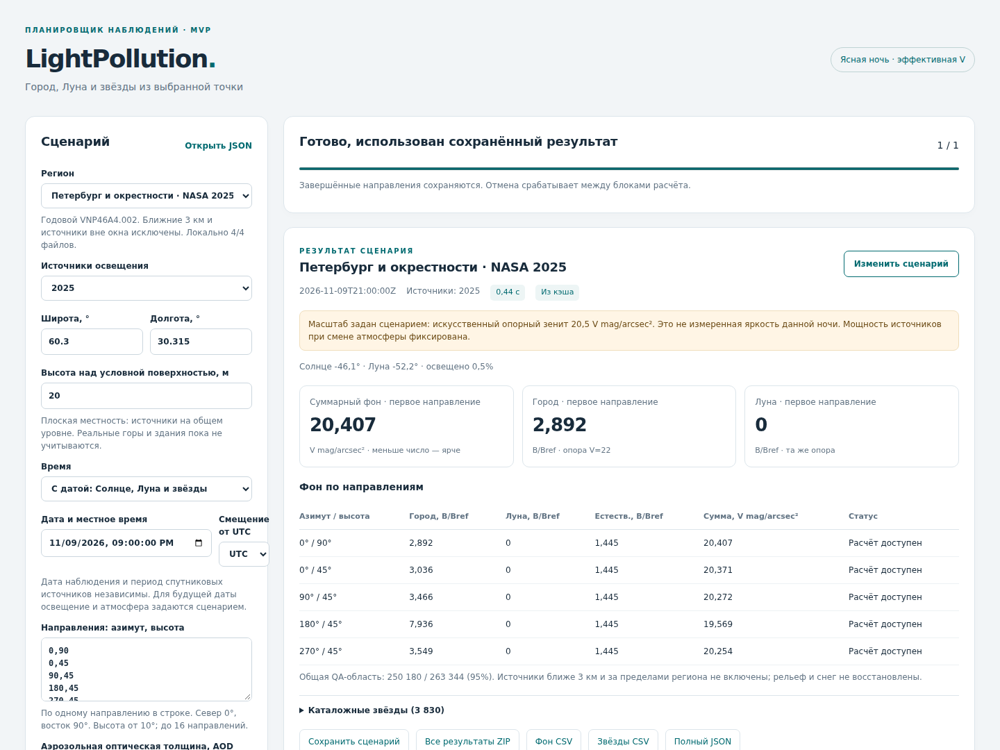

Проверки: 120/120 тестов; четыре численных контрольных направления
проходят допуск 1% (максимум различия квадратур 0,0076%, укрупнения 0,692%).
На NASA первые запуски заняли 13–25 с, повторы 0,2–0,4 с на данной машине.
В браузере пройдены два сценария, сравнение и круг сохранения/открытия;
обнаруженное мобильное переполнение исправлено. Пакет запускается
в отдельном окружении на встроенном учебном примере.
[Полный отчёт](artifacts/mvp-release-20261111/README.md).

Подготовлен [следующий исследовательский план](docs/MODEL_ROADMAP.md).
Для спектрального опыта проверена таблица CIE: 9 шаблонов LED, 81 длина
волны 380–780 нм, SHA-256 издателя совпал, CC BY-SA 4.0. Эти шаблоны
ещё не подключены и не выдаются за измеренный состав ламп города.

## 11 ноября 2026: общая фотометрия и первые спектральные модели 0.3

По поручению пользователя выполнены этапы 1–2. Общий знаменатель источников
теперь определяется до исключения ближней зоны, опора зенита закреплена
географически. Прежние города не перемещаются и не получают дополнительную
мощность при переносе наблюдателя. В петербургском сценарии искусственный
зенит изменился с 20,5000 до 22,3939 V mag/arcsec² при переходе от 60,300°N
к 60,650°N с тем же коэффициентом источников. Это численный сценарий;
независимых полевых измерений второй точки нет.

Калибровка стала переносимым документом с областью применимости и
контрольным хешем. Сохранён строгий отбор ясных безлунных интервалов и
разделение ночей. На прежнем AstMon: 1 ночь/9 измерений настройки,
1 другая ночь/9 измерений контроля; остаток −0,13694 mag, модель ярче
на 13,44%. Новый условный уровень поверхности не объявляется DEM Мадрида.

Добавлен спектральный перенос на 95 длинах волн 360–830 нм. Получены
14 CIE-шаблонов ламп, раздельные Johnson B/V и дневной/ночной отклики.
У звёзд: две CALSPEC-формы и пять Gaia XP; из девяти Gaia-кандидатов
четыре отклонены и сохранены в протоколе. В петербургской сцене 4/3830 звёзд
используют полученную измеренную форму, 3594/3830 — континуум по B−V,
232/3830 остаются без спектра. Не назначается белый цвет при отсутствии данных.

Две гипотезы смеси ламп, настроенные на одни V-данные Мадрида, почти одинаково
проходят V-контроль, но дают S/P 2,293 и 0,737. Это показывает
неоднозначность восстановления спектра по одной полосе. Независимый контроль
исходных Gaia-потоков по BSC дал MAE 0,08913 mag и максимум 0,27751 mag
на пяти звёздах; причины отдельных расхождений не объявляются установленными.

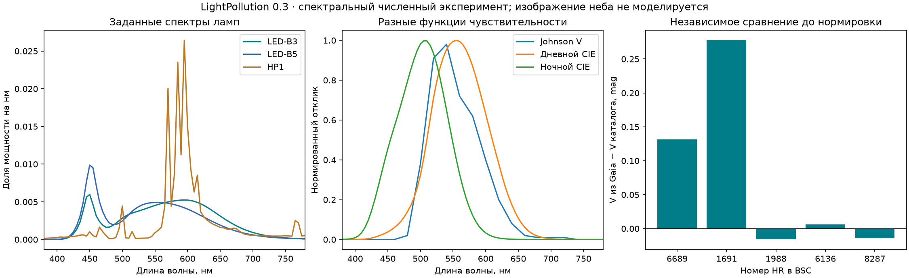

140/140 автотестов; 112/112 сравнений шага 5 нм с 1 нм на выбранных лучах,
максимум 0,69689%; браузер 3/3, включая импорт калибровки. Проверка браузером
обнаружила несовпадение хешей чисел `22.0`/`22`; протокол исправлен и покрыт
регрессией. Научные исходные графики и UI не заменяют проверку восприятия.

[Отчёт и численные результаты](artifacts/photometry-spectra-20261111/README.md),
[формальная теория](docs/PHOTOMETRY_AND_SPECTRA.md),
[обновлённый запуск](docs/MVP.md). Следующие модели сумерек, снега, ближних
источников/рельефа, глаза и камеры остаются отдельными этапами.
