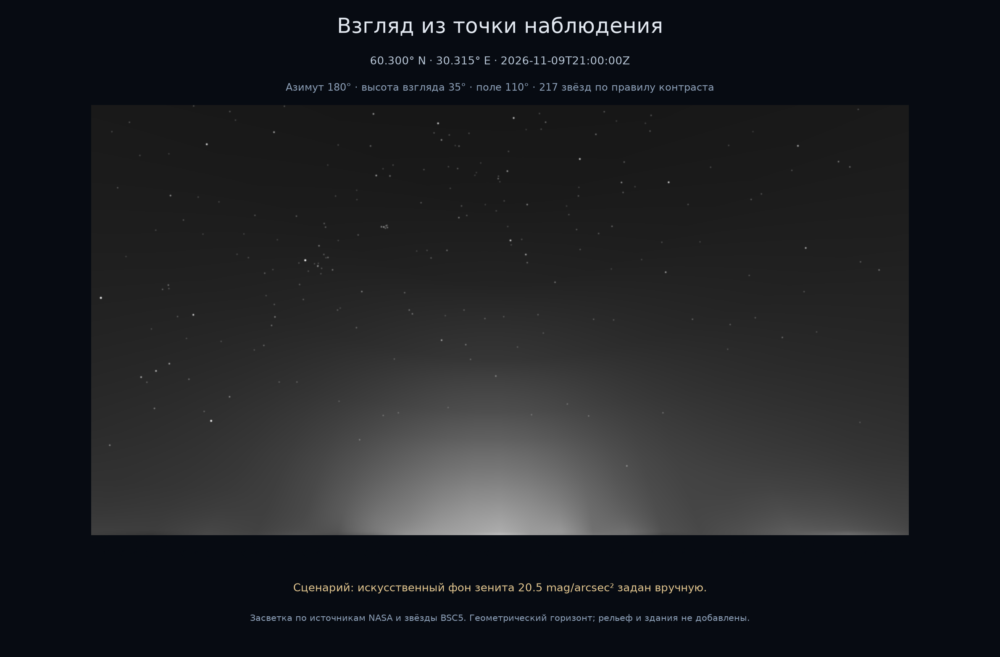
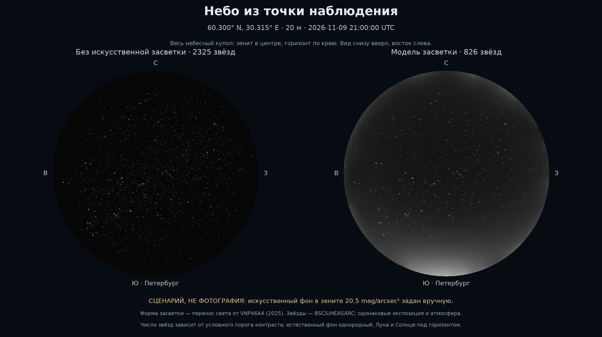

# LightPollution

Исследовательское дополнение для KStars: **приближённый вид ночного неба
невооружённым глазом** и **физически обоснованный прогноз съёмки камерой**
из заданной точки. Общая основа — перенос городского света через атмосферу
и распределение фона по направлениям взгляда.

Наблюдателю проект должен помочь оценить видимость звёзд с учётом засветки
и адаптации. Астрофотографу — прогнозировать фон, шум и насыщение для выбранных
направления, оптики, фильтра и выдержки. Это цель улучшения предварительных
моделей и планирования; обработка готовых фотографий — отдельная задача.

**Сейчас работает относительная однополосная модель и условная визуализация.**
Калиброванные режимы глаза/камеры и встроенные кнопки ещё не реализованы.
Ниже сохранены результаты этого прототипа, а не примеры готовых новых режимов.

[История моделей и результатов с изображениями](HISTORY.md) ·
[Реальные фотографии и пределы сравнения](docs/PHOTO_COMPARISON.md).

Актуальная постановка: [теория, данные и план](docs/OBSERVATION_PLAN.md) ·
[что уже умеют KStars/Ekos/INDI](docs/KSTARS_CAMERA_AUDIT.md) ·
[литература и границы её применения](docs/LITERATURE.md).

В INDI уже есть параметр Sky Glow, а Ekos оценивает экспозицию по яркости
неба и шуму камеры, включая QE и размер пикселя. Наше предполагаемое отличие —
географический расчёт неоднородного фона и раздельные модели глаза/сенсора.
Улучшение точности ещё предстоит подтвердить независимыми измерениями.

Новый опыт: [фотография и расчёт в её опубликованной точке](artifacts/photo-comparison/photo-vs-model.png),
Германия, NASA 2014. Это иллюстративное сопоставление: ориентация кадра не
подтверждена, цвет и абсолютная яркость не откалиброваны. Годовые входы —
реальные композиты измерений; идеализированы атмосфера и перенос света.

## Результат текущего прототипа

Точка примера: **60,300° N, 30,315° E, 20 м**, примерно 40 км севернее центра
Петербурга. Время: **2026-11-09 21:00 UTC / 10 ноября 00:00 МСК**.
Источники — реальные NASA VNP46A4.002 за 2025 год; звёзды — BSC5/HEASARC.



Обычная перспектива: взгляд на юг, высота 35°, горизонтальное поле 110°.
Горизонт геометрический; рельеф и здания не добавлены.



Слева — однородный естественный фон без искусственной засветки. Справа — тот же
звёздный каталог и атмосфера с рассчитанным светом городов. Зенит в центре,
горизонт по краю, север сверху, восток слева: это взгляд вверх, не карта земли.

**Это результат численного запуска, а не фотография.** Абсолютная яркость
искусственного фона в зените **20,5 mag/arcsec² задана как сценарий**. Форма
распределения рассчитана; фотометрической калибровки по наземным измерениям
пока нет. Количество показанных звёзд зависит от явного правила контраста.

## Физическая модель

Последовательность: спутниковая яркость → относительные мощности участков
поверхности → перенос через атмосферу → яркость небесного купола → звёздная
сцена наблюдателя.

Земля — непрозрачная сфера радиуса 6371 км. Источники распределены по поверхности;
их веса пропорциональны принятой по качеству яркости VIIRS и площади ячейки.
Сумма весов равна единице. Спутниковая яркость не объявляется полной мощностью
города: для такого преобразования недостаточно данных о спектре и диаграмме
излучения. Базовая диаграмма — ламбертовская.

Искусственная составляющая в направлении `d`:

```text
L_art(d) = ∫ T(x,O) Σ_i [P_i f(μ_i) / |x−S_i|²] T(S_i,x)
                 × [β_R(x) p_R(c_i) + β_a,s(x) p_HG(c_i)] ds
```

`S_i` — источник, `x` — точка рассеяния, `O` — наблюдатель. Пропускание
`T(a,b)=exp(−∫β_e dl)` учитывает ослабление на обоих участках пути.
Сферическое экранирование исключает пересекающие землю пути. Город за
горизонтом может освещать видимую часть атмосферы.

Учитываются однократное молекулярное рассеяние Рэлея, аэрозольное рассеяние
Хеньи — Гринстейна и поглощение аэрозолями. Плотности экспоненциально убывают
с высотой. Опорная длина волны — 550 нм; AOD=0,10, `g=0,8`. Это параметры
сценария, не измеренная погода Петербурга. [Вывод и размерности](docs/MODEL.md).

## Звёзды и изображение

Открытый каталог содержит 9096 звёзд: координаты FK5 J2000, V-величины и
собственные движения. Astropy пересчитывает их в азимут и высоту для точки и
времени. Свет звёзд ослабляется той же модельной атмосферой. Рефракция выключена.

Спутник задаёт пространственную структуру фона; заданная зенитная яркость
определяет масштаб визуального сценария. Искусственный и естественный фоны
складываются в линейных единицах. При росте фона слабые звёзды перестают
проходить условный порог контраста. Экспозиция обоих изображений одинакова.
[Формулы визуализации и пределы интерпретации](docs/OBSERVER_VIEW.md).

KStars 3.6.2 действительно запущен в режиме `--dump`. Отдельный пример
[внешнего слоя поверх его звёздного изображения](artifacts/petersburg-2025/kstars/kstars-with-skyglow.png)
использует ту же рассчитанную засветку. Это рабочий прототип обмена изображениями;
патч рендерера KStars и встроенная интерактивная функция ещё не реализованы.
Глифы KStars не считаются измеренными потоками звёзд.

## Воспроизведение

Python ≥3.12 и [uv](https://docs.astral.sh/uv/). Токен NASA для повторного рендера
не нужен: проверенная региональная карта сохранена в репозитории.

```bash
uv sync --locked
uv run lightpollution simulate --output artifacts/petersburg-2025/observer-sky \
  --azimuth-step 5 --altitudes 0 0.5 1 2 3 5 7.5 10 15 20 30 45 60 75 90 \
  --block 8 --ray-segments 192 --path-quadrature 24
uv run lightpollution render --utc 2026-11-09T21:00:00Z --artificial-zenith-mag 20.5
uv run pytest -q -p no:cacheprovider
```

Повторный рендер использует готовый `sky-grid.npz`; атмосферный расчёт повторять
необязательно. Для новой точки сначала запускается `simulate` с `--latitude`,
`--longitude`, `--height`, затем `render` с нужным UTC. [Подробный запуск](docs/QUICKSTART.md).

## Проверки и ограничения

Данные: четыре HDF5 NASA, проверены размеры, сигнатуры, метаданные и контрольные
суммы. В окне 345 600 ячеек NearNadir проходит QA у 331 809/345 600 (96,01%).
Яркие участки с высоким разбросом сохранены и разобраны в [аудите](docs/DATA_AUDIT.md).
QA не является гарантией фотометрической точности.

Численные проверки: нормировки, геометрия, закон ослабления, сохранение весов,
симметрия, сходимость и ориентация звёздной сцены. Процент физической точности
не заявляется: нет сопоставления с наземными измерениями.
На восьми контрольных лучах реальной карты уточнение интегрирования даёт
до 0,183% различия, измельчение источников — до 0,504%. Это выбранные
направления, не оценка ошибки всего неба. Автотесты: 52/52 проходят.

Пока отсутствуют многократное рассеяние, рельеф, здания, облака, погодная карта,
реальные спектры фонарей и фотометрическая калибровка. Источники ближе 3 км,
водные источники и источники вне окна 29–32° E / 59–61° N исключены из базового
сценария. Естественный фон пока однородный: без Млечного Пути и отдельных
компонент свечения атмосферы. Рендер отклоняет дневные/сумеречные моменты и
моменты с Луной над горизонтом; эти составляющие ещё не моделируются.

## Основания и документы

- [Cinzano & Falchi: перенос светового загрязнения](https://arxiv.org/abs/1209.2031).
- [Garstang: Model for Artificial Night-Sky Illumination, 1986](https://doi.org/10.1086/131768).
- [NASA Black Marble Collection 2: руководство](https://viirsland.gsfc.nasa.gov/PDF/BlackMarbleUserGuide_Collection2.0.pdf).
- [NASA HEASARC: Bright Star Catalogue](https://heasarc.gsfc.nasa.gov/W3Browse/catalog/bsc5p.html).
- [KStars: исходный код](https://invent.kde.org/education/kstars).
- [Актуальный план двух режимов и физические формулы](docs/OBSERVATION_PLAN.md).
- [Аудит камеры KStars/INDI с версиями исходников](docs/KSTARS_CAMERA_AUDIT.md).
- [Дополнительная литература и выбор моделей](docs/LITERATURE.md).
- [Первоначальный разбор первой реализации](docs/REVIEW_AND_PLAN.md),
  [журнал изменений кода](docs/CODE_CHANGELOG.md).
