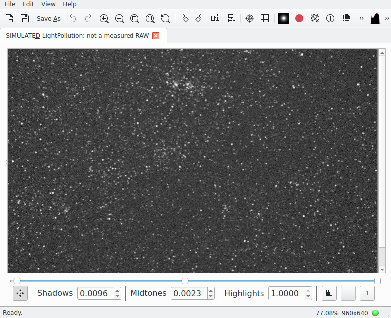

# LightPollution

Я разрабатываю дополнение для KStars, которое помогает оценить ночное небо
**из конкретной точки**: какие звёзды можно различить невооружённым глазом
и какой фон, шум и насыщение получатся на камере.

Общая основа — свет городов, его перенос через атмосферу, рельеф и
ближние источники. Глаз и камера используют одно световое поле, но имеют
разные отклики. Я отделяю физические числа от условного экранного изображения.

## Документация

| Документ | Для чего я его веду |
|---|---|
| [HISTORY](HISTORY.md) | Путь проекта по этапам, изображения и результаты без календарной ленты |
| [THEORY](THEORY.md) | Вся необходимая теория с определений, выводами и размерностями |
| [MODELS](MODELS.md) | Выбранные модели, их формулы и причины приближений |
| [LIMITS](LIMITS.md) | Действующие границы, недостающие входы и открытые задачи |
| [VISUALIZATION](VISUALIZATION.md) | Изображение глаза/камеры, реальные фотографии и правила сравнения |
| [BENCHMARK](BENCHMARK.md) | Источники данных, совместимость мест/дат, метрики и сравнение версий; пока без новых расчётов |

Порядок чтения: THEORY → MODELS → LIMITS. Для знакомства с результатами
достаточно начать с HISTORY. Первоисточники — в [литературе](docs/LITERATURE.md),
происхождение массивов — в [данных](docs/DATA_SOURCES.md).

Формулы в THEORY/MODELS записаны в LaTeX и отображаются на GitHub.
Общую PDF-копию с набранными формулами можно получить командой
`uv run python scripts/build_theory_bundle.py`; оригиналы остаются в Markdown.

## Что работает сейчас

В версии 0.10 я реализовал спектральное однократное рассеяние, общую
фотометрию между точками/периодами, сценарную атмосферу, лунный и естественный
фон, ограниченные сумерки, первое отражение снега, DSM и ближние площадки.

Для глаза работают локальный порог Crumey, потоковая оптика и фиксированный
монохромный вывод; экспериментальный цвет включается отдельно. Для камеры —
монохромный линейный сенсор, шумы, насыщение и научный FITS.
Глубокий каталог передаёт исходные полосы/астрометрию, полный искусственный
горизонт действует на поле, а штатный Ekos получает физический электронный фон.



Это снимок работающего KStars с модельным кадром. Я использую его каталог,
геометрию, FITS Viewer, профили и калькулятор Ekos. Проверена приватная
Qt6.11.1-сборка KStars3.8.6 Beta с INDI. Установка/совместный запуск
автоматизированы при подготовленных зависимостях; upstream-пакета пока нет.
[Устройство и сборка интеграции](docs/KSTARS_INTEGRATION.md).

## Запуск

Из корня репозитория, Python≥3.12 и uv:

```bash
uv sync --locked
uv run lightpollution serve
```

Локальный интерфейс: `http://127.0.0.1:8765`. Учебный пример работает
без NASA и явно содержит искусственные источники. Web и CLI — клиенты
общего ядра; нативная панель KStars обращается к нему же.
[Подробный запуск, сцены и экспорты](docs/QUICKSTART.md).

## Достоверность результата

Я не считаю изображения доказанным видом человеческого глаза или снимком
произвольной торговой камеры. Начальный сенсор идеальный V-согласованный;
полного природного спектра и независимых RAW для его проверки нет.
Для зрения также ещё нет независимых наблюдателей.

В опыте0.10 прошли317 тестов и3 расчёта камеры в Qt6/KStars.
Вместо311 записей получено17071 до нативной величины12;
полнота Johnson V≤12 не доказана. Горизонт совпал на2054/2054 лучах,
старый кадр воспроизвёл614400/614400 ADU. Это проверяет реализацию,
а не устанавливает полевую точность. [Численный отчёт](artifacts/kstars-catalogue-integration-20261112/README.md). [Методика проверки](docs/VALIDATION.md).

В `artifacts/` я сохраняю уникальные входы, результаты, изображения,
источники и протоколы опытов; [указатель архива](artifacts/README.md).
Датированный технический аудит правок остаётся в [CODE_CHANGELOG](docs/CODE_CHANGELOG.md).
