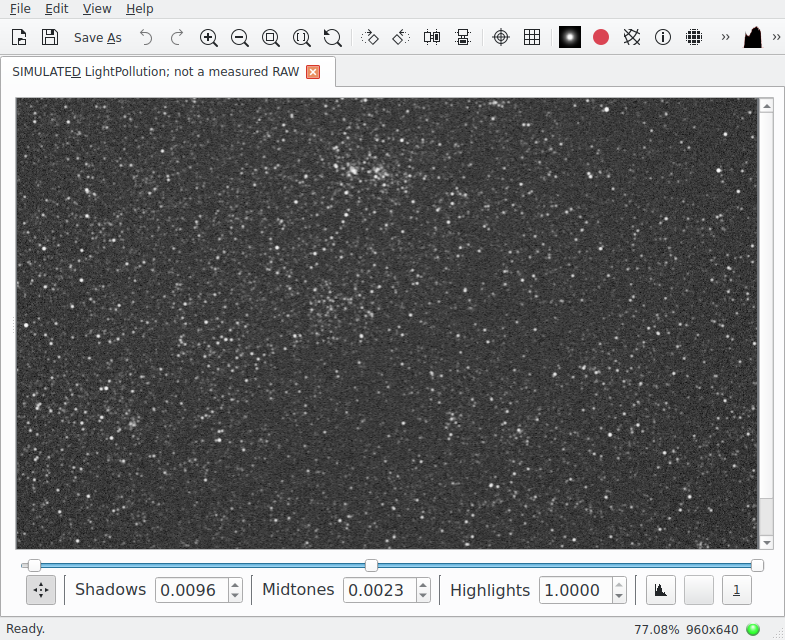

# LightPollution

Я разрабатываю модель ночного неба для конкретного места и времени и
подключаю её к KStars. Модель считает свет городов и его перенос,
естественный фон и лунную засветку. Глаз и камера используют одно световое
поле с разным откликом.

## Запуск

Нужны Python 3.12+ и uv. Выполняю команды из корня репозитория.

```bash
uv sync --locked
uv run lightpollution serve
```

Веб-интерфейс доступен на `http://127.0.0.1:8765`. Встроенный учебный пример
работает офлайн. [Команды и форматы сцен](docs/QUICKSTART.md) ·
[Подключение KStars и Ekos](docs/KSTARS_INTEGRATION.md)

## С чего начать

| Задача | Где искать |
|---|---|
| Сверить модель с измерениями | [Методика проверки](docs/VALIDATION.md) и [каталог данных](docs/DATA_SOURCES.md) |
| Понять формулы и действующие приближения | [Теория](THEORY.md), [модели](MODELS.md) и [ограничения](LIMITS.md) |
| Проверить изображения глаза или камеры | [Визуализация и наблюдения](VISUALIZATION.md) |
| Посмотреть результаты и воспроизвести опыт | [История по этапам](HISTORY.md), [архив расчётов](artifacts/README.md) и [общий бенчмарк](BENCHMARK.md) |
| Найти конкретную правку и её проверки | [Журнал изменений кода](docs/CODE_CHANGELOG.md) |

Последний набор наблюдений — [ночи для проверки трёх вариантов AOD](artifacts/photometer-aod-selection-20261126/README.md).

## Состояние модели

В основном режиме доступны спектральный перенос с однократным рассеянием,
сценарная атмосфера, естественный и лунный фон, ограниченные сумерки,
первое отражение снега, рельеф и ближние площадки. Многократное рассеяние
и пространственные поля аэрозоля исследую в отдельных расчётах.
Проверка на реальном небе продолжается. Изображения глаза и камеры
показывают результат выбранных профилей, включая явно заданные пределы
чувствительности и калибровки.


