# Визуализация и сравнение с реальным небом
> Дата создания: 2026-11-12

Здесь я собираю изображения и объясняю, что именно по ним можно проверить.
Моя цель — связать расчёт света с наблюдением из точки, а не получить
похожий ночной пейзаж подбором экспозиции. Физические формулы находятся
в [THEORY](THEORY.md), выбранные операторы — в [MODELS](MODELS.md).

## 1. Три разных результата

| Представление | Что означает | С чем сравниваю |
|---|---|---|
| Численная карта | Радиансность/полосовой фон по направлениям | Калиброванная угловая фотометрия в той же полосе |
| Режим глаза | Порог и условный экранный вид при заданной адаптации | Независимые ответы наблюдателей и измеренный дисплей |
| Режим камеры | Электроны, ADU, шум, насыщение и отдельный preview | Линейный RAW/FITS с известным сенсором и оптикой |

Планетарный кружок звезды, обработанный JPEG и вид невооружённым глазом
не имеют общей шкалы яркости. Даже короткая экспозиция смартфона может
содержать сложение кадров, шумоподавление и локальную обработку.

## 2. Как я показываю расчёт глаза

Фон реконструирую в линейных P/S/V; поток звезды интегрирую через
нормированное угловое пятно по пикселям. Только затем применяю фиксированный
экранный профиль, тональное ограничение и один sRGB. Для мобильного размера
интегрирую заново.16-bit сохраняет плавность;8-bit dithering работает
лишь на последнем округлении и не изображает атмосферный шум.

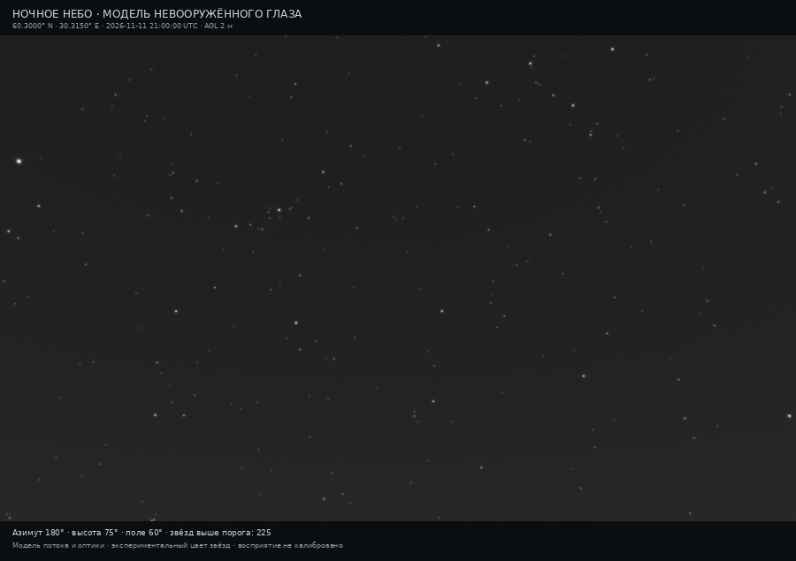

Это модель, не реальная фотография. Номинальный порог поля 225/537
не изменился после добавления цвета. Из 3832 физических строк форма цвета
доступна для 3600; отсутствие спектра не заполняется вымышленным оттенком.
Фон нейтрален по принятому отображению, а не потому, что я измерил его серым.

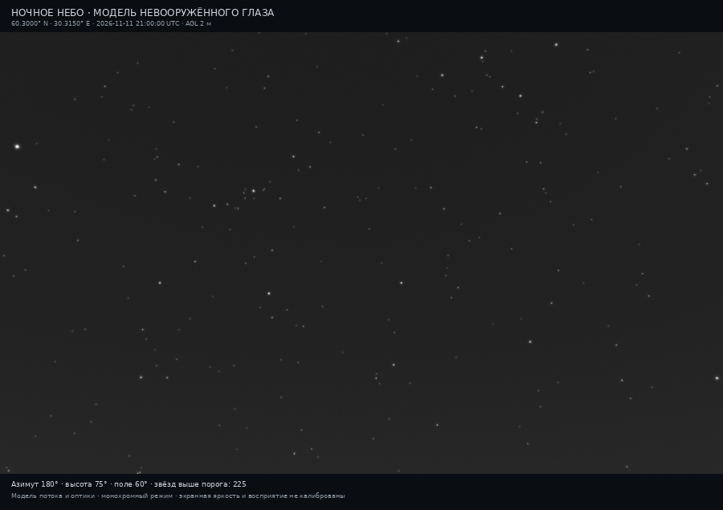

Разность двух изображений проверяет цветовую ветвь при прежних физических
данных. Она не доказывает распознавание цвета человеком. Для такого вывода
нужны независимые наблюдатели, адаптация и параметры экрана.

## 3. Как я показываю камеру

Основной результат — линейный FITS с научными картами. PNG применяет
заданные black/white ADU и asinh, одинаковые между сравниваемыми сценами.
В FITS Viewer можно менять растяжение, но оно не меняет исходный заряд
и не служит калибровкой реальной камеры.

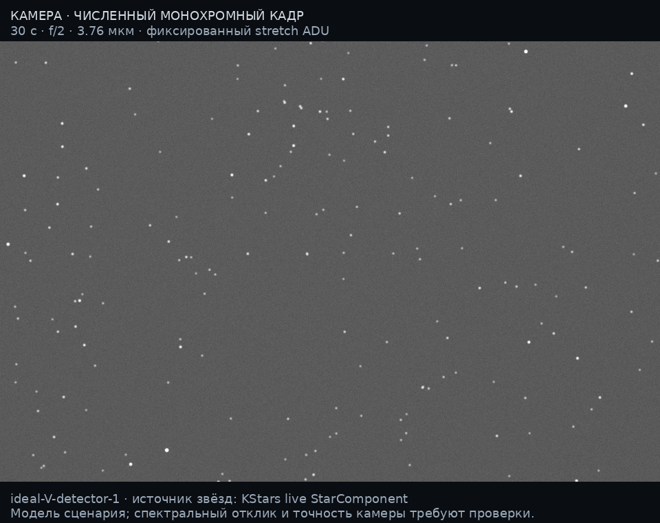

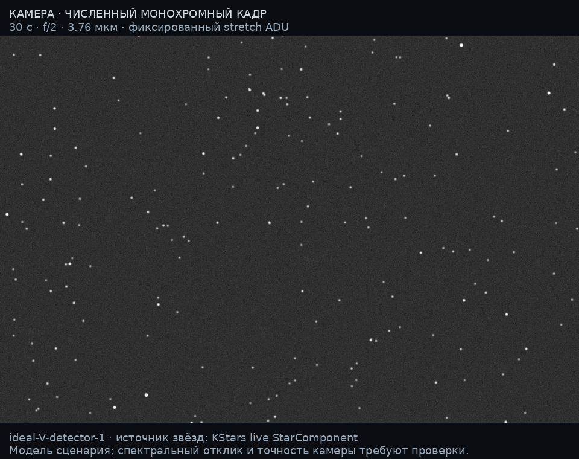

У этих кадров одна физическая таблица звёзд, оптика, выдержка и экранное
растяжение. Медианный фон 139,05 и 37,24e⁻/pixel различается в 3,73 раза.
City-off — математическое вмешательство в компонент, а не фотография
другого места. Более тёмный фон повышает SNR при том же звёздном сигнале.

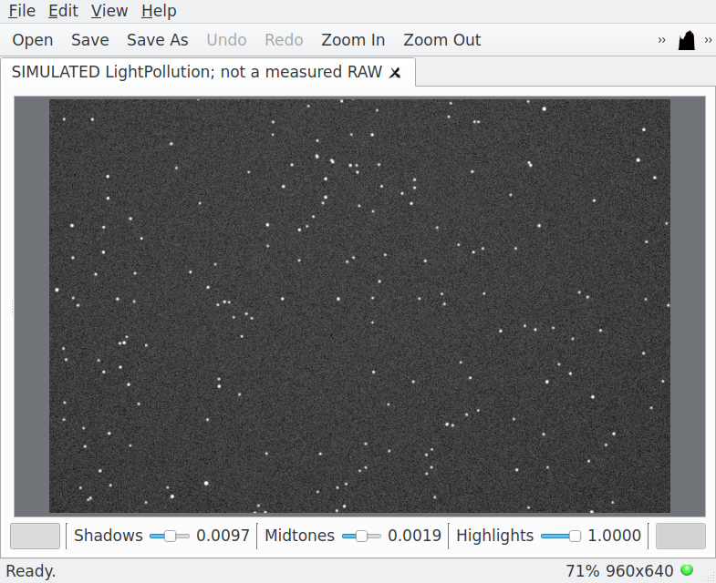

Это настоящий снимок окна собранного KStars3.6.2 с синтетическим FITS.
Кадр не получен от физического сенсора. Каталог достигает V=8 в данной
установке; отсутствие более слабых звёзд не следует трактовать как
предсказанный предел камеры.

### Камера0.10 и угловая маска

В следующем опыте я подключил глубокий каталог:17071 строка,10569 центров
в прежнем сенсоре. Для10107 центров поток рассчитан, для462 неизвестен.
Их отсутствие нельзя считать обнаружительным пределом камеры.
Полосы Johnson и вероятный Tycho учитываются раздельно; цветной RAW
или новый режим глаза этот этап не создаёт.

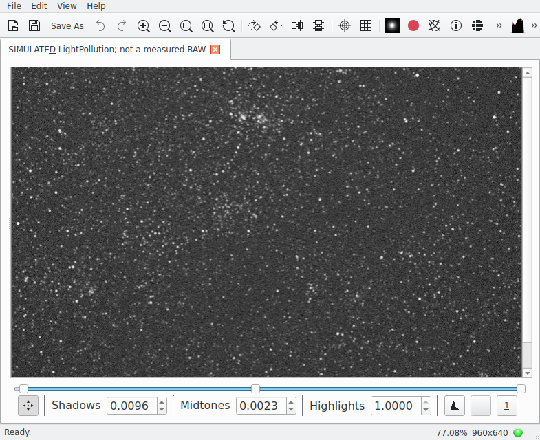

Это Qt6/KStars3.8.6 Beta. В этой иллюстрации stretch выбирает штатный
FITS Viewer; сравнение с прежней картинкой показывает наполненность
каталога и работу программы. Численные яркости я сравниваю в линейных
картах при фиксированных профиле/экспозиции. Старый замороженный вход
сохранил614400/614400 ADU, поэтому новый вид не означает смену C.

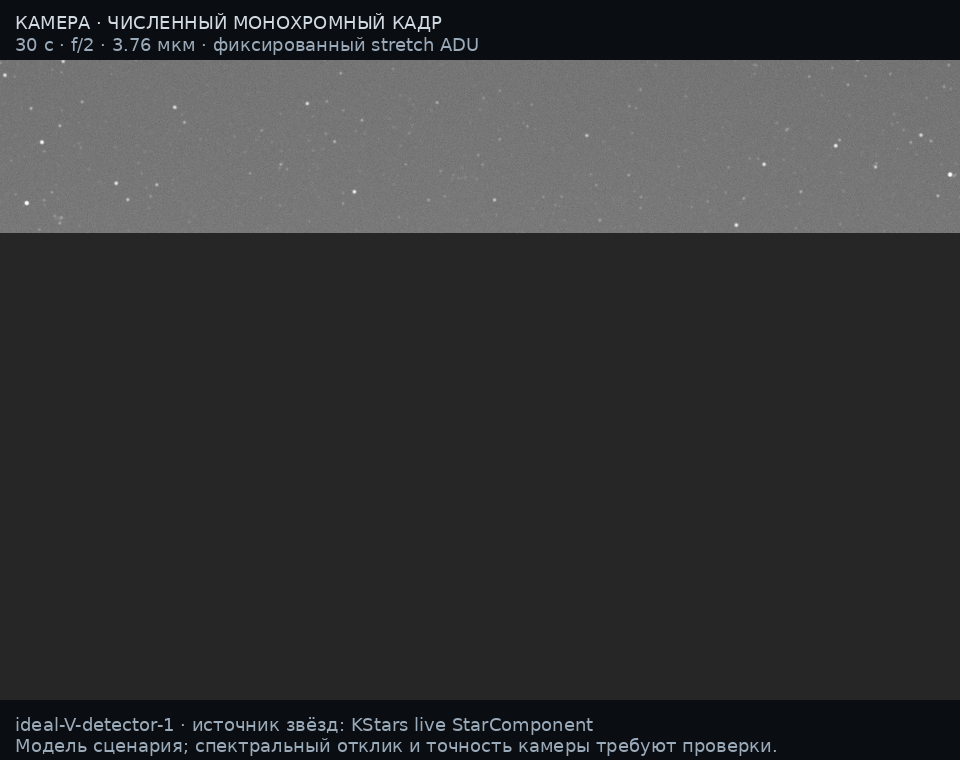

Здесь фиксирован preview ADU. Серое — неподдержанная область с MASK=0,
а не рассчитанная отражающая поверхность. В научных слоях там NaN.
Контуры применены до PSF скрытой звезды и к направлениям пикселей;
у открытой части поля остаётся собственный фон. Нативные контуры этого
проверочного сеанса не являются измерением горизонта реальной площадки.
[Входы, полный протокол и ограничения опыта](artifacts/kstars-catalogue-integration-20261112/README.md).

## 4. Реальные фотографии: короткая экспозиция и городской фон

### Оденсе

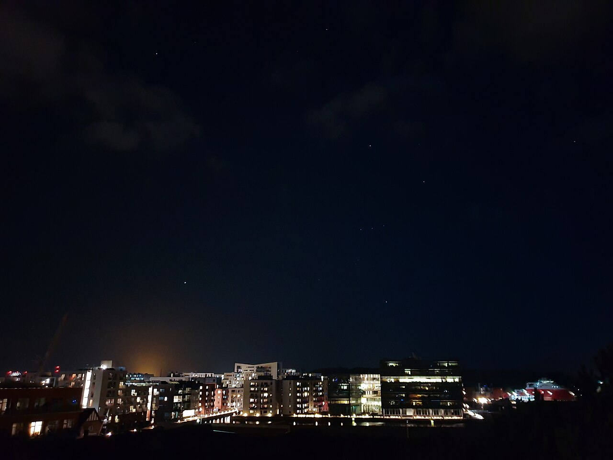

Автор: **Askeuhd**. [Оригинал](https://commons.wikimedia.org/wiki/File:Sirius_and_Orion_over_Odense_Harbour_at_night.jpg),
[CC BY-SA4.0](https://creativecommons.org/licenses/by-sa/4.0/).
Опубликованная точка 55,410000°N10,386000°E; EXIF1/4 с, f/1,5, ISO 800,
SamsungSM-G960F. Lightroom указан, характер обработки/сложения неизвестен.
На снимке есть небольшая облачность. Поэтому я использую его как пример
«несколько звёзд и городской горизонт», не как калиброванный вид глазом
или строгую проверку ясного решателя.

### Паттайя

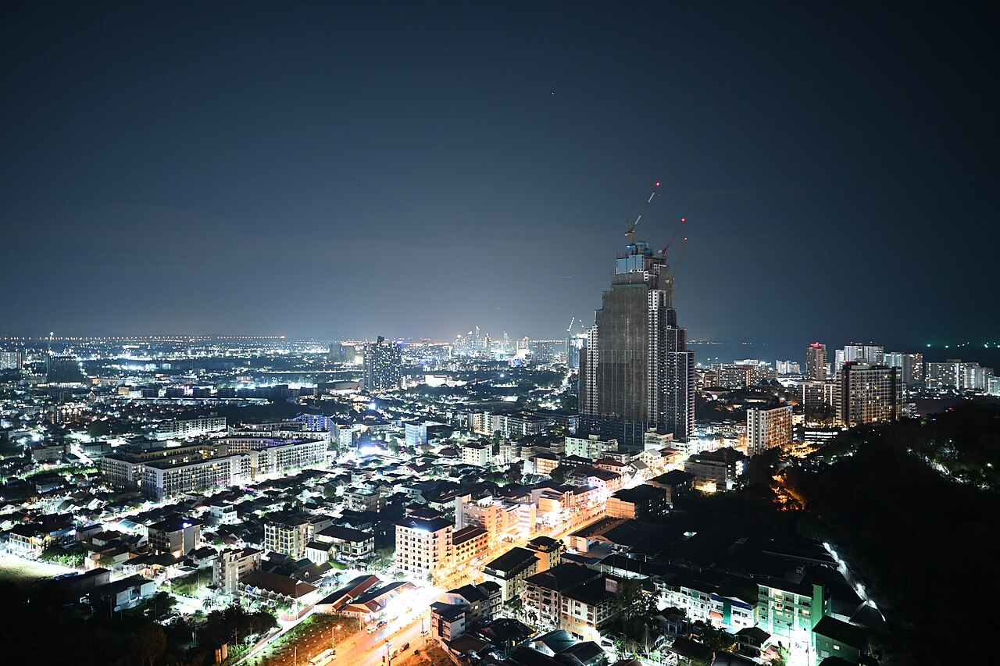

Автор: **PattayaPatrol**.
[Оригинал](https://commons.wikimedia.org/wiki/File:DFC_4635_Pattaya_lights_sparkle_under_a_clear_night_sky_-_the_city_glowing_with_life_from_street_level_to_skyline.jpg),
[CC BY-SA4.0](https://creativecommons.org/licenses/by-sa/4.0/).
Точка 12,916458°N100,869213°E; NikonZfc,1/2 с, f/1,7, ISO 640.
Название автора не заменяет независимую проверку дымки/облаков.
Я не подгоняю по этому JPEG спектр городской засветки.

## 5. Реальное звёздное небо в длинной экспозиции

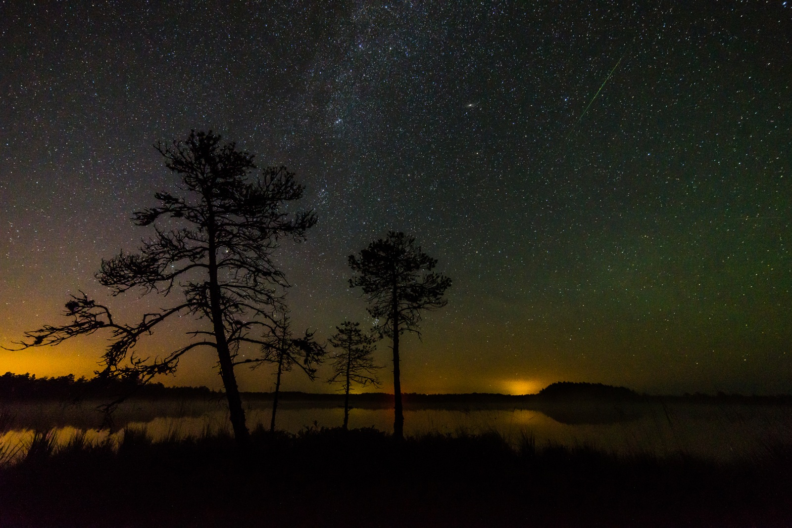

Автор: **Martin Mark**.
[Оригинал](https://commons.wikimedia.org/wiki/File:In_the_photo_there_is_one_Perseid,_Milky_Way_and_Andromega_galaxy_and_light_pollution_on_the_horizon_-_Luhasoo_bog_in_Estonia.jpg),
[CC BY-SA4.0](https://creativecommons.org/licenses/by-sa/4.0/).
NikonD600,20 с, f/4, ISO 1600,15 мм; обработка Lightroom 6.1.
Точная точка камеры не опубликована. Это полезный пример слабых
протяжённых структур и яркости длинной экспозиции, не эталон глаза.
Зелёный оттенок не доказывает городской источник: возможны airglow
и влияние обработки. Млечный Путь и весь этот спектр моя текущая модель не рассчитывает.

## 6. Первая попытка сравнить одну географическую точку

Я использовал `Sweet spot` Christian Reimer, опубликованная точка
49,532563°N6,549911°E. [Оригинал](https://commons.wikimedia.org/wiki/File:Sweet_spot_-_Flickr_-_christianreimer.jpg),
[CC BY-SA2.0](https://creativecommons.org/licenses/by-sa/2.0/).
SonyILCE-7,28 мм, f/3,5,15 с, ISO 6400; Lightroom и автоматический баланс белого.

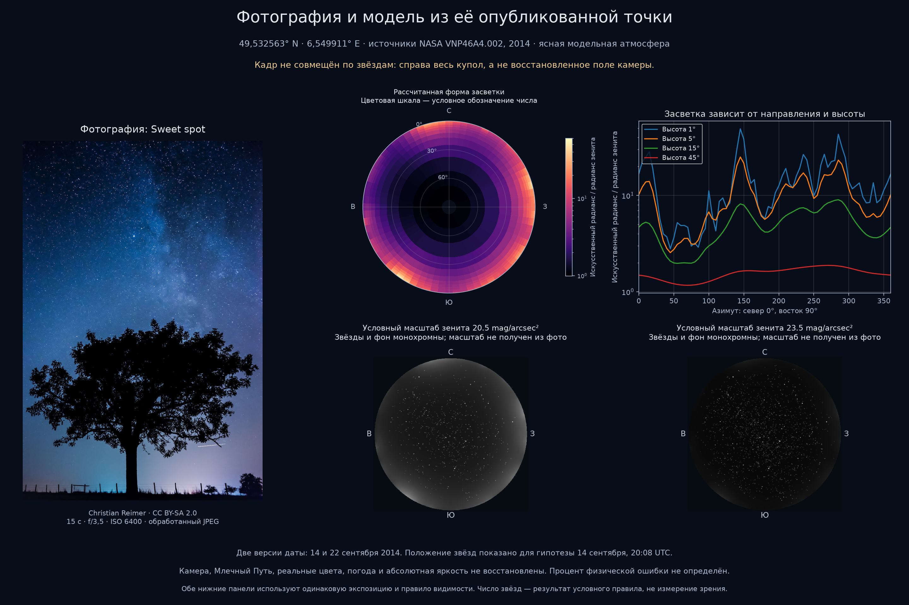

Для расчёта я получил отдельный годовой набор NASA нужного года и сохранил
1080 значений поля/1009 независимых лучей. Уточнение четырёх контрольных
лучей дало до 0,0261% различия квадратур и до 0,4700% от укрупнения источников.
Это численная проверка того решателя, не ошибка относительно фотографии.

Астрометрическое совмещение Astroalign/Tetra3 не установлено; конфликт
дат описания и EXIF сохранён в метаданных. Следовательно, совпадает
опубликованная точка, но не подтверждены ориентация поля, купола и амплитуда.
Я не вычисляю процент фотометрической точности по этому JPEG и не называю
старый рендер 0.9-камерой. [Метаданные и права](artifacts/photo-comparison/references/SOURCES.md),
[попытки регистрации](artifacts/photo-comparison/registration-attempts.json).

## 7. Что должно совпасть в строгом сравнении

Для геометрии мне нужны координаты и высота камеры, UTC с часовым поясом,
ориентация, фокусное расстояние/сенсор или решение WCS, местный горизонт.
Для фотометрии — фильтр/QE, линейный RAW, экспозиция, g/RN/dark, bias/dark/flat,
насыщение и маски. Для атмосферы — проверенные облака, прозрачность и
положение Солнца/Луны; для источников — сопоставимый временной период.

Я проверяю последовательно: совмещение звёзд; форму фонового градиента;
амплитуду в согласованной полосе; потоки звёзд; распределение шума и насыщение.
Независимое масштабирование каждой картинки, автоматическая экспозиция
или подбор цвета не должны скрывать ошибку модели.

Для глаза вместо RAW нужны ответы наблюдателей без подсказки предсказания,
заданные условия адаптации и независимые контрольные ночи. Цвет проверяется
отдельно от ответа «видел». Формат и метрики — [VALIDATION](docs/VALIDATION.md).

## 8. Что я буду добавлять в этот документ

Сюда я буду включать новые реальные снимки только с авторством, лицензией,
параметрами и явным назначением сравнения. Для количественного случая
буду показывать реальный кадр, модель, карту остатка и метрики на одних
масках. Сейчас согласованного независимого RAW-случая и проверки зрения нет;
это открытая работа, не скрытая калибровка по представленным фотографиям.

Оригиналы фотографий сохраняют собственные лицензии. Я не называю их
своими снимками и не перекрашиваю исходные копии. Машиночитаемые атрибуция
и SHA-256: [короткие экспозиции](artifacts/visual-reference-search-20261110/sources.json),
[длинные экспозиции](artifacts/photo-comparison/references/sources.json).
