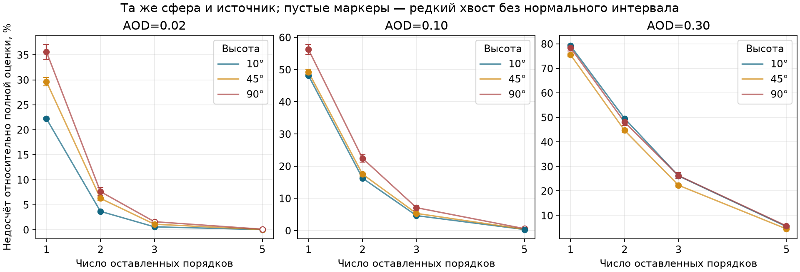
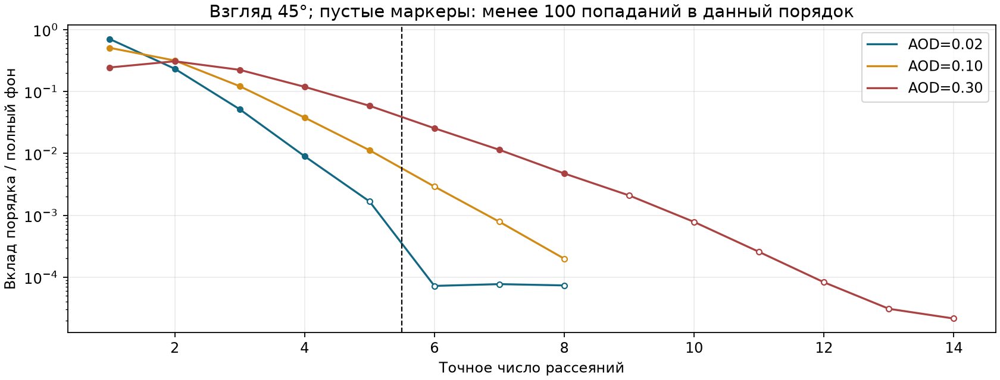
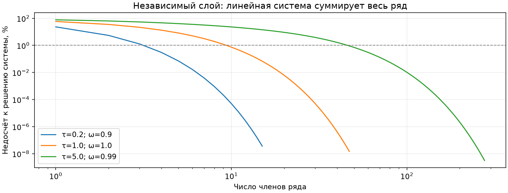

# Все порядки рассеяния: уравнение, методы и проверка
> Дата создания: 2026-11-13

Я исследовал совместное суммирование рассеяний и реализовал два способа
его вычисления. **Такой подход существует:** интегральное уравнение
переноса описывает все порядки сразу. Для прежней сферы я теперь оцениваю
полную сумму без фиксированного ограничения числа рассеяний. Для слоя
решаю линейную систему, которая также содержит всю сумму.

В девяти прежних сценах первые три порядка недосчитывают 0,57–26,23%
полного оценённого фона. В опорном случае AOD 0,10/45° — 5,31%.
Это улучшение полноты заданного уравнения, не новая оценка точности
относительно реального неба. Источники и атмосфера остались прежними.

Версия исследования **LP-all-orders-1**, предыдущая база —
[LP-core-diagnostics-1](../benchmark-baseline-20261113/README.md), Git c549dbd.
Основное приложение остаётся 0.10.0; исследовательский решатель ещё не
заменяет производственную карту NASA/KStars.

## 1. Что означает «все рассеяния сразу»

Отдельный фотон обычно поглощается или покидает атмосферу после
конечного числа событий. Заранее неограниченно множество возможных
длин цепочки. Поэтому конечная жизнь каждого пути совместима с
бесконечной суммой возможных порядков.

Обозначу всё поле радиансности через L, прямое поле от границ через L0,
а перенос с одним добавочным рассеянием через K. Тогда:

$$
L=L^{(0)}+\mathcal{K}L,\qquad
L=(I-\mathcal{K})^{-1}L^{(0)}=
\sum_{n=0}^{\infty}\mathcal{K}^nL^{(0)}.
$$

I — тождественный оператор, то есть «оставить поле как есть».
K действует на целую функцию по координатам и направлениям, а не
умножает одну яркость на число. Обратный оператор называется резольвентой.
При подходящих потерях на поглощение/выход ряд сходится; формально
достаточно спектрального радиуса K меньше 1. Замкнутая идеально
отражающая система без поглощения требует отдельного рассмотрения.

Это одно интегральное уравнение, но неизвестное поле стоит внутри
интеграла. Поэтому его компактная запись не устраняет всю вычислительную
работу. Нельзя заменить K величиной AOD и получить поправку 1/(1−AOD).
Постановка и определения с размерностями — в
[THEORY](../../THEORY.md#одно-интегральное-уравнение-для-всех-порядков).

## 2. Какие методы я изучил и что выбрал

| Подход | Что делает | Применение в этой работе |
|---|---|---|
| Интегральное уравнение/ряд Неймана | Совместно описывает первичный свет и все его перераспределения | Основа обоих вычислителей |
| Обратный Монте-Карло | Интегрирует случайные цепочки до физических границ | Основной контроль прежней сферической геометрии |
| Линейная система для слоя | Решает уравнение функции источника без ограничения порядка | Независимый численный референс, с уточнением сетки |
| DISORT, doubling–adding | Решают слоистый перенос с многократным рассеянием | Изучены как альтернативы; чужие программные пакеты не запускались |
| SHDOM/гармоники | Ускоряют угловой интеграл, отдельно решая пространственный перенос | Обоснованное направление ускорения; специальный угловой случай проверен |
| Диффузионное приближение | Упрощает почти изотропное поле при многих транспортных взаимодействиях | Не использовано как общая замена направленному ясному небу |

Ключевые первоисточники: [Yang et al.,2021,§2](https://arxiv.org/abs/2104.07007),
[Evans1998,SHDOM](https://nit.coloradolinux.com/~evans/shdom.html),
[libRadtran/Emde et al.2016](https://gmd.copernicus.org/articles/9/1647/2016/),
[DISAMAR,§3.3.1](https://gmd.copernicus.org/articles/15/7031/2022/gmd-15-7031-2022.html#section3),
[Cinzano & Falchi2012,§§2–3](https://arxiv.org/abs/1209.2031).
Роли, просмотренные разделы и границы переноса методов в код — в
[LITERATURE](../../docs/LITERATURE.md#7-все-порядки-и-интегральное-уравнение-переноса).
Это известные методы переноса, а не новый открытый мной физический закон.

### Реализация в сфере

Сохранил прежние выборку свободного пробега, коэффициенты Рэлей/HG,
сферическую Землю и излучающую площадку. Продолжаю путь до земли или
космоса. При неявном поглощении вес на столкновении умножается на
альбедо однократного рассеяния. В отдельном аналоговом режиме фотон
поглощается случайно с соответствующей физической вероятностью.

Для пути с H рассеяниями и попаданием на площадку D:

$$
Y=L_D\chi_D\prod_{j=1}^{H}\varpi(\mathbf{x}_j),\qquad
\widehat{L}_{\infty}=\frac{1}{N}\sum_{k=1}^{N}Y_k.
$$

Здесь LD — радиансность площадки, χD равен 1 при попадании на неё,
иначе 0. Число H выбирается самой траекторией; верхний физический
порядок я не назначаю. Вклад ограничен 0≤Y≤LD. Поэтому есть конечная
дисперсия, стандартная ошибка среднего и консервативная оценка Хёффдинга.
В коде также сохранены ковариации для сравнения вложенных сумм.

Я записываю отдельно 1–5 и категорию «выше 5», но категория не завершает
перенос. Нет удаления малых весов или скрытой остановки после пятого.
Защитный бюджет работы вызывает отказ всего расчёта, не возвращает
усечённый результат под видом полного. Русская рулетка с компенсирующим
весом тоже допустима, однако для этой конечной среды не потребовалась.
Просто отбрасывать слабые пути было бы систематической ошибкой.

### Реализация в слое

После пространственной и угловой квадратуры получаю:

$$
(I-A)\mathbf{s}=\mathbf{b},\qquad
L_{\infty}=\mathbf{e}^{\mathsf{T}}\mathbf{s}.
$$

Вектор s описывает функцию источника по слоям, b — её прямую часть,
A — межслойный перенос с новым рассеянием, e — выход к наблюдателю.
Решаю систему без явного формирования обратной матрицы. Число ячеек
не ограничивает число рассеяний, но создаёт ошибку дискретизации.

Отдельно суммирую ряд до нормовой границы остатка 1e−10. При q=||A||∞<1
неучтённая часть поля ограничена ||Aᵐb||∞/(1−q). Поэтому проверяю
решение системы рядом, не выбирая произвольное «достаточно 100 порядков».
Это граница ошибки дискретного уравнения, не атмосферы мира.

## 3. Что получилось с характеристическими функциями

Идея преобразований полезна. Для независимых одинаковых перемещений
с характеристической функцией φX и независимого геометрического числа
шагов M, P(M=m)=(1−q)qᵐ, m≥0:

$$
\varphi_{X_1+\cdots+X_M}(\mathbf{k})=
\frac{1-q}{1-q\varphi_X(\mathbf{k})}.
$$

Бесконечная цепочка действительно сворачивается в компактное выражение.
Для атмосферы надо учесть дополнительные зависимости: HG сохраняет
направление, длины пробега меняются с высотой, а источник и границы
выбирают пространственные пути. Одной скалярной функции для всей
городской задачи поэтому недостаточно.

Угловой аналог преобразования — сферические гармоники. Для HG
коэффициент степени l равен gˡ; после n одинаковых угловых рассеяний —
gⁿˡ. При геометрическом числе событий он становится
(1−q)/(1−qgˡ). Для Рэлей ненулевые коэффициенты — 1 при l=0 и 0,1 при l=2.
Так угловое интегрирование можно сильно упростить, сохранив отдельную
задачу пространственного переноса. Этот принцип используется в SHDOM.

Я проверил идеализированный угловой процесс: q 0,8, HG g 0,8,
262144 истории. q здесь — произвольно заданная вероятность продолжения,
а не AOD, g или восстановленная вероятность выхода земной атмосферы.

| Степень l | Аналитический момент | Случайная оценка | Отклонение в стандартных ошибках |
|---|---|---|---|
| 1 | 0,55556 | 0,55430 | −1,17 |
| 2 | 0,40984 | 0,41009 | +0,23 |
| 3 | 0,33875 | 0,33920 | +0,42 |
| 4 | 0,29748 | 0,29760 | +0,12 |

Все 4/4 прошли заранее заданный допуск 4 стандартных ошибки.
Это подтверждение специального преобразования, не прогноз городской
яркости по одной такой дроби. [Исходные числа](checks/characteristic-angular-example.json).

## 4. Прямое сравнение с прежними сценами

Оставил круг радиусом 40 км с центром в 60 км к югу от наблюдателя,
высоту 20 м, азимут 180°, 550 нм, SSA 0,9, g 0,8, масштабы 8 км/1,2 км,
верх 80 км и единичную радиансность. На каждую из 9 сцен — 2 097 152 пути,
seed 3011 и batch 8192. Облака, Луна, Солнце, природное свечение, снег,
DSM и переотражения земли отключены. Источники и C не подгонялись.

Новые первые 1/2/3 воспроизвели прежние 9/9 случаев; отдельно совпали
оба прежних контроля 1–5. Старые файлы не изменены. Отличия теперь
относятся к снятию ограничения по порядку, а не смене исходной сцены.

В таблице доля недостающего света равна
fₙ=(L∞−Sₙ)/L∞, где Sₙ — сумма до n-го порядка. Все проценты имеют
знаменатель «полная оценка». Для третьего приведена приблизительная
95%-полуширина в процентных пунктах, с учётом ковариации.

| AOD | Высота | Недосчёт 1, % | Недосчёт 2, % | Недосчёт 3, % ±п.п. | Недосчёт 5, % |
|---|---|---|---|---|---|
| 0,02 | 10° | 22,22 | 3,67 | 0,57 ±0,03 | 0,018 * |
| 0,02 | 45° | 29,63 | 6,26 | 1,09 ±0,18 | 0,022 * |
| 0,02 | 90° | 35,61 | 7,62 | 1,59 * | 0,094 * |
| 0,10 | 10° | 48,10 | 16,27 | 4,63 ±0,09 | 0,310 |
| 0,10 | 45° | 49,22 | 17,51 | 5,31 ±0,35 | 0,390 * |
| 0,10 | 90° | 56,22 | 22,44 | 7,09 ±0,74 | 0,574 * |
| 0,30 | 10° | 79,18 | 49,56 | 26,12 ±0,23 | 5,463 |
| 0,30 | 45° | 75,52 | 44,70 | 22,29 ±0,64 | 4,493 |
| 0,30 | 90° | 78,40 | 48,07 | 26,23 ±1,26 | 5,698 |

Звёздочка означает менее 100 попаданий в соответствующий остаточный
хвост: нормальный интервал не опубликован. Точечная оценка сохранена,
но малая оценка не доказывает такой же малой ошибки. Сырые моменты,
ковариации и консервативный интервал полной яркости сохранены в JSON.
Порог100 — практический фильтр, не доказательство точного покрытия 95%.



Для тонких сцен 45°/90° заранее добавлены независимые проверки с
8 388 608 путями и seed 9031. Недосчёт третьего уточнился до
1,084 ±0,088п.п. и 1,616 ±0,191п.п. соответственно, с 582/272
попаданиями в хвост. Остаток после пятого всё ещё редок: 19/9 попаданий,
поэтому строгого малого относительного предела для него я не объявляю.

В опорной атмосфере при 45° полная оценка 0,00602218±0,00005209
единицы радиансности, где ± — одна стандартная ошибка. Она выше суммы
до третьего на 5,60%, но недосчёт третьего относительно полной равен 5,31%:
разные знаменатели дают разные проценты. Все исходные значения доступны
в [таблице CSV](comparison-table.csv) и [сферических JSON](spherical/aod-0.10-alt-45.json).



Пустые маркеры на этом графике означают менее 100 попаданий в данный
порядок. Отдельные высокие порядки поэтому оценены значительно слабее,
чем сумма всего хвоста. Соединяющая линия не доказывает точной формы
редкого хвоста; отсутствующие попадания не нарисованы как нулевой вклад.

В основной серии максимальная встреченная длина пути 22 рассеяния.
Это не скрытый предел алгоритма. Ненаблюдавшиеся ещё более длинные
цепочки остаются допустимыми. Поэтому я убрал фиксированное обрезание,
а численную точность теперь характеризую числом путей и их дисперсией.

## 5. Независимый контроль полной суммы

Решил три изотропных слоя с единичным испусканием земли, чёрными
границами для рассеянного входящего света и разными τ/SSA. Сетки:
256/64 →512/128 →1024/192 слоёв/углов. Затем сравнил с Монте-Карло
в оболочке толщиной 1 м, 524288 путей, seed 9901. Такая оболочка близка
к плоской геометрии; различие не объявляю нулевым.

| τ | SSA | Полная радиансность слоя | Отклонение сферического MC, стандартные ошибки |
|---|---|---|---|
| 0,2 | 0,9 | 0,07937224 | +0,07 |
| 1,0 | 1,0 | 0,34132870 | −0,34 |
| 5,0 | 0,99 | 0,68007675 | −0,94 |

Все 3/3 прошли заранее заданный допуск 4. Между двумя последними сетками
максимальное изменение 0,000552%. Решение линейной системы согласуется
с рядом в пределах его нормовой оценки; последняя ниже 1e−10. Эти числа
отделены от ошибки сетки. Слой τ 5 — стресс-тест, не типичная ясная ночь.



Независимые дополнительные проверки сферы: другой seed в опорной сцене
дал 0,41 совместной стандартной ошибки; аналоговое поглощение — 2,38
при AOD 0,10 и 1,46 при 0,30. Все 3/3 укладываются в предписанный допуск 4.
Подгонки по этим сравнениям не было. Происхождение и результаты — в
[протоколе](protocol.json), [сводке](summary.json),
[проверке целостности](integrity-verification.json).

## 6. Стоимость и способ чтения результата

Сравнил одинаковые 524288 путей, seed 701/702, по 2 свежих процесса
для 1/2/3/5/полной суммы. Те же атмосфера AOD 0,10, 45° и площадка.
Linux x86_64, 6 логических CPU; BLAS/OMP ограничены одним потоком.
Общая машина не была выделена исключительно под опыт. Время — сам
решатель, без импортов; память — VmHWM процесса с Python/импортами.

| Порядки | Медиана, с | Диапазон 2 повторов, с | Максимум RSS, MiB |
|---|---|---|---|
| До 1 | 2,85 | 2,67–3,02 | 39,60 |
| До 2 | 3,42 | 3,40–3,44 | 39,92 |
| До 3 | 4,70 | 4,59–4,81 | 39,97 |
| До 5 | 5,20 | 4,49–5,91 | 40,06 |
| Все | 5,15 | 4,87–5,44 | 40,43 |

Полная сумма заняла на 6–13% больше времени, чем три порядка при тех же
seed, в этих двух повторах. Небольшая разница 5/∞ ненадёжна: шум времени
и разные реализации превышают её. Это сравнение одинакового N, не
одинаковой достигнутой ошибки. Оно не прогнозирует время полной
спектральной карты NASA, рельефа или всего небосвода.

Практический вывод: бесконечное число допустимых порядков не означает
бесконечный объём работы на каждом пути. Большинство путей завершается
рано; высокая длина встречается редко. Читать результат следует вместе
с ошибкой среднего, числом попаданий и границами исходной модели.

## 7. Что остаётся приближённым и что делать дальше

1. Полной стала сумма **этого скалярного уравнения**, а не вся физика
   ночи. Остаются HG вместо измеренной фазовой функции, сценарные
   профили/SSA, 550 нм, конечная площадка, чёрная земля и тёмный космос.
   Поляризация, спектральные линии и новые отражения земли не добавлены.

2. Следующий практический шаг — согласованное испускание реальной карты
   источников и спектральный перенос. Переход от диаграммы точечной лампы
   к радиансности площадки требует проверки: для плоской площадки
   интенсивность содержит проекцию µ, поэтому деление произвольной
   низкоугловой диаграммы на µ может нарушить ограниченность веса.
   Свойства конечной ламбертовской площадки нельзя обещать любой точечной модели.

3. Для ускорения полного пространственного поля подходят гармоники,
   адаптивные/безматричные методы и библиотеки функций распространения
   при неизменной атмосфере. Плотная матрица всей 3D-задачи не нужна:
   даже 40×40×32 ячейки × 48 направлений дали бы около 48 ТБ для double-матрицы.

4. Улучшение к настоящему небу проверяется отдельно на согласованных
   ночной атмосфере и фотометрии. Новая оценка ошибки к AstMon, Луне,
   людям или RAW в этом исследовании не получена: прежний контрольный
   круг не подставлялся вместо настоящего города с перенастроенным C.
   Основная интеграция KStars остаётся на прежнем производственном переносе.

Общая теория и конкретные приближения продолжаются в
[THEORY](../../THEORY.md), [MODELS](../../MODELS.md) и [LIMITS](../../LIMITS.md).
Неподдержанные наблюдательные показатели остаются missing, а не нулём.

## 8. Повторяемость и проверки

Вычислители: [all_orders.py](../../src/lightpollution/models/all_orders.py)
и [slab_resolvent.py](../../src/lightpollution/models/slab_resolvent.py).
Старые physics.py/scattering_orders.py не изменены. Протокол содержит
их SHA256, хеш прежнего протокола и настройки до запуска результатов.
Старые артефакты сохранены; новый опыт имеет отдельную версию и каталог.

```bash
export OPENBLAS_NUM_THREADS=1 OMP_NUM_THREADS=1
uv run python scripts/run_all_orders_study.py
uv run python scripts/summarize_all_orders_study.py
```

Для следующего запуска использую новый --output, при сборке — --root.
Имена файлов выше указывают текущий опубликованный набор и не должны
перезаписываться при сравнении будущей версии.

Основные расчёты и контроли: 48 758 784 MC-пути. С пилотом — 49 938 432;
unit-тесты сюда не входят. 262144 угловые истории учитываются отдельно.
Подробный [журнал](execution-ledger.json) разделяет все источники счётчиков.

Проверки: **371/371 pytest за 107,50 с**, 0 ошибок/пропусков; 25 новых
проверок отдельно прошли за 4,61 с. uv lock --check пройден. Контроли
9/9 трёхчленных и 2/2 пятичленных префиксов, 3/3 полных слоёв,
3/3 seed/поглощения, 4/4 угловых моментов отражают разные вопросы,
а не один искусственно увеличенный счётчик точности.
Целостность кодов/сумм/референсов — 31/31; PDF и ссылки проверяются отдельно.
Статус реализации: development в main, без production-релиза KStars.
