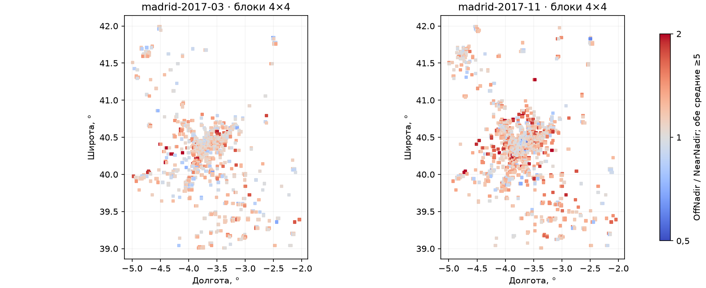
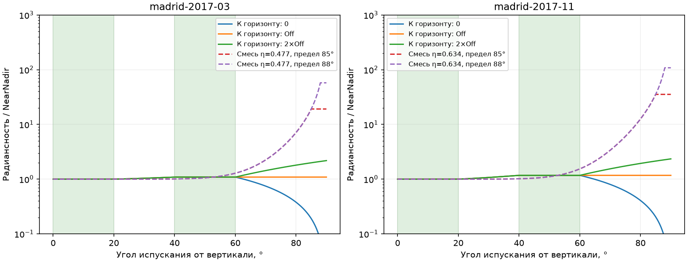
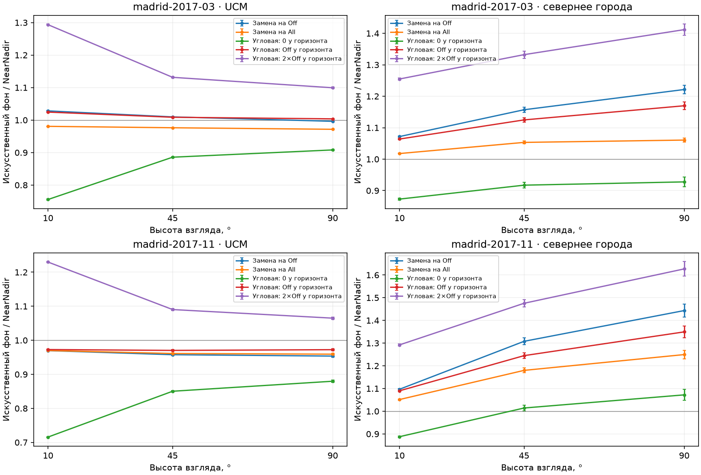

# Ракурсы NASA и диаграммы излучения города

Я проверил, как смена углового композита и продолжение диаграммы за пределы измерений меняют искусственный фон при переносе всех порядков. Это исследование входов и чувствительности заданного уравнения; новую точность относительно реального неба я не измерял.

Протокол **LP-NASA-angular-all-orders-1**; базовая ревизия `3e284c8`. Завершено **22/22** сцен, **46,137,344** траекторий, девять вариантов границы на каждом пути. Основной интерфейс/KStars остаётся прежним. Новые функции работают в отдельном исследовательском режиме. [PDF для чтения](LightPollution-angular-nasa-study.pdf).

## 1. Какие данные я действительно использовал

Я независимо перечитал исходные Collection2 HDF5, проверил продукт/период/географию/единицы/масштаб/fill и сравнил каждый декодированный массив с региональным кэшем. Проверены все ссылки на HDF5 (**21**) и декодированные поля (**120**). Новые спутниковые данные и токены не потребовались. Имена, SHA256 и границы сохранены в `*-audit.json`; источники и права — в [source-audit.json](source-audit.json).

NearNadir — диапазон 0–20° от местной вертикали, OffNadir —40–60°. AllAngle использует перекрывающиеся наблюдения, включая другие углы; это не третий независимый снимок под известным углом. Использую только Snow_Free, конечные неотрицательные радиансности, QA0, Num>3 и классы суши/берега 0/1/5. В каждой строке сравниваю одинаковые ячейки, прошедшие все три категории.

| Область/период | Вся сетка | Пригодные Near / Off / All | Общее пересечение | Off/Near суммы D×A | All/Near суммы D×A |
|---|---:|---:|---:|---:|---:|
| madrid-2015-01 | 518400 | 418025 / 517268 / 518052 | 417875 | 1.13633 | 1.04531 |
| madrid-2015-07 | 518400 | 517214 / 518085 / 518297 | 517029 | 1.16420 | 1.05261 |
| madrid-2017-03 | 518400 | 502561 / 505955 / 518318 | 491197 | 1.09302 | 1.02385 |
| madrid-2017-11 | 518400 | 492739 / 518038 / 518283 | 492493 | 1.17312 | 1.06812 |
| petersburg-2025 | 345600 | 250349 / 237439 / 242817 | 235533 | 1.07709 | 1.00743 |
| petersburg-2025-01 | 345600 | 305 / 5810 / 78767 | 47 | 1.45538 | 1.15431 |
| petersburg-2025-07 | 345600 | 0 / 0 / 0 | 0 | — | — |
| saarland-2014 | 518400 | 518153 / 517285 / 517804 | 517260 | 1.22729 | 1.11031 |

Здесь D измерена в нВт/(см²·ср), A — площадь ячейки; отношения безразмерны. Это различие пространственного входа, а не напрямую изменение небесного фона или восстановленные ватты ламп. Январь Петербурга содержит лишь 47 общих ячеек и 3 ярких пары, июль не содержит ни одной; эти месяцы в перенос не включены. Ранее опубликованные 423 январские NearNadir-ячейки относились ко всем классам поверхности и одной категории — это другой знаменатель.

В перенос входят март/ноябрь Мадрида, годовой Петербург и годовой Саар. Для двух месяцев Мадрида дополнительно фиксирую одно временное пересечение: **467904** ячейки. На нём Off/Near составляет 1,09141 в марте и 1,17348 в ноябре; небольшое отличие от таблицы связано с маской. Неизвестные ячейки и источники вне региона исключены во всех вариантах одинаково; их свет не объявлен известным нулём.

## 2. Что меняется по территории

Чтобы слабые значения и цензурирование не определяли вывод, отдельно рассматриваю пары с Near≥5 и Off≥5 нВт/(см²·ср). Пороги 1/5/20 и нули сохранены в аудитах. NASA устанавливает значения ниже 0,5 в 0; поэтому отношение всех слабых пикселей не равно устойчивой оценке диаграммы.

| Набор | Ярких пар, знаменатель | Off/Near: P05 / медиана / P95 | Off<Near, число/знаменатель | Ярких блоков 12×12 | Off<Near среди блоков |
|---|---:|---:|---:|---:|---:|
| madrid-2015-01 | 13046 | 0.666 / 1.097 / 1.994 | 4664/13046 (35.8%) | 59 | 9/59 |
| madrid-2015-07 | 21719 | 0.666 / 1.108 / 2.075 | 7349/21719 (33.8%) | 205 | 19/205 |
| madrid-2017-03 | 16807 | 0.637 / 1.079 / 1.979 | 6378/16807 (37.9%) | 125 | 16/125 |
| madrid-2017-11 | 19388 | 0.636 / 1.092 / 2.096 | 7233/19388 (37.3%) | 188 | 20/188 |
| petersburg-2025 | 24498 | 0.722 / 1.102 / 1.641 | 7788/24498 (31.8%) | 198 | 29/198 |
| saarland-2014 | 35484 | 0.816 / 1.140 / 1.548 | 7758/35484 (21.9%) | 249 | 14/249 |

Блоки 4/12/24 — фиксированная пространственная сетка. Принимаю блок с≥4 общими ячейками, покрытием≥80% известных ячеек суши/берега и обеими средними≥5; площади ячеек учтены. В Мадриде шаг 15″ примерно 0,46 км с севера на юг и 0,35 км с запада на восток; блок 4×4 — около 1,85×1,41 км,12×12 —5,56×4,23 км. Это шаг сетки, не независимое оптическое разрешение. Численные блоки сохранены в `*-blocks.csv`.



Отношение ниже 1 несовместимо с моей прежней семьёй «ламбертовская + неотрицательная низкоугловая компонента» при сопоставимом стационарном источнике. Такие отношения сохраняются после пространственного усреднения. Однако композиты используют разные времена/ракурсы, поэтому каждый отдельный пиксель не является доказательством формы конкретной лампы. Я сохраняю несовместимость и не обрезаю найденную η в 0 или 1.

## 3. Что происходит с параметром смеси

Я проверил действующие настройки: `SolverSettings.horizontal_fraction=0` и `direct_horizontal_fraction=0` по умолчанию, то есть базовая угловая форма ламбертовская. Низкоугловая смесь является явно заданным сценарием. Если включён спектральный режим и состав не указан, код выбирает `LED-B3: 1`; это библиотечный шаблон, а не спектр города, восстановленный NASA. В новом опыте сравнения идут с этой базовой ламбертовской формой при одном фиксированном спектральном приближении.

Я сравниваю радиансности. Для ламбертовской площадки радиансность постоянна; косинус входит в интенсивность конечной площадки. Поэтому ожидание Off/Near=cos50°/cos10° здесь неверно. Формула перехода и подбора приведена в [THEORY](../../THEORY.md#что-добавляют-несколько-спутниковых-ракурсов).

При равномерном усреднении по телесному углу внутри диапазонов низкоугловая часть даёт GNear=0,00000696434 и GOff=0,1003695. Отношение Off/Near=1,10 требует η≈0,4991. Это диагностический подбор с допущением о весах, а не измеренная доля фонарей.

| Набор в переносе | Off/Near | η: равномерно по телесному углу | η: равномерно по зенитному углу | Мощность смеси 85 / мощность Near-Lambert |
|---|---:|---:|---:|---:|
| madrid-2017-03 | 1.09141 | 0.47666 | 0.49308 | 1.715 |
| madrid-2017-11 | 1.17348 | 0.63350 | 0.64863 | 2.357 |
| petersburg-2025 | 1.07709 | 0.43443 | 0.45065 | 1.603 |
| saarland-2014 | 1.22729 | 0.69369 | 0.70748 | 2.778 |

В этих сравнениях фиксирую измеренный NearNadir и один общий масштаб. Поэтому восстановленная полная мощность при смене формы меняется; это не прежний опыт изменения η при заведомо неизменной мощности лампы. Отдельной перенастройки C или каждого зенита нет. Полные отношения интегралов мощности всех вариантов сохранены в [summary.json](summary.json).

Исходная интенсивностная низкоугловая функция при переводе в радиансность растёт как 1/μ у горизонта. Я не применяю к ней ложную конечную границу радиансности: в опыте явно фиксирую радиансность после 85° или 88°. Оба варианта отличаются от неограниченного исходного закона. Положение ограничения само становится проверяемым допущением.



## 4. Как я считал перенос

На сцену — **2,097,152** траекторий;18 основных сцен и 4 контроля. Я продолжаю обратный путь до земли/космоса либо физического поглощения, без ограничения порядков, удаления малых весов и повторной передачи Бера. Использую прежние выборку пробегов и фаз Рэлей/HG. Все девять вариантов оцениваются на одних полных путях; сохраняю полную ковариацию для их отношений.

Фиксирую 550 нм, SSA0,9, g0,8, AOD0,10, экспоненциальные масштабы 8 км/1,2 км и верх 80 км. В двух контролях меняю только AOD на 0,02/0,30. Наблюдатели в 20 м над одной сферической землёй: UCM40,451111/−3,726111; севернее города 40,85/−3,726111; Петербург 60,3/30,315; Саар 49,532563/6,549911. Рельеф и фактическая высота станции не воспроизведены. Азимут 180° при высотах 10°/45°;90° — зенит.

Числа DNB задают пространственную амплитуду одного монохромного прокси. Спектральной инверсии DNB→550 нм/V я не выполнял. Облака, Луна, естественный фон, DSM и переотражения земли отключены. Ближние конечные ячейки включены — в отличие от прежних опытов с исключением 3 км.

Я сравниваю 9 вариантов: Near/Off/All как отдельные ламбертовские карты; угловую форму с плато Near на 0–20°, линейным переходом по μ на 20–40° и плато Off на 40–60°; три продолжения этой формы к горизонту до 0/Off/2×Off; смесь η0,1 с ограничением 85°; регионально подобранную смесь с ограничениями 85°/88°. Все три ограниченные эмпирические формы точно совпадают в двух наблюдаемых диапазонах при любых весах внутри этих диапазонов. Радиансность каждого варианта проверяется против объявленной конечной границы при каждом попадании.

## 5. Насколько различается искусственный фон неба

В таблице показываю изменение относительно NearNadir с ламбертовской формой. Диапазон «0…2Off» отражает выбранные продолжения к горизонту, не доверительную вероятность реальной диаграммы. У варианта «Off на горизонте» ± — приблизительная 95%-полуширина только парной ошибки Монте-Карло, в процентных пунктах. Это не ошибка атмосферы и не полевая точность.

| Сцена | Заменить на Off | Заменить на All | Угловая: Off на горизонте | Угловая: 0…2Off на горизонте |
|---|---:|---:|---:|---:|
| madrid-2017-03-ucm-alt10 | +2.82% | -1.93% | +2.45% ±0.10 п.п. | -24.45% … +29.35% |
| madrid-2017-03-ucm-alt45 | +0.98% | -2.37% | +0.86% ±0.12 п.п. | -11.43% … +13.15% |
| madrid-2017-03-ucm-alt90 | -0.39% | -2.84% | +0.37% ±0.13 п.п. | -9.19% … +9.94% |
| madrid-2017-03-north-alt10 | +7.18% | +1.78% | +6.39% ±0.19 п.п. | -12.70% … +25.48% |
| madrid-2017-03-north-alt45 | +15.70% | +5.33% | +12.47% ±0.73 п.п. | -8.27% … +33.22% |
| madrid-2017-03-north-alt90 | +22.14% | +6.06% | +16.97% ±1.18 п.п. | -7.23% … +41.17% |
| madrid-2017-11-ucm-alt10 | -3.04% | -3.01% | -2.73% ±0.07 п.п. | -28.43% … +22.98% |
| madrid-2017-11-ucm-alt45 | -4.24% | -3.88% | -2.97% ±0.23 п.п. | -14.97% … +9.03% |
| madrid-2017-11-ucm-alt90 | -4.64% | -4.08% | -2.76% ±0.29 п.п. | -12.03% … +6.50% |
| madrid-2017-11-north-alt10 | +9.67% | +5.14% | +9.00% ±0.30 п.п. | -11.22% … +29.21% |
| madrid-2017-11-north-alt45 | +30.79% | +17.99% | +24.48% ±1.23 п.п. | +1.42% … +47.54% |
| madrid-2017-11-north-alt90 | +44.33% | +24.95% | +34.94% ±2.56 п.п. | +7.21% … +62.68% |
| petersburg-2025-north-alt10 | +2.89% | -3.28% | +2.66% ±0.49 п.п. | -15.86% … +21.17% |
| petersburg-2025-north-alt45 | +7.19% | +0.04% | +5.49% ±1.95 п.п. | -12.99% … +23.97% |
| petersburg-2025-north-alt90 | +9.32% | +2.86% | +7.48% ±3.69 п.п. | -13.78% … +28.74% |
| saarland-2014-saar-alt10 | +34.60% | +19.64% | +30.55% ±0.32 п.п. | -5.33% … +66.43% |
| saarland-2014-saar-alt45 | +27.72% | +15.54% | +22.57% ±0.65 п.п. | -3.39% … +48.52% |
| saarland-2014-saar-alt90 | +26.76% | +15.04% | +21.50% ±0.72 п.п. | -1.86% … +44.86% |



Для смеси привожу отдельные отношения, чтобы большой сценарный эффект не скрывал небольшие различия карт. Знаменатель каждого отношения — NearNadir/Lambert той же сцены.

| Сцена | Смесь η0,1, предел 85° | Региональная η, предел 85° | Та же η, предел 88° | Доля света от испускания>60° в Near/Lambert | Доля после третьего порядка в Near/Lambert |
|---|---:|---:|---:|---:|---:|
| madrid-2017-03-ucm-alt45 | 1.139 | 2.139 | 2.380 | 31.9% | 0.82% |
| madrid-2017-03-north-alt45 | 1.221 | 2.811 | 3.246 | 44.8% | 3.62% |
| madrid-2017-11-ucm-alt45 | 1.143 | 3.220 | 3.698 | 32.6% | 0.86% |
| madrid-2017-11-north-alt45 | 1.223 | 4.464 | 5.280 | 45.1% | 3.67% |
| petersburg-2025-north-alt45 | 1.209 | 2.445 | 2.757 | 42.2% | 3.60% |
| saarland-2014-saar-alt45 | 1.253 | 6.149 | 7.159 | 50.4% | 4.18% |

В полной [таблице 198 оценок](sky-comparisons.csv) сохраняю все направления/варианты, стандартные ошибки, парные 95%-интервалы, доли испускания>60°/>85° и хвосты после третьего/пятого порядков. Сырые JSON с ковариациями находятся в `cases/`. Пересчёт вΔmag относится только к искусственной составляющей; с неизвестным естественным фоном изменение общей яркости будет иным.

## 6. Атмосферная чувствительность и независимая выборка

Здесь фиксирую мартовскую карту, северную точку и взгляд 45°, меняю только AOD. Это три сценарные атмосферы, не измерения ночей.

| AOD | Заменить на Off | Угловая: Off у горизонта | Угловая: 0…2Off у горизонта | Региональная смесь 85 / Near |
|---|---:|---:|---:|---:|
| 0.02 | +15.18% | +11.84% ±0.73 п.п. | -10.56% … +34.24% | 3.099 |
| 0.10 | +15.70% | +12.47% ±0.73 п.п. | -8.27% … +33.22% | 2.811 |
| 0.30 | +17.59% | +14.84% ±0.70 п.п. | -4.01% … +33.68% | 2.442 |

Другой seed проверяю в мартовской северной точке при 10°/45°. До расчёта задал допуск 4 объединённых стандартных ошибки по каждому из 9 вариантов.

| Независимая сцена | Максимальное отклонение, SE | Прошли варианты |
|---|---:|---:|
| madrid-2017-03-north-alt10-seed19073 | 2.257 | 9/9 |
| madrid-2017-03-north-alt45-seed19073 | 0.497 | 9/9 |

## 7. Проверки, затраты и границы вывода

Численные проверки: **160/160**, ошибок **0**. Проверяю сохранение числа исходов/масок, сумму порядков/углов, неотрицательность ковариации, хеши кода/кэшей и отсутствие обрезания. Максимально встретившийся порядок — **19**, это не физический предел. Минимальная диагностика эффективных весовых вкладов — **89.3**; нормальные парные интервалы допущены в **197/198** оценок. Порог 100 вкладов — практический фильтр, не доказательство нормального покрытия.

Сумма времён 22 отдельных переносов: **688.63 с**; максимальная RSS процесса **361.6MiB**. Это измеренное время переносов, без перечитывания HDF5, аудита, графиков и PDF. Часть расчётов шла одновременно с pytest, поэтому время не является чистым аппаратным бенчмарком. Повторное использование JSON не включено как новый физический расчёт.

Полная программная проверка: **378/378**,0 ошибок/пропусков,144,06 с; `uv lock --check` пройден,52 пакета. Новые проверки: сначала 6/7 за 3,79 с, затем 7/7 за 2,62 с. Единственная начальная ошибка — неверное ожидание теста: несовместимая η может быть>1, а не только<0; проверка исправлена, физическая формула подбора не менялась. Два режима поглощения точно воспроизводят прежние средние и ковариации контрольной площадки. Дополнительно 12/12 интегралов мощности регуляризованной смеси совпали с независимой аналитической формулой; максимальная разница 8,9×10⁻¹⁶. [Проверка интегралов](flux-verification.json). Подробности — [test-verification.json](test-verification.json), [test-results.txt](test-results.txt), [integrity-verification.json](integrity-verification.json).

Нормальный интервал не опубликован для `petersburg-2025-north-alt90 / mixed_eta_regional_cap85`: 89,3 эффективных весовых вклада при 57333 положительных путях и пороге 100. Причина — сильная концентрация веса в редких ярких/наклонных попаданиях. Точечная оценка сохранена в CSV/JSON; большое число положительных попаданий само по себе не устраняет эту проблему. Интервалы Хёффдинга сохраняются как консервативные маргинальные границы и могут быть практически слишком широкими.

Не получены: независимая полевая ошибка новых угловых моделей, абсолютная V/DNB→V калибровка, спектры/азимутальные диаграммы отдельных блоков, синхронные ночные AOD/SSA/профили, суточные ракурсы и статистический интервал полной физической неопределённости. Причина — этих входов и независимой контрольной серии в исследовании нет. Совпадение со спутниковыми композитами не заменяет такого контроля.

## 8. Что я предлагаю делать с моделью

Идея разбить территорию на ячейки работает как вычислительная постановка: перенос конечных ячеек всех порядков уже рассчитан. Для источников я предлагаю хранить Near/Off/All, QA/Num/Std, общую маску, класс поверхности и ограниченную угловую форму по территории. В плохо покрытых местах оставлять missing. Для укрупнения отдельно контролировать погрешность, особенно у наблюдателя и в тенях.

Я не предлагаю автоматически заменять одну общую η на карту обрезанных η. Пространственные отношения бывают обоих знаков, а почти горизонтальная часть исходной смеси слишком жёстко связана с небольшим изменением Off/Near. Лучше проверять неотрицательные ограниченные функции радиансности/базисы и явно отделять неизмеренное продолжение после 60° от данных. Для следующего подбора нужны суточные скорректированные VNP46A2 и соответствующая геометрия/QA VNP46A1 с реальными Sensor_Zenith/Sensor_Azimuth, проверка временного поведения, разделение обучающих/контрольных периодов и независимая наземная фотометрия при измеренной атмосфере. Это предложение по результатам опыта, а не уже выполненная загрузка или подтверждённая новая модель.

Спектр города нужно определять отдельно: два угловых композита одной DNB-полосы не определяют смесь LED/натрия и особенно её синюю часть. В опубликованном [опыте Hung et al.](https://arxiv.org/abs/2107.02026) наземноеV-свечение выросло при снижении DNB после замены освещения; я использую это как независимое предостережение, не импортирую их численные наблюдения в свой fit.

## 9. Воспроизведение

Исходные HDF5 и региональные кэши должны соответствовать хешам аудитов. Секреты, рабочие базы и большие HDF5 в Git не входят.

```bash
uv run python scripts/run_angular_nasa_study.py
uv run python scripts/summarize_angular_nasa_study.py
uv run pytest -q -p no:cacheprovider
uv lock --check
```

Второй запуск первого скрипта сверяет входы/код/настройки и использует только совпадающие завершённые JSON. У генератора графиков собственный хеш; изменение оформления не выдаётся за новый перенос. Канонические предпосылки — [THEORY](../../THEORY.md), действующие режимы — [MODELS](../../MODELS.md), ограничения — [LIMITS](../../LIMITS.md).
