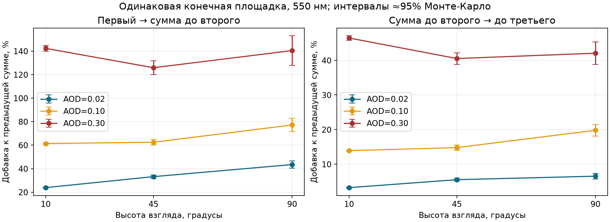
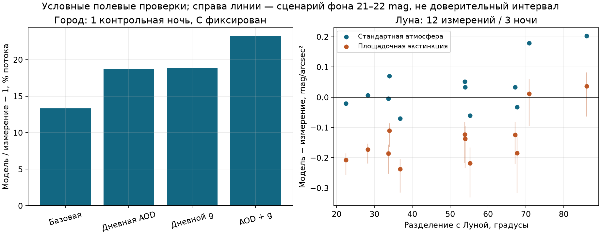
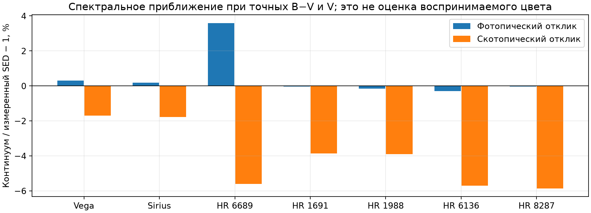

# Первый диагностический бенчмарк LightPollution
> Дата создания: 2026-11-13

Я выполнил пять групп опытов, чтобы отделить недостатки переноса,
неопределённость входов и численную ошибку. Главный результат: **высшие
порядки рассеяния уже существенны в контролируемых сценах, а более подробные
дневные атмосферные данные пока не доказали повышения полевой точности**.
Полной калибровки глаза/камеры этот этап не даёт.

Версия набора: **LP-core-diagnostics-1**. Основное приложение остаётся0.10.0;
его первый порядок, KS-Луна, глаз и камера не подстраивались под результаты.
Новый решатель работает отдельно как исследовательский инструмент.
Формальное устройство — [THEORY](../../THEORY.md#независимая-выборка-порядков-рассеяния),
приближения — [MODELS](../../MODELS.md), полный каталог — [BENCHMARK](../../BENCHMARK.md).

## 1. Что и насколько чисто сравнивалось

| Группа | Объём | Что зафиксировано | Статус вывода |
|---|---|---|---|
| Порядки переноса | 9 сцен1/2/3;2 проверки4/5 | Конечная площадка,550нм, мощность, среда, геометрия каждого опыта | Чистая физическая чувствительность; без наблюдательной ошибки |
| Город B01 | 18 исходных V-записей/2 ночи | Общие NASA-ячейки, источник, высота, естественный фон, один мартовский C | Условная проверка; атмосфера дневная, ноябрь уже изучался ранее |
| Луна B04 | 12 прошедших отбор из108 записей/3 ночи | Измеренные углы/фаза, KS, V; меняется только экстинкция | Изолированный лунный блок, но природный фон и облачная QA неполны |
| Спектры | 7 звёздных SED;1 лабораторный LED | Те же B−V/V для звёзд; равный V лампы | Ошибка/чувствительность спектрального приближения, не глазной цвет |
| Укрупнение | 4 геометрии,8 сравнений | Та же суммарная мощность, атмосфера и область | Численная чувствительность к пространственной агрегации |

Фильтры каждого опыта сохранены до его расчёта. Не выбираю случаи по
малому остатку и не смешиваю проценты разных физических величин в общий
«процент точности». По наблюдениям есть30 записей за5 различных ночей:
9 обучающих и21 контрольная/без подбора. Это не30 независимых ночей.
Для полевых опытов я пока сохраняю статус **conditional**, не certified.

## 2. Одно, два и три рассеяния

Я задал светящийся ламбертовский круг радиусом40км с центром в60км к югу
от наблюдателя. Точка наблюдения(0°,0°), высота20м, азимут180°. Это
контрольная геометрия, а не город на экваторе. Радиансность площадки равна1
в выбранной монохромной единице. Длина волны550нм, SSA0,9, g0,8,
масштабы высот8км/1,2км, верх атмосферы80км.

Облака, Луна, Солнце, природное свечение, снег, DSM и отражения от земли
отключены. Земля после испускания поглощает, космос тёмный. В каждом случае
2 097 152 случайных пути, фиксированные seed3011 и batch8192. Пары по
максимальному порядку имеют одинаковые случайные префиксы.

Обозначаю точный порядок через L1/L2/L3, а накопленную сумму через
S1=L1, S2=L1+L2, S3=L1+L2+L3. Ниже Δ2=S2/S1−1, Δ3=S3/S2−1.
Знак ± — приближённая95%-полуширина численного Монте-Карло-интервала
в процентных пунктах. Учитываю ковариацию, поскольку суммы вложены.

| AOD550 | Высота | Δ2, % ± п.п. | Δ3, % ± п.п. |
|---|---|---|---|
| 0,02 | 10° | 23,86 ±0,29 | 3,22 ±0,08 |
| 0,02 | 45° | 33,20 ±1,38 | 5,52 ±0,43 |
| 0,02 | 90° | 43,47 ±3,01 | 6,53 ±0,83 |
| 0,10 | 10° | 61,34 ±0,67 | 13,91 ±0,20 |
| 0,10 | 45° | 62,46 ±2,41 | 14,79 ±0,75 |
| 0,10 | 90° | 77,17 ±5,57 | 19,79 ±1,68 |
| 0,30 | 10° | 142,32 ±2,46 | 46,46 ±0,66 |
| 0,30 | 45° | 125,87 ±5,88 | 40,52 ±1,66 |
| 0,30 | 90° | 140,44 ±12,69 | 42,07 ±3,28 |



Следовательно, ограничение первым порядком в этих сценах существенно.
Проценты нельзя переносить на любой регион: они зависят от геометрии,
спектра, профиля, поглощения и границ. Больше света также не означает
меньше остаток к реальным измерениям, если другие входы неверны.

### Остаток после третьего

При взгляде45° я дополнительно вычислил четвёртый и пятый порядки.
При AOD0,10 сумма S5 выше S3 на **5,19 ±0,38п.п.**; при AOD0,30 —
на **22,90 ±0,93п.п.**. Это измеренная положительная часть хвоста,
не его верхняя граница. Шестой и последующие порядки здесь не оценены.
Три порядка ещё нельзя объявить сошедшимся ответом.

### Независимые проверки

Первый порядок отдельно рассчитан существующим интегратором с
поверхностной квадратурой12×32 →24×64 →32×96, лучевой256→512→1024
и путевой24→48→64. Максимальное изменение между двумя последними
приближениями0,1961%; допуск протокола был0,5%. Все9/9 случаев согласуются
с Монте-Карло в пределах2,20 стандартной ошибки при предписанном допуске4.
Минимум255 светящихся попаданий на отдельный порядок основной серии.

Независимый seed3012 в опорной сцене дал отклонения −0,54/1,63/−0,32
совместных стандартных ошибок по трём порядкам. Дополнительно сравнил
пять порядков с детерминированным послойным решением изотропной среды:
5/5 в пределах1,61 стандартной ошибки. Уточнение слоя/углов меняет
референс максимум на0,001272%. Это искусственная оболочка толщиной1м,
изотропная фаза и оптическая толщина1, а не модель земной погоды.
Сферическая оболочка и плоский слой близки, но не тождественны.

Первый порядок подтверждает совместимость с прежним ядром; послойный
референс отдельно проверяет рекурсию высших порядков. Ни один контроль
не измеряет правильность AOD/g реальной ночи.

### Цена расчёта

Сравнил одинаковые524 288 путей в свежих процессах, по2 повтора на
порядок,6 запусков. Linux x86_64,6 логических CPU; общей машине не задавал
исключительное владение CPU. Время включает сам решатель, без импортов;
память включает Python/импорты. Сравнение ведётся при одинаковом N,
а не при одинаковой достигнутой ошибке.

| Максимум порядков | Медиана, с | Диапазон2 повторов, с | VmHWM, MiB |
|---|---|---|---|
| 1 | 2,91 | 2,71–3,11 | 39,32–39,36 |
| 2 | 3,72 | 3,67–3,77 | 39,59–39,70 |
| 3 | 4,44 | 3,78–5,11 | 39,54–39,73 |

Для этой площадки третий порядок обошёлся примерно в1,53 медианного
времени первого. Это не прогноз стоимости полной карты NASA/DSM и не
надёжный микробенчмарк по двум повторам. Полный спектр и полный обзор
неба не вычислялись. Ошибочный ранний RSS387048KiB отражал максимум
родителя до exec; я исправил измеритель на VmHWM текущего процесса,
повторил серию и исключил прежнее значение из таблицы.

Финальная серия:28 311 552 пути; с независимым послойным контролем —
28 835 840. С учётом первого повторённого прохода и пилота —57 278 464;
случайные пути unit-тестов в эти счётчики не входят. Подробный
[журнал запусков](execution-ledger.json) разделяет эти величины.
Результаты: [протокол](scattering/protocol.json), [CSV](scattering/score-table.csv),
[сводка](scattering/summary.json), [референс](scattering/slab-reference.json),
[замеры ресурсов](scattering/timing.json).

## 3. Город: библиотечная и доступная атмосфера

Использую исходный AstMon Johnson-V, точка40,451111°N;3,726111°W,
высота650м. По авторским рисункам5/6 выбраны ясные безлунные интервалы
22:00–23:00UTC19марта и19ноября2017года. В исходном CSV нет отдельной
облачной маски: это внешняя QA публикации. Я заново считал исходные
величины по точным UTC, проверил SHA256 и совпадение18/18 значений.

Условия: Солнце ниже−18°, Луна ниже−5°; источник — месячный
VNP46A3.002 NearNadir Snow_Free за тот же месяц. Общая QA/суша-маска
477 828 из518 169 опорных наземных ячеек; область39–42°N,5–2°W.
Вес ячейки — прежняя радиансность×площадь с общей мартовской нормировкой.
Свет ближе3км отсутствует в этом замороженном источнике; высоты источников
остаются сферическими. Это известные ограничения, а не нулевая засветка.

Сравнение намеренно монохромное550нм с эффективной V-калибровкой, без
параллельной смены спектра ламп, рельефа и снега. Естественный фон21,6mag.
Один C подогнан по среднему линейному потоку9 мартовских записей; затем
сохранён для обеих ночей и всех вариантов. Мартовское совпадение не
считаю независимой точностью. Ноябрь уже рассматривался в разработке:
это контроль переносимости, а не новая слепая выборка.

### Что действительно измерено в AERONET

Прибор примерно в200м от AstMon, высота680м. Выбираю последнее дневное
измерение нужного дня по времени, без использования остатков неба.

| Ночь | AOD550 над прибором | AOD550 на опоре модели | g550 столбовой | Последняя AOD UTC | Последний g UTC |
|---|---|---|---|---|---|
| Март | 0,07355 | 0,12963 | 0,61197 | 17:12:45 | 15:24:59 |
| Ноябрь | 0,04243 | 0,07478 | 0,64044 | 16:02:16 | 15:21:35 |

Опорный перенос AOD учитывает высоту прибора при том же предполагаемом
аэрозольном масштабе1,2км. Без него мы подставили бы не тот столб.
Вывод формулы — в [MODELS](../../MODELS.md#подстановка-измеренного-столба-aeronet).
g550 интерполирован между440/675нм по логарифму длины волны. Ни профиль,
ни местная фазовая функция этим не измерены. SSA остаётся0,9: пригодного
измерения в этих строках нет. До середины наблюдения AOD отстоит на
5,29/6,46ч, g — примерно на7ч. Ночной атмосферы у нас нет.

| Вариант | Остаток ноября, mag | Поток модели относительно наблюдения |
|---|---|---|
| Стандартные AOD0,1;g0,8 | −0,1359 | +13,3% |
| Только дневная AOD | −0,1862 | +18,7% |
| Только дневной g | −0,1878 | +18,9% |
| Дневные AOD и g | −0,2266 | +23,2% |

Отрицательный остаток model−observed в звёздных величинах означает,
что модель ярче. Среднее берётся в линейном потоке, не в логарифмической
шкале. Контрольный знаменатель —9 записей одной ночи; статистической
точности по популяции ночей я не оцениваю.

В отдельном диагностическом разрезе разрешил каждой ветви свой C,
полученный только из марта. Тогда ноябрьские остатки −0,1359/−0,2461/
−0,1264/−0,2103mag. Это отдельная проверка обученной переносимости,
а не тот же опыт с неизменным C. Ноябрь нигде не подгонялся.



Максимальное численное изменение при192/24→384/48 равно0,00451%.
Оно значительно меньше наблюдаемого расхождения. Простой вывод
«добавить реальные параметры — станет точнее» не подтвердился.
Причину нельзя однозначно приписать AOD/g: остаются дневной разрыв,
вертикальный профиль, широкий спутниковый отклик, диаграмма, высоты,
композит и единственная калибровочная ночь. Нельзя исправлять это
подбором C по контрольному ноябрю.

Результаты: [протокол](city/protocol.json), [происхождение источников](city/source-provenance.json),
[отклики](city/responses.json), [остатки](city/results.json).
Первоисточник измерений/QA: [Robles et al.,2021](https://www.mdpi.com/2072-4292/13/8/1511),
формат атмосферы — [AERONET](https://aeronet.gsfc.nasa.gov/print_web_data_help_v3.html).

## 4. Луна без городского спутникового тракта

Я импортировал непосредственно численную таблицу13
[Winkler,2022](https://arxiv.org/html/2205.07773), а не считал его модельный
остаток измерением. В ней108 V-измерений: шесть строк без лунных углов,
одна площадка без координат в таблице10. Пропуски сохранены и исключены,
не заполнены догадками. Использую опубликованные фазу и углы, а не
неизвестную ориентацию фотографии. Спутниковые данные для этого
изолированного лунного компонента не нужны.

Отбор: освещённая доля0,90–0,98; высота Луны≥25°, цели≥30°;
разделение20–90°; модуль галактической широты≥20°; Солнце≤−18°
во всём временном интервале неопределённости. Прошли12/108 за3 ночи,
96 исключены; причины пересекаются, их суммы не равны96.
Фотометрия авторов опирается на стандартные звёзды, но отдельной
поминутной маски облаков и индивидуальных ошибок таблица не предоставляет.

Время задано HJD−2456000, не UTC. Для дополнительного контроля сумерек
и расстояния до Луны использую приблизительное JD с запасом±10мин.
Углы остаются опубликованными. Координаты1м-телескопа SAAO используются
только для этих вспомогательных эфемерид, не выдаются за точную позицию
0,5м-телескопа. Максимальный размах расстояниевого множителя в этом
интервале0,13%; это не основной бюджет ошибки.

KS1991 не меняю. В обоих вариантах одинаковы фаза, расстояние, направления
и природный фон21,6mag. Меняется только kV: стандартная атмосфера над
высотой1798м против опубликованной τV0,138, то есть kV≈0,14983mag/airmass.
Этот площадочный k получен по звёздной экстинкции, не подогнан по небу.

| Вариант | MAE по12 записям | RMSE | Средний остаток | MAE с равным весом3 ночей |
|---|---|---|---|---|
| Стандартная атмосфера | 0,0637mag | 0,0882mag | +0,0324mag | 0,0529mag |
| Площадочная экстинкция | 0,1459mag | 0,1604mag | −0,1378mag | 0,1536mag |

Невозможно заключить, что сценарная атмосфера физически вернее.
В принятом площадочном прогнозе природный фон составляет до17,5%.
Изменение его сценария21–22mag даёт до0,1916mag размаха результата,
сопоставимого с остатком. Совпадение стандартного варианта может быть
компенсацией ошибок KS/фона/полосы. Индивидуальные погрешности наблюдений,
облаков и разделения фона не получены; значимость различия MAE не установлена.
Я не использовал параметры RSS, подогнанные авторами по этим же данным,
как независимую истину или гарантированно лучшую модель.

Результаты: [протокол](moon/protocol.json), [все причины отбора](moon/selection-audit.json),
[12 исходных численных случаев и наши прогнозы](moon/primary-results.json),
[сводка](moon/summary.json).

## 5. Спектры и укрупнение источников

Для семи закреплённых CALSPEC/Gaia SED я восстановил fallback-континуум
по B−V, вычисленному из того же измеренного спектра, и нормировал к тому же V.
Это лучший случай с точными входными B−V/V; их совпадение — условие,
а не независимая проверка. Другие отклики дают максимум3,59% фотопического
и5,86% скотопического различия относительно измеренного SED.
Погрешности исходного SED не распространялись;7 объектов не представляют
все спектральные классы и не проверяют весь каталог KStars.



Из LSPDD взят один измеренный тёплый LED, CCT2691K, capture2469;
кандидат библиотеки LED-B1 выбран по классу тёплого белого света до
вычисления разностей. Нормировка одинакова по V, общий диапазон381,5–780нм,
784 отсчёта. Скотопический отклик кандидата выше на8,88%. Для городского
V-фона в трёх заданных направлениях различие меньше0,087% после того же
однократного переноса. Это проверка одного похожего спектра при известном V,
не восстановление регионального спектра из DNB. Исходный спектральный
массив LSPDD не перераспространяю; сохраняю URL, хеш и производные числа.

Для агрегации сравнил блоки12/6/3 на двух месячных источниках Мадрида
в направлениях(150°,10°) и(0°,90°). Мощность сохраняется до2,3·10⁻¹⁶
относительно. Максимальное отклонение блока12 от3 —1,449%, блока6 —0,641%.
Лучевое уточнение отдельно меняет ответ меньше0,00773%.
Блок3 — более тонкое приближение, не точный пространственный эталон.
Эти опыты не ограничивают ошибку отсутствующих источников за областью,
фонарей в3км или теней DSM. По этой выборке дальнейшее дробление далёких
ячеек имеет меньший эффект, чем пропущенный многократный перенос.

Результаты: [спектры](spectra/summary.json), [агрегация](aggregation/summary.json),
[SED-происхождение](../../src/lightpollution/resources/spectra/provenance.json),
[LSPDD capture2469](https://api.lspdd.sbcloud.ca/capture/2469).

## 6. Приоритеты и ещё не полученные показатели

1. **Перенос и одновременные наблюдения — параллельный первый приоритет.**
   Нужны карта излучения для высших порядков, ускорение, оценка хвоста
   и несколько новых ясных безлунных ночей с синхронной V-фотометрией,
   AOD/профилем и облачной QA. Нельзя выбрать окончательную физику по
   одной контрольной ночи, а потом тем же примером подтвердить её точность.

2. **Проверить входы и идентифицируемость.** Ночные AOD/SSA/фаза/профиль,
   корректная высота опоры, спектральный/угловой мост DNB, источники вблизи
   наблюдателя. Новые данные подключать раздельно при одном масштабе;
   PSD/преломление не восстанавливаются однозначно из имеющихся g/AOD.

3. **Замкнуть бюджет естественного и лунного фона.** Нужна согласованная
   безлунная/лунная серия на одной площадке и независимые входы атмосферы.
   Проверять угловую форму и абсолютный V отдельно, не подбирать неизвестный
   природный фон по контрольному лунному кадру.

4. **Реальная камера и глаз.** Полный линейный RAW/FITS с bias/dark/flat,
   QE/откликом, gain/RN и оптикой; отдельно человеческие per-star
   seen/unseen, адаптация и измеренный дисплей. Их итоговые показатели
   сейчас missing. Фотография с выдержкой не заменяет наблюдателя.

5. **Остальные блоки допускать по одному.** Для снега — согласованная пара
   при той же атмосфере/свете; для сумерек — синхронный спектр и солнечная
   геометрия; для DSM/фонарей — геометрия и измеренный угловой профиль.
   Полусфера и цветовой вывод могут развиваться отдельно, но не дают
   доказательства физической точности.

Статусы всех12 исходных групп сохранены в [case-status.json](case-status.json).
Полные сцены глаза/камеры, снег, сумерки, рельеф, реальные фонари,
угловое восстановление NASA, IPRT/libRadtran в этом запуске не оценивались.
Для них нет ни нулевых ошибок, ни придуманного общего рейтинга.

## 7. Повторяемость, проверки и файлы

Каждый протокол содержит параметры, время, SHA256 кода/входов и правила
отбора. Базовый Git до реализации — e69261f; фактическую идентичность
новых вычислителей задают хеши в протоколах и коммит этого каталога.
Исторический аудит данных не перезаписан. Окончательный статус —
development, без смены производственного переноса и выпуска KStars.

Команды из корня после подготовки закреплённых исходных файлов:

```bash
uv run python scripts/run_scattering_benchmark.py
uv run python scripts/check_orders_slab_reference.py
uv run python scripts/run_city_benchmark.py
uv run python scripts/run_moon_benchmark.py
uv run python scripts/run_spectral_benchmark.py
uv run python scripts/run_aggregation_benchmark.py
uv run python scripts/summarize_benchmark.py
```

Для нового сравнения задаю новый каталог через --output, для сборки —
--root; существующий выпуск бенчмарка не перезаписываю. Большие исходные
NASA/AstMon и сетевые ответы остаются вне Git; их URL/хеши и происхождение
сохранены в протоколах и предыдущем аудите. Токены нигде не нужны для
повторного локального расчёта и не включены в артефакты.

Проверки реализации: **346/346 pytest за108,41с**,0 ошибок/пропусков;
uv lock --check пройден. Из них25 новых проверок геометрии/фаз/порядков,
нулевых сред, общих случайных префиксов и корректного импорта приложения.
Научные проверки9/9 первых порядков и5/5 послойных контролей учитываются
отдельно. Проверка ссылок и PDF фиксируется дополнительными JSON-аудитами.
Проверки реализации не переименованы в полевую точность.

Дополнительно прошли84/84 проверки входных хешей, NASA, повторного
вычисления прогнозов и учёта запусков:
[целостность](integrity-verification.json), [тесты](test-verification.json),
[ссылки](documentation-verification.json), [PDF](pdf-verification.json).

Сводные числа — [summary.json](summary.json), исходные значения — в
тематических подкаталогах. Графики построены из JSON скриптом
summarize_benchmark.py; это научные диаграммы, не синтетические фотографии
и не имитация того, как именно увидит небо человек.
