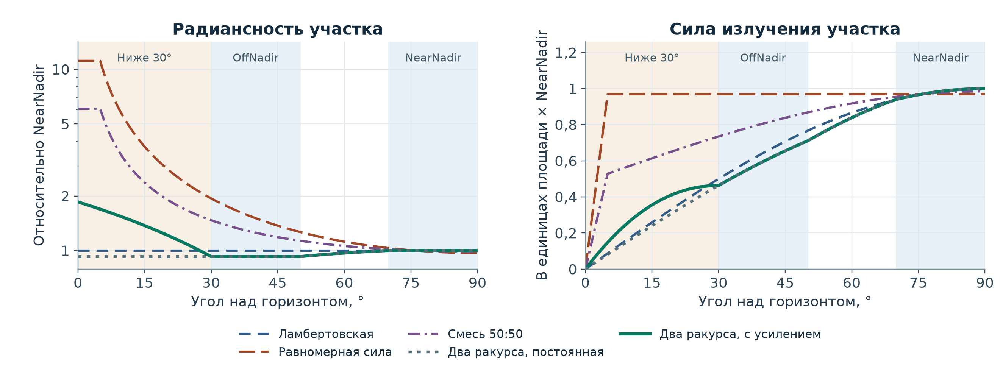
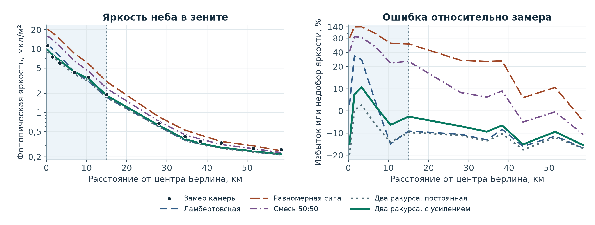

# Как диаграмма излучения Берлина меняет прогноз яркости неба

Сравнение пяти вариантов в 12 точках к югу от Берлина в ночь с 28 на 29 марта 2017 года.

**Результат.** На шести точках, где по расчёту преобладает Берлин, средняя абсолютная ошибка яркости составила **15,24%** у ламбертовской диаграммы, **8,89%** после привязки к двум ракурсам Black Marble и **7,27%** с дополнительным усилением у горизонта. Во всех пяти вариантах порядок яркости одинаков для всех 64 заметно различавшихся пар на маршруте. За 15 км расчёт с усилением занижает яркость на всех шести дальних точках. В этом секторе существенен вклад соседних населённых пунктов.

## Что содержат исходные данные

| Набор | Что измеряет и как я использовал |
|---|---|
| [Наземная фотометрия Jechow и Hölker, таблицы 1 и A1](https://doi.org/10.3390/rs12203412) | Одна Canon EOS 6D с объективом «рыбий глаз», откалиброванная по звёздам. Оценка полной фотопической яркости неба в круге радиусом 10° вокруг зенита, в мкд/м². Камера регистрирует вместе искусственный свет и естественный фон. По оценке исследователей, погрешность фотометрии около 10%. |
| [Ручной фотометр SQM на том же маршруте](https://arxiv.org/html/2202.08258v1#S3.SS1) | Второй ряд наземных измерений с собственной спектральной полосой прибора. Использовал его для проверки порядка яркости площадок. Ошибку в мкд/м² считаю по фотопической оценке камеры. |
| [NASA Black Marble, VNP46A3.002 и VNP46A4.002](https://ladsweb.modaps.eosdis.nasa.gov/missions-and-measurements/products/VNP46A3) | Спутниковая радиансность от участков поверхности в широкой полосе VIIRS DNB, примерно 500–900 нм. Для расчёта это карта света, уходящего от поверхности в атмосферу. Композит объединяет пролёты за период. Направление лучей задают слои NearNadir и OffNadir. |
| [AERONET, станция Freie Universität Berlin, таблица A3](https://doi.org/10.3390/rs12203412) | Оптическая толщина аэрозоля из измерений прямого солнечного света. За последние два светлых часа 28 марта опубликованы AOD 0,19 на 440 нм, 0,17 на 500 нм и 0,13 на 675 нм. По ним получил AOD 0,156 на 550 нм и показатель Ангстрема 0,888. Это дневная опора для ночного расчёта. |

Наблюдения сделаны в 12 точках на расстояниях 0,3–58,5 км от центра Берлина. Маршрут прошли последовательно за 3 ч 36 мин, с 01:11 до 04:47 местного времени 29 марта, или с 23:11 UTC 28 марта до 02:47 UTC 29 марта. Облачность по полевому отчёту 0 октантов. По эфемеридам высота Солнца от −34,1° до −18,4°, Луны от −33,9° до −24,6°. [Точки, координаты и время](observations.json) · [Публикация с описанием камеры и апертуры](https://arxiv.org/html/2202.08258v1#S2.SS2)

Использовал бесснежный композит Black Marble за март 2017 года, плитка h19v03. Если месячная ячейка NearNadir отсутствовала или не проходила фильтр, брал ячейку из годового композита 2017 года. Фильтр принимает флаг качества 0 и больше трёх наблюдений. Годовые замены дают 4,42% радиансности Берлина в NearNadir. Из 6 796 ячеек внутри границы города годны 6 544 в NearNadir и 6 102 в обоих ракурсах. [Руководство Black Marble Collection 2.0](https://landweb.modaps.eosdis.nasa.gov/data/userguide/BlackMarbleUserGuide_Collection2.0_20241203.pdf)

## Как привёл прогноз к показанию камеры

- **Место и направление.** Запустил перенос на координатах каждой остановки. Высоты наблюдателей взял из Copernicus DEM GLO-90 и добавил 1,5 м для камеры. Усреднил лучи по телесному углу в конусе радиусом 10° вокруг зенита. [Источник высот](https://open-meteo.com/en/docs/elevation-api)
- **Полоса и единицы.** Привязал спектры тёплого LED и натриевой лампы высокого давления к равным вкладам в спутниковую полосу DNB. Считал перенос в пяти интервалах 380–780 нм и сложил их с фотопическими весами CIE. Так получил мкд/м², то есть милликанделы на квадратный метр. Спектр реальных ламп, свет в ближней ИК-части полосы DNB и отличие зелёного канала камеры от CIE остаются источниками неопределённости. [Полоса VIIRS DNB](https://ladsweb.modaps.eosdis.nasa.gov/missions-and-measurements/products/VNP02DNB/)
- **Атмосфера и фон.** Считал все порядки рассеяния на сфере с одним атмосферным профилем на весь маршрут. Задал AOD 0,156, высоту аэрозольного масштаба 1,2 км и масштаб молекулярного рассеяния 8 км. К искусственной яркости всех прогнозов добавил 0,170 мкд/м², опорный естественный фон из статьи. Ночной фон и высотный профиль аэрозоля остаются неопределёнными. [Опорный фон, таблица 2](https://doi.org/10.3390/rs12203412)
- **Изменяемый параметр.** Между сценариями менял только угловую диаграмму ячеек внутри муниципальной границы Берлина. Соседние источники, атмосфера, фон и спектральная смесь были общими. Масштаб каждого варианта задал по спутнику до сравнения с камерой. Коэффициент по наземным замерам не подбирал. [Граница DE001C, GISCO 2024, © EuroGeographics](https://gisco-services.ec.europa.eu/distribution/v2/urau/geojson/URAU_RG_100K_2024_4326_CITIES.geojson)

## Что именно менялось в диаграммах

Диаграмма задаёт, сколько света участок отдаёт вверх и вбок. Радиансность L описывает свет на единицу видимой площади и телесного угла. Сила излучения I описывает свет всего участка на единицу телесного угла. Для горизонтального участка площади A и высоты луча h над горизонтом выполняется I = A × L × sin(h). У матовой поверхности L постоянна, а при взгляде сбоку видимая площадь A × sin(h) меньше. [Закон Ламберта](https://ntrs.nasa.gov/api/citations/19680004191/downloads/19680004191.pdf)

| Вариант | Правило для излучения участка Берлина |
|---|---|
| **Ламбертовская** | Радиансность постоянна и равна NearNadir. Сила излучения слабее под малым углом. При 30° над горизонтом она вдвое меньше, чем вертикально вверх. |
| **Равномерная сила** | Сила излучения одинакова для углов от 5° до 90° над горизонтом. Радиансность при наклоне растёт, потому что видимая площадь уменьшается. В последних 5° радиансность фиксируется на значении при 5°. |
| **Смесь 50:50** | Ламбертовская и равномерная диаграммы смешаны с равными вкладами в NearNadir. Это доли в спутниковом ракурсе. |
| **Два ракурса, постоянная** | Для той же ячейки сохраняю NearNadir и OffNadir в их диапазонах углов. Между диапазонами интерполирую по косинусу угла от вертикали. Ниже 30° над горизонтом продолжаю OffNadir постоянной радиансностью. |
| **Два ракурса, с усилением** | Те же значения в измеренных диапазонах. Ниже 30° радиансность плавно растёт от значения OffNadir к удвоенному значению у горизонта. |

**Что значит «два ракурса».** NearNadir собирает свет, уходящий почти вертикально вверх, от 70° до 90° над горизонтом. OffNadir собирает свет под наклоном, от 30° до 50°. Для каждой ячейки это две оценки радиансности по разным спутниковым пролётам. Участок с отсутствующим OffNadir остаётся ламбертовским. Оба сценария одинаковы по всем измеренным углам и расходятся только ниже 30° над горизонтом. [Диапазоны NearNadir и OffNadir](https://landweb.modaps.eosdis.nasa.gov/data/userguide/BlackMarbleUserGuide_Collection2.0_20241203.pdf#page=25)

При одинаковой опоре NearNadir ламбертовская диаграмма даёт отношение OffNadir к NearNadir 1,00, равномерная — 1,55, смесь — 1,28. Усреднение по телесному углу внутри диапазонов приближённое. В композитах на общем покрытии Берлина отношение **0,926**. Равномерная модель даёт слишком много света уже в наклонном ракурсе, который спутник наблюдает.

Усиленный вариант даёт в 1,48 раза больше радиансности на 15° над горизонтом и в 1,83 раза на 5° относительно постоянного продолжения. Эффективная площадь горизонтального участка падает к горизонту, поэтому его сила излучения убывает даже при таком росте радиансности. Малые углы важны вдали от города. Например, в плоском приближении луч на высоту 2 км над точкой в 50 км выходит из города под углом около 2,3° и может рассеяться в зенитное поле камеры.

## Как изменились прогнозы

Средняя абсолютная ошибка — среднее по остановкам от модуля разницы, делённого на измеренную полную яркость. Среднее смещение сохраняет знак, плюс означает избыток расчётной яркости. На первых шести точках, до 15 км включительно, Берлин даёт больше половины искусственной яркости во всех трёх вариантах с ламбертовским или измеренным распределением. В дальней группе шесть остальных точек, от 28 до 58,5 км.

| Вариант | Ошибка до 15 км, 6 точек | Смещение до 15 км | Ошибка дальше 15 км, 6 точек | Ошибка на всём маршруте, 12 точек |
|---|---:|---:|---:|---:|
| Ламбертовская | 15,24% | +7,23% | 12,71% | 13,97% |
| Равномерная сила | 97,10% | +97,10% | 16,68% | 56,89% |
| Смесь 50:50 | 52,16% | +52,16% | 6,60% | 29,38% |
| Два ракурса, постоянная | 8,89% | −7,90% | 13,55% | 11,22% |
| Два ракурса, с усилением | 7,27% | −0,62% | 10,49% | 8,88% |

- **От ламбертовской к двум ракурсам.** Постоянное продолжение уменьшило ошибку на шести точках с преобладанием Берлина на 6,35 процентного пункта. Избыток яркости около центра сменился небольшим средним недобором. У смеси 50:50 низкая ошибка на дальних точках сочетается с сильным завышением возле города и с избытком света в наклонном ракурсе Black Marble.
- **От постоянного продолжения к усилению.** Усиление дополнительно снизило среднюю ошибку на тех же шести точках на 1,62 процентного пункта, а среднее смещение приблизилось к нулю. На самой дальней точке прибавка составила 0,0036 мкд/м² при остаточном недоборе примерно 0,040 мкд/м².

### Измерения и прогнозы по точкам

Все значения яркости в мкд/м². Столбец «Берлин» показывает его долю в искусственном сигнале в варианте с усилением. «Постоянная» и «Усиление» используют оба ракурса Black Marble. Расчётные десятичные знаки оставлены для сравнения вариантов.

| км | Камера | Ламберт | Равн. сила | Смесь 50:50 | Постоянная | Усиление | Берлин |
|---:|---:|---:|---:|---:|---:|---:|---:|
| 0,3 | 11,300 | 11,594 | 20,405 | 15,999 | 9,039 | 9,629 | 99% |
| 1,5 | 7,500 | 10,016 | 17,968 | 13,992 | 7,528 | 8,055 | 99% |
| 3,3 | 6,000 | 7,676 | 14,407 | 11,042 | 6,156 | 6,643 | 98% |
| 6,9 | 4,300 | 4,442 | 8,566 | 6,504 | 4,021 | 4,379 | 96% |
| 10,5 | 3,600 | 3,064 | 5,845 | 4,454 | 3,090 | 3,373 | 92% |
| 15,0 | 1,900 | 1,727 | 3,054 | 2,391 | 1,716 | 1,851 | 67% |
| 28,0 | 0,670 | 0,599 | 0,852 | 0,725 | 0,596 | 0,624 | 35% |
| 34,5 | 0,420 | 0,365 | 0,527 | 0,446 | 0,363 | 0,380 | 43% |
| 38,3 | 0,350 | 0,321 | 0,442 | 0,381 | 0,314 | 0,327 | 41% |
| 43,5 | 0,330 | 0,277 | 0,350 | 0,313 | 0,272 | 0,280 | 34% |
| 51,5 | 0,270 | 0,239 | 0,299 | 0,269 | 0,238 | 0,245 | 40% |
| 58,5 | 0,260 | 0,216 | 0,248 | 0,232 | 0,216 | 0,220 | 33% |

В опыте 180 прогонов всех порядков по 131 072 траектории, суммарно 23 592 960. Ковариации и стандартные ошибки в архиве относятся к численному усреднению по траекториям. Сохранил координаты, эфемериды, хеши плиток, спектральные веса и полные прогнозы. Численные наблюдения из публикации распространяются по CC BY 4.0. [Наблюдения](observations.json) · [Результаты](results.json) · [Воспроизведение расчёта](../../scripts/run_berlin_propagation.py)

## Что говорят порядок, спад и дальние точки

**Порядок.** Считаю точки примерно равными, если разница яркости не больше 10% от среднего в паре. Все пять диаграмм верно указали более яркую точку в 64 из 64 различимых пар по камере, в том числе в 15 из 15 пар на первых шести остановках. Из двух близких пар ламбертовская диаграмма и постоянное продолжение распознали по одной, остальные варианты — ни одной. У ручного SQM 63 различимые пары, порядок у усиленной диаграммы совпал во всех 63. Пары используют одни и те же точки одной ночи. [Измерения SQM](https://arxiv.org/html/2202.08258v1#S3.SS1) · [Расчёт по порогам 5, 10 и 20%](results.json)

**Спад в зоне преобладания Берлина.** При вычете одинакового фона из наблюдений и прогнозов яркость от 0,3 до 15 км упала по наблюдениям в 6,43 раза. Ламбертовский расчёт даёт 7,34 раза, постоянное продолжение — 5,74, усиленное — 5,63. Средняя ошибка отношений искусственной яркости по 15 парам уменьшилась с 0,247 до 0,131 звёздной величины у обоих спутниковых вариантов.

**Спад дальше.** От 15 до 58,5 км искусственный сигнал уменьшился в 19,2 раза по наблюдениям и в 33,8 раза по варианту с усилением. В последней точке камера измерила 0,260 мкд/м², прогноз дал 0,220. Из последних 0,220 на принятый фон приходится 0,170, на Берлин около 0,017, на прочие источники 0,033. После вычета фона остаётся 0,090 по камере и 0,050 в расчёте. Поэтому ошибка в 15,5% от полной яркости соответствует примерно 45% от искусственного остатка. Этот спад относится к совместному вкладу Берлина и соседних источников и чувствителен к реальному естественному фону.

## Как устойчив результат и что осталось проверить

| AOD на 550 нм | Ламбертовская | Два ракурса, постоянная | Два ракурса, с усилением |
|---:|---:|---:|---:|
| 0,10 | 13,15% | 12,19% | 7,01% |
| 0,156, дневной AERONET | 15,24% | 8,89% | 7,27% |
| 0,22 | 18,72% | 7,65% | 8,74% |

В таблице средняя абсолютная ошибка на шести точках с преобладанием Берлина. Во всех трёх случаях лучший результат даёт одна из диаграмм с двумя спутниковыми ракурсами. Предпочтение между постоянным продолжением и усилением зависит от атмосферы. Точное усиление у горизонта по этой ночи остаётся неопределённым.

**Спектр под малым углом.** По сохранённым результатам заменил спектр только дополнительного излучения ниже 30° над горизонтом с натриевого HP1 на тёплый LED-B2 при том же вкладе в спутниковую полосу. На 58,5 км изменение меньше 0,0001 мкд/м². Выраженный синий компонент около 450 нм требует отдельного спектрального контроля. VIIRS DNB слабо чувствителен в этой области, а рассеяние и ослабление света по пути зависят от длины волны. [Исследование спектрального переноса](https://www.sciencedirect.com/science/article/pii/S0022407313004792)

**Где важны другие факторы.** В ламбертовском прогоне на пяти ближних точках 82–97% искусственного вклада дают источники в радиусе 10 км от камеры. На этих расстояниях могут влиять высоты фонарей и экранирование зданиями. На дальних точках заметнее соседние источники и изменение естественного фона, в том числе airglow. Для проверки излучения по азимуту и отделения этих факторов нужны одновременные цветовые измерения в нескольких направлениях и тёмная контрольная площадка.
