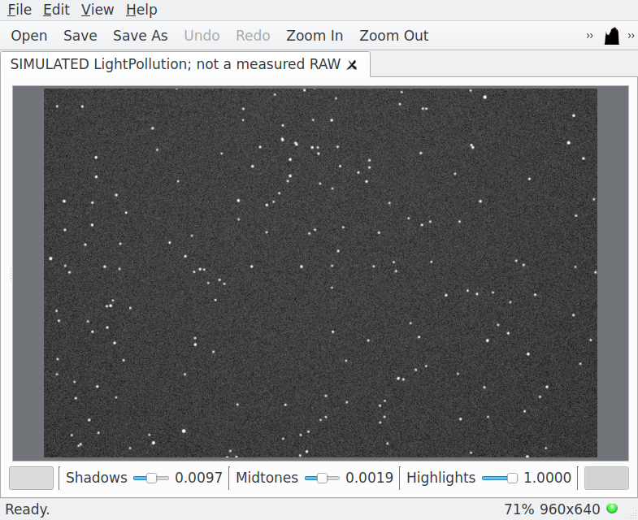
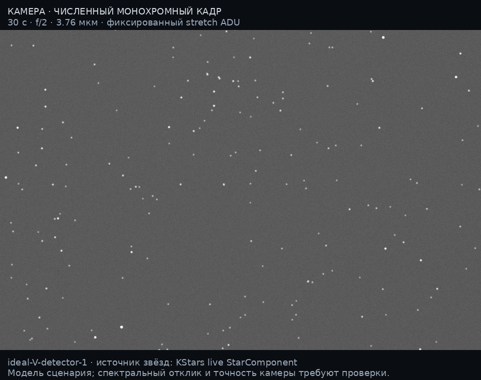
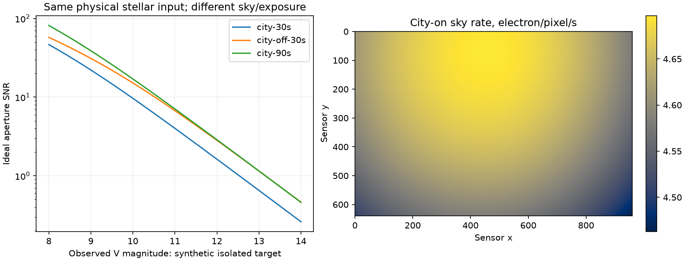

# Камера 0.9: физический кадр в KStars
> Дата создания: 2026-11-12

По поручению пользователя камера реализована сразу в существующей нативной
панели KStars, с повторным использованием его каталогов, FITS Viewer и
описаний камер Ekos. Расчётный результат — монохромный линейный FITS с
компонентами, шумом и насыщением. Изображения ниже — численная симуляция,
не фотография и не подтверждение точности конкретной коммерческой камеры.

## 1. Что реализовано и что уже существовало

| Слой | Действующая реализация 0.9 |
|---|---|
| Общая световая сцена | Прежний спектральный перенос городского света, DSM и ближние площадки, естественный/лунный/сумеречный компоненты с их областями применимости. C не перенастроен под камеру. |
| Камера | Потоки фотонов, эффективная апертура, пиксельные телесные углы/PSF, электроны, Poisson и Gaussian RN, dark, full well, g, bias и АЦП. Eye threshold не применяется. |
| Каталог KStars | StarComponent/DeepStarComponent, JIT-астрометрия, V/B−V, горизонтальные направления в UTC снимка. Используются установленные данные; полнота не предполагается. |
| Просмотр | Настоящий класс FITS Viewer KStars, сигнал loaded и реальное Qt-окно; его штатные stretch/zoom/гистограмма. |
| Данные камеры Ekos | Чтение существующего XML v1: pitch и RN для mode/gain; peak QE сохраняется подсказкой. Оставшиеся параметры явно сценарные. |
| Калькулятор Ekos | Тот же критерий read-noise penalty. Наш camera-ekos.json добавляет физическую пространственную b и отдельную границу насыщения. |
| INDI | Существующие sky-glow/шумы/дефекты исследованы. Драйвер и оборудование не изменены. |

Нативная панель имеет выключатель камеры, выдержку, фокусное расстояние,
диаметр апертуры, импорт/экспорт JSON и частичный XML-импорт. Место, UTC и
центр берутся из KStars. Web — дополнительный клиент общего ядра.



Проверенная сборка — Qt5/KStars3.6.2 с CFITSIO, без INDI device control.
В ней ещё нет Exposure Calculator. Условная кнопка штатного диалога новых
версий использует V-прокси/f-ratio/ID и честно подписана «не SQM»; эта ветвь
не проверена на Qt6. Автоматической передачи спектральной карты в Capture,
изменения очереди или публикации upstream KDE не выполнено.

## 2. Теория → проблема → решение

### Теория

Энергия фотона E=hc/λ. Для Lλ в Вт/(м²·ср·нм), QE/T безразмерных,
площади A в м², Ω пикселя в ср и t в с:

```text
μ_sky,p = t A τ cosθp Ωp ∫Lλ(ωp) T QE λ_m/(hc) dλ_nm
μ_star,p = t A τ cosθstar ∫Fλ T QE λ_m/(hc) dλ_nm × Pp
Σ_all_pixels Pp = 1; обрезка границей не перенормирует звезду.
μ = μ_star + μ_sky + t I_dark
Q ~ Poisson(μ); ε_read ~ Normal(0,RN²)
ADU = clip(round((min(Q,full_well)+ε_read)/g+bias))
Var_e = μ+RN²                 до насыщения/квантования
```

Нормированная Gaussian PSF задаётся эффективным угловым FWHM; интегралы
считаются по пикселям с локальным якобианом проекции. Косинус проекции
входного зрачка вместе с точным Ω даёт естественное падение порядка cos⁴θ.
g означает e⁻/ADU; регулятор gain/ISO не определяет его автоматически.
Основание шумовой части — EMVA1288 Linear4.0 §§2.1–2.4, а не произвольное
добавление белых точек. Полная сертификация EMVA не реализована.

### Проблема

Единственный V-интеграл естественного/лунного фона не определяет число
электронов произвольной камеры. Peak QE из XML не задаёт QE(λ), а красивый
JPEG не заменяет RAW. Полный спектр местного естественного неба неизвестен.

### Решение и основания

Основной профиль намеренно идеальный: QE(λ) пропорциональна RV(λ)/λ,
так что QE λ/(hc)=kV RV. Поэтому электронный отклик V-остатка точен
для **объявленного математического сенсора**, без придуманного природного
спектра. Это не утверждение о точности света исходной атмосферной модели.
Для реальной табличной QE/T нужен остаточный спектр; иначе вывод недоступен.
Можно явно выбрать flat-energy V-нормированный сценарий, но не измерение.
Пяти­нанометровая сетка не поддерживает узкие полосы менее20нм эффективной ширины.

Все единицы, допущения, PSF, геометрия, WCS и форматы:
[формальная модель](../../docs/CAMERA_MODEL.md).
Объяснение с основ: [главы32–33](../../docs/PHYSICS_AND_MATH_GUIDE.md#32-камера-от-энергии-фотона-до-числа-в-fits).
Файлы, URL, ревизии, хеши и права: [source-audit.json](source-audit.json).

## 3. Замороженная сцена и честный статус входов

| Параметр | Значение |
|---|---|
| Наблюдатель | 60,3°N; 30,315°E; 2м AGL; 61,4403м MSL в сферическом приближении EGM2008 DSM |
| Время | 2026-11-11T21:00:00Z — середина экспозиции; прежняя сцена для сравнения, не «фото сегодня» |
| Поле | Зенит, az0°/alt90°/rotation0°; 960×640 квадратных пикселей |
| Оптика | f=16мм, D=8мм, f/2; τ=0,8; FWHM=100″ — эффективный сценарий, не измеренный seeing |
| Сенсор | p=3,76мкм; g=0,8e⁻/ADU; RN=3e⁻; dark=0,02e⁻/с; full well20 000e⁻; 16bit; bias500ADU |
| Отклик | ideal-V-detector-1; V energy-matched; peak QE0,65; не торговая камера |
| Источники | Прежние NASA VNP46A4.002 за2025 год, LED-B3; новые месячные/снеговые данные не добавлялись |
| Среда | Прежние Copernicus GLO-90 DSM и конечные ближние площадки; AOD0,1, SSA0,9, g_aerosol0,8; ясная погода, snow0 |
| Абсолютный масштаб | C=44897606336985,7 — прежний сценарный якорь, не новая независимая полевая калибровка |
| Отображение PNG | black500, white6000ADU; asinh10 и один sRGB; одинаково для трёх кадров |

Физический ввод с таблицей каталога и узлами поля сохранён в
[camera-input.json](camera-input.json). Его достаточно для повторения сенсора
без NASA, токена, DSM или запущенного KStars. Это повтор преобразования
сохранённого света; для нового места нужно заново вычислить атмосферную сцену.

Получены311 записей KStars;267/311 слабееV=6,5. До сенсора проходят192 записи
с учётом PSF у края,188/311 центров находятся в поле. Старый BSC в том же
поле содержит26 центров. Установленный каталог фактически доV=8 при запросе
до12: слабые звёзды глубже него на изображении отсутствуют из-за данных,
а не решения физического порога. У всех311 отсутствует B−V;188/188 записей
в поле используют явно помеченный эффективный550нм V-прокси экстинкции.

Аудит нашёл3 пары записей ближе10″. ID/точное координатное устранение
повторов не заменяет межкаталожную астрометрическую сверку: пары могут быть
дублями или кратными системами, поэтому сохранены без неподтверждённого
слияния. Числа относятся к каталожным записям, а их возможное наложение
остаётся ограничением звёздной фотометрии. [Полный аудит](catalogue-audit.json).

## 4. Контроли: засветка и выдержка

Три кадра используют одни звёздные потоки, атмосферу и C. City-off —
контрфактическое обнуление рассчитанного городского компонента при сохранении
прочего фона. Это не фотография другой деревни и не повторная подгонка C.
В90с все математические ожидания ровно втрое больше30с; seed другой.

| Сценарий | Фон min/median/max, e⁻/pixel | Full well, pixels/614400 | ADC overflow |
|---|---|---|---|
| Город,30с | 133,884 /139,055 /140,907 | 7/614400 | 0/614400 |
| Город выключен,30с | 36,390 /37,241 /37,606 | 7/614400 | 0/614400 |
| Город,90с | 401,653 /417,165 /422,722 | 28/614400 | 0/614400 |



Медианный фон уменьшается в3,73 раза при выключении города. Звёздные потоки
при этом не исчезают; улучшается SNR. Изменение растяжения могло бы визуально
скрыть эффект, поэтому параметры PNG одинаковые. [City-off PNG](city-off-30s/camera-preview.png),
[90с PNG](city-90s/camera-preview.png), [все числа](case-summary.json).



Кривые SNR — синтетические цели заданной **наблюдаемой** V-величины,
не дополнительные найденные звёзды. Для них нет второй атмосферной
экстинкции. Простая апертура, известный средний фон, без blending/фонового
кольца: это контроль формулы, не вероятность обнаружения реального объекта.

## 5. Экспозиция: уже известный критерий Ekos и новый пространственный фон

Для допуска ε=5% штатный критерий добавки RN:

```text
sqrt((b t+RN²)/(b t)) ≤1+ε
t_min = RN²/[b((1+ε)²−1)]
```

Наша b_min/median/max=4,4628/4,6352/4,6969e⁻/(pixel·s). Нижняя граница
по всему полю19,6748с; оценка до90% меньшего из full well/ADC capacity
по ярчайшему пикселю12,1557с. Границы несовместимы;30с уже насыщает часть
звёзд. Это осмысленный конфликт целей. Дополнительная засветка не улучшает
снимок: она лишь быстрее делает RN малой долей более сильного шума неба.

Скорости/границы и флаги:
[camera-ekos.json](city-30s/camera-ekos.json).
Реальный XML Atik проверен отдельно: pitch6мкм и RN9e⁻ при mode0/gain0;
остальные параметры не получены из него. [Частичный импорт](ekos-import-example.json)
не использован как измеренный профиль Atik для показанного кадра.

## 6. FITS и численная проверка

Primary — uint16 ADU, EXPTIME, g/RN/dark/fullwell/seed, SIMULATE,
DATE-OBS начала и DATE-AVG середины в UTC, ICRS TAN WCS. Расширения:
MEAN_E, SKY_E, CITY_E, OTHER_E, STAR_E, DARK_E, VAR_E2, OMEGA_SR, MASK.
Все ожидаемые карты/дисперсия до clipping; VAR_E2 не включает произвольно
добавленное g²/12. Научные неподдерживаемые пиксели NaN, MASK0. В данном
зенитном поле поддержаны614400/614400 пикселей.

- Итоговый pytest:292/292,98,19с; отдельный камера-набор25/25.
- Нативная проверка:2/2 задания, geometry/UTC/stale/AGL–MSL и FITS loaded.
- Chromium:1/1 задание,6/6 экспортов, профиль/scene/ZIP, JS-ошибок0,
  ширина390px без горизонтального переполнения.
- Установленный wheel вне checkout:90/90 файлов совпали,6/6 экспортов,
  офлайн320×240 и10/10 FITS CHECKSUM.
- Основной FITS:10/10 CHECKSUM,614400/614400 primary ADU воспроизведены
  из замороженного ввода;8/8 научных карт имеют только float32-округление,
  максимум относительной ошибки менее6·10⁻⁸.
- WCS:5/5 контрольных пикселей, max0,189959″ при пороге1″. Это местная
  TAN-аппроксимация, не plate solve и не доказательство наблюдательной точности.
- Monte Carlo200000 пикселей: ожидание121e⁻, дисперсия146e⁻²;
  измеренная дисперсия145,960895 при g1. Проверены экспозиционное
  масштабирование, фотонная нормировка PSF, gain и cos⁴-зависимость.

Первый физический расчёт занял405,61с и превысил прежний300с тайм-аут
проверки; backend закончил его успешно. Тайм-аут теста теперь900с.
Первый прогретый зенитный расчёт16,47с; итоговое повторение при одновременных
проверках20,82с, юг45°15,86с, без новых transfer misses. Это рабочие времена
данной машины, не гарантия интерактивного нового направления.

Проверки: [qa.json](qa.json), [численная](numerical-verification.json),
[нативная](native/native-verification.json), [browser](browser/verification.json),
[wheel](wheel-verification.json), [pytest](test-results.txt),
[задания](job-evidence.json), [код](source-code.json), [хеши](manifest.json).

## 7. Воспроизведение и следующие изменения

```bash
uv sync --locked
uv run python scripts/run_camera_case.py --render-saved \
  --output scratch/camera-replay \
  --workspace scratch/camera-replay-exports
uv run python scripts/validate_camera.py --output scratch/camera-replay
```

Новый расчёт внутри KStars требует пересборки нативного модуля и локального
backend; [инструкция](../../integrations/kstars/README.md).
Настройки пользователя и реальная камера проверкой не изменялись.

Первая область ограничена монохромным сенсором, квадратными пикселями,
f/≥1, полем≤60°,≤2MP, экспозицией≤120с и экваториальным ведением.
Атмосфера/горизонт заморожены на середину. Нет RGB/CFA/баланса белого,
вращения поля/треков, диффузных DSO/Млечного Пути, рефракции, оптических
бликов прямой Луны/фонарей, PRNU/DSNU и коррелированного шума.
Перечисленное нельзя восстановить увеличением выдержки или ISO.

Дальнейший обоснованный порядок:

- Реальный профиль монохромной камеры: QE/T, g/RN/fullwell, dark(T),
  bias/dark/flat, измеренная PSF и оптика; затем проверка той же сцены на RAW.
- Глубокий установленный каталог, cross-ID и собственные движения;
  проверка звёздных потоков и недостающих DSO/диффузного света.
- Измеренный/обоснованный остаточный спектр неба; RGB/CFA/канальные
  шумы и фильтры после проверки монохромной фотометрии.
- Сборка и UI-проверка современного Qt6/Ekos, затем отдельный явный
  контракт электронного фона для планирования Capture/INDI.
- Временной интеграл неба/позы, вращение/треки и оптические блики
  по измеряемым параметрам, не по фотографическим впечатлениям.

**Новых реальных RAW:0; независимая точность камеры не установлена.**
Формальный вывод и численные тесты доказывают согласованность реализации
заявленной модели, а не её полное совпадение с реальным небом/сенсором.
