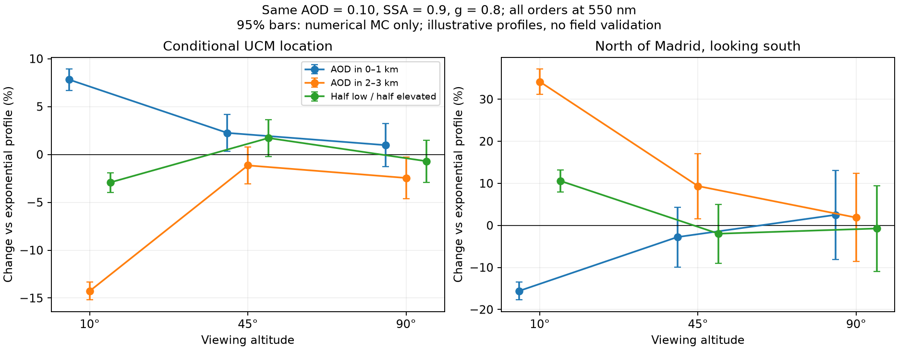

# Городская засветка: угловая диаграмма и вертикальный аэрозоль

Я исследовал, как лучше определять диаграмму города и отделять её от
атмосферы. Три предложенные работы рассматриваю вместе с дополнительными
публикациями и собственным контролируемым расчётом всех порядков.
Этот отчёт содержит источники, численные результаты и ограничения;
формулы остаются в [THEORY](../../THEORY.md), устройство моделей —
в [MODELS](../../MODELS.md), каталог идей — в [LIMITS](../../LIMITS.md#11-каталог-идей-по-улучшаемому-эффекту).

## 1. Результат и статус

Я считаю вертикальный профиль аэрозоля существенным входом для городской
засветки. В собственных сценариях при одинаковой AOD0,10 его изменение
дало от−15,58% до+34,17% искусственного фона. Знак зависит от положения
наблюдателя и направления взгляда. Это чувствительность к предположению,
а не измеренное улучшение точности реального неба.

Пользователь согласовал переход продукта на многократное рассеяние и
постоянную радиансность OffNadir на60–90° от местного зенита испускания.
Я зафиксировал решение и сравнил два прочтения функции на0–60°:
прежнюю подобранную смесь и эмпирическую интерполяцию NASA.
Основной Planner/KStars в этой работе **ещё не переключён**: выбор
функции на0–60° уточняется; производственная спектральная/DSM-интеграция
также не равна уже проверенному серому исследовательскому переносу.
Я не объявляю исследовательскую проверку завершённым выпуском продукта.

## 2. Что означает выбранное продолжение к горизонту

Все углы этого раздела относятся к направлению выхода света из городской
ячейки, а не к высоте взгляда наблюдателя. NearNadir означает0–20° от
зенита ячейки; OffNadir —40–60°. Для60–90° я использую постоянную
**радиансность** OffNadir. Интенсивность площадки всё равно содержит
проекционный множитель: постоянная радиансность не означает постоянную
интенсивность при скользящем выходе света.

Сравниваемые варианты:

- **Эмпирический:** NearNadir на0–20°, интерполяция по косинусу на20–40°,
  OffNadir на40–90°. Эта функция непрерывна.
- **Смесь:** прежняя ламбертовская/низкоугловая интенсивностная смесь,
  переведённая в радиансность и привязанная к NearNadir на0–60°;
  после60° — локальный OffNadir. Коэффициент η — ранее рассчитанная
  региональная величина; в обсуждении он также назван ν.

Смесь подогнана к среднему диапазона40–60°, поэтому значение прямо у60°
в общем случае выше этого среднего. Переход на постоянный OffNadir
создаёт конечный скачок. Это допустимая заданная граница, но я не
сглаживаю её без изменения постановки. Региональная η также не описывает
все локальные отношения пикселей; отрицательные/несовместимые локальные
подборы нельзя обрезать и назвать измерениями.

Для общей маски прежнего исследования я получил следующие аналитические
интегралы именно для ограниченной смеси. Значения сохранены в
[protocol.json](protocol.json), интегралы независимо проверены квадратурой.

| Набор | η / ν смеси | Off/Near по суммам радиансность×площадь | Полная восходящая мощность относительно Near-Lambert | Доля мощности ниже25° над горизонтом |
|---|---|---|---|---|
| Мадрид, март2017 | 0,47666 | 1,09141 | 1,05131 | 18,54% |
| Мадрид, ноябрь2017 | 0,63350 | 1,17348 | 1,09738 | 19,10% |
| Петербург, год2025 | 0,43443 | 1,07709 | 1,04327 | 18,44% |
| Саар, год2014 | 0,69369 | 1,22729 | 1,12758 | 19,44% |

Я не называю η физической долей низкоугловой мощности после изменения
хвоста. Для сравнения с другими работами вычисляю интегральную долю ξ
для одинакового диапазона высот. Например, мартовская η0,47666 не
означает, что47,7% света уходит ниже25°: в выбранной ограниченной функции
это18,54%. Общую мощность между вариантами не перенормирую заново.

Прямо перед60° смесь превышает OffNadir в1,177 раза для мартовского
Мадрида, в1,312 для ноябрьского, в1,151 для Петербурга и в1,391 для Саара.
Это отдельный эффект выбранного сопряжения функций, а не ошибка Монте-Карло.

## 3. Три предложенные работы

### Drone photometry enables characterization of upward emission patterns of light-pollution sources, 2026

В [работе Kocifaj/Wallner](https://doi.org/10.1093/mnras/stag547) излучение
источника восстанавливают по разности зенитной яркости на земле и на
высоте над тем же местом. Метод выделяет нижний слой и уменьшает зависимость
от атмосферы выше дрона; ядро переноса нижнего слоя всё равно требуется.
Нужны согласованные измерения вдоль трассы и стабильные условия.

Я беру из неё способ независимой проверки почти горизонтального хвоста,
а не готовый коэффициент для нашего города. В статье проверка численная;
я не нашёл опубликованного набора полевых дроновых измерений для прямого
импорта. Примерный геометрический масштаб: при высоте200м угол85° требует
расстояния около2,3км. Приведённые авторами высоты порядка140–220м относятся
к исследованным сочетаниям расстояний и аэрозолей, а не гарантии для любой
ночи. Вычитание близких сигналов дополнительно требует контроля ошибок
и взаимной калибровки приборов.

### Satellite Imagery Reveals Near-Horizon Urban Light Emissions Impacting Ambient Environment, 2025

В [работе Kocifaj/Kómar](https://doi.org/10.1029/2025JD045452) используют
асимметрию рассеянного ореола с ближней и дальней стороны города при
косом спутниковом наблюдении. Отношение ореолов сопоставляют с переносом,
а не напрямую объявляют долей горизонтального света. Результат зависит
от AOD, фазовой функции и высотного распределения аэрозоля.

Я беру метод дополнительного ограничения хвоста60–90°, поскольку прямые
ракурсы не измеряют его. Для семи случаев четырёх городов авторы получили
доли потока ниже25° над горизонтом0,16–0,62; это результаты их инверсии,
а не допустимый интервал нашего Мадрида. Нужны отдельные TOA/SDR-наблюдения,
геолокация, облака/Луна и атмосфера того же пролёта. Авторы исключают
месячные композиты. Поэтому наши уже скорректированные A3/A4 нельзя
просто подставить вместо их ореолов и повторно снять атмосферное ослабление.

### The new world atlas of artificial night sky brightness, 2016

В [Falchi et al.](https://pmc.ncbi.nlm.nih.gov/articles/PMC4928945/) среднюю
угловую функцию подбирают как комбинацию трёх форм по наземной фотометрии.
Авторы прямо предупреждают, что подобранная функция может компенсировать
ошибку принятой прозрачности. После отбора описаны20865 SQM-наблюдений,
сведённых весами к10441 эффективному наблюдению; независимые CCD-наборы
проверяют отдельно.

Я беру многокомпонентный базис и раздельную калибровку/проверку. Этого
недостаточно для восстановления нескольких коэффициентов из двух наших
угловых средних без дополнительных ограничений. Готовые коэффициенты
атласа я не переношу: это средний результат для другого периода,
спутниковой обработки и стандартной атмосферы. Полезна и практика учёта
естественного света, времени наблюдения и неравноценности повторов за
одну ночь. Получить хорошее совпадение одного зенита недостаточно для
проверки угловой формы всего купола.

## 4. Дополнительные материалы: что именно использовать

| Материал | Что я могу взять | Что требуется проверить |
|---|---|---|
| [Kocifaj/Solano Lamphar2016, критика CEF](https://doi.org/10.1088/1538-3873/128/970/124001) | Различие интенсивности и радиансности при задании границы; контроль поведения у горизонта | Форму не следует переносить между этими величинами без проекции; доступен авторский аннотационный текст, полный издательский PDF не получен |
| [Kocifaj2017, инверсия CEF](https://doi.org/10.1364/OPTICA.4.000255) | Восстановление угловой функции по направленным измерениям неба | Нужны измерения с известной средой; библиотека ν из статьи не предоставлена |
| [Kocifaj et al.2019, PNAS](https://pmc.ncbi.nlm.nih.gov/articles/PMC6475415/) | Регуляризованная инверсия, проверка на синтетических данных и полевой случай Los Mochis | Нужны аэрозольные свойства и преимущественно один доминирующий город; сгущение углов само не увеличивает независимую информацию |
| [Espey2021](https://www.mdpi.com/2072-4292/13/19/3827) | Сборка CEF из инвентаря фонарей, фотометрии и метрового DSM | Наш DSM90м не заменяет геометрию улиц; общественное освещение не равно всем источникам города |
| [Espey/Yan/Patrascu2023](https://www.mdpi.com/2072-4292/15/12/2973) | Классы городской ткани, азимут улиц, сезонное экранирование; сравнение с VIIRS и калиброванными снимками МКС | Основа исследования — в основном натриевое общественное освещение2015–2017; перенос на современную смесь требует спектрального контроля |
| [Petržala2023, вертикальные профили](https://doi.org/10.1016/j.jqsrt.2023.108676) | Сравнение экспоненты, перемешанного пограничного слоя и поднятого аэрозоля | Доступные аннотация/разделы указывают изменения порядка десятков процентов; чисел этой статьи я не выдаю за результат нашего кода |
| [Kocifaj/Bará2021, дифференциальная фотометрия](https://arxiv.org/abs/2011.03441) | Измерения с разных высот как ограничение оптической толщины нижнего слоя | Нужны совместимые приборы, геометрия и общий оптический столб; одно фото с земли не задаёт профиль |
| [Kocifaj/Falchi2025, облачные состояния](https://doi.org/10.1093/mnrasl/slaf083) | Облачная засветка как отдельная задача с коэффициентами распространения | Облачность не заменяет ясный аэрозольный профиль; перенос одного облачного множителя на все города не обоснован |

В работе2023 года опубликован перечень дополнительных Python/R-скриптов
и CSV фотометрии; актуальный полный код авторы предлагают запрашивать.
Скачивание приложения с издательского URL у меня завершилось HTTP403,
поэтому я не заявляю, что импортировал эти таблицы или проверил их код.
Чужие изображения, закрытые данные инвентаря и статьи в репозиторий не включены.
Статусы доступа перечислены в [source-audit.json](source-audit.json).

## 5. Вертикальная структура: где появляется физическая разница

Наша существующая атмосфера уже стратифицирована: молекулы и аэрозоли
имеют разные экспоненциальные масштабы. Разбить те же экспоненты на100
численных слоёв означает проверить дискретизацию; новых измерений и
более подходящей реальной атмосферы от этого не появится.

Физически другой профиль получается, когда при той же общей AOD меняется
положение аэрозоля. Почти горизонтальный городской свет проходит через
одни высоты гораздо дольше, чем через другие. Одновременно меняются
места рассеяния и ослабление света до них и после них. Поэтому даже знак
изменения яркости нельзя назначить одним правилом «больше аэрозоля — ярче».

Простой аналитический пример, отдельно от сферического расчёта: при
AOD0,10 на550нм экспонента H=1200м имеет экстинкцию у земли8,33×10⁻⁵м⁻¹.
На условном прямом горизонтальном пути50км на высоте100м аэрозольная
передача равна примерно0,0216. Для всей AOD в равномерном слое0–1000м
она0,00674; при всей AOD в2–3км аэрозольная часть передачи этого пути1.
Молекулярное ослабление остаётся отдельным. Это иллюстрация разных
передач, а не предсказание яркости неба и не плоская замена нашего решателя.

## 6. Собственный опыт всех порядков

Я использовал мартовскую карту Мадрида и общую маску467904 ячеек
март/ноябрь из предыдущего исследования. Хеши исходных NPZ, маски и
рассчитывающего кода проверены. Ничего нового NASA не скачивал.
Два условных наблюдателя находятся в20м над общей сферой: у координат
UCM40,451111°N,−3,726111°E и севернее40,85°N,−3,726111°E.
Это не восстановленные высоты станции над уровнем моря.

Смотрю на юг на высотах10°,45°,90°. Сравниваю четыре среды:

- существующая экспонента H=1200м;
- вся аэрозольная AOD в0–1000м;
- вся AOD в2000–3000м;
- половина AOD в каждом из этих двух слоёв.

Общие AOD0,10, SSA0,9, HG g0,8 и молекулярный профиль фиксированы.
Слой2–3км со всей AOD — намеренно сильный сценарий чувствительности,
а не утверждение о реальной атмосфере Мадрида. Спектральный перенос
здесь заменён одним550нм; DNB остаётся пространственным прокси.
DSM, облака, Луна, природный фон и повторные отражения земли отключены.

Получены24/24 сцены по524288 полных траекторий: **12582912 путей,
72 оценки вариантов**. Три угловых варианта используют одни пути внутри
случая. Для разных атмосферных профилей использую независимые seed.
Масштаб источников между вариантами не подгоняю. Прерывания по порядку
нет; максимальный встреченный порядок13 не является физическим пределом.

В таблице — ограниченная смесь на0–60° с OffNadir на60–90°.
Проценты считаю относительно экспоненты для той же точки и высоты взгляда.
После ± указан приблизительный95% интервал только численной выборки,
в процентных пунктах; атмосферные неопределённости в него не входят.

| Место / высота взгляда | Аэрозоль0–1км | Аэрозоль2–3км | Половина в каждом слое |
|---|---|---|---|
| UCM /10° | +7,81% ±1,12п.п. | −14,27% ±0,93п.п. | −2,92% ±1,03п.п. |
| UCM /45° | +2,25% ±1,91п.п. | −1,15% ±1,91п.п. | +1,71% ±1,92п.п. |
| UCM /90° | +0,97% ±2,25п.п. | −2,46% ±2,18п.п. | −0,71% ±2,21п.п. |
| Север /10° | −15,58% ±2,15п.п. | +34,17% ±3,03п.п. | +10,58% ±2,64п.п. |
| Север /45° | −2,78% ±7,13п.п. | +9,34% ±7,73п.п. | −1,98% ±7,00п.п. |
| Север /90° | +2,50% ±10,61п.п. | +1,85% ±10,47п.п. | −0,75% ±10,17п.п. |



На низком взгляде севернее города изменения уверенно различаются в
пределах этого численного опыта. Малые сдвиги северного зенита существенно
меньше соответствующей погрешности; я не делаю из них вывод о выигрыше
одного профиля. Точность к реальной ночи можно проверить только новым
наблюдением с известным профилем и совместимыми источниками.

### Что меняет толкование ν на0–60°

В той же мартовской карте и экспоненциальной атмосфере ограниченная смесь
относительно эмпирической формы дала на северной точке:

- взгляд10°: **+0,28% ±0,25п.п.**;
- взгляд45°: **−3,34% ±0,91п.п.**;
- зенит: **−5,35% ±1,34п.п.**.

Это парные приблизительные95% интервалы Монте-Карло. В точке UCM
на тех же высотах получилось+1,42%,+2,47%,+2,67% соответственно.
Таким образом, даже при одинаковом хвосте60–90° две функции на0–60°
не эквивалентны. Числа позволяют выбрать конкретную реализацию для
производственного переноса, не смешивая её с прежней неограниченной η.

## 7. Как лучше подбирать диаграмму

Я предлагаю следующий порядок исследования:

1. Сохранить выбранный постоянный OffNadir-хвост как явно помеченный
   исходный сценарий. Проверять его с альтернативами отдельно;
   изменение ν внутри0–60° не восстанавливает неизвестный хвост.
2. Получить суточные наблюдения с настоящими углами/азимутами, временем
   и QA. У опубликованных категорий A3/A4 нет весов каждого ракурса;
   равномерность внутри диапазона остаётся нашим предположением.
3. Отдельно проверить азимутальные эффекты и городской класс. Соседние
   кварталы могут иметь похожую диаграмму; высотная застройка или улицы
   определённого направления способны нарушить общую возрастающую смесь.
4. Получить совместимый ночной атмосферный столб и профиль. В инверсии
   проверять ν вместе с AOD, высотой нижнего слоя, g/SSA и спектром,
   сохраняя их независимые измерительные ограничения.
5. Начать с малого числа неотрицательных ограниченных угловых компонент.
   Сложность увеличивать лишь при независимой информации. Два средних
   NASA не идентифицируют произвольную функцию из десятков угловых узлов.
6. Проверить процедуру на синтетических случаях с известной диаграммой,
   затем на новых ночах и местах. Отдельно сохранить статистику остатка,
   формы купола, цвета и переносимости масштаба. Ноябрь2017 уже знаком
   разработке и не становится новым слепым контролем.

Разделять нужно численную погрешность, ошибку исходных данных и ошибку
самой модели. Удачный fit одного направления может скрыть неверную ν
за ошибочным атмосферным профилем или перенастроенным C.

## 8. Где брать более подходящую атмосферу

- [ACTRIS/EARLINET](https://earlinet.eu/our-knowledge/access-to-data/)
  предоставляет профили аэрозольных оптических свойств и ошибок,
  включая экстинкцию для подходящих Raman-измерений. Я буду проверять
  совпадение места/времени, нижнюю область перекрытия и высоты MSL/AGL.
  Одно обратное рассеяние не равно экстинкции без lidar ratio.
- [CAMS reanalysis](https://www.ecmwf.int/en/research/climate-reanalysis/cams-reanalysis)
  даёт трёхмерные поля с60 модельными уровнями, но характерная
  горизонтальная сетка около80км. Это возможное ограничение фоновой
  структуры, а не измеренная городская дымка каждого квартала.
- [AERONET lunar AOD2026](https://amt.copernicus.org/articles/19/6487/2026/)
  расширяет ночное наблюдение столба. Нужны пригодные фаза и положение
  Луны; поэтому он не гарантирует одновременно вход для строго
  безлунной фотографии. Сам AOD всё ещё не задаёт распределение по высоте.

Параметры аэрозоля следует согласовывать со спектром: влажность меняет
оптические свойства частиц, а одинаковый g не задаёт полностью одинаковую
фазовую функцию. Для первого проверяемого расширения я предпочёл бы
2–3 измерительно ограниченных слоя множеству свободно подгоняемых слоёв.
Горизонтальная городская неоднородность остаётся отдельным приближением.

## 9. Проверки, стоимость и воспроизведение

Численный контроль прошёл **296/296**: хеши кода, состав24 сцен,
сохранение524288 исходов в каждом случае, суммы по порядкам и углам,
границы вкладов, ковариации, маски и отсутствие обрезания порядков.
Минимальное эффективное число вкладов681,54; приближённые нормальные
интервалы разрешены для72/72 оценок. Это диагностический фильтр,
не доказательство точного95% покрытия или физической достоверности.

Основная серия заняла182,38с внутри интеграторов; максимальный RSS
процесса183,34МиБ. Эти числа не включают загрузку карт, поиск литературы,
отрисовку и проверки. До окончательной серии выполнен предварительный
прогон тех же24 геометрий на общем seed; он помог выбрать независимые
seed для межпрофильной статистики. Ещё один первоначальный запуск
остановился на проверке конфигурации до трассировки. Финальные таблицы
используют только закреплённую серию из protocol.json.

Первый запуск целевых тестов:47/50, три ошибки в проверке новой
исследовательской конфигурации; базовый валидатор получал структурированные
слои вместо только скалярных параметров. Я исправил передачу базовых полей.
Затем50/50 прошли за6,83с. Полный набор прошёл **390/390 за103,02с**,
без ошибок и пропусков. `uv lock --check` пройден,52 пакета.
Итог полного набора и проверки lock сохраняю в
[test-verification.json](test-verification.json).

Новых измеренных профилей: **0**. Новых независимых наземных ночей: **0**.
Сертифицированной ошибки городской модели к реальному миру: **нет**.

Воспроизведение на уже закреплённых локальных NASA-картах:

```bash
uv run python scripts/study_city_emission_atmosphere.py
uv run python scripts/summarize_city_emission.py
uv run pytest -q -p no:cacheprovider
uv lock --check
```

Результаты: [summary.json](summary.json),
[профили и все угловые варианты CSV](profile-comparisons.csv),
[протокол](protocol.json), [численный QA](integrity-verification.json).
Рабочие HDF5/NPZ, сторонние статьи и секреты не добавляются в Git.
