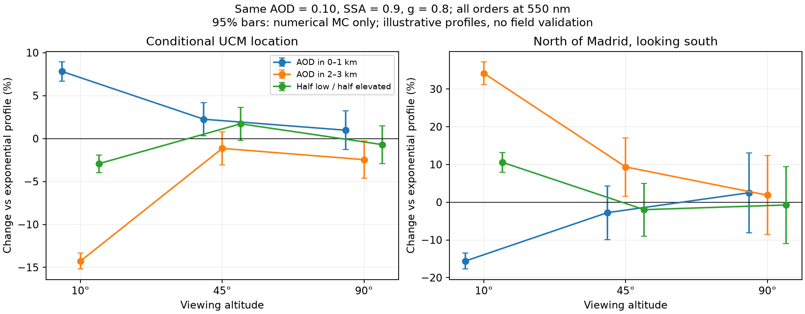

# Низкоугловой свет в LightPollution

Продолжение обзора городской диаграммы. Я рассматриваю три способа узнать, куда город испускает свет, затем разбираю форму видимого купола и оцениваю, стоит ли учитывать типы далёких кварталов.

**Мой вывод.** Для спутникового ореола я бы проверял диапазон допустимых долей низкоуглового света по каждому пролёту. Из дроновой статьи уже можно взять схему численного эксперимента. Для далёких кварталов есть смысл проверить несколько общих диаграмм с компактными весами. Пользу такой детализации нужно измерить по форме купола на независимых наблюдениях.

Здесь и далее **угол испускания** отсчитываю у источника, **высоту взгляда** — у наземного наблюдателя. Например, свет на 5° над горизонтом города может рассеяться в атмосферу и прийти к наблюдателю с высоты 45°. Зенитный угол спутника описывает ещё одну геометрию. Доля ξ₂₅ — мощность, выходящая в пределах 25° над горизонтом источника, делённая на всю его восходящую мощность.

## 1. Спутниковый ореол. Насколько точны результаты?

Kocifaj и Kómar берут ночной снимок VIIRS с косого пролёта. За пределами яркой части города атмосфера видна как слабый ореол. Авторы измеряют его радиансность на сопоставимых расстояниях от ближней и дальней границ города и строят профиль отношения R₁/R₂. Косая геометрия даёт разные траектории и углы рассеяния с двух сторон. При заданных атмосфере и семействе диаграмм модель предсказывает, как отношение изменится при другой ξ₂₅. Затем этот расчёт обращают по измерениям. Входом служат геопривязанные VIIRS DNB SDR отдельного пролёта. [Статья Kocifaj и Kómar, §§2–4](https://agupubs.onlinelibrary.wiley.com/doi/10.1029/2025JD045452)

В таблице 1 семь пролётов над четырьмя городами. Для Флагстаффа авторы получили 16% и 18%, для Эворы 24% и 28%, для Лас-Вегаса 52% и 56%, для Лос-Мочиса 62% по одному пролёту. Таблица даёт точечные оценки. В ней нет доверительных интервалов ξ₂₅ для отдельных пролётов. Разница между повторными пролётами включает геометрию, атмосферу и возможные изменения света. Поэтому 2–4 процентных пункта разброса внутри трёх городов полезны как проверка согласованности, но по ним нельзя назначить погрешность отдельного результата. [Таблица 1 и обсуждение](https://agupubs.onlinelibrary.wiley.com/doi/10.1029/2025JD045452)

| Источник погрешности | Что известно и что это означает |
|---|---|
| Слабый спутниковый сигнал | Авторы заканчивали профиль на уровне шума 0,3 нВт/(см²·ср). Это порог отбора. У слабой дальней стороны шум сильнее влияет на отношение, поскольку сигнал там в знаменателе. Близкие пиксели и остаточный фон могут давать общую ошибку. |
| Высота аэрозоля | В опыте авторов при изменении масштаба высоты с 1 до 4 км и угле спутника 45° отношение R₁/R₂ снижалось на 30% при ξ₂₅ = 0,40 и на 15% при ξ₂₅ = 0,65. При 60° авторы приводят около 40% и до 70% для приведённых ими сильного и слабого низкоуглового испускания. Это изменение отношения при фиксированной доле, в сценариях статьи. |
| Остальная атмосфера и геометрия | AOD задаёт оптическую толщину столба, параметр g описывает преимущественное рассеяние вперёд. Оба влияют на отношение. Косой пролёт различает диаграммы сильнее и может быть чувствительнее к атмосфере. Ошибка границы города, посёлки на линии профиля, дымка с одной стороны и остаточный свет Луны тоже смещают результат. |
| Вид диаграммы | Одинаковая ξ₂₅ допускает разное распределение света внутри диапазона. Концентрация у 5° и у 20° по-разному освещает воздух. Нужна проверка нескольких форм и азимутов, особенно у вытянутого города. |

**Как перевести шум в погрешность доли.** Учебный пример масштаба. Если две радиансности известны с независимой относительной стандартной неопределённостью по 5%, для их отношения получается около 7,1% по сложению дисперсий. При отношении 1,60 это около 0,11 в единицах отношения. Если *локально* в нашей модели +10 п.п. к ξ₂₅ дают +0,20 к отношению, одни эти измерительные ошибки дают около 5,7 п.п. неопределённости ξ₂₅. При более пологой кривой оценка хуже. Эти 5% и наклон выбраны для примера. Для реального пролёта фон и атмосферные ошибки надо оценить отдельно и учесть корреляцию двух сторон.

**Что я бы сделал с их результатами.** Сначала воспроизвёл бы один случай с сильным и один со слабым ореолом, например Лас-Вегас и Флагстафф из таблицы. Сохранил бы R₁ и R₂ по отдельности и сравнил профили на нескольких полосах вокруг линии авторов. Для каждого пролёта прогнал бы допустимые AOD, профиль, фазовую функцию, фон и границу города, а также пару форм почти горизонтального испускания. Тогда можно указать диапазон ξ₂₅, который согласуется с наблюдением. Если диапазоны перекрываются, вывод о разнице между городами остаётся открытым. Сами опубликованные значения годятся как ориентиры для сравнения. Озвучить точность этой инверсии для LightPollution сейчас нельзя без повторного анализа снимков и атмосферы.

У авторов есть эталонные материалы MSOS_LP1. Наш решатель считает яркость неба для поверхности Земли. Для воспроизведения первого метода ему нужна отдельная геометрия наблюдения сверху, включая отклик DNB и фон вокруг города. Месячные A3/A4 уже скорректированы и усреднены по времени. Они остаются входом для пространственного источника в нашем наземном расчёте. [Материалы авторов на Zenodo](https://zenodo.org/records/17164622) · [Руководство NASA Black Marble](https://landweb.modaps.eosdis.nasa.gov/data/userguide/BlackMarbleUserGuide_Collection2.0_20241203.pdf)

## 2. Дроновая фотометрия. Что можно сделать уже сейчас?

**Да, можно попробовать и модель авторов, и саму идею.** Kocifaj и Wallner предлагают одновременно смотреть в зенит двумя фотометрами на одной вертикали, у земли и на высоте H. Повторяют это на нескольких расстояниях D от источника. Вычитание яркостей выделяет чувствительность к нижнему слою. Для компактного источника угол испускания к верхней точке этого слоя примерно равен arctan(H/D) над горизонтом. При H = 200 м и D ≈ 2,3 км он составляет около 5°. Каждое измерение взвешивает диапазон углов, а не один луч. Авторы строят приближённое ядро однократного рассеяния. Оно связывает разности яркости на нескольких расстояниях с интенсивностью источника в нескольких угловых интервалах. Обратное решение даёт оценку этих интенсивностей. [Статья Kocifaj и Wallner, §§2–4](https://doi.org/10.1093/mnras/stag547)

Что можно перенести в LightPollution по шагам.

- **Воспроизвести формулу статьи для компактного источника.** Задать известную диаграмму и посчитать сигналы для нескольких D и H. Восстановить исходную диаграмму при той же геометрии. Это проверка проекции, нормировок и обращения. Ядро статьи выдаёт интенсивность источника. Для конечной горизонтальной площадки наш решатель использует радиансность и проекцию площади.
- **Сделать синтетические парные измерения нашим решателем всех порядков.** Посчитать зенит в нижней и верхней точках, затем взять разность. Сначала взять компактный источник, затем городскую карту с одним общим масштабом для нескольких допустимых диаграмм. Проверить, где разность различает хвосты и насколько однократная формула воспроизводит её при том же профиле. Для разности потребуется оценка совместной ошибки двух вычислений или оценка суммы дисперсий при независимых запусках.
- **Восстанавливать сперва один-два параметра.** Например, взять известные диапазоны Near/Off и оценить силу продолжения после 60° и, если хватает данных, наклон этого продолжения. Повторить на синтетических данных с шумом, разной атмосферой и разными опорными расстояниями. Чувствительность должна сохраняться на других точках трассы. Это проверит, действительно ли измерения добавляют информацию.
- **Полевой этап имеет смысл после проверки различимости.** Приборы сначала сравнить рядом на земле, затем синхронизировать и проверить наклон, поле зрения, спектральный отклик и стабильность освещения. Желательна трасса с доминирующим источником и независимой оценкой нижнего аэрозоля. Затем можно сопоставить расчёт с подходящими парами наземных и высотных измерений.

Разность особенно чувствительна к взаимной калибровке. Если в условных линейных единицах приборы дают 100 и 90, а их независимая относительная стандартная ошибка составляет по 5%, стандартная ошибка разности около 6,7 при сигнале 10. Это 67% разности. Общая мультипликативная ошибка действует иначе, чем относительное смещение приборов. В статье приводится абсолютная точность SQM порядка 0,10 mag/arcsec², около 10% в линейных единицах. Она сама по себе не задаёт точность взаимной калибровки. Высоты полёта и устойчивость метода в статье получены в численных экспериментах. Над сложным городом вклад верхних слоёв и нескольких порядков стоит проверять прямым парным расчётом. [Статья Kocifaj и Wallner](https://doi.org/10.1093/mnras/stag547)

## 3. Что конкретно даёт World Atlas

Falchi и соавторы строили глобальную карту искусственной яркости в зените. По одной спутниковой карте источников они сделали **три предсказания на земле**. Для первого предположили ламбертовское испускание, для второго усилили окологоризонтные направления, для третьего взяли пик на промежуточном угле. При фиксированной атмосфере складывали эти три расчётные карты с весами, подбирая согласие с наземными SQM. В сравнении учитывали естественный фон и время ночи. Много повторов в одной точке за ночь получали меньший суммарный вес. Отдельно проверяли согласие с CCD. [World Atlas, разделы Sky brightness data, Calibration, Consistency checks](https://arxiv.org/pdf/1609.01041)

**Зачем это нам.** Представим городскую станцию и загородную точку. Базовая форма отлично совпала с зенитом городской станции после выбора общего масштаба, но недооценила купол на загородной точке. Увеличение общей мощности поднимет обе оценки. Усиление почти горизонтального компонента может изменить их в разных пропорциях. Идея атласа даёт рабочий способ проверить именно это. Посчитать отклик неба на несколько заданных форм и сравнить, какая их комбинация одновременно объясняет городской и загородный фон. Для проверки углов я бы добавил несколько высот и азимутов и оставил отдельные ночи и места для контроля.

Атлас даёт **приём калибровки и сравнения**, а его собственная диаграмма годится как внешний пример для тестового расчёта. В первой статье эта диаграмма служит базой с ξ₂₅ ≈ 32%. Это значение относится к принятой там форме атласа. Подбирать местные веса стоит с независимо заданной атмосферой. Две угловые группы NASA ограничивают задачу, но оставляют свободу после 60°. Для проверки хвоста как раз пригодны ореол, высотные пары или направленная наземная фотометрия. [World Atlas](https://arxiv.org/pdf/1609.01041) · [Как его диаграмму использует спутниковая статья](https://agupubs.onlinelibrary.wiley.com/doi/10.1029/2025JD045452)

## 4. Что такое форма засветки и почему меняется купол

У города есть **диаграмма испускания** — свет, выходящий вверх в зависимости от угла и азимута. У наблюдателя есть **карта искусственной яркости неба** — яркость в зависимости от высоты взгляда и азимута. Форму видимого купола можно описывать положением максимума, шириной по азимуту, спадом от 10° к 45° и зениту, различием между направлением к городу и контрольным азимутом. Для сравнения с измерением важны линейные радиансности, полоса прибора и оценка естественного фона. Нормированный профиль помогает проверить форму отдельно от общей яркости.

Petržala в 2023 году сравнивал с помощью Монте-Карло экспоненциальный профиль аэрозольной экстинкции, пограничный слой и поднятый аэрозоль. Расчётные яркости по направлениям могли различаться на десятки процентов. Физически у луча два участка: путь от города до места рассеяния и путь от него к наблюдателю. Поднять аэрозоль — значит изменить освещение рассеивателей, углы поворота лучей и ослабление на обоих участках. Один и тот же вертикальный AOD допускает очень разные наклонные пути. Отсюда и разная форма купола при одной AOD. [Статья Petržala](https://www.sciencedirect.com/science/article/abs/pii/S0022407323001942)

В нашем опыте при взгляде на 10° и AOD 0,10 слой на 2–3 км дал около −14% в городской точке UCM и +34% севернее города, оба относительно экспоненциального профиля в той же точке. На части других направлений интервалы перекрывались. Это изменение *моделируемого неба* при смене атмосферы. Для сравнения с реальной ночью нужны измеренный профиль и совместимая фотометрия. [Наш опыт с вертикальными профилями](README.md)

Если под «статьёй о форме» имеется в виду работа Kocifaj и соавторов в PNAS, она решает обратную задачу. Авторы используют направленную яркость неба вокруг доминирующего источника, чтобы оценить диаграмму самого города. Близкие направления неба часто дают похожую информацию. Поэтому авторы ограничивают решение регуляризацией и показывают пример Лос-Мочиса. Для нас отсюда следует практический тест: построить меридиональные профили в сторону яркого города, добавить контрольные азимуты и проверить на синтетике, какие параметры вообще восстанавливаются при известной атмосфере. [Статья в PNAS](https://doi.org/10.1073/pnas.1900153116)

## 5. Имеет ли смысл различать далёкие кварталы?

**Да, я бы проверил типы кварталов для дальних источников.** Застройка действует прежде всего там, где свет выходит из квартала. Стены могут закрывать малые высоты поперёк улицы, а открытая площадка или направление вдоль улицы могут выпустить больше света. Дальше атмосфера переносит уже эту угловую картину. Большой город с разнонаправленными улицами может давать достаточно устойчивое среднее по азимуту. Вытянутый район, порт, промышленная площадка или длинная сетка параллельных улиц могут сохранить предпочтительное направление.

Espey, Yan и Patrascu (2023) рассчитали выход света из реального инвентаря уличных фонарей с учётом препятствий. Для исследованных мало- и среднеэтажных районов различия азимутально усреднённых кривых сильнее зависели от фотометрии фонарей, чем от экранирования. Для отдельной улицы получили смысл ориентация дороги и фотометрия светильника по азимуту. Это основание проверить несколько широких типов. По одной высоте зданий нельзя восстановить форму для фасадной подсветки, вывесок, окон или промышленного освещения. [Espey и соавторы, §§3–4](https://www.mdpi.com/2072-4292/15/12/2973)

### Как сжать данные с помощью линейности

При фиксированных атмосфере и геометрии перенос линейный по радиансности источника, включая многократное рассеяние. Для дальней ячейки можно хранить несколько весов и использовать общую библиотеку диаграмм. Пусть форма класса $f_k(\theta,\phi)$ нормирована на среднюю радиансность в NearNadir, а $a_{ik}$ — вклад класса $k$ в NearNadir ячейки $i$. Тогда

$$
L_i(\theta,\phi)=\sum_k a_{ik}\, f_k(\theta,\phi).
$$

Сумму весов калибрую по NearNadir. OffNadir проверяет среднее в другом диапазоне. Доли площади и доли радиансности различаются: малый яркий коммерческий участок может доминировать над большой жилой площадью. Если есть только грубая карта классов, начинать можно с долей площади как явно оговорённого приближения. Учитываю застройку один раз: шаблоны описывают свет, уже вышедший из квартала. Повторный коэффициент экранирования той же застройкой занизит поток. Для теста с согласованным постоянным OffNadir после 60° новые классы могут менять форму до 60°. Влияние классов именно на хвост требует отдельного исследовательского сценария.

Для оценки объёма беру миллион ячеек и четыре веса. Четыре float32 на ячейку занимают около **16 МБ** без индекса, масок и метаданных. Четыре общих таблицы по 18 высотам и 36 азимутам — около **10 КБ**. Столько же углов в отдельной float32-таблице для каждой из миллиона ячеек заняли бы **2,59 ГБ**. Это арифметика для сравнения форматов. Время расчёта и размер реального кэша зависят от числа направлений, атмосфер и спектральных каналов.

Для далёкого блока я бы агрегировал веса каждого класса с учётом площади ячеек. Такое укрупнение точно лишь при одинаковом отклике переноса для источников внутри блока. В реальности расстояние, азимут, затенение рельефом и высота источников меняются. Границы допустимого размера блока нужно проверять сравнением с расчётом на исходной сетке. Особенно важны яркие края города и блоки на границе видимости. Дальность сама по себе не гарантирует малую ошибку.

### Как решить, стоит ли расширять модель

- Сравнить три случая на одной карте, маске и атмосфере. **A** — общая диаграмма. **B** — несколько азимутально усреднённых форм для открытой и плотной застройки, промышленного или коммерческого света и неопределённого класса. **C** — тот же B с азимутальной поправкой только для районов, где есть подтверждённая ориентация и фотометрия. Классы — кандидаты для опыта.
- Сверить пространственные признаки по одной-двум контрастным агломерациям с хорошими данными. Для разметки годятся локальные климатические зоны LCZ и высоты зданий GHSL. Это признаки застройки. Нужны совпадение эпохи с NASA и отдельный источник для фотометрии. [Глобальная карта LCZ](https://essd.copernicus.org/articles/14/3835/2022/) · [Высоты зданий GHSL](https://doi.org/10.2905/85005901-3A49-48DD-9D19-6261354F56FE)
- Сначала сохранить одинаковую опору NearNadir между сценариями. Дополнительно сделать сравнение при равной полной восходящей мощности, чтобы измерить вклад именно перераспределения по направлениям. Если нужен эффект застройки, формы освещения в таком опыте держу одинаковыми или сравниваю отдельным сценарием. По возможности использовать общие траектории для вариантов. Сравнить низкие высоты, зенит, ширину купола, городской и контрольный азимуты в нескольких диапазонах расстояний, а также память и время.
- Оставить классы, если выигрыш относительно общей формы воспроизводится на других ночах или площадках и остаётся заметен при варьировании измерительной и атмосферной неопределённости. Если разницу видно лишь в численной выборке, можно сохранить общую диаграмму для дальних блоков и локальные исключения для проверенных ярких зон.

Мой приоритет для ближайшего шага — сначала проверить идентифицируемость низкоуглового хвоста на синтетических высотных парах. Параллельный расчёт общей и нескольких классовых диаграмм покажет, насколько чувствителен купол к детализации в этих сценариях. Точность к реальному небу ещё предстоит проверить. Здесь я использую опубликованные измерения и прежний опыт проекта. Расчёт квартальных классов предложен для проверки.
