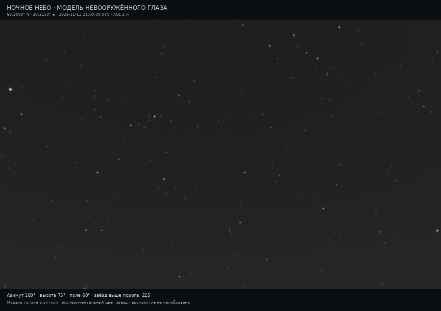
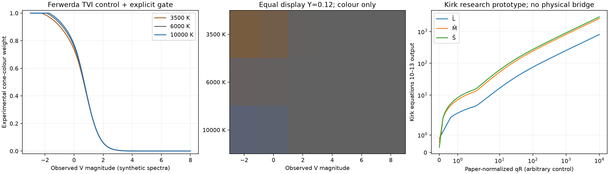

# Спектральный цвет и подготовка независимой проверки — 0.8
> Дата создания: 2026-11-11

## Результат и статус этапов

По поручению «Переходи к следующим этапам» продолжены этапы 4–5
исследовательского плана. Этап 4 выполнен как спектральный расчёт и
**экспериментальный** цветовой контроль. Этап 5 выполнен технически:
сохраняемые профили, Web/Qt-интеграция, численный контроль, протокол и
импорт независимых наблюдений. Сравнение с людьми ещё не выполнено:
**наблюдателей 0, новых наземных ночей 0**. Камера остаётся отложенной.

В выбранном поле по-прежнему 225/537 звёзд выше порога. Цвет вычислен для
3600/3832 физических строк; 232/3832 не имеют требуемой спектральной формы.
Наличие спектрального цвета не означает доступность порога: 819/3832 строк
находятся вне скотопической области, 232/3832 не имеют спектра. В исходной
таблице всего 2781/3832 поддерживаемых порогов: 872 выше, 1909 ниже.
Ни мощность города, ни физические потоки, ни пороги не изменены.



Это результат численного рендера, **не фотография и не длинная выдержка**.
Изображение остаётся преимущественно нейтральным: из 225 показанных звёзд
только 1 имеет внутренний вес цвета выше 0,1. Этот вес — параметр нашей
модели, не вероятность узнавания цвета или измеренная способность глаза.
Монохромный режим остаётся по умолчанию.

## Зафиксированная сцена и физическая основа

| Вход | Значение и смысл |
|---|---|
| Точка | 60,3000° N, 30,3150° E; 2 м над DSM |
| UTC | 2026-11-11T21:00:00Z |
| Направление изображения | Азимут 180°, высота 75°, горизонтальное поле 60° |
| Полное поле / превью | 1800×1100 / 900×550 / 390×238 px; подписи отдельно |
| NASA | Прежний годовой VNP46A4.002 за 2025; новых файлов/сезонной подгонки нет |
| Поверхность и атмосфера | Без снега; прежние DSM/ближние ячейки; AOD 0,1, SSA 0,9, g=0,8 |
| Спектральный сценарий города | LED-B3, прежние 95 длин волн 360–830 нм |
| Источник физического результата | 0.7, commit e84dc59d613c60b534ede8fd64e785271e32f68d |
| C | 44897606336985,7; без повторной подгонки |
| Область модели глаза | Ясно; полная адаптация; Солнце −46,61°, Луна −47,93°; без прямых фонарей |
| Наблюдатель / экран | F=2, зрачок 6 мм; угловая интеграция цвета 5′; номинальный sRGB |

[case-summary.json](case-summary.json) содержит SHA-256 исходного файла,
параметры, идентичности библиотек, весь экранный профиль и результаты.
Физическая основа лежит в соседнем неизменённом
`../eye-rendering-20261111/physical-result.json`. Здесь нет повторного запуска
атмосферного переноса и повторного подбора C. Новые параметры цвета не
используются для исправления засветки или численной ошибки исходной модели.
Относительная ошибка реконструкции P/S ниже относится к внутреннему
согласованию спектральных интегралов, **не к точности прогноза реального неба**.

## Теория → проблема → реализованное решение

### Спектральные интегралы

Теория: свет звезды у наблюдателя описывается Eλ, Вт·м⁻²·нм⁻¹.
Фотопический и скотопический интегралы используют разные функции:

```text
E_p = 683 ∫ Eλ V(λ)dλ, лк
E_s = 1700 ∫ Eλ V′(λ)dλ, скотопические лк
XYZ = 683 ∫ Eλ [x̄,ȳ,z̄]dλ
LMS = ∫ Eλ [l̄,m̄,s̄]dλ, взвешенные Вт/м²
R = E_s/1700, взвешенные Вт/м²
```

Проблема: нельзя ослабить атмосферой уже наблюдаемый поток второй раз.
Из V и S/P нельзя восстановить полный естественный спектр и LMSR.

Решение: восстанавливается прежняя форма спектра Sλ, умножается на Tλ,
а амплитуда закрепляется сохранённым наблюдаемым Johnson V:

```text
Eλ = F_V,observed SλTλ / ∫SλTλR_V(λ)dλ
```

Новые XYZ/LMS вычисляются только после проверки совпадения P/S с физической
таблицей. Для 3600/3600 доступных форм максимальное относительное расхождение
7,5562·10⁻¹⁶. Природный фон пока отображается нейтрально, без выдуманного
спектра. Энергетические LMS не названы троландами или q статьи Kirk.

### Цвет при ослаблении сигнала

Теория: обнаружение световой точки и различение её цвета — разные задачи.
TVI Ferwerda оценивает пороги приращения яркости. Это не готовая формула
цветового порога звёзд.

Проблема: яркость звезды в одном экранном пикселе меняется с разрешением.
Каталожная раскраска без учёта потока переоценила бы цвет слабых объектов.

Решение: поток усредняется в фиксированном угловом пятне диаметром d=5′:

```text
G = Σw_j[1−exp(−r²/(2σ_j²))]/(πr²), ср⁻¹; r=dπ/(180×120)
P_local=P_bg+E_pG; S_local=S_bg+E_sG
u=clamp((1−log10(max(S_local,10⁻⁸)))/3,0,1)
a_p=E_p/T_p(P_local); a_s=uE_s/T_s(S_local)
w_colour=(a_p/(a_p+a_s)) [1−exp(−(E_pG/T_p(P_local))²)]
```

TVI взята из первичной работы; логарифмическое смешение, диаметр и последняя
заслонка — **инженерные сценарные параметры нашей реализации**. Они дают
нулевой цвет при ослаблении и фотопический предел при сильном сигнале, но
ещё не подогнаны по человеческим наблюдениям. Это ограничение записано в
JSON и документации. Мощность звезды и порог Crumey не меняются.



Слева — изменение веса для континуумов 3500/6000/10000 K; в центре — только
цвет при одинаковой Y экрана, без имитации одинаковой яркости звёзд. Справа
— формулы Kirk на отдельно заданных q; оси не являются физическими
Вт/м². [Все входы и числа](colour-controls.json).

### Кирк–О'Брайен: что получилось и что не установлено

Реализованы формулы 10–13 первичной работы: регулирование LMSR,
оппонентные каналы и добавка палочкового сигнала. Нулевые палочки дают
строго исходный LMS. Функция принимает только `paper_normalized`.
Масштаб q, максимумы исходных функций и первичные цвета дисплея нельзя
без проверки заменить нашими CIE2006/сRGB данными. Статья использует
измеренный Apple Cinema HD и отдельный HDR-оператор.

Поэтому полного физического перехода в Kirk, его полного display/HDR-pipeline
и физиологически подтверждённого цвета здесь нет. Оператор оставлен
исследовательским; основной эксперимент использует прозрачный TVI-контроль.
Сравнение сейчас устанавливает область применимости и корректность алгебры,
а не победителя по совпадению с человеческим зрением.

### Цветовой охват и кодирование

Линейный RGB нормируется на Y, заданную прежним скалярным тональным
оператором. При выходе из охвата компоненты одновременно приближаются к
нейтральному цвету с той же Y. Независимого клиппинга каналов нет.
После этого — один sRGB и общий для каналов ограниченный 8-bit dithering.
16-bit PNG действительно содержит 16 бит на каждый RGB-канал.

В полном поле 12/1 980 000 пикселей потребовали gamut-сжатия. После 8-bit
округления у 13/1 980 000 хотя бы один канал равен 255; у 3/1 980 000 —
все три. Это пиксели конечного отображения, не число насыщенных звёзд или
потерянный физический поток. Максимальная ошибка сохранения Y до кодирования
3,33·10⁻¹⁶. Нейтральный фон не раскрашивается квантующим шумом.

## Профили и интеграция

Профиль сохраняет F, S/P, зрачок, диаметр интеграции, режим цвета и display.
Он не меняет место, UTC, поле зрения или численное sampling. Для дисплея
отдельно хранятся номинальное/введённое/измеренное происхождение, прибор,
время, освещение помещения и геометрия окна. Измеренное происхождение —
запись пользовательских измерений, не автоматическое подтверждение точности.
При неизвестной ширине/дистанции угловой масштаб остаётся неизвестным.

```text
θ_display = 2 arctan(window_width_mm/(2 viewing_distance_mm))
scale = θ_display / horizontal_fov
```

В браузере появились выбор режима цвета, диаметр и импорт/экспорт профиля.
В собранной нативной C++/Qt-панели KStars — переключатель цвета и кнопки
профиля. Изображение открывается внутри Qt, без уменьшения уже кодированных
точек. Собственная карта и глифы KStars сохраняются; этот рендер не внедрён
в SkyPainter. Поддержка Qt6/HiDPI и универсальный установочный пакет не проверены.

## Этап 5: как подготовлена проверка и чего ещё нет

Импорт будущих анонимных записей проверяет SHA-256 физического результата,
принадлежность звёзд и условия. Параметр F может настраиваться только на
calibration-ночах; validation-ночи и тот же физический файл разделены.
Предсказание для нового F: `q_saved·F_saved/F≥1`. Подбирается только F,
не город C, не спектр, не фоновая яркость. Метрики хранят TP/TN/FP/FN,
seen/not_seen и разрезы наблюдателей/ночей. При недостаточном обучении F=null.
Настройка F может поглотить ошибку атмосферы/фона; это явно ограничивает выводы.

[Пустой шаблон](observation-template.json) и [его реальный статус](observation-status.json):
0 записей, 0 наблюдателей, 0 ночей; `prepared_not_observed`.
Полный [протокол](../../docs/EYE_OBSERVATION_PROTOCOL.md) описывает темновую
адаптацию, независимость ночей, измерение экрана, категории и знаменатели.
Человеческие ответы и подтверждённая точность цвета не созданы автоматически.

## Проверки и основания выводов

| Проверка | Получено | Что этим не подтверждено |
|---|---:|---|
| pytest, итоговая версия | 267/267, 72,44 с | Совпадение с реальным наблюдателем |
| Издательские суммы CIE | 6/6; 3 таблицы | Измеренный спектр местного неба |
| P/S-реконструкция | 3600/3600; max 7,56·10⁻¹⁶ | Спектральная точность континуума по B−V |
| Замороженные физические строки | 3832/3832 без изменения | Измеренная яркость этой ночи |
| Физические float32-массивы | 7/7 совпали с 0.7 | Валидация модели атмосферы |
| Монохромные PNG | 4/4 совпали по пикселям с 0.7 | Калибровка телефона |
| Независимый декодер 16-bit RGB | 5 940 000/5 940 000 каналов | Линейный RAW камеры |
| Максимальная ошибка округления 16-bit | 0,49999970 кода; допуск 0,5 | Погрешность восприятия |
| Нейтральные фоновые пиксели | 105 032/105 032 без RGB-разности | Истинный цвет неба |
| Chromium / экспорты / профиль | 1/1 задача, 10/10 экспортов, 0 JS-ошибок | Любой браузер/дисплей |
| Qt5 KStars 3.6.2 | 2/2 задачи и нативное окно цвета | Qt6, HiDPI, upstream-установка |
| Изолированный wheel | 85/85 файлов совпали; офлайн-цвет/PNG доступны | Системный бинарник KStars |
| Наблюдатели / новые наземные ночи | 0 / 0 | Независимая полевая точность |

Во время проверки исправлены ошибка RGB-маски в счётчике насыщения и
неполный ключ кэша цвета: он теперь зависит от локальных P/S и модели
оптики. Добавлена регрессия на изменение фона. Первый полный прогон дал
266/266; итоговый после этой проверки — 267/267. Синтетические unit-записи
проверяют отсутствие утечки контрольных ответов, не считаются наблюдениями.
Перед коммитом обнаружено, что общее Git-правило заменяло CRLF исходных
CSV CIE на LF и нарушало издательские хеши. Для этих трёх таблиц добавлено
исключение в .gitattributes для таблиц и метаданных. Их исходный формат
не исправляется стилистической проверкой пробелов. Проверены байты 6/6 файлов
в Git index: новая копия репозитория сохраняет исходные контрольные суммы.

Подробные результаты: [qa.json](qa.json),
[encoding-verification.json](encoding-verification.json),
[browser/verification.json](browser/verification.json),
[native/native-verification.json](native/native-verification.json),
[wheel-verification.json](wheel-verification.json),
[source-audit.json](source-audit.json), [manifest.json](manifest.json).

## Файлы и воспроизведение

`eye-view.png` — полный подписанный вид; `eye-preview.png` — 900 px;
`eye-mobile.png` — отдельный 390 px интеграл; `eye-view-16bit.png` — поле без
подписей. `monochrome-preview.png` — прежний контроль. `eye-colour.csv` —
XYZ/LMSR, статусы и веса; `eye-profile.json` — переносимый профиль.
Полные линейные данные регенерируются в игнорируемом
`data/eye-colour-20261111/colour/eye-linear.npz`; физическая основа уже
отслеживается в предыдущем отчёте, повторный большой файл здесь не добавлен.

```bash
uv sync --locked
uv run python scripts/run_eye_colour_case.py
uv run --with pypng python scripts/validate_eye_colour.py
uv run python scripts/audit_eye_observations.py \
  artifacts/eye-colour-20261111/observation-template.json \
  --output artifacts/eye-colour-20261111/observation-status.json
uv run pytest -q -p no:cacheprovider
uv lock --check
```

Qt/Chromium требуют дополнительных системных библиотек; точные аргументы
сохранены в `qa.json` и документах интеграции. Публичные таблицы CIE
поставляются под CC BY-SA 4.0, а ссылки/права/хеши — в source-audit.
Чужие полные статьи, NASA-ключи и персональные наблюдения в отчёт не входят.
Для проверки подготовленного к коммиту индекса к команде
`scripts/validate_eye_colour.py` добавляется `--check-index`.

## Следующие содержательные задачи

- Получить реальные анонимные ответы и независимые измерения фона, разделить
   ночи до настройки, оценить ошибки и переносимость F/цветового диаметра.
- Установить спектральный масштаб LMSR, собрать/выбрать измеренный природный
   фон и измерить дисплейные первичные цвета; затем сравнить Kirk и контроль
   на одинаковых физических входах и человеческих ответах.
- Отдельно исследовать яркие звёзды, прямой лунный/фонарный свет, широкие
   блики и динамическую адаптацию. Эти условия сейчас не покрываются PNG.
- После этого перейти к камере с QE, фильтром, PSF, электронами, шумом и
   FITS, используя физический свет до тонального оператора глаза.

## Теория и первоисточники

Полный вывод с единицами: [EYE_MODEL §§14–17](../../docs/EYE_MODEL.md#14-теория-08-спектр-xyz-lms-и-нормировки).
Пояснение с основ: [главы 30–31](../../docs/PHYSICS_AND_MATH_GUIDE.md).

- CIE: [XYZ 1931](https://doi.org/10.25039/CIE.DS.xvudnb9b),
  [LMS 2006](https://doi.org/10.25039/CIE.DS.tijidesg),
  [D65](https://doi.org/10.25039/CIE.DS.hjfjmt59); исходные CSV и метаданные.
- [Ferwerda et al. 1996, полный текст](https://jamesferwerda.com/wp-content/uploads/2015/06/j03_ferwerda96_sig.pdf),
  пороги TVI; инженерная цветовая заслонка не взята из статьи.
- [Kirk & O'Brien 2011, страница авторов](https://jamesobrien.com/papers/Kirk-PBT-2011-08/index.html),
  [DOI](https://doi.org/10.1145/2010324.1964937), полный текст прочитан,
  формулы 10–13; абсолютный мост и полный display/HDR-pipeline не установлены.
- [Watson 2013](https://doi.org/10.1167/13.6.18), прежняя средняя оптика;
  [Crumey 2014](https://arxiv.org/abs/1405.4209), прежний порог обнаружения.
- [W3C CSS Color 4](https://www.w3.org/TR/css-color-4/#color-conversion-code),
  первичные цвета и матрица sRGB/D65; наше gamut-сжатие не объявляется CSS-стандартом.
