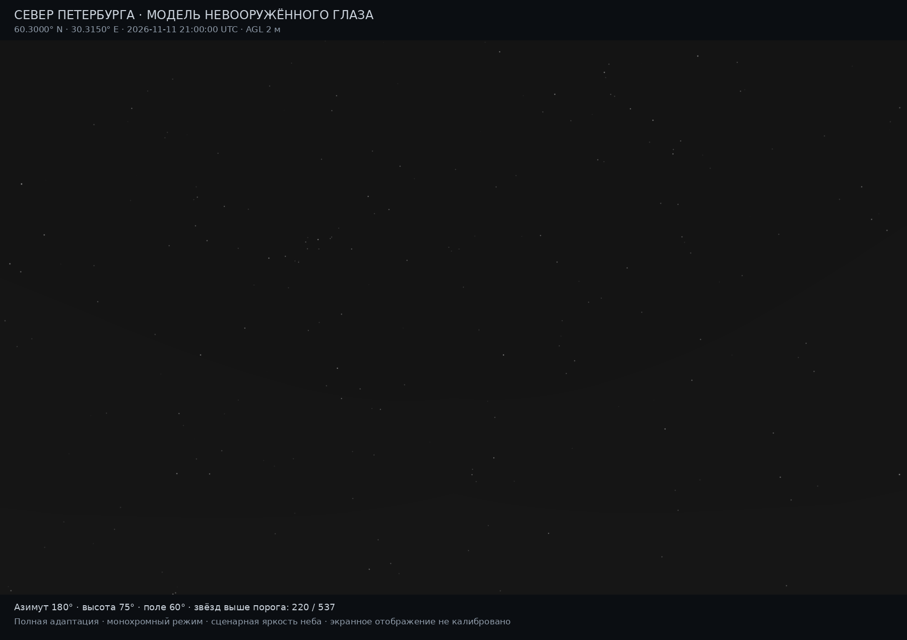
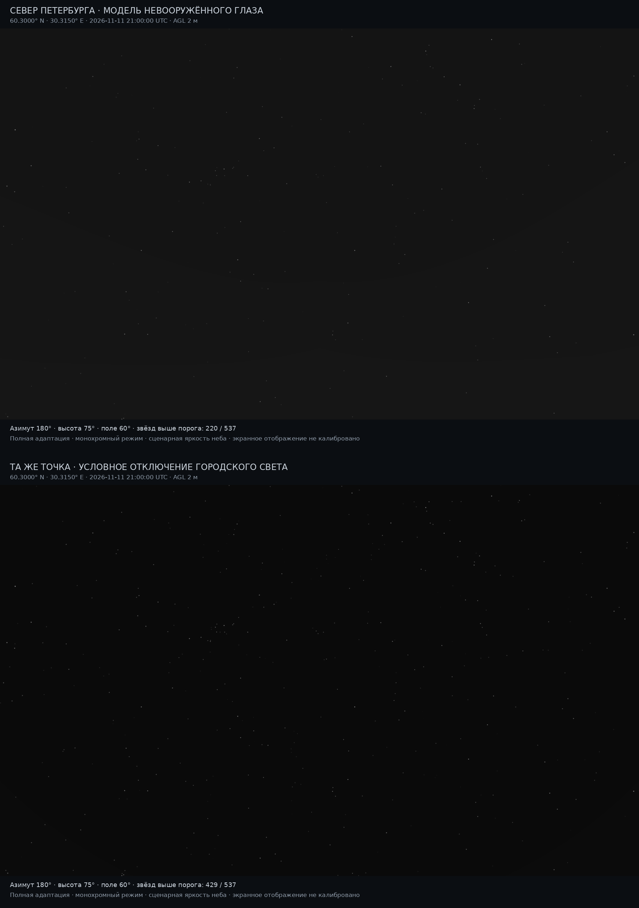

# Первый режим невооружённого глаза, LightPollution 0.6
> Дата создания: 2026-11-11

> Я сохраняю этот отчёт как архив конкретного опыта. Его статусы относятся к описанной версии; текущее устройство — в [MODELS](../../MODELS.md), ход развития — в [HISTORY](../../HISTORY.md).

## Результат и смысл опыта

Реализован ограниченный скотопический порог обнаружения точечной звезды
для полностью адаптированного наблюдателя. Городское небо и звёздные потоки
вычислены общей физической системой: NASA → источники → спектральное
рассеяние/поглощение → DSM/горизонт → сигнал у глаза → порог.
Изображение строится из этого результата отдельным модулем.

Это **вычисленная монохромная иллюстрация**, не фотография. Порог не
определяет субъективную яркость или цвет ярких звёзд. Экранная передача
явно условна; предсказательная точность на реальных наблюдателях не оценена.
Формальная теория с определениями, единицами и источниками:
[docs/EYE_MODEL.md](https://github.com/WarriorOfTea/LightPollution/blob/52a3604b6603be48e07c4bd0d60a9cf32f0b9f38/docs/EYE_MODEL.md).



## Зафиксированные условия

| Величина | Значение и происхождение |
|---|---|
| Точка | 60,300° N; 30,315° E, севернее Петербурга |
| Глаза | AGL 2 м; вычисленная радиальная MSL-высота около 61,44 м |
| Время | 2026-11-11 21:00:00 UTC; геометрия рассчитывается по дате |
| Направление изображения | Юг 180°, высота 75°, горизонтальное поле 60° |
| Размер | 1800×1100 пикселей поля, дополнительно подписи |
| Солнце / Луна | Высоты −46,61° / −47,93°; Луна ниже горизонта |
| Источники | VNP46A4.002, годовой композит 2025, QA/хеши прежнего набора |
| Рельеф | Copernicus DSM GLO-90, реальный набор Петербурга |
| Атмосфера | AOD550=0,10; ω=0,90; g=0,80; высоты молекул/аэрозоля 8/1,2 км |
| Лампы | Сценарная смесь LED-B3=1, не измеренный инвентарь фонарей |
| Поверхность | Альбедо 0,15, снег 0; прямая доля вверх 0,15, низкоугловая 0 |
| Шкала мощности | Сценарная опора: V=20,5 mag/arcsec² городского зенита в фиксированной географической точке; C не подгоняется под картинку |
| Ночной природный фон | Зенит V=21,6; доля airglow 0,6, высота 90 км |
| Наблюдатель | Полная адаптация, F_eye=2; неизвестный S/P остатка=1,408 |

Дата задаёт положение светил, но **не превращает годовой композит 2025
в измерение освещения или погоды 11 ноября 2026**. Здесь сценарий ясной
безлунной ночи, без прямых фонарей. Источники и DSM реальны; атмосфера,
спектры ламп, природный фон и параметр наблюдателя заданы предположениями.
Полный запрос: [scene.json](city/scene.json),
развёрнутые параметры: [resolved-scene.json](city/resolved-scene.json).

## Что и почему реализовано

1. Порог Blackwell/Crumey 2014 из точечной скотопической ветви. При
   B_eff=max(B_eq,10⁻⁵) требуемая освещённость равна
   F_eye·(6,505·10⁻⁴ B_eff^¼ − 8,461·10⁻⁴ B_eff^½)² лк.
   Это эмпирическая психофизика пространственного суммирования, поверх
   закона Бера и атмосферного рассеяния физического ядра.
2. Приведение к лабораторному спектру 2850 K: B_eq=L_s/1,408,
   E_eq=E_s/1,408. Ночная чувствительность CIE уже интегрирована с
   рассчитанным спектром. Отношение q=E_eq/порог даёт классификацию;
   2,5 log10(q) — запас до порога. Вероятность обнаружения не назначается.
3. Звёздный поток уже ослаблен атмосферой. F_eye не содержит атмосферу;
   второго ослабления и дополнительного множителя площади зрачка нет.
4. Городской фон имеет спектр; V-only природный остаток использует явный
   фотопический прокси и сценарный S/P. Он не выдаётся за восстановленный
   полный спектр. Изменение F_eye/S/P не пересчитывает мощность города.
5. Eye-режим добавляет угловые лучи через 45° и высоты 20°,45°,70°;
   здесь поле 8×5 узлов, зенит рассчитывается один раз. С географической
   опорой — 34 ядра переноса. Интерполяция билинейная в линейном свете.
6. Порог доступен при полной адаптации, астрономической темноте, Луне под
   горизонтом и фоне не выше 0,003 кд/м² в принятой области. За пределами
   области — недоступность, а не произвольная экстраполяция.
7. PNG — отдельная проекция: фиксированная функция фона, `asinh(q−1)`
   для точек, условный Gaussian FWHM 3′ и sRGB. Это не измеренная PSF глаза.
   Масштаб одинаков в обоих кадрах; автоматического растяжения нет.

В коде разделены `models/eye.py`, `application/eye.py` и
`interfaces/eye_view.py`. `SceneSpec.eye` необязателен; прежний режим
сохраняется без него. CLI, Web и нативная панель KStars используют общее ядро.
Появились JSON/CSV порогов, метаданные экранного вида и PNG в ZIP задания.

## Контроль: выключить только городской свет

Контроль — математическое вмешательство в той же точке, **не фотография
другой площадки**. Городские L_p/L_s обнуляются; положение/спектры/потоки
звёзд, атмосфера, природный фон и дисплей остаются теми же. Калибровка
мощности заново не проводится. Контрольный `result.json` явно имеет тип
`eye_only_counterfactual`: это eye-экспорт, не новый полный расчёт переноса.

| Показатель | Город включён | Город условно выключен |
|---|---:|---:|
| Записей каталога в изображении | 537 | 537 |
| Выше номинального порога в изображении | 220 | 429 |
| Площадь изображения в области модели | 1 980 000 / 1 980 000 | 1 980 000 / 1 980 000 |
| Записей каталога после горизонта, вся расчётная область | 3832 | 3832 |
| Порог доступен, вся область | 2781 / 3832 | 3600 / 3832 |
| Выше порога, вся область | 867 / 2781 доступных | 2225 / 3600 доступных |
| Ниже порога, вся область | 1914 / 2781 | 1375 / 3600 |
| Порог недоступен, вся область | 1051 / 3832 | 232 / 3832 |

В изображении для 45 из 537 записей нет подходящего спектра; поэтому число
пороговых классификаций меньше полного числа записей. Неподдерживаемый
порог не означает «звезда невидима». Числа относятся к BSC5P, не ко всем
существующим слабым звёздам; двойные источники отдельно не объединены.



Ранее проверенный широкий вид (90°, центр 50°) попадал в скотопическую
область примерно на 57% площади. Неподдерживаемое поле было заштриховано.
Основное изображение направлено выше, чтобы весь кадр находился в области
формулы; коэффициенты порога и физический свет не подгонялись ради вида.

## Чувствительность допущений

При неизменном физическом небе и S/P=1,408 число записей выше порога во
всей расчётной области: F_eye=1,4 → 1322; F_eye=2 → 867; F_eye=2,4 → 696.
При S/P остатка=2,5: соответственно 1229 / 809 / 645. Знаменатели и число
недоступных случаев сохранены в [sensitivity.json](sensitivity.json).
Это сценарная чувствительность, не доверительный интервал и не оценка
распределения человеческого зрения.

## Проверки и их практический смысл

- Опубликованный ориентир при B=2·10⁻⁴ кд/м²: 6,93445 при F=1 и
  6,18188 при F=2, против округлённых 6,93 и 6,18. Это лабораторная
  эталонная фотопическая шкала, не универсальный V-предел любого спектра.
- Приближение Crumey eq.54 проверено в 101 точке V-фона 20,01–21,99:
  максимальное отличие 0,009413 mag, заданный критерий <0,011.
- Планковский спектр 2850 K на нашей сетке: S/P=1,409636,
  отличие от округлённых 1,408 около 0,116%. Это численный контроль
  согласования шкал, не достигнутая полевая точность.
- Проверка ослабления потока вдвое даёт q 2→1. Для 2781 общей доступной
  записи контроль подтвердил неизменность звёздного потока и увеличение
  q при выключении города.
- Полный pytest: **212/212 passed, 65,25 с**, ошибок/пропусков нет.
  Включены 22 eye-случая; проверены границы, отсутствие ложных нулей,
  независимость от пиксельного размера, кэш и недоступный старый PNG.
- Web Chromium: 1/1 job, 5/5 eye-экспортов, ZIP, импорт настроек и размеров,
  0 JS errors; ширина 390 px без горизонтального переполнения.
- Настоящий KStars 3.6.2/Qt5: 2/2 jobs, UTC/геометрия, AGL/MSL,
  устаревание при движении карты, открытие PNG и снимок самого eye-окна.
  Это локальная исходная сборка без INDI/Ekos device control; Qt6 не проверен.
- Wheel 0.6 установлен отдельно и запущен из `/tmp`: 68/68 файлов/ресурсов
  совпадают с checkout, учебный eye-расчёт/PNG работают. Окружение содержит
  пакет проекта и 36 runtime-зависимостей; новых зависимостей для глаза нет.
- `uv lock --check`, Node syntax и `git diff --check` прошли.

Обнаруженные проблемы исправлены: HTML `step=0.1` не допускал S/P=1,408
и блокировал отправку; задан `step=any`. Для повторного CLI-вывода при
недоступной новой сцене прежний PNG сохраняется под другим именем,
а не выдаётся за текущий. Отсутствующий звёздный спектр возвращает `null`,
не фиктивный нулевой поток. Первый проверочный скриншот KStars снимал
главное окно вместо отдельного диалога; добавлен отдельный проверяемый
метод сохранения eye-окна. Загрузка устаревшего PNG после нового задания
отбрасывается по идентификатору задания.

Независимых визуальных наблюдателей **0**, независимых зарегистрированных
визуальных обнаружений **0**. Ошибка прогноза видимости/цвета, точность
угловой интерполяции по местным измерениям и MAE в величинах **не получены**:
соответствующих контрольных данных нет. Тесты подтверждают реализацию
формул/контрактов, а не совпадение субъективного зрения с картинкой.

## Что остаётся сделать

Сначала нужны совместные наблюдения: измеренный фон/спектр, реальная
атмосфера, записи видимости известных звёзд и условия адаптации. Затем —
личная настройка F_eye, мезопический переход и внутриглазное рассеяние/
блики от Луны и фонарей. Отдельные следующие задачи — адаптация во времени,
цвет ярких звёзд, PSF глаза, объединение двойных и более полный каталог.
Сейчас нельзя достоверно вывести индивидуальную физиологию или истинный
цвет природного фона из годового спутникового композита.

## Воспроизведение и файлы

```bash
uv sync --locked
uv run pytest -q -p no:cacheprovider
uv run python scripts/run_eye_demo.py
uv run python scripts/validate_eye_model.py
uv run python scripts/build_theory_bundle.py --output artifacts/eye-model-20261111
```

Реальный опыт требует подготовленных NASA/DSM-файлов; учебный `demo`
работает без сети. Протоколы Web/native запусков:
`scripts/check_eye_browser.py` и `scripts/check_kstars_native.py --eye`.
Сырые источники NASA/DSM и чужая статья не включены в Git.

- [Сводка сценария и происхождение](summary.json), [критерии до опыта](predeclared-criteria.json).
- [Численные проверки](numerical-validation.json), [источники](source-audit.json).
- [Полный основной результат](city/result.json), [eye JSON](city/eye.json),
  [звёздные пороги CSV](city/eye-stars.csv), [параметры отображения](city/eye-display.json).
- [Контроль eye-only](city-off/result.json), [контрольный PNG](city-off/eye-view.png).
- [Браузер](browser/verification.json), [native KStars](native/native-verification.json),
  [изображение настоящего eye-окна](native/kstars-native-eye-window.png),
  [wheel](wheel-verification.json).
- [Полная формальная теория с основ, PDF](https://github.com/WarriorOfTea/LightPollution/blob/52a3604b6603be48e07c4bd0d60a9cf32f0b9f38/artifacts/eye-model-20261111/theory-from-zero.pdf),
  [проверка сохранения формул](https://github.com/WarriorOfTea/LightPollution/blob/52a3604b6603be48e07c4bd0d60a9cf32f0b9f38/artifacts/eye-model-20261111/theory-source-check.json).

Основной первоисточник: [Crumey 2014](https://arxiv.org/abs/1405.4209),
[DOI](https://doi.org/10.1093/mnras/stu992). Первичные таблицы CIE и данные
неба описаны в связанных документах и манифестах существующего ядра.
