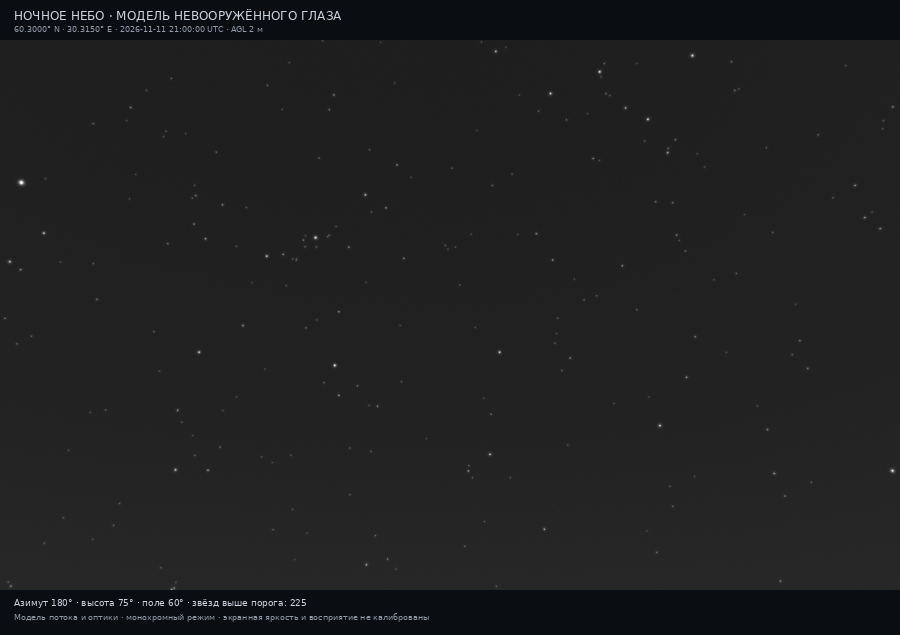
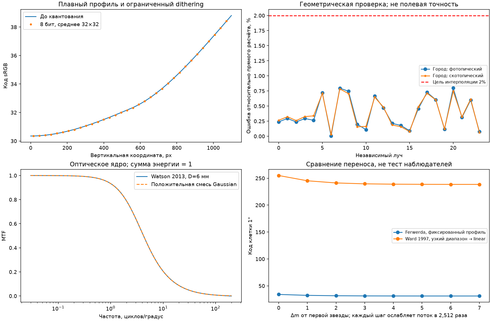
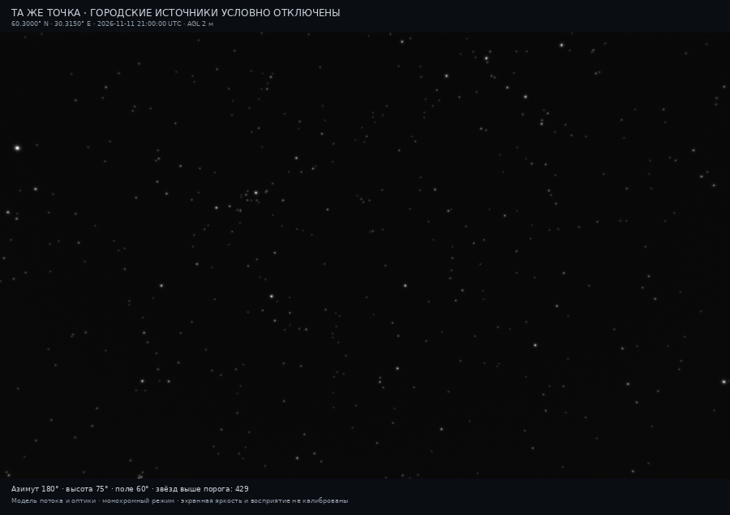
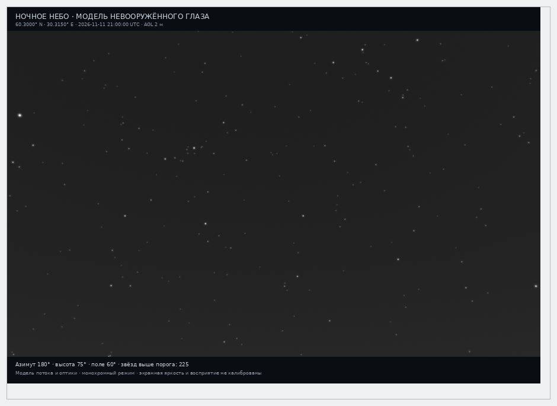

# Визуализация глаза 0.7: реализация этапов 1–3
> Дата создания: 2026-11-11

Исполнено поручение «делай»: плавный вывод фона, проверка углового поля,
звёзды по потоку с нормированным оптическим ядром. Картинки — результат
численного запуска. Это не фотография и не откалиброванная имитация
индивидуального восприятия. Цвет и камера этим этапом не добавлены.

## 1. Конкретный результат



| Условие | Значение |
|---|---|
| Наблюдатель | 60,3000° N; 30,3150° E; AGL 2 м; MSL из DSM ≈61,44 м |
| Дата | 2026-11-11 21:00:00 UTC, геометрические направления без рефракции |
| Поле | Юг: азимут 180°, высота центра 75°, горизонтальный угол 60° |
| Источники | Прежний NASA VNP46A4.002, годовой композит 2025, прежняя QA-маска |
| Атмосфера | Ясная сценарная: AOD550=0,1; SSA=0,9; g=0,8 |
| Спектр/поверхность | Прежний LED-B3; без снега; прямой/отражённый свет разделены |
| Небо | Солнце около −46,61°; Луна около −47,93°; airglow-слой 90 км, доля 0,6 |
| Глаз | F=2; полная местная адаптация; S/P неизвестного природного остатка=1,408 |
| Оптика иллюстрации | Среднее ядро Watson, номинальный зрачок 6 мм; не личное измерение |
| Экранный профиль | White100 / black0,05 / adaptation20 кд/м²; world S-adaptation0,002 кд/м² |

В поле **225/537** каталожных звёзд выше порога, раньше **220/537**.
У **45/537** нет достаточной спектральной информации; поток им не придуман.
Вся модельная область: 872 выше / 1909 ниже / 1051 недоступна, всего 3832
каталожных записи после маски рельефа. Это не подсчёт всех звёзд реального неба.

Коэффициент городских источников C и таблица потоков **всех 3832 звёзд
точно совпадают с 0.6 в численной JSON-таблице**. Пять объектов пересекли
порог из-за более точного фона в их направлениях. Имена/q:
[classification-changes.json](classification-changes.json).

## 2. Что изменилось и почему

| Проблема 0.6 | Реализация 0.7 | Проверяемая граница |
|---|---|---|
| Фон после округления имел только 3 кода | Float32, один sRGB, 16-bit и ограниченный финальный dithering | Физический фон не размывается и не зашумляется |
| Редкая азимутальная сетка, скачки производных | Локальные настоящие лучи в гномонической плоскости; положительный PCHIP | Форма проверена в одном выбранном поле, не глобально |
| Амплитуда звёзд задавалась asinh(q−1), ядро не сохраняло поток | E_s + нормированная оптическая смесь, интеграл по пикселям | Оптика средняя, надпороговое восприятие не калибровано |
| Qt уменьшал готовый кодированный PNG | Отдельные расчёты 900/390 px до tone mapping; Qt показывает 900 px 1:1 | Проверены Linux/Qt5, DPR1; Qt6/HiDPI пока нет |

Воспроизводимый dithering — только способ округления кодов, **не шум
атмосферы**. Средний профиль плавного света сохраняется; отдельных
256 уровней 8-bit файла достаточно для такого представления без широких
полос. 16-bit файл — тонально перенесённое изображение; абсолютные физические
величины находятся в NPZ, а не выводятся из его PNG-кодов.

## 3. Теория → задача → решение

### 3.1 Пространственное поле

Направление — единичный вектор d. В зените азимут не уникален, поэтому
интерполировать его как прямоугольную карту без проверки недостаточно.
Для ортонормированных осей взгляда f,r,u:

```text
x=(d·r)/(d·f); y=(d·u)/(d·f)
d=(f+x r+y u)/sqrt(1+x²+y²)
```

Сетка 3×3 строится по нормированным x,y выбранного поля. Отдельные прямые
расчёты в центрах ячеек проверяют её; при ошибке >1% сетка увеличивается
до 5×5, при явно разрешённом лимите — до 9×9. Здесь 3×3 оказалось достаточно:
максимум на четырёх пробах 0,4104%. C остаётся неизменным.

PCHIP применяет кубические эрмитовы функции и ограниченные гармонические
производные. Положительные данные не превращаются в отрицательную яркость;
монотонный участок не получает нового экстремума. Это численная
реконструкция, не дополнительный физический закон рассеяния.
За выбранным полем сохраняется прежняя грубая периодическая сетка.

После замораживания сетки выполнены **24 независимых off-grid луча**,
включая четыре около зенита. Они не участвовали в уточнении. Максимум
расхождения P/S/V с прямым решателем **0,7988%**, цель 2% выполнена
на **24/24**. Для четырёх лучей отдельно рассчитан standard: совместная
разница квадратуры и агрегации относительно quick не более **1,1467%**.
Это не полевая точность и не проверка неизвестной смеси ламп/погоды.

### 3.2 Оптика и энергия звезды

Поток звезды у наблюдателя E_s измеряется в скотопических лк. Яркость
протяжённого объекта L_s — в скотопических кд/м². PSF распределяет поток,
её интеграл должен быть равен 1. Средняя MTF Watson 2013 для зрачка d=2…6 мм:

```text
u1=21.95−5.512d+0.3922d²
M(u,d)=[1+(u/u1)²]^(−0.62) sqrt(D_diffraction(u,d,555nm))
M_fit(u)=Σ w_j exp(−2π² σ_j² u²), w_j≥0, Σw_j=1
```

Собственная положительная смесь 48 Gaussian приближает MTF и позволяет
интегрировать пиксели через normal CDF. Локальный Jacobian учитывает
масштаб/корреляцию гномонической проекции. Затем:

```text
Φ_pixel=Σ E_s,i · integral_pixel(PSF_i)       [скотопические лк]
L_star,pixel=Φ_pixel/Ω_pixel                 [скотопические кд/м²]
L_scene=L_background+L_star
```

Ω — точный телесный угол сферического пикселя. Обрезанное краем поля пятно
не перенормируется; потеря потока записана отдельно. Рассеяние широкого
угла и индивидуальные лучи вокруг ярких звёзд не добавляются.
Номинальный зрачок меняет только форму, не повторно площадь/порог.

Для 6 мм RMS/максимум ошибки MTF-аппроксимации: 0,000593/0,002613
абсолютных единиц. Для 2 мм максимум 0,02293 — ограничение положительной
Gaussian-смеси около резкого дифракционного cutoff. Исходная формула и
средняя модель глаза тоже не являются личным измерением PSF.

### 3.3 Порог и яркость на экране

Порог Crumey сохранён: q=E_s/E_threshold на локальном фоне. Спектральный
сигнал уже включает атмосферное ослабление один раз. В физическом NPZ
сохраняется также свет подпороговых источников с известными спектрами;
иллюстрация показывает только q≥1. Это не вероятность обнаружения.

Основной тональный прототип использует Ferwerda 1996:

```text
m=t_photopic(L_adaptation,display)/t_scotopic(L_adaptation,world)
z=1−exp(−m·L_scene/(white−black))
```

TVI-функции взяты из формул 3–5 первичной статьи. Мягкое ограничение z —
явное инженерное дополнение. Оно сохраняет порядок яркостей и низкосигнальный
наклон, но не доказывает субъективную яркость. После него ровно одна
sRGB-функция и округление. Разница 1 mag сохраняет отношение линейных
потоков 2,511886; коды PNG не обязаны иметь такое же отношение.

Ядро Ward Larson 1997 реализовано для сравнения: гистограмма усреднений
около 1°, ограничение производных по TVI. На тесте 2400 фовеальных клеток
узкий диапазон вызывает предусмотренный статьёй linear fallback. Фон
получается около кода 238 вместо 31 у фиксированного профиля. Для сравнения
city-on/off выбран фиксированный Ferwerda-профиль, чтобы гистограмма кадра
не меняла экспозицию. Это выбор воспроизводимости, не голосование людей
и не доказательство превосходства. Полные glare/acuity/colour-модули pcond
не воспроизведены; низкояркостная S-шкала сравнения указана явно.

Все формулы, размерности и границы подробно:
[EYE_MODEL.md, §§9–13](../../docs/EYE_MODEL.md#9-теория-и-решение-07-угловая-реконструкция-без-разрыва-зенита).

## 4. Измеренные ошибки и проверки

| Проверка | Фактический результат | Критерий/смысл |
|---|---|---|
| Независимая интерполяция | 24/24, максимум 0,7988% | ≤2%; не полевая точность |
| Quick/standard | 4/4, максимум 1,1467% | Разница численных профилей, C фиксирован |
| Сохранение потока | 24/24; максимум 3,10×10⁻¹⁰ в float64 | ≤1%; 390/900/1800 px, 4 фазы, 2 корреляции |
| После сохранения float32 | Максимальная относительная ошибка 2,59×10⁻⁸ | Отдельная от физической ошибки проверка записи |
| 16-bit округление | Максимум 0,4999997 кода | ≤0,5 |
| 8-bit dithering фона | Максимум 0,99921; средняя ошибка +0,000113 кода | <1; средняя близка к нулю |
| Фоновый диапазон | 11 кодов 8-bit; 2335 уровней 16-bit | Не мера точности неба; масштаб отличается от старого |
| Код 255 | 4/1 980 000 пикселей поля | До округления ни одно значение не равно 1; максимум 254,999984 |
| Pytest | 243/243, 66,14 с; затем 31/31 после удаления неиспользуемого helper | Сеть/токены не используются |
| Браузер | 1/1 задание, 9/9 экспортов, ZIP, 0 JS-ошибок | Round-trip sampling/optics/display, мобильные 390 px |
| KStars 3.6.2 / Qt5 | 2/2 финальных задания; предыдущий прогон тоже 2/2 | Native-окно, UTC, AGL/MSL, stale, каталог |
| Изолированный wheel 0.7 | 71/71 файл, 5/5 изображений/NPZ; 36 runtime-зависимостей | Запуск из /tmp без исходников на sys.path |
| Lock / JS / diff | Все проверки успешны | Без новых runtime-зависимостей |



Первое получение новых лучей: 34 прежних ядра из кэша +41 новых.
Интервал от регистрации условий до записи результата ≈844 с по временным
меткам файлов, **не точный benchmark perf_counter**. В ходе проверки найден
и исправлен таймер: раньше он заканчивался до дополнительных лучей глаза.
Регрессия покрыта тестом. Повтор всех 75 ядер из кэша — 25,70 с, включая
угловую проверку, **без PNG/NPZ-экспорта**. Первичный ошибочный показатель
не выдаётся за полное время; см. [initial-transfer-run.json](initial-transfer-run.json).

Обнаруженные ошибки тестов и их исправления перечислены в
[checks.json](checks.json); первичный снимок/план не переписаны.
SHA трёх старых артефактов совпали с прежним опубликованным аудитом.

## 5. Контроль: тот же наблюдатель без городского света



**429/537** выше порога; те же звёзды, атмосфера, геометрия, дисплейный
профиль. Нулём заменены только городские P/S-компоненты. Это не другое
измеренное место и не прогноз реального выключения света. Естественный
остаток/его S/P остаются прежними сценариями. Из него не восстанавливается
полный природный спектр.

## 6. Интеграция и устройство



KStars передаёт атомарный снимок места/UTC/направления в тот же backend.
В проверке переключены два направления, подтверждены устаревание результата,
AGL отдельно от высоты места, выбранная Вега/HD/спектральный тип.
Снимки — реальных Qt-виджетов в private D-Bus/offscreen. Сборка без
INDI/Ekos device control; штатная установка пользователя не заменялась.
Приложение не рисует это поверх штатных глифов карты: отдельная кнопка
открывает модельный вид. Это позволяет независимо развивать оптику/цвет.

Слои: `eye_field` → физический фон; `application.eye` → пороги;
`eye_optics` → поток/пиксель; `eye_display` → TVI/encoding;
`interfaces.eye_view` → экспорт; Qt/Web → просмотр. Отсутствующие модели
не подменены скрытыми константами цвета или свойствами камеры.

## 7. Ограничения и следующий этап

Цвет не реализован: изображение намеренно ахроматическое. Нужно согласовать
LMS/R-нормировки, спектральные формы и мезопический ответ; нельзя просто
раскрасить звёзды по их фотографическим B−V. Дополнительные измеренные
спектры природного фона/ярких звёзд и профиль устройства улучшат проверку.

Независимых наблюдателей **0**, новых ночей фотометрии **0**. Погода,
зрачок, смесь фонарей, снег и S/P в этой сцене заданы, не измерены.
Отсутствуют широкоугольные блики/прямые фонари, дневная адаптация,
мерцание, индивидуальная острота. При Луне над горизонтом или вне
скотопической области eye-режим по-прежнему не строит достоверную картинку.
Полная физическая ошибка атмосферы/источников не установлена.

Следующие приоритеты: спектральный цвет; калибровка просмотра и визуальные
наблюдения; затем лунные/близкие блики и динамика адаптации. Камера остаётся
отдельным последующим этапом по решению пользователя.

## 8. Файлы и воспроизведение

- [predeclared-criteria.json](predeclared-criteria.json): параметры и 24 луча до расчёта.
- [case-summary.json](case-summary.json), [numerical-validation.json](numerical-validation.json): сводки/все контрольные числа.
- [classification-changes.json](classification-changes.json): пять изменений q относительно 0.6.
- [source-provenance.json](source-provenance.json): первоисточники/доступ/SHA; PDF не перепубликуются.
- `city/`: полный результат, eye JSON/CSV, изображения, линейный NPZ.
- `city-off/`: отдельный eye-only контроль; нет противоречащих city-on спектральных таблиц.
- `browser/`, `native/`, [wheel-verification.json](wheel-verification.json): подтверждения запуска клиентов и wheel.
- [report.pdf](report.pdf): данный отчёт; полная теория остаётся в документации проекта.

```bash
uv run python scripts/run_eye_rendering_case.py --compute-only
uv run python scripts/run_eye_rendering_case.py --render-saved
uv run python scripts/validate_eye_rendering.py
uv run pytest -q -p no:cacheprovider
uv lock --check
```

NASA/DSM здесь прежние локально подготовленные файлы; новый токен для
повторной отрисовки не нужен. Скрипт исследования 0.6 сохранён отдельно:
он проверяет прежнее изображение и не выдаётся за аудит нового рендера.

Первоисточники: [Watson 2013](https://doi.org/10.1167/13.6.18),
[Ferwerda 1996, полный авторский PDF](https://jamesferwerda.com/wp-content/uploads/2015/06/j03_ferwerda96_sig.pdf),
[Ward Larson 1997, полный институциональный PDF](https://radsite.lbl.gov/radiance/papers/lbnl39882/tonemap.pdf),
[Fritsch–Butland1984, официальная аннотация](https://doi.org/10.1137/0905021).
