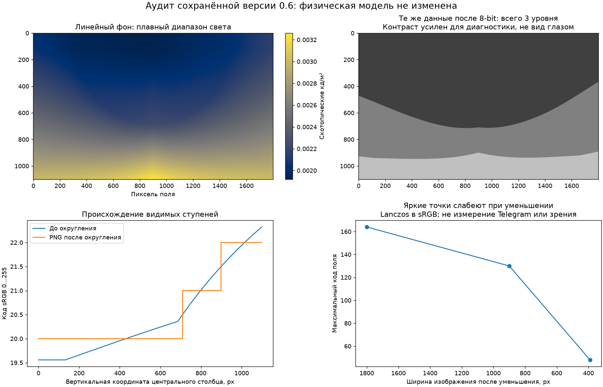

# Исследование визуализации перед камерой
> Дата создания: 2026-11-11

> Я сохраняю этот отчёт как архив конкретного опыта. Его статусы относятся к описанной версии; текущее устройство — в [MODELS](../../MODELS.md), ход развития — в [HISTORY](../../HISTORY.md).

Выполнены аудит сохранённого изображения 0.6, изучение полных первичных
работ и проверка открытых данных. Приложение/физическая модель не менялись.
Пять последующих этапов — **предлагаемый план**, не готовые функции.

## Главные результаты

- Фон до округления занимает 19,5381…22,3230 в 8-bit sRGB; после — только
  три уровня 20/21/22. Это подтверждённая причина крупных полос/пятен.
- R=G=B у 1 980 000 / 1 980 000 пикселей поля: цвета нет по конструкции.
  Насыщенных пикселей 0; максимальный код 164/255, поэтому клиппинг белого
  не объясняет отсутствие различий.
- При диагностическом уменьшении Lanczos до 900/390 px максимум падает
  с 164 до 130/48. Это пример ресемплинга, не измерение Telegram/зрения.
- Грубая угловая сетка 8×5 и её билинейная реконструкция требуют прямого
  контроля промежуточных лучей. Такой контроль здесь не выполнялся;
  нельзя всю физическую неоднородность объявить ошибкой.
- Получены пять полных работ: Ferwerda 1996, Ward 1997, Jensen 2001,
  Kirk–O'Brien 2011 и Watson 2013. Для прочих источников явно записаны
  аннотация/официальное описание/неполный доступ. PDF не включены в Git.
- Проверены CIE XYZ (471 строка) и LMS (89 строк): MD5/SHA-256 4/4 совпали.
  LMS: 43 NaN S-канала находятся за его опубликованной областью. Данные
  исследовательские, в рабочую спектральную библиотеку пока не подключены.



## Рекомендуемый порядок

1. Убрать квантование и потери отображения: float-буфер, управляемые
   кодирование/дизеринг/размер preview, без изменения физического порога.
2. Проверить световые купола на заранее заданных контрольных лучах;
   адаптивно уплотнить поле, сохранив реальные градиенты и общую мощность.
3. Отрисовывать поток через нормированную PSF с интегрированием по пикселю;
   отдельно выбрать и проверить тональную передачу и модель адаптации.
4. Исследовать LMSR/ночной цвет на известных спектрах. Не выдавать
   раскраску B−V или дневные RGB за физиологическую модель.
5. Проверить изображение в Qt/Web и контролируемых наблюдениях; затем
   расширять адаптацию/блики/лунные условия и переходить к камере.

Формальные определения, литература, границы, входы, сложность и критерии:
[подробный документ](https://github.com/WarriorOfTea/LightPollution/blob/52a3604b6603be48e07c4bd0d60a9cf32f0b9f38/docs/EYE_VISUALIZATION_RESEARCH.md),
[PDF исследования и плана](https://github.com/WarriorOfTea/LightPollution/blob/52a3604b6603be48e07c4bd0d60a9cf32f0b9f38/artifacts/eye-visualization-research-20261111/visualization-research-plan.pdf).

## Воспроизведение и статус проверок

```bash
uv run python scripts/audit_eye_visualization.py
uv run python -m py_compile scripts/audit_eye_visualization.py
```

Аудит заново читает сохранённый результат; город, звёзды, атмосфера и
порог не пересчитываются. SHA-256 трёх исходных файлов совпадают до/после.
Отдельных новых физических лучей 0; независимых визуальных наблюдателей 0.
Все знаменатели пиксельной диагностики сохранены в JSON. Это не новая
полевая валидация. Полный pytest в исследовательской задаче не запускался:
рабочий код приложения не менялся; прежние 212/212 относятся к поставке 0.6.

- [Численный аудит](image-audit.json).
- [Источники, уровни доступа, хеши таблиц и исходников](source-audit.json).
- [Состояние PDF](pdf-verification.json).

Чужие PDF/исходники и проверенные CSV остались в игнорируемом scratch.
Git содержит наши пояснения, собственную диагностику, URL/DOI и контрольные
суммы; научные ограничения не скрыты за наличием известной статьи.
