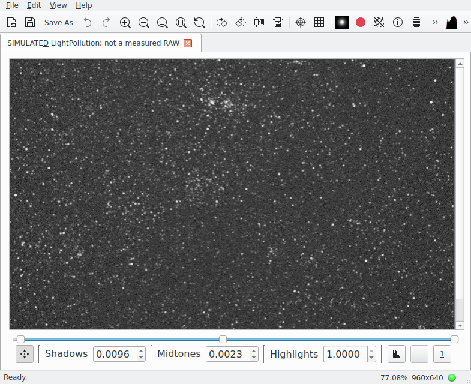
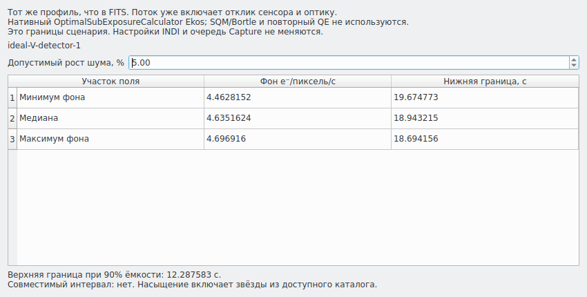
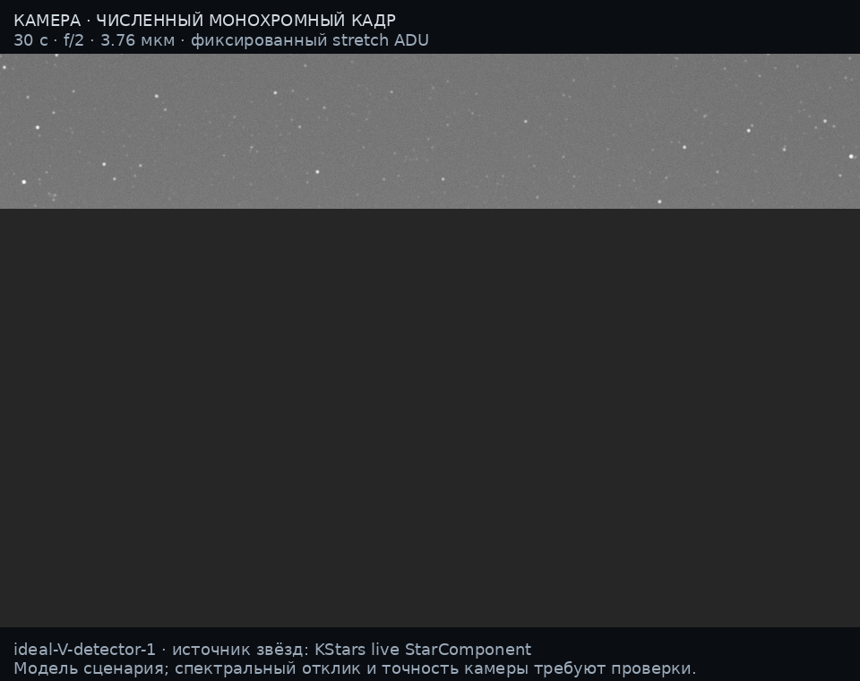

# Глубокий каталог и интеграция Qt6/Ekos — 0.10
> Дата создания: 2026-11-12

Я выполнил пункты 1 и 5 плана: улучшил звёздный вход и довёл локальную
интеграцию до проверенной Qt6-сборки, полного углового горизонта и
реального вычисления выдержки штатным Ekos. Это вычислительный опыт,
не новая наблюдательная калибровка. Исходники моделей —
[MODELS](../../MODELS.md), выводы и определения — [THEORY](../../THEORY.md),
действующие ограничения — [LIMITS](../../LIMITS.md).

## 1. Что изменилось в каталоге

| Показатель одного зенитного поля | Раньше,0.9 | Сейчас,0.10 |
|---|---|---|
| Получено записей | 311 | 17071 |
| Слабейшая нативная величина | 8 | 12 |
| Центры звёзд внутри сенсора | 188 | 10569 |
| Строки с доступным нативным цветом | 0/311 | 17008/17071 |
| Центры с рассчитанным потоком | 188 | 10107 |
| Центры с неизвестным потоком | 0 при прежнем V-прокси | 462/10569 |

Поле и сенсор:60,3°N30,315°E,2 м AGL, UTC 2026-11-11T21:00:00Z,
960×640,16 мм f/2, пиксель 3,76 мкм,30 с, seed20261112. Я использовал
тот же подготовленный годовой Black Marble2025 и DSM Copernicus90 м;
не скачивал новую NASA-ночь и не выбирал новую «идеальную» погоду.
Атмосфера остаётся указанным сценарием, не измерением этой ночи.

Новая глубина относится к полю установленного смешанного каталога,
не к доказанной полноте Johnson V≤12. Обмена по лимиту 20000 не было:
truncated=false. Глаз продолжает пользоваться
своей BSC-таблицей; глубокий живой каталог в этом опыте подключён к камере.

Для подготовки я использовал закреплённый современный базовый каталог
KStars и проверенный глубокий файл зеркала Siril. Штатный cross-ID удалил
155 дублирующих звёзд/160 записей,6 HD перенесены. Ограниченный по памяти
проход побайтно совпал с полным, повтор удалил 0. Три прежние близкие пары
объяснены разными эпохами; произвольного слияния соседних звёзд нет.
Я пересобрал байтовые смещения HD:272875 однозначных индексов,
4731 неоднозначный пропущен. Три нативных поиска слабее 8-й величины прошли.
[Происхождение и хеши](source-audit.json), [разбор пар](three-pairs-audit.json).

Для связи с измеренными формами звёзд использую уникальный HD,
отсутствие кратности и согласие координат J2000≤3″. Совпало
44 записей с BSC; измеренную форму беру лишь при её наличии в библиотеке.
Иначе использую доступный цвет/континуум. Это перенос формы/цвета,
а не подмена положения или каталожной амплитуды.

## 2. Почему я отдельно учитываю полосы

В старых файлах поля «V/B−V» могут содержать инструментальные Vₜ/Bₜ−Vₜ.
Я проверил примеры по первичной таблице CDS и руководству Tycho-2.
Для вероятных Tycho-записей использую явное приближение:

```text
V = Vₜ −0,090(Bₜ−Vₜ)
B−V =0,850(Bₜ−Vₜ)
```

Область моего применения:−0,2≤Bₜ−Vₜ≤1,8, сценарий незапылённой
главной последовательности. Под этим понимаю отсутствие неизвестного
межзвёздного покраснения; местную атмосферную экстинкцию считаю отдельно.
Формула эмпирическая; класс светимости,
покраснение и полосы всех объектов независимо не установлены.
Преобразованы 5942 записей;
у 710/17071 нет допустимого
преобразования. Их отсутствие в электронном изображении означает
неизвестный поток, а не предсказанное отсутствие света.
Сохраняю исходные значения и политику рядом с результатом.

Полная Gaia/TYC-сверка, отдельный полный XHIP-проход глубокой копии,
измеренные SED всех звёзд и разделение слабых звёзд с диффузным остатком
ещё не выполнены. Увеличение числа точек не доказывает полевую точность.

## 3. Что работает внутри KStars

Я собрал KStars3.8.6 Beta, Qt6.11.1, KF6.31.0, INDI2.1.9,
StellarSolver2.7, CFITSIO и OpenCV4.10. Системную установку не заменял.
В исходник добавлен локальный GPL-модуль; upstream KDE его не принимал.
Зависимости/хеши закреплены в [проверке сборки](build-verification.json).



Это снимок Qt-окна с синтетическим кадром. Штатный FITS Viewer использует
своё экранное растяжение. Его нельзя напрямую сравнивать по яркости
с прежним PNG; числа я сравниваю в линейном FITS.

Кнопка экспозиции вызывает настоящий
`OptimalExposure::OptimalSubExposureCalculator::calculateSubExposureDetail`.
Я передаю b в e⁻/pixel/s и RN того же профиля. QE, фильтр и f/ratio
повторно не умножаю; SQM/Bortle для этого входа не используются.

```text
sqrt((b t + RN²)/(b t)) ≤1+δ
⇒ t ≥RN² / (b ((1+δ)²−1))
```

Для δ=0,05 и RN=3e⁻ получены три нижние границы:
19.674773 с по минимальному фону,
18.943215 с по медиане и
18.694156 с по максимальному фону.
Насыщение даёт отдельную верхнюю границу
12.287583 с при 90% ёмкости.
Предел насыщения относится к учтённым потокам каталога; неизвестные
объекты могут дать дополнительное ограничение.
Совместимого интервала в этом сценарии нет. Это полезный результат двух
критериев, не ошибка и не универсальная «идеальная выдержка».
Расчёты Ekos совпали с независимой формулой с относительным допуском 10⁻¹².



Физический сенсор остаётся идеальным монохромным V-согласованным
сценарием. Реальное оборудование, INDI-устройства и очередь Capture
я не изменял; аппаратный сквозной тест ещё не проводил.

## 4. Горизонт действует на всё поле

Snapshot2 переносит все включённые контуры ArtificialHorizon и потолки.
Я повторяю нативные правила сферических дуг большого круга, короткого
азимутального интервала, перехода через север и ближайших границ. Проверка на 2054 направлениях дала 2054 совпадения.
Каждый пиксель проверяется по своему направлению, звезда — до PSF;
закрытый центр больше не запрещает открытую часть изображения.



В проверочном поле доступны 166080/614400
пикселей; остальные имеют MASK=0, ADU=0 и NaN в научных слоях.
Радиансность здания не рассчитана. Контуры созданы только в приватном
тестовом сеансе, в личную базу KStars не записаны.

## 5. Что я проверил и исправил

| Проверка | Фактический результат |
|---|---|
| Основной pytest | 317/317 за 85,97 с |
| Установщик после исправления цепочки LRU | 3/3 unit-проверки |
| Нативные задания Qt6 | 3/3 |
| Повтор каталога после поворота | 17071/17071, ID/V/B−V/астрометрия одинаковы |
| Native horizon против NumPy | 2054/2054 направлений |
| HD-поиск по перестроенному индексу | 3/3 |
| Ошибочный новый запрос | Отклонён, прежний результат остался устаревшим |
| Старый замороженный 311-звёздный вход | 614400/614400 ADU, SKY_E/STAR_E идентичны |
| Новые зенит/горизонт из замороженных входов | По 614400/614400 ADU, MASK/MEAN_E/SKY_E/STAR_E идентичны |
| FITS новых двух случаев | По 10/10 контрольных сумм |
| Wheel вне checkout | 94/94 файла,6/6 экспортов,10/10 HDU |
| Запуск/завершение launcher | Свои процессы завершены, порт освобождён, другой backend жив |
| Новые независимые RAW/наблюдатели | 0/0 |

После отдельных контролей я повторил исправленный нативный драйвер
целиком: exit0, все этапы прошли в одном приватном сеансе. Зенит и
частичный горизонт совпали с прежними случаями по 614400/614400 ADU,
фону и маске. В свежем live-каталоге появились различия высоты звёзд
менее 10⁻⁹° в зенитном поле; максимум различия звёздного float32-слоя
0,00048828125e⁻. Это отдельные нативные входы, а не один замороженный
вход. Повтор одного сохранённого входа остаётся точным. Последняя версия драйвера проверена
фактически. Ранее его управление картой сохраняло выбранную звезду
после setAltAz; отрицательная проверка теперь выполняется до выбора
объектов. Стандартный диалог под горизонтом исключён только в приватном
автоматическом профиле, физические маски от этого не меняются.

Первый Qt6-запуск выявил QJsonValue в QVariant списка: идентификаторы
источников превращались в пустые строки. Теперь передаю QString и
жду готовности каталога данных. Проверка с настоящим DSM выявила
перекрытие имени переменной углового горизонта массивом рельефа; исправлено.

Повторный нативный каталог выявил мою ошибку защиты LRU: перестановка
блоков нарушала порядок освобождения и давала 17071→9606 записей после
поворота. Я сохранил [неуспешный контроль](native-catalogue-regression-before-fix.json),
восстановил markFirst/markNext-порядок и пересобрал приложение.
Быстрый повтор и полный сценарий подтвердили исправление.
Нативная сверка также выявила 12/2054 расхождений линейной границы
со сферической дугой GreatCircle. Я ввёл явный тип геометрии, сохранил
линейный контракт отдельно и проверил сферические правила на всех лучах.
[Первый контроль](native-horizon-regression-before-fix.json) сохранён.
Это анализ найденных ошибок, а не только счётчик успешных тестов.

Коэффициент городского масштаба C=44897606336985.7 сохранён.
Контроль прежнего входа сохраняет прежнее Johnson-предположение только
для воспроизводимости; его успешный повтор не подтверждает старые полосы.
[Числа и карты](case-verification.json), [старый контроль](control-verification.json),
[нативный QA](native/native-verification.json),
[полные 2054 native-метки](native/native-horizon-ray-comparison.json.gz),
[жизненный цикл](launcher-verification.json), [wheel](wheel-verification.json).

## 6. Установка и воспроизведение

Установка не требует ручного переноса C++-файлов, каталога и индексов.
При подготовленных зависимостях Qt6/KF6/INDI:

```bash
uv run python integrations/kstars/setup.py \
  --prefix scratch/my-kstars --jobs 1
uv run python integrations/kstars/launch.py \
  --installation scratch/my-kstars
```

Подробные зависимости, SDK, выбор workspace, собственный профиль/D-Bus
и режим проверки — в [инструкции KStars](../../docs/KSTARS_INTEGRATION.md).
Повторная установка с неизменными параметрами проверена отдельно;
macOS/Windows и другие SDK автоматически проверенными не считаю.

Для повторения сенсора NASA, DSM и KStars уже не нужны: линейный свет,
звёзды и полный горизонт сохранены в gzip-JSON. Из корня репозитория:

```python
import gzip, json
from pathlib import Path
from lightpollution.interfaces.camera_view import export_camera
folder = Path("artifacts/kstars-catalogue-integration-20261112")
source = folder / "horizon-camera-input.json.gz"
result = json.loads(gzip.decompress(source.read_bytes()))
export_camera(result, Path("scratch/horizon-replay"))
```

Второй вход — [зенит](zenith-camera-input.json.gz), первый —
[горизонт](horizon-camera-input.json.gz). Сжатие сохраняет числа без потерь,
seed фиксирован. Полные линейные FITS пересоздаются этим вызовом;
большие SDK/сырой глубокий каталог не дублирую в Git.
Новый атмосферный ракурс по-прежнему требует нового переноса света.

## 7. Следующие содержательные задачи

Я перехожу к измеренному профилю одной камеры и линейным RAW,
проверенным полосам/cross-ID каталога, независимым ясным ночам и
атмосферным входам. Для глаза остаются независимые люди и дисплей.
Расширение Ekos до планирования/INDI имеет смысл проверять на
измеренном профиле и симуляторе устройств. Новую модель цвета,
многократное рассеяние или атмосферный прогноз этот этап не добавляет.
