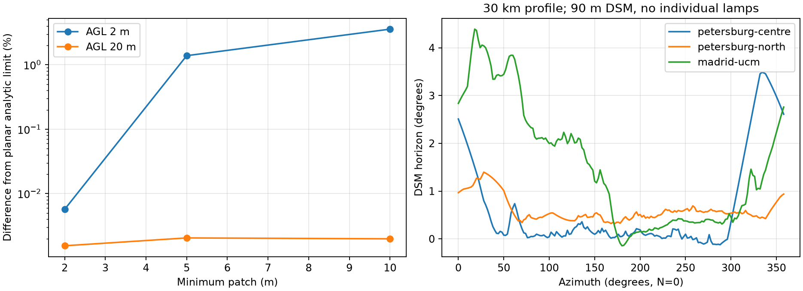
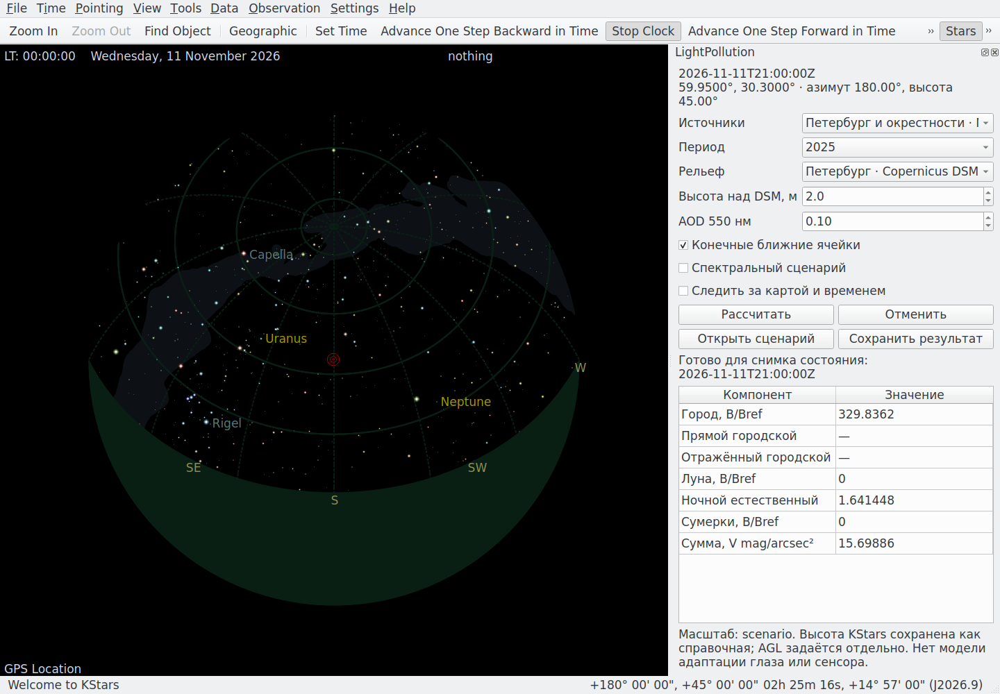

# KStars, рельеф и ближнее освещение: отчёт 0.5
> Дата создания: 2026-11-11

> Я сохраняю этот отчёт как архив конкретного опыта. Его статусы относятся к описанной версии; текущее устройство — в [MODELS](../../MODELS.md), ход развития — в [HISTORY](../../HISTORY.md).

## Выполненные изменения

Интеграция и модели разрабатываются совместно. Добавлена нативная
C++/Qt-панель KStars: читает место, виртуальный UTC, геометрический центр
карты, FOV, выбранный объект и штатную маску Artificial Horizon; передаёт
снимок в общий Planner. Панель показывает компоненты фона, отменяет задания,
помечает результат устаревшим, сохраняет полный JSON. Локальный сайт
остаётся дополнительным клиентом; панель не является встроенной веб-страницей.

Используемые данные звёзд KStars: имя/каталожная величина выбранного объекта,
для StarObject — B−V, спектральный тип и HD. Недоступный B−V не подменяется
белым спектром. Поле звёзд ядро пока строит по своему BSC-адаптеру; полный
перенос каталогов, собственного движения и параллакса — последующее расширение.

`near_field` возвращает ранее исключавшиеся источники ближе 3 км как
конечные светящиеся площадки. Сумма их мощностей сохраняется, общая
нормировка не зависит от наблюдателя. Подъячеечная квадратура не добавляет
новую измеренную информацию о расположении фонарей.

`terrain` поднимает источники и наблюдателя на проверенный DSM, проверяет
заслонение обоих путей городского рассеяния, строит профиль горизонта и
исключает заслонённые звёзды. Входная высота — AGL над DSM. Высота места
KStars над морем — отдельная справочная величина. Для закрытого направления
сумма неба неизвестна (`null`): отражение препятствия не задано.

## Формальные модели и документация

- [Рельеф и ближний свет](https://github.com/WarriorOfTea/LightPollution/blob/52a3604b6603be48e07c4bd0d60a9cf32f0b9f38/docs/TOPOGRAPHY_AND_NEAR_FIELD.md): определения,
  геометрия сферической Земли, датум EGM2008, закон обратных квадратов,
  сохранение мощности, интеграл по площади источника, Бера, Рэлея/
  Хеньи–Гринстейна, двухпутевая видимость и численные ограничения.
- [Интеграция KStars](../../docs/KSTARS_INTEGRATION.md): аудит исходников,
  что переиспользуется, snapshot/JSON/D-Bus, фоновые задачи, сборка.
- [Объяснение с основ](https://github.com/WarriorOfTea/LightPollution/blob/52a3604b6603be48e07c4bd0d60a9cf32f0b9f38/docs/PHYSICS_AND_MATH_GUIDE.md): главы 27–28.
- [Единый сборник PDF](https://github.com/WarriorOfTea/LightPollution/blob/52a3604b6603be48e07c4bd0d60a9cf32f0b9f38/artifacts/kstars-terrain-near-20261111/theory-from-zero.pdf) и [его исходный текст](https://github.com/WarriorOfTea/LightPollution/blob/52a3604b6603be48e07c4bd0d60a9cf32f0b9f38/artifacts/kstars-terrain-near-20261111/theory-from-zero.md).
  Копии формул/кода проверяются побайтно, ссылки внутри формул не переписываются.

## Реальные данные

Подготовлены 29/29 публичных GeoTIFF Copernicus DEM GLO-90: Петербург
20/20, Мадрид 9/9. Сохраняются SHA-256, размеры, реальные affine transforms,
PixelIsPoint, EGM2008 и атрибуция. Основная съёмка DSM относится к
2011–2015 годам, а не к текущему состоянию каждого здания.

| Набор | Размер рабочей сетки | Диапазон высот, м | Данные |
|---|---|---|---|
| Петербург | 4796 × 5996 | −59,61…255,61 | [манифест](petersburg-copdem90-manifest.json) |
| Мадрид | 3596 × 3596 | 352…2416,39 | [манифест](madrid-copdem90-manifest.json) |

90 м — номинальное разрешение исходного DSM. Сетка 1/1200° не увеличивает
его информационную детализацию. Два внешних ряда/столбца без покрытия
исходной точечной сеткой отсечены, внутренние NoData запрещены. Первая
попытка мозаики обнаружила 10799 NoData на внешней границе Петербурга;
они не были заменены нулевыми высотами.

NASA-источники переиспользованы: Петербург — год 2025, Мадрид — март 2017.
Новые HDF5 и независимые наземные ночи не скачивались. Земная вода
исключается существующей QA-маской источников. Файлы DSM/пакеты сборки
находятся в игнорируемых `data/`/`scratch/`, в Git — проверяемые манифесты.

## Численная проверка

Критерии записаны до опыта в [predeclared-criteria.json](predeclared-criteria.json).
Сравниваются сырые отклики при одном S_ref, без повторной подгонки C.

Независимый аналитический предел — телесный угол прямоугольной
ламбертовской площадки. На высоте AGL=2 м грубые параметры 10 м/порядок 2
отличаются от него на 3,5747%, 5 м/порядок 2 — на 1,3840%.
Они не прошли порог 0,2%. Поэтому новые defaults — 2 м/порядок 3:
отклонение 0,00569% при 2 м и 0,00155% при 20 м; **2/2** финальных
случая проходят порог. Сохранение мощности **6/6**, max abs ≈4,44·10⁻¹⁶.
[Все шесть случаев, включая неудачные грубые настройки](finite-cell-convergence.json).

В реальных опытах ниже использован быстрый профиль 96/12, AGL=2 м,
зенит; зафиксирована одна и та же общая мощность источников. Множители
в первых двух колонках относятся к явно сохранённым грубым 10 м/порядок 2,
а последняя колонка — к новым defaults 2 м/порядок 3.

| Точка | Ближние ячейки / прежнее исключение 3 км | DSM / общая поверхность при ближних ячейках | Изменение шага 100→50 м, новые defaults |
|---|---|---|---|
| Петербург, 59,95° N 30,30° E | ×3,3513 | ×0,99925 | 0,01553% |
| Север Петербурга, 60,30° N 30,315° E | ×1,2699 | ×1,00373 | 0,01639% |
| UCM, 40,451111° N −3,726111° E | ×2,3200 | ×0,96320 | 0,01150% |

Изменение DSM включает одновременно высоты источников/наблюдателя,
плотность атмосферы по абсолютной высоте и заслонение; это не отдельно
измеренный процент горной тени. Высоты DSM в точках: 12,53 / 59,44 /
652,65 м. Уточнение квадратуры ближних источников 10/2→2/3 меняет эти
зенитные отклики менее чем на 0,005%. Удвоение атмосферных узлов
96/12→192/24 на выбранном луче центра Петербурга меняет отклик на 0,02201%.
Это **3/3** проверок шага и **1/1** выбранных проверок атмосферных узлов
с допуском 1%, не гарантия для произвольного азимута, горы или низкого AGL.

[Полные числа/параметры](real-DSM-transfer.json), [сводка](summary.json).



Это диагностические графики, не имитация зрения человека.

## Программные проверки

Полный pytest: **190/190 passed**, 0 failed/errors/skipped/warnings,
49,95 с; добавлено 25 случаев к прежним 165. Проверены аналитический
интеграл, сохранение мощности, плоский предел, уменьшение рассеянного
света за хребтом при одинаковых источниках, строгий snapshot/UTC,
маски горизонта и HTTP. Неизвестный/отсутствующий DSM не становится
плоской поверхностью. [Протокол](python-verification.json).

Живой KStars 3.6.2: **2/2** холодных и **2/2** повторных задания на
настоящих NASA/DSM-данных завершены. Проверены место, фактический UTC,
центр карты, AGL/MSL, устаревание после поворота, каталог выбранной Веги
(HD/тип и nullable B−V), собственные скриншоты Qt. Нативная панель —
настоящее окно приложения. [Последний протокол](native-verification.json),
[холодный/повторный запуск](native-performance.json).

Первая проверка времени остановилась до задания: тест предполагал, что
`setGPSLocation(...,tz0=0)` сохраняет нулевой пояс. KStars выбирает пояс
ближайшего города (в этой точке UTC+3), поэтому `setLocalTime(21:00)`
дало 18:00 UTC. Native snapshot правильно передал фактическое UTC.
Проверочный скрипт исправлен: читает реальный `location().tz` и задаёт
местное время соответственно. Эта неудачная проверка не скрывается и
не считается завершённым расчётом.

| Направление | Первый backend-расчёт | Повтор из кэша сцены |
|---|---|---|
| Зенит | 192,67 с, 6 новых ядер | 1,59 с |
| Юг, высота 45° | 83,80 с, 6 попаданий / 4 новых ядра | 1,57 с |

Это времена Python-ядра на данном CPU, без обещания realtime при новом
месте/атмосфере. GUI выполняет обращения асинхронно и показывает прогресс.
Служебная сетка ещё требует лишних лучей для одного направления;
разреженный контракт и переиспользование геометрии — дальнейшая оптимизация.



Слева штатная карта планетария, справа наши численные результаты.
Это не визуализация адаптации глаза или экспозиции камеры. Показанная
V-яркость имеет сценарную опору, а не измеренную местную шкалу.

Браузер Chromium: **1/1** завершённое задание с новыми контролами,
сохранение terrain/near_field, происхождение KStars сохраняется при
неизменной геометрии и снимается после ручной правки, JS ошибок **0**,
ширина 390 px без горизонтального переполнения.
[Протокол](browser-verification.json).

Wheel 0.5 установлен в отдельное окружение с 36 закреплёнными runtime-
зависимостями и запущен из `/tmp` без исходной рабочей директории.
65/65 файлов пакета совпадают с исходниками; новые модели работают
без rasterio при загрузке готовой поверхности. [Протокол](wheel-verification.json).
`uv lock --check`, `git diff --check`, Node JS syntax check прошли.

## Исходники и сборка KStars

Аудит текущего кода: commit `50e6b7b70078da6107616671b019f0eccbca1266`,
[файлы/SHA/HTTP-статусы](KStars-source-audit.json).
Проверяемая сборка — KStars 3.6.2, исходный архив 111110944 байта,
SHA-256 `0d7f9e2c8f1da450d85141f052b5b41dc11ed994f49a5d1209cacbbbf804d5de`.
[Закреплённые исходники, зависимости и параметры](native-build-provenance.json).

Сборка изолирована в `scratch/`; системные пакеты и пользовательские
настройки не менялись. Для проверки карты/панели INDI/Ekos device control
выключены; это не проверка интеграции сенсора или телескопа. Использована
Qt5/KF5 и оптимизация `-O0` для проверочной сборки. Совместимость с текущим
Qt6/master пока не доказана. У upstream встречаются предупреждения
deprecated API; число Python-тестов нельзя трактовать как отсутствие
предупреждений стороннего C++ кода.
Скрипт установки сохраняет mtime неизменённых исходников: **4/4** файла
проверены повторным применением, лишняя пересборка не требуется.

## Пределы результата и следующий шаг

Независимых ясных ночей для проверки нового рельефа/ближнего света **0**;
MAE/RMSE физического прогноза не определены. Ранее полученная калибровка
другого решателя не применяется автоматически. По умолчанию C сценарный.

DSM 90 м не восстанавливает отдельные фонари, дворы и строительные изменения.
Положение/IES/мощность локальных ламп, прямое ослепление глаза/объектива,
детальные препятствия, наклонные BRDF и многократное рассеяние остаются
расширениями. Двухпутевое DSM-заслонение применено к городу; эмпирическая
Луна не получила полного освещения гор. Модели адаптации/обнаружения глазом
и электронов/шума камеры не объявляются готовыми.

Следующая работа: собрать Qt6-вариант выбранной актуальной версии,
добавить известные локальные лампы с устранением двойного учёта VIIRS,
получить наземные ночи и только после согласования полос подключать
вычисленный фон к Exposure Calculator/INDI. Эти задачи могут идти совместно
через уже существующий контракт ядра и панели.

## Воспроизведение

```bash
uv sync --locked --extra terrain --extra kstars
uv run lightpollution prepare-terrain --dataset petersburg-copdem90 --directory data/terrain
uv run lightpollution prepare-terrain --dataset madrid-copdem90 --directory data/terrain
uv run python scripts/run_terrain_near_field.py
uv run pytest -q -p no:cacheprovider
uv lock --check
```

NASA HDF5 должны быть подготовлены по прежним манифестам. Дополнительные
параметры живой проверки и установки модуля — в документации интеграции.
