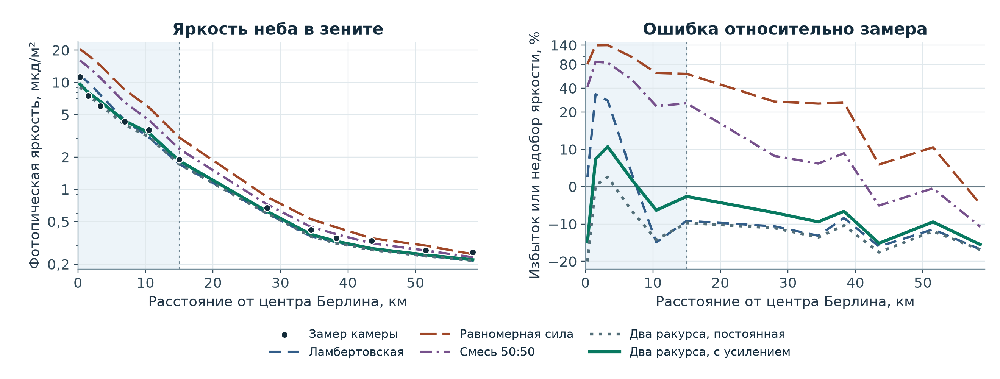
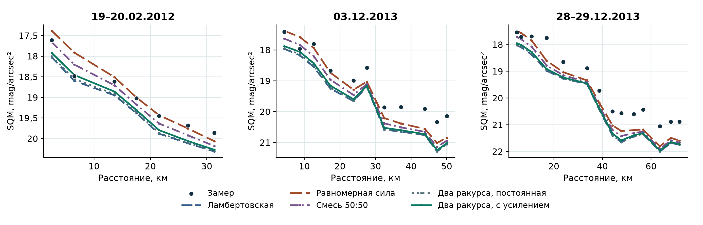
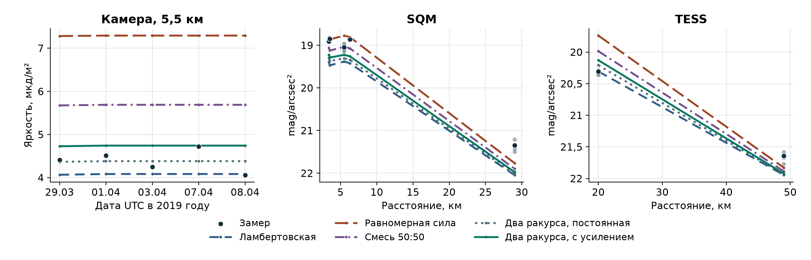
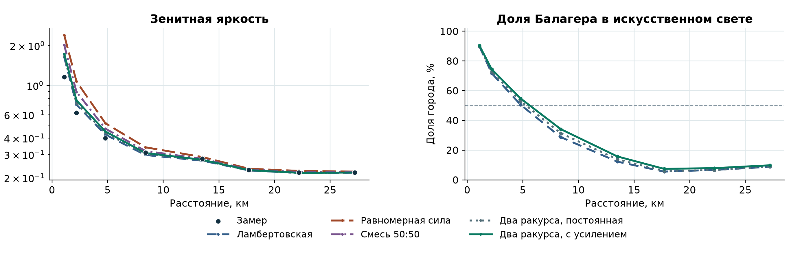

# Пять диаграмм засветки на ясных ночах четырёх городов

Берлин, Мадрид, Тусон и Балагер. Сопоставление наземной зенитной фотометрии с расчётом многократного рассеяния по Black Marble.

В Мадриде наклонное излучение заметно меняет ошибку. На точках с преобладанием города лучший результат даёт смесь 50:50. В Тусоне ламбертовская диаграмма и два ракурса с постоянным продолжением дали близкие ошибки. В Балагере лидирует ламбертовская. Следовательно, результат Берлина с усилением у горизонта зависит от города и условий наблюдения.

[Разбор ошибок по расстоянию, архивной погоде и режиму освещения в Мадриде и Тусоне](weather-audit.md)

## Сводка по всем точкам каждого города

Числа в таблице — средняя абсолютная относительная ошибка полной яркости. Для SQM и TESS считаю разницу после перевода из звёздных величин в линейный сигнал соответствующей полосы. Каждый замер имеет одинаковый вес внутри строки. Сравнение между городами учитывает различия их приборов и маршрутов.

| Город | Замеры | Ламберт | Равн. | 50:50 | Пост. | Усил. |
|---|---:|---:|---:|---:|---:|---:|
| Берлин | 12 | 13,97% | 56,89% | 29,38% | 11,22% | 8,88% |
| Мадрид | 32 | 44,20% | 29,93% | 34,33% | 43,35% | 40,72% |
| Тусон | 28 | 22,41% | 40,65% | 26,61% | 22,13% | 22,66% |
| Балагер | 8 | 9,08% | 28,42% | 17,59% | 9,80% | 11,27% |

**Ламберт** держит радиансность постоянной, а сила излучения убывает с наклоном из-за проекции поверхности. **Равн.** держит силу излучения постоянной на высоте 5–90° над горизонтом, а ниже 5° фиксирует радиансность. **50:50** смешивает эти диаграммы поровну по сигналу NearNadir. **Пост.** сохраняет оба ракурса Black Marble и продолжает OffNadir постоянной радиансностью ниже 30° над горизонтом. **Усил.** сохраняет те же ракурсы и плавно увеличивает радиансность к горизонту до двойного OffNadir. Для двух последних форм углы 70–90° и 30–50° над горизонтом задают NearNadir и OffNadir. [Схема диаграмм и берлинский протокол](../berlin-propagation-20261126/README.md)

В таблицах по точкам «Доля города» — вклад выбранного города в искусственную яркость при усиленном сценарии. В группе «Преобладает город» его вклад выше 50% при всех трёх диаграммах Ламберт, Пост. и Усил. Во всех формах учитываю соседние источники на карте.

## Берлин. Предыдущий опыт

Один ясный маршрут 28–29 марта 2017 года, 12 точек на 0,3–58,5 км. На шести ближних точках с преобладанием Берлина средняя ошибка составила 15,24% при Ламберте, 8,89% при постоянном продолжении и 7,27% с усилением. Все пять вариантов правильно упорядочили 64 из 64 различимых пар. На дальнем участке суммарная искусственная яркость падает в расчёте быстрее измеренной.

[Полевые наблюдения Jechow и Hölker](https://doi.org/10.3390/rs12203412) · [Полная таблица Берлина](../berlin-propagation-20261126/README.md#измерения-и-прогнозы-по-точкам)

## Мадрид. Три ясных маршрута с SQM

Из открытого автомобильного архива отобрал три маршрута 19–20 февраля 2012, 3 декабря 2013 и 28–29 декабря 2013 года. После фильтрации исходных отсчётов остались 904, 598 и 1 385 кандидатов соответственно. Взял одну площадку на каждый заполненный интервал расстояния в 5 км. Координаты выбрал по медиане расстояний, затем взял медиану показаний в пределах 600 м и двух минут от этой точки. Получилось 32 сравнения. Почасовой реанализ на маршрутах даёт 0–12% облачности, нулевые осадки и снег. Для итоговых точек Солнце ниже −19,7°, Луна ниже −6,7° при обеих трактовках времени исходного CSV, как UTC и как местного. [Архив SQM](https://zenodo.org/records/51713) · [Методика маршрутов и отбраковка дорожного света](https://arxiv.org/html/1512.06694#S3) · [ERA5 и ERA5-Land](https://open-meteo.com/en/docs/historical-weather-api)

По всем 32 точкам равномерная диаграмма даёт 29,93% ошибки, смесь 34,33%, Ламберт 44,20%. На восьми точках с преобладанием Мадрида смесь лучше равномерной, 18,54% против 22,69%. Например, на 2,5 км в феврале Ламберт даёт недобор 32%, равномерная диаграмма — избыток 23%, смесь — недобор 4%. На самой дальней декабрьской площадке в 71,6 км все пять вариантов занижают яркость на 48–55%. В расчёте там преобладают источники вне Мадрида. По трём маршрутам модели верно упорядочили 150–152 из 155 различимых пар внутри одной ночи.

В таблицах яркость в mag/arcsec² по шкале SQM. Дата обозначает начало ночи, даже если GPS-замеры сделаны после полуночи.

| Разрез | Замеры | Ламберт | Равн. | 50:50 | Пост. | Усил. |
|---|---:|---:|---:|---:|---:|---:|
| Преобладает город | 8 | 32,81% | 22,69% | 18,54% | 30,97% | 26,53% |
| 2012-02-19 | 7 | 28,09% | 18,50% | 16,52% | 26,49% | 22,63% |
| 2013-12-03 | 11 | 46,23% | 29,66% | 36,07% | 45,42% | 42,70% |
| 2013-12-28 | 14 | 50,67% | 35,87% | 41,87% | 50,16% | 48,20% |

### 2012-02-19

| км | Замер | Ламберт | Равн. | 50:50 | Пост. | Усил. | Доля города |
|---|---|---|---|---|---|---|---|
| 2,5 | 17,61 | 18,02 | 17,38 | 17,66 | 18,00 | 17,92 | 96% |
| 6,5 | 18,48 | 18,60 | 17,91 | 18,20 | 18,55 | 18,46 | 92% |
| 13,6 | 18,62 | 18,95 | 18,51 | 18,71 | 18,92 | 18,86 | 45% |
| 17,5 | 19,02 | 19,38 | 19,00 | 19,18 | 19,36 | 19,31 | 35% |
| 21,5 | 19,45 | 19,88 | 19,43 | 19,63 | 19,86 | 19,79 | 36% |
| 26,7 | 19,68 | 20,11 | 19,75 | 19,92 | 20,11 | 20,06 | 26% |
| 31,3 | 19,86 | 20,31 | 20,06 | 20,18 | 20,30 | 20,27 | 19% |

### 2013-12-03

| км | Замер | Ламберт | Равн. | 50:50 | Пост. | Усил. | Доля города |
|---|---|---|---|---|---|---|---|
| 4,3 | 17,41 | 17,96 | 17,38 | 17,63 | 17,95 | 17,88 | 96% |
| 8,7 | 17,96 | 18,17 | 17,58 | 17,84 | 18,13 | 18,06 | 96% |
| 12,6 | 17,80 | 18,55 | 17,94 | 18,20 | 18,52 | 18,44 | 90% |
| 17,3 | 18,67 | 19,25 | 18,74 | 18,96 | 19,23 | 19,16 | 54% |
| 23,8 | 18,99 | 19,66 | 19,29 | 19,46 | 19,64 | 19,59 | 30% |
| 27,6 | 18,57 | 19,19 | 19,03 | 19,11 | 19,19 | 19,17 | 11% |
| 32,4 | 19,86 | 20,58 | 20,21 | 20,38 | 20,58 | 20,52 | 29% |
| 37,1 | 19,85 | 20,65 | 20,39 | 20,51 | 20,64 | 20,60 | 19% |
| 43,9 | 19,91 | 20,76 | 20,56 | 20,65 | 20,75 | 20,73 | 14% |
| 47,3 | 20,33 | 21,29 | 21,01 | 21,14 | 21,28 | 21,25 | 23% |
| 50,0 | 20,14 | 21,05 | 20,84 | 20,94 | 21,05 | 21,02 | 14% |

### 2013-12-28

| км | Замер | Ламберт | Равн. | 50:50 | Пост. | Усил. | Доля города |
|---|---|---|---|---|---|---|---|
| 4,8 | 17,54 | 18,03 | 17,48 | 17,72 | 18,02 | 17,95 | 96% |
| 6,6 | 17,71 | 18,10 | 17,57 | 17,80 | 18,07 | 18,01 | 96% |
| 10,9 | 17,70 | 18,37 | 17,85 | 18,08 | 18,34 | 18,28 | 87% |
| 17,0 | 17,74 | 18,98 | 18,61 | 18,78 | 18,96 | 18,91 | 37% |
| 23,9 | 18,65 | 19,27 | 19,03 | 19,15 | 19,26 | 19,23 | 18% |
| 33,7 | 18,88 | 19,47 | 19,34 | 19,41 | 19,47 | 19,46 | 8% |
| 38,6 | 19,72 | 20,43 | 20,17 | 20,29 | 20,42 | 20,39 | 15% |
| 44,2 | 20,50 | 21,41 | 21,02 | 21,20 | 21,39 | 21,33 | 32% |
| 47,7 | 20,56 | 21,65 | 21,23 | 21,42 | 21,64 | 21,58 | 34% |
| 52,9 | 20,60 | 21,43 | 21,20 | 21,31 | 21,43 | 21,39 | 18% |
| 56,7 | 20,43 | 21,35 | 21,18 | 21,26 | 21,34 | 21,32 | 15% |
| 63,6 | 21,06 | 22,00 | 21,80 | 21,90 | 21,99 | 21,96 | 25% |
| 68,1 | 20,88 | 21,68 | 21,49 | 21,58 | 21,68 | 21,65 | 15% |
| 71,6 | 20,89 | 21,74 | 21,59 | 21,67 | 21,74 | 21,72 | 10% |

## Тусон. Измерения до полуночи

Использовал колонку до полуночи из таблицы 4 Barentine и соавторов, интервал 06:55–07:00 UTC. Сохранил 28 замеров на семи площадках от 3,4 до 49 км за шесть ночей. Замер TESS в Oracle State Park 1 апреля исключил после замечания авторов об облаках. Архивная маска GOES подтверждает облака у Oracle и показывает ясные или вероятно ясные пиксели в пределах 5 км от остальных площадок в окнах использованных замеров. Камера и SQM на 5,5 км дают отдельные сравнения. Авторы измерили между ними смещение около 0,42 mag при совместной проверке. Для прогнозов применил общие спектральные нули приборных полос. [Таблицы 2–4 и проверка приборов](https://arxiv.org/html/2005.12357#S3) · [Сопоставление с погодой](weather-audit.md#тусон-площадки-и-облака)

**Режим фонарей.** В обычную ночь номинальная мощность до полуночи составляла 90%, затем около 16 000 управляемых фонарей переходили на 60%. Данные Kyba и соавторов уточняют даты эксперимента. Ночь 7 апреля прошла в повышенном режиме, а 8 апреля система вернулась к обычному. В архивных строках 90% обозначает номинальный сценарий исходной фотометрической статьи. Для расчёта использую спутниковый масштаб источников, включая частное освещение. Композит объединяет пролёты после полуночи с разными фактическими режимами. [Номинальный режим и фотометрия](https://arxiv.org/html/2005.12357#S2) · [Показания фонарей и времена пролётов VIIRS, таблицы 1 и 4](https://journals.sagepub.com/doi/10.1177/1477153520958463)

Ламберт и постоянное продолжение дали 22,41% и 22,13% на всех замерах. На 18 замерах с преобладанием Тусона ошибки 15,60% и 15,62%, а усиление даёт 17,36%. Приборы показывают разные предпочтения. Постоянная диаграмма лучше согласуется с камерой в одной точке, смесь 50:50 — с SQM, Ламберт — с TESS. Все пять диаграмм воспроизвели 10 из 11 различимых пар той же ночи и полосы. Сферический перенос использует высоты станций. Экранирование Santa Catalina Mountains, особенно перед дальней площадкой, остаётся отдельным фактором. [Описание дальнего контроля и горного экранирования](https://arxiv.org/html/2005.12357#S3.SS4)

В таблице DSLR в мкд/м², SQM и TESS в mag/arcsec² своих полос. Даты приведены в UTC. Относительные ошибки вычислены в линейной яркости соответствующего прибора.

| Разрез | Замеры | Ламберт | Равн. | 50:50 | Пост. | Усил. |
|---|---:|---:|---:|---:|---:|---:|
| Преобладает город | 18 | 15,60% | 50,52% | 25,41% | 15,62% | 17,36% |
| DSLR | 5 | 7,05% | 66,53% | 29,86% | 4,41% | 8,24% |
| SQM | 12 | 38,03% | 24,03% | 22,80% | 34,46% | 30,18% |
| TESS | 11 | 12,34% | 47,02% | 29,29% | 16,74% | 20,99% |

| Дата UTC | Прибор | км | Замер | Ламберт | Равн. | 50:50 | Пост. | Усил. | Доля города |
|---|---|---|---|---|---|---|---|---|---|
| 29.03 | DSLR | 5,5 | 4,410 | 4,066 | 7,283 | 5,674 | 4,366 | 4,727 | 92% |
| 29.03 | TESS | 20,0 | 20,36 | 20,26 | 19,67 | 19,93 | 20,16 | 20,08 | 89% |
| 29.03 | SQM | 29,0 | 21,50 | 22,05 | 21,77 | 21,90 | 22,03 | 21,99 | 56% |
| 29.03 | TESS | 49,0 | 21,77 | 21,94 | 21,85 | 21,89 | 21,94 | 21,92 | 30% |
| 31.03 | SQM | 3,4 | 18,91 | 19,39 | 18,81 | 19,06 | 19,30 | 19,23 | 92% |
| 31.03 | TESS | 20,0 | 20,32 | 20,26 | 19,67 | 19,93 | 20,16 | 20,08 | 89% |
| 31.03 | SQM | 29,0 | 21,42 | 22,05 | 21,77 | 21,90 | 22,03 | 21,99 | 56% |
| 31.03 | TESS | 49,0 | 21,67 | 21,94 | 21,85 | 21,89 | 21,94 | 21,92 | 30% |
| 01.04 | DSLR | 5,5 | 4,510 | 4,084 | 7,294 | 5,689 | 4,382 | 4,742 | 92% |
| 01.04 | SQM | 5,5 | 18,96 | 19,38 | 18,77 | 19,04 | 19,31 | 19,23 | 92% |
| 01.04 | SQM | 6,3 | 18,86 | 19,42 | 18,81 | 19,07 | 19,34 | 19,26 | 92% |
| 01.04 | TESS | 20,0 | 20,29 | 20,31 | 19,74 | 19,99 | 20,21 | 20,13 | 88% |
| 03.04 | DSLR | 5,5 | 4,250 | 4,084 | 7,294 | 5,689 | 4,382 | 4,742 | 92% |
| 03.04 | SQM | 5,5 | 19,10 | 19,38 | 18,77 | 19,04 | 19,31 | 19,23 | 92% |
| 03.04 | TESS | 20,0 | 20,34 | 20,31 | 19,74 | 19,99 | 20,21 | 20,13 | 88% |
| 03.04 | SQM | 29,0 | 21,35 | 22,04 | 21,76 | 21,89 | 22,02 | 21,97 | 55% |
| 03.04 | TESS | 49,0 | 21,64 | 21,95 | 21,83 | 21,89 | 21,94 | 21,92 | 31% |
| 07.04 | SQM | 3,5 | 18,85 | 19,47 | 18,86 | 19,13 | 19,37 | 19,29 | 92% |
| 07.04 | DSLR | 5,5 | 4,720 | 4,084 | 7,294 | 5,689 | 4,382 | 4,742 | 92% |
| 07.04 | SQM | 5,5 | 19,00 | 19,38 | 18,77 | 19,04 | 19,31 | 19,23 | 92% |
| 07.04 | TESS | 20,0 | 20,29 | 20,31 | 19,74 | 19,99 | 20,21 | 20,13 | 88% |
| 07.04 | SQM | 29,0 | 21,21 | 22,04 | 21,76 | 21,89 | 22,02 | 21,97 | 55% |
| 07.04 | TESS | 49,0 | 21,64 | 21,95 | 21,83 | 21,89 | 21,94 | 21,92 | 31% |
| 08.04 | DSLR | 5,5 | 4,060 | 4,084 | 7,294 | 5,689 | 4,382 | 4,742 | 92% |
| 08.04 | SQM | 5,5 | 19,15 | 19,38 | 18,77 | 19,04 | 19,31 | 19,23 | 92% |
| 08.04 | TESS | 20,0 | 20,29 | 20,31 | 19,74 | 19,99 | 20,21 | 20,13 | 88% |
| 08.04 | SQM | 29,0 | 21,34 | 22,04 | 21,76 | 21,89 | 22,02 | 21,97 | 55% |
| 08.04 | TESS | 49,0 | 21,58 | 21,95 | 21,83 | 21,89 | 21,94 | 21,92 | 31% |

## Балагер. Ясный маршрут до Монтсека

Восемь площадок 1,1–27,2 км в ясную ночь 3–4 мая 2016 года. Взял фотопическую яркость камеры из таблицы 1 и координаты с высотами из таблицы 3. Для Парка Монтсек взял раннее измерение 0,22 мкд/м². Поздний повтор был 0,20. В ту же ночь на окраине Балагера отдельно измерили падение с 1,15 до 0,99 после выключения декоративной подсветки. Для маршрута использовал опубликованные значения ясной серии. Время отдельных кадров и состояние подсветки для каждой строки остаются открытыми входами. [Таблицы ясного маршрута](https://doi.org/10.1038/s41598-017-06998-z) · [Наблюдение выключений](https://arxiv.org/html/1808.10224)

На восьми точках ошибка Ламберта 9,08%, постоянного продолжения 9,80%, усиления 11,27%. На трёх точках, где город преобладает, ошибки выше, 20,77%, 23,47% и 28,56% соответственно. На 1,1 км камера дала 1,16 мкд/м², а Ламберт 1,64. Усиление подняло прогноз до 1,73. Все варианты уловили не менее 24 из 25 различимых пар. На дальних площадках полный сигнал близок к естественному фону. Варьирование фона с 0,17 до 0,25 мкд/м² увеличивает среднюю ошибку Ламберта с 9,08% до 31,71%. Поэтому низкую среднюю ошибку по всему маршруту важно читать вместе с ближними точками.

В таблице яркость в мкд/м².

| Разрез | Замеры | Ламберт | Равн. | 50:50 | Пост. | Усил. |
|---|---:|---:|---:|---:|---:|---:|
| Преобладает город | 3 | 20,77% | 69,68% | 45,22% | 23,47% | 28,56% |
| DSLR | 8 | 9,08% | 28,42% | 17,59% | 9,80% | 11,27% |

| км | Замер | Ламберт | Равн. | 50:50 | Пост. | Усил. | Доля города |
|---|---|---|---|---|---|---|---|
| 1,1 | 1,160 | 1,635 | 2,399 | 2,017 | 1,658 | 1,731 | 90% |
| 2,2 | 0,620 | 0,715 | 1,072 | 0,893 | 0,732 | 0,772 | 74% |
| 4,8 | 0,400 | 0,424 | 0,517 | 0,471 | 0,437 | 0,448 | 55% |
| 8,4 | 0,310 | 0,298 | 0,340 | 0,319 | 0,303 | 0,308 | 34% |
| 13,5 | 0,280 | 0,270 | 0,287 | 0,279 | 0,272 | 0,274 | 16% |
| 17,7 | 0,230 | 0,228 | 0,234 | 0,231 | 0,228 | 0,229 | 7% |
| 22,2 | 0,220 | 0,218 | 0,226 | 0,222 | 0,218 | 0,218 | 8% |
| 27,2 | 0,220 | 0,219 | 0,223 | 0,221 | 0,219 | 0,219 | 10% |

## Как обеспечил сопоставимость

- **Источники.** Месячные бесснежные VNP46A3 Collection 2, при пропусках ячеек NearNadir использую годовой VNP46A4 того же года. Для обоих ракурсов требую флаг качества 0 и более трёх наблюдений. Диаграмму меняю внутри границы города. Для остальных источников оставляю Ламберта. Масштаб всех моделей фиксирую по NearNadir. В двух последних вариантах дополнительно сохраняю радиансность OffNadir в его диапазоне. Годовые замены дают 11,1% сигнала Тусона в марте, 1,5% в апреле и менее 0,3% по остальным городским композитам. [Black Marble](https://doi.org/10.5067/VIIRS/VNP46A3.002)
- **Перенос и атмосфера.** Использую рассеяние всех порядков на сферической границе с опорой на 500 м для Мадрида, 700 м для Тусона и 250 м для Балагера. Высоты станций учитываю относительно этой границы. Для февральского Мадрида использую сценарий AOD 0,100. Для двух декабрьских ночей по дневному AERONET получаю около 0,085 и 0,021 на 550 нм у опорной поверхности. Для Балагера дневная AOD над станцией Montsec 0,040. Экспоненциальное продолжение от 1 574 м к опорным 250 м даёт 0,120 и вносит неопределённость. Тусон использует параметры авторов AOD 0,06 на 500 нм, показатель Ангстрема 1, SSA 0,935 и спектральную зависимость асимметрии. У опорной поверхности Тусона это AOD 0,056 на 550 нм. [AERONET](https://aeronet.gsfc.nasa.gov/) · [Атмосфера Тусона](https://arxiv.org/html/2005.12357#S4.SS1.SSS1)
- **Фотометрия.** Считаю восемь спектральных интервалов 380–780 нм. Общий спектр источников — равные доли DNB двух опорных спектров HP1 и LED-B2. Отдельно применяю отклики CIE, SQM и TESS. Для SQM и TESS использую лабораторные формы полос и синтетический нуль Vega, с приближением поля зрения кругом радиусом 10° и 8,5° соответственно. Для камеры усредняю 10° вокруг зенита, как в расчёте Берлина. Вклад естественного фона 0,170 мкд/м² в фотопической полосе. В SQM и TESS его перевожу по спектру Paranal. Наземные измерения используются для проверки ошибок. [Калибровка SQM и TESS](https://doi.org/10.3390/s19061336) · [Фоновый спектр Paranal](https://etimecal.hq.eso.org/observing/etc/doc/skycalc/helpskycalc.html)

Различимые пары считаю внутри одной ночи и полосы, при разности более 10% от среднего линейного сигнала пары. Повторные точки и пары одной ночи могут быть зависимы. Проверки спектров HP1 и LED-B2 и фона 0,25 сохранены для всех 68 замеров. У Мадрида при чистом LED ошибка смеси становится 29,40%, равномерной 29,48%. Это ещё один признак зависимости лучшей диаграммы от спектрального сценария.

## Источники и повторение

Выполнил 408 прогонов по 98 304 траектории, суммарно 40 108 032 траектории. Одинаковые геометрии и атмосферные параметры повторно используют расчёт. Между пятью формами в каждом спектральном интервале траектории общие. Хеши карт, геометрии и спектральных входов, координаты, все сравнения и ковариации сохранены в архиве.

Для границ использовал Madrid ES001C из GISCO Cities 2024, Balaguer ES_25040 из GISCO LAU 2024 и Tucson GEOID 0477000 из Census 2019. Административные границы ЕС © EuroGeographics. Исходный архив SQM Мадрида и производная выборка распространяются по CC BY-NC 4.0, значения Балагера по CC BY 4.0. Кривые TESS адаптированы из рисунка 1 Bará, Tapia и Zamorano, CC BY 4.0. Использованы численные значения таблиц Тусона из публикации авторов. [GISCO Cities](https://ec.europa.eu/eurostat/web/gisco/geodata/statistical-units/cities-functional-urban-areas) · [GISCO LAU](https://ec.europa.eu/eurostat/web/gisco/geodata/statistical-units/local-administrative-units) · [Census Cartographic Boundary Files 2019](https://www2.census.gov/geo/tiger/GENZ2019/shp/cb_2019_04_place_500k.zip)

Для повторения использую архив наблюдений и файл с тремя геометриями GeoJSON под ключами Madrid, Balaguer и Tucson, затем передаю каталог карт, геометрии, CALSPEC Vega и Paranal в скрипт переноса. Скрипт графиков и таблиц читает тот же численный результат. [Замеры и условия](observations.json) · [Все расчёты](results.json) · [Скрипт переноса](../../scripts/run_multicity_propagation.py) · [Графики и таблицы](../../scripts/report_multicity_propagation.py)
