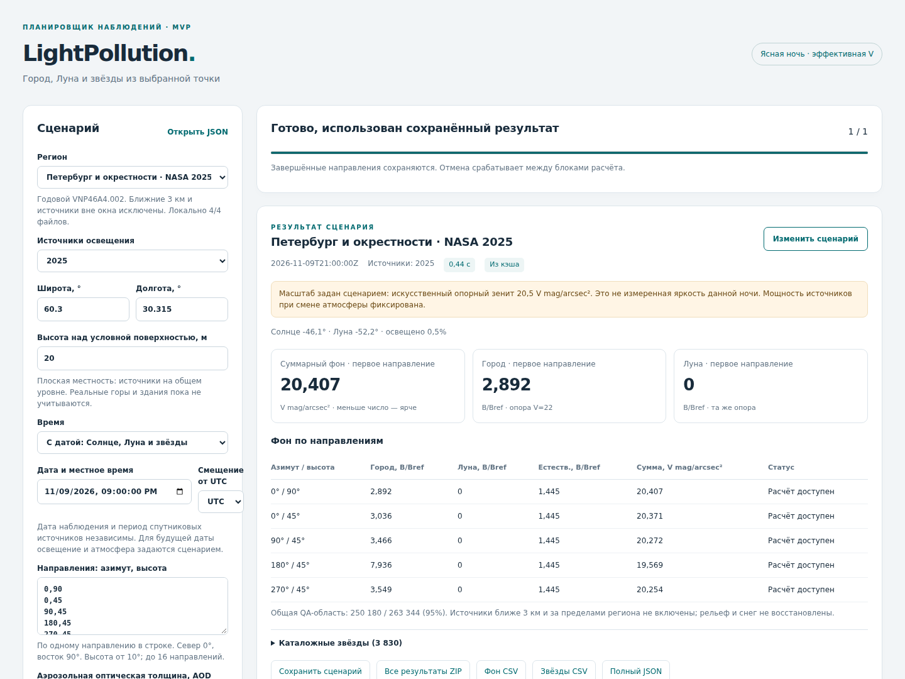

# Технический MVP LightPollution 0.2: результат и проверки
> Дата создания: 2026-11-11

Выполнены все шесть технических поставок согласованного плана. Получен
локальный численный планировщик с веб-формой и CLI: точка/время, источники,
атмосфера, раздельные компоненты фона, звёздный каталог, сравнение и экспорт.
Следующий [план моделей и извлечения данных](../../docs/MODEL_ROADMAP.md)
подготовлен отдельно. Новые модели глаза/сенсора и реалистичный рендер
этим выпуском не объявляются реализованными.

## 1. Что именно реализовано

- Версионированный `SceneSpec` схемы 2, развёрнутые параметры, структурированные
  ошибки и отдельные контракты фонового поля, звёздных потоков и результата.
- Расчёт сцены вынесен из файлового ввода/вывода. `observe` схемы 1 и
  импорт `cli.run_simulation` сохранены через совместимые обёртки.
- Подготовленные регионы/периоды, pinned-манифесты NASA, автоматическое
  извлечение, контроль файлов, QA и общая месячная область.
- Один коэффициент источников опорного сценария: смена AOD действительно
  меняет амплитуду переноса, а не компенсируется новой нормировкой зенита.
- Один вычислительный процесс, очередь до восьми активных заданий, прогресс,
  отмена между блоками, восстановление через сохранённые лучи, атомарные файлы.
- Отдельный кэш исходных карт, месячной области, лучей и сцены. Ключи учитывают
  источники, место, атмосферу, численные настройки, версии и код моделей.
- Локальная форма, сохранение/открытие сценария, история, таблицы,
  совместимое сравнение, CSV/JSON и ZIP. Пакет содержит офлайн-пример.



Полное руководство, архитектура, API и семантика высот —
[MVP.md](../../docs/MVP.md). Это снимок реального браузера с выполненным
расчётом NASA; фотография неба не синтезировалась.

## 2. Физический смысл результата

Сохранены прежние однократное рассеяние Рэлея/Хеньи—Гринстейна, сферическое
экранирование и ослабление Бугера–Ламберта–Бера, а также лунный baseline
Krisciunas–Schaefer 1991. Фоновые компоненты складываются в одной линейной
эффективной V-шкале. Звёздный поток отделён от радиансности на единицу угла.

Новый прикладной масштаб:

```text
Csource = 10^[−0.4(μanchor−22)] / Rreference(zenith; θreference)
qcity,m(ω; θ) = Csource × Rm(ω; θ)
qtotal = qcity + qmoon + qnatural
```

`R` — прежний отклик на относительные источники, сохраняющий отношение
месячных мощностей; `θreference` — фиксированная опорная атмосфера.
В новом сценарии при изменении текущей AOD коэффициент `Csource` не меняется.
Это исправляет организацию сравнения, не превращая DNB в измеренный V-спектр.

MVP явно использует **сценарный** искусственный зенит 20,5 и постоянный
естественный фон 21,6 V mag/arcsec² по умолчанию. Полевая точность не задана.
Доступны фон, геометрия и относительные потоки, а `eye_detection`,
`camera_electrons`, `spectral_radiance`, `validated_display` недоступны.
Без даты звёздные возможности также отсутствуют.

Высота 0–100 м относится к общей условной поверхности источников `z=0`.
Реальное плато, горы и источник на высоте 650 м не восстанавливаются;
историческая настройка AstMon автоматически не применяется. Поддерживаются
ясная астрономическая ночь, высоты 10–90° и лунные направления вне ближних 10°.
Сумерки отклоняются; возможные затмения и близкая Луна маскируются.
Ближние 3 км, вода, источники за окном, снег и полный DEM не учитываются.

## 3. Функциональные проверки

Последний полный pytest: **120 passed / 120, 0 failed, 0 errors, 0 skipped**,
33,53 с, без предупреждений. База до этого этапа — 96 тестов; добавлено
24 проверки MVP, включая три замороженных результата до реорганизации.
Сравниваются фоновые числа, число звёзд и контрольные потоки, а не только
структура файлов. [JUnit](pytest.xml).

Проверены: прежние команды, неоднозначное время, неподдерживаемые высоты,
невозможные параметры, общая шкала, сохранение амплитуды при смене AOD,
переиспользование городского поля при смене даты, испорченный кэш,
частичная отмена/повтор, перезапуск работника, блокировка рабочей папки,
месячная маска/мощность, HTTP, ZIP и недоступность незавершённого экспорта.

Первый тестовый HTTP-клиент выдавал предупреждение устаревания; зависимость
заменена на поддерживаемый текущей Starlette HTTPX2. Итоговый полный прогон
предупреждения не содержит. После исправления мобильного CSS повторён
браузерный проход; численные формулы и Python API этим исправлением не менялись.

### Проверка настоящим браузером

Chromium/Playwright прошёл **2/2 сценария NASA** с AOD 0,1 и 0,2:
создание задания, успешное завершение, скачивание запроса, открытие его обратно
и сравнение результатов. Ошибок JavaScript — **0**. Проверен экран 1440×1080
и мобильный 390×844. Первоначально таблица расширяла мобильную страницу
до 590 px; исправлены минимальные размеры grid-контейнера и карточек.
После исправления горизонтального переполнения страницы нет; широкая таблица
прокручивается внутри своего контейнера.

Запуск Chromium сначала остановился из-за отсутствующих shared libraries.
Они извлечены в игнорируемый `scratch/browser-runtime`, без установки
системных пакетов. Это окружение проверки, не зависимость пользователя MVP.
[Протокол браузера](browser-check.json), [мобильный результат](mvp-mobile-result.png).

### Чистая установка

Собраны wheel и sdist версии 0.2.0. Wheel установлен в изолированное окружение,
запуск выполнен вне исходного checkout. Проверены наличие UI, примера
и семи pinned-манифестов. Офлайн-пример рассчитан: **5 направлений**, **3830
каталожных звёзд** в доступной области; это не число звёзд, видимых глазом.
После исправления CSS пакет пересобран и проверен повторно с новой рабочей
папкой. [Протокол установки](installation-check.json).

## 4. Реальные данные, время и память

Использованы прежние локальные HDF5 NASA; **новых NASA-файлов скачано 0**.
Проверка следует манифестам продукта/периода и SHA-256. Первый проход включает
подготовку имеющихся данных, но не сетевую загрузку.

| Сценарий | Первый запуск, с | Повтор, с |
|---|---:|---:|
| Явный учебный пример | 2,34 | 0,17 |
| Петербург, годовой 2025 | 15,01 | 0,41 |
| Мадрид, март 2017 | 24,67 | 0,27 |
| Мадрид, ноябрь 2017 | 13,12 | 0,21 |

Это измерения данного запуска, не SLA. Машина: Linux x86_64, Python 3.12.3,
шесть логических CPU, один вычислительный работник. Пиковый RSS всего
последовательного проверочного скрипта **416,91 MiB**; это не гарантированный
верхний предел для любой сетки/региона. [Исходные измерения](benchmark.json).

Годовой Петербург: общая пригодная суша вне 3 км — **250 180/263 344**,
95,00%. Мадридские месяцы: **477 828/518 169**, 92,21%.
Качество и знаменатель относятся к выбранной области, не к доле «правильного
неба». Пара январь/июль Петербурга отвергнута из-за отсутствия общей
пригодной месячной области; пропуски не заменены нулевым излучением.
[Сохранённый отказ](empty-monthly-QA.json).

Сохранены четыре исходных сценария, отдельный опыт AOD 0,2 и
[сезонное](seasonal-comparison.json) / [атмосферное](atmosphere-comparison.json)
сравнения. Итоговые метаданные можно повторно собрать из кэша; измеренное
первоначальное время сохраняется отдельно. Для этих сценариев масштаб
условный; прежний MADRID ground-fit не переименован в точность MVP.

### Численная сходимость

До сравнения задан допуск **1% на четырёх выбранных лучах** годового
Петербурга. Базовый профиль — 192 сегмента, квадратура 24, блок 12;
отдельно проверены 384/48 и блок 6.

| Контроль | Лучей прошло / проверено | Максимальное различие |
|---|---:|---:|
| Уточнение интегрирования | 4 / 4 | 0,00754% |
| Уменьшение блоков источников | 4 / 4 | 0,69170% |

Направления: север 10°, юг 10°, юг 45°, зенит. Это проверка выбранных
направлений, не граница ошибки всего купола и не полевая физическая точность.
[Полные значения](numerical-validation.json). Старый расширенный наземный
опыт с неизвестной облачностью и его большим остатком остаётся в
[предыдущем отчёте](../seasonal-ground-20261110/README.md).

## 5. Воспроизведение и дальнейшая работа

```bash
uv sync --locked
uv run lightpollution serve
uv run lightpollution plan --output data/offline-example
uv run pytest -q -p no:cacheprovider
uv lock --check
```

Реальные случаи и численная проверка: `uv run python scripts/verify_mvp.py`
после получения закреплённых HDF5. Для холодного измерения использовать новую
рабочую папку через `--workspace`. Браузерная проверка:

```bash
uv run --with playwright python scripts/check_mvp_browser.py \
  --region petersburg-2025
```

Браузер и его системные библиотеки подготавливаются отдельно; приложение
использует браузер пользователя и не требует Playwright. `uv lock --check`,
компиляция Python, синтаксис JavaScript, Git diff и хеши контролируются
в [сводной верификации](verification.json).

Следующая работа — общая фотометрия/пространственная проверка и спектральный
опыт, затем выбранные модели естественного неба/сумерек, снега, ближних
источников/высот, глаза и камеры. В [плане](../../docs/MODEL_ROADMAP.md)
для каждой указаны физическое основание, способы извлечения входов,
открытые источники, недостающие данные и критерий перехода к реализации.

Источники текущего поля: [NASA Black Marble](https://ladsweb.modaps.eosdis.nasa.gov/missions-and-measurements/products/VNP46A3),
[BSC5/HEASARC](https://heasarc.gsfc.nasa.gov/W3Browse/catalog/bsc5p.html),
первичные физические ссылки в [MODEL.md](../../docs/MODEL.md) и
[OBSERVATION_MODEL.md](../../docs/OBSERVATION_MODEL.md).
