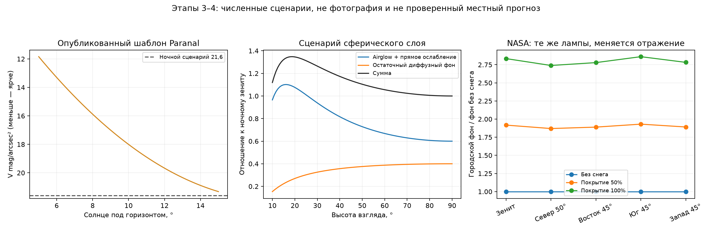

# Этапы 3–4: естественный фон, сумерки и снег, версия 0.4
> Дата создания: 2026-11-11

> Я сохраняю этот отчёт как архив конкретного опыта. Его статусы относятся к описанной версии; текущее устройство — в [MODELS](../../MODELS.md), ход развития — в [HISTORY](../../HISTORY.md).

Реализованы первые ограниченные физические/эмпирические модели этапов 3–4
[согласованного плана](https://github.com/WarriorOfTea/LightPollution/blob/52a3604b6603be48e07c4bd0d60a9cf32f0b9f38/docs/MODEL_ROADMAP.md). Входы, формулы,
предположения, размерности и выводы с нуля —
[NATURAL_TWILIGHT_SNOW.md](https://github.com/WarriorOfTea/LightPollution/blob/52a3604b6603be48e07c4bd0d60a9cf32f0b9f38/docs/NATURAL_TWILIGHT_SNOW.md).
Учебные основы всей системы —
[PHYSICS_AND_MATH_GUIDE.md](https://github.com/WarriorOfTea/LightPollution/blob/52a3604b6603be48e07c4bd0d60a9cf32f0b9f38/docs/PHYSICS_AND_MATH_GUIDE.md).
Это численный результат; фотографии/видимость глазом не синтезировались.

Для чтения отдельно: [единый сборник теории с основ, PDF](https://github.com/WarriorOfTea/LightPollution/blob/52a3604b6603be48e07c4bd0d60a9cf32f0b9f38/artifacts/natural-twilight-snow-20261111/theory-from-zero.pdf)
(38 страниц; [тот же исходный текст](https://github.com/WarriorOfTea/LightPollution/blob/52a3604b6603be48e07c4bd0d60a9cf32f0b9f38/artifacts/natural-twilight-snow-20261111/theory-from-zero.md)). Он включает
учебный гид и формальные модели общей фотометрии/спектров, Луны и этапов 3–4.

## Что изменилось

1. Естественная ночь: отдельный тонкий сферический слой airglow (van Rhijn)
   и остаточный диффузный фон. Прямая передача Бера зависит от высоты взгляда
   и сценарной атмосферы; сумма в зените точно соответствует заданному уровню.
   Каталожные звёзды остаются отдельными потоками.
2. Сумерки: V-регрессия Patat et al. 2006, Table 1, при Солнце −15…−5°,
   взгляде не ниже 50°. Из полной кривой вычтен её ночной фон, затем добавлен
   ночной фон текущего сценария. Нет фиктивного двойного естественного фона.
3. Снег: условная инверсия исходного бесснежного uplight на мощность тех же
   ламп; независимые прямой/ламбертовский отражённый лепестки. Меняются
   только отражение и сумма, общий коэффициент источников фиксирован.
4. Форма, CLI/HTTP, кэши и экспорты поддерживают эти поля и отдельные
   компоненты. Неизвестный вклад даёт `null` суммы и причину; одновременно
   сохраняются ограничения Луны и сумерек. Старые сцены без новых полей
   сохраняют прежний ночной режим.



Левая панель — воспроизведение опубликованной кривой Paranal, не измерение
Петербурга. Средняя — угловой сценарий естественного фона; при прямой передаче
его максимум может находиться не у горизонта из-за ослабления. Правая —
городские отношения при одних NASA-источниках и разных серых альбедо.

## Опыт на реальных NASA-входах

Координаты: 60,300° N, 30,315° E, 20 м над **условной общей сферической
поверхностью**, без DEM. Источники — те же закреплённые VNP46A4.002 2025
`NearNadir_Composite_Snow_Free`, их SHA/QA сохранены в каждом результате.
Период карты выбирается явно и не становится реальным расписанием ламп
летней/зимней ночи 2026 года. Новых NASA HDF5 в этом этапе не скачано.

Атмосфера — базовый сценарий: AOD550=0,10, H_R=8000 м, H_a=1200 м,
SSA_a=0,9, g=0,8, α=1,3; спектральная смесь LED-B3, 95 λ 360–830 нм.
Пропущены источники ближе 3 км, вода и территория вне региона. Полный
параметрический вход есть в `scene.json`, все defaults — в `resolved-scene.json`.

Снег: `u=0,15`, `ρ_bare=0,15`, `ρ_snow=0,8`, `η_direct=0,1`.
Покрытие относится ко всей освещённой земле источников, равномерно по региону;
это гипотеза, не полученная из фактической снежной карты.

| Покрытие | Уходящая вверх мощность / бесснежная | Городской зенит B/Bref | Прямой зенит | Отражённый зенит | Суммарный зенит V mag/arcsec² |
|---|---:|---:|---:|---:|---:|
| 0% | 1,0000 | 3,9811 | 2,2958 | 1,6853 | 20,1637 |
| 50% | 1,9955 | 7,6325 | 2,2958 | 5,3367 | 19,6050 |
| 100% | 2,9910 | 11,2839 | 2,2958 | 8,9881 | 19,2380 |

Три сценария имеют строго один коэффициент мощности/область сравнения.
Усиление **городского** фона по пяти направлениям 2,740–2,861; усиление
**полного** фона 2,272–2,616, поскольку естественная составляющая не
умножается на снег. Это условный эффект выбранных параметров, не
универсальное утверждение о зиме или физическая точность модели.

Для независимого точного предела дополнительно посчитаны `lambert-bare`
и `lambert-snow`: оба лепестка ламбертовские. На всех 5 лучах городской
фон меняется ровно в 2,99099099 раза с машинной точностью.

## Белая ночь и честные пробелы покрытия

В `white-night` задано **2026-06-21T22:00:00Z**. Astropy даёт высоту Солнца
−6,26548°, Луна ниже горизонта. Зенит эмпирического шаблона Paranal —
13,66971 V mag/arcsec²; после добавления сценарного города — 13,66770.
Это демонстрация работы геометрии и эмпирического компонента, **не проверенный
прогноз реальной яркости Петербурга**. Местные отличия площадки/атмосферы/снега
этим шаблоном не рассчитываются. Ночная опора в этом опыте — отдельный
сценарий без модели поверхности; зимние результаты с ним не перекалибровываются.

Поддержаны **2/5 направлений**: зенит и север на высоте 50°; три направления
45° имеют неизвестный сумеречный вклад, их сумма `null`. В
`deep-transition-unsupported` при **2026-09-01T00:00:00Z**, Солнце −17,29491°,
поддержаны **0/5**: диапазон между −15° и −18° не экстраполирован.
Город, ночной фон и звёздные прямые потоки сохраняются отдельно.

## Основания и отсутствие независимой полевой оценки

[Аудит первоисточников](literature-audit.json) хранит URL, реальный HTTP-статус,
размер и SHA-256 полученных материалов. У издателя A&A PDF вернули 403;
полные авторские Patat 2003 и Noll 2012 успешно получены через arXiv.
Текст Jechow 2019 прочитан через веб-инструмент; прямой HTTP-запрос дал 403.
Исходные статьи не перепубликовываются. MCD43A3 и MOD10A1 изучены, но карты
снега/альбедо не загружались. Права CIE-библиотеки остаются в исходном
спектральном provenance; график использует только наши расчётные отношения.

Независимых местных ясных ночей для снежного усиления: **0**;
для сумеречного переноса: **0**. Согласованных пар измерений с покрытием,
альбедо, фонарями и атмосферой не получено. MAE/RMSE и доверительный
интервал физической ошибки новых моделей **не определены по этой причине**.
Мадридский контроль версии 0.3 не проверяет сумерки и снег.

Особенно важно: прямая передача airglow — упрощение уровня Patat 2003,
Appendix C. Noll 2012 §4.1 показывает заметное рассеяние в луч; наша
геометрия его ещё не добавляет. Снег серый, без BRDF, карт и повторных
земля–атмосфера отражений. Наличие формального вывода и сохранение энергии
не дают права назначить процент физической точности.

## Проверки и найденные проблемы

| Проверка | Результат | Что именно подтверждает |
|---|---|---|
| Последний полный pytest | **165/165 passed**, 0 failed/errors/skipped/warnings, 37,38 с | Реализация и прежняя совместимость |
| Новые тестовые случаи | **25/25** входят в полный набор | Геометрия/регрессия/маски/кэш/экспорт/HTTP |
| Энергетический параметрический опыт | **225/225**, max abs 1,11·10⁻¹⁶ | Алгебраический баланс первого отражения |
| Естественная τ, 96/192 узла | **6/6**, max rel 2,81·10⁻¹³ при пороге 10⁻⁶ | Эти шесть интегралов в базовой атмосфере |
| Ламбертовский снежный предел | **5/5**, max rel 3,33·10⁻¹⁶ | Линейность и сохранение масштаба |
| Patat, пять контрольных высот | **5/5** | Точный перенос коэффициентов таблицы |
| Браузер Chromium | **3/3 заданий**, JS errors 0 | Снег/сумерки, сравнение, импорт/экспорт |
| Мобильный экран | 390×844, переполнения страницы нет | Доступность формы/таблиц с телефона |
| uv lock | **48** пакетов, `uv lock --check` прошёл | Согласованность зависимостей |
| Изолированный wheel 0.4 | **60/60** файлов совпали; запуск из `/tmp` прошёл | Пакет работает без исходного checkout |

До итогового прогона один тест получил 404: он ошибочно предполагал наличие
`/api/validate`. Исправлен на реальный `/api/jobs` с проверкой нормированного
ввода и отказа некорректному покрытию. При самопроверке добавлено сохранение
**обеих** причин, если одновременно недопустимы Луна и сумерки; отдельная
регрессия входит в 165. Дополнительный полный прогон после этого изменения
прошёл; численные сценарии пересчитаны/переэкспортированы с теми же значениями.

[Браузерный протокол](browser-check.json) ·
[Пакет](wheel-check.json) ·
[Сводная проверка](verification.json) ·
[Сводка численного опыта](summary.json) ·
[Сравнения](snow-comparisons.json) ·
[Шесть оптических интегралов](natural-geometry.csv) ·
[Patat](patat-reproduction.json) ·
[Заранее заданные критерии](predeclared-criteria.json).

## Воспроизведение

```bash
uv sync --locked
uv run pytest -q -p no:cacheprovider
uv lock --check
uv run python scripts/run_background_surface.py
uv run lightpollution plan \
  --scene artifacts/natural-twilight-snow-20261111/white-night/scene.json \
  --output data/reproduced-white-night
```

Нужны закреплённые NASA-файлы в `data/blackmarble`; скрипт сам не скачивает
их и не использует токены. Для проверки без NASA выберите `region=demo`,
`period=synthetic` в сохранённом сценарии. Браузерный скрипт опционален,
Playwright не является зависимостью приложения:

```bash
uv run lightpollution serve \
  --workspace data/background-browser-20261111 \
  --raw-directory data/blackmarble --port 8766
uv run --with playwright python scripts/check_background_browser.py
```

На машине этой проверки дополнительные библиотеки Chromium находились в
игнорируемом `scratch/browser-runtime`; параметр `--library-directory`
передаёт их изолированно. Системные пакеты не устанавливались.

## Что требуется следующим

Не расширять область сумерек без данных/решателя с земной тенью и повторным
рассеянием. Получить сопоставимые ясные снежные и сумеречные наблюдения,
оценить `u`/диаграммы ламп и освещённое покрытие; затем добавить карты,
спектральное альбедо и рассеяние естественного фона. Ближняя зона, рельеф,
глаз и камера остаются следующими самостоятельными этапами 5–7.
