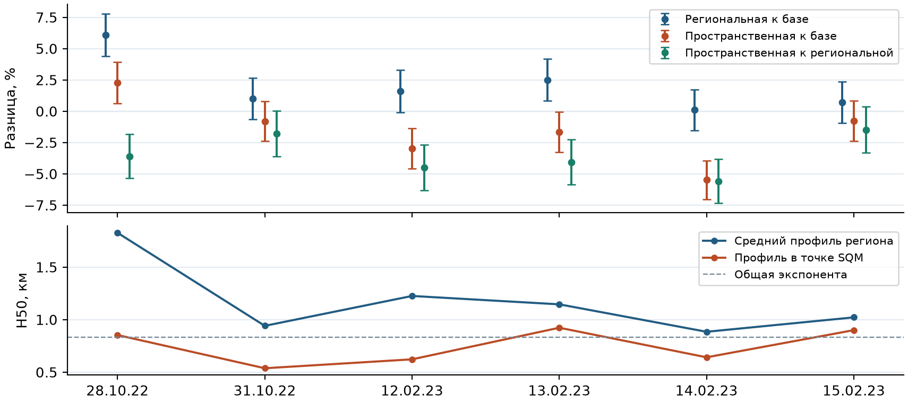

# Пересчёт засветки Венето с высотными профилями аэрозоля

[Сравнение с замерами SQM по каждой ночи](measured-comparison.md).

Я пересчитал искусственную яркость в зените для 19 прежних часовых окон на двух станциях. В этих окнах 442 отсчёта SQM. Для проверки масштаба различий оставил те же шесть ночей Galzignano, которые обсуждали после прогона с общей экспонентой. На них средние различия составили **2,00% между региональной и базой, 2,33% между пространственной и базой и 3,50% между пространственной и региональной**.

## Те же шесть ночей Galzignano

Проценты считаю как 100 × (искусственная яркость первого варианта / яркость второго − 1). Плюс означает более яркий первый вариант. Среднее абсолютное отличие вычислено по процентам шести отдельных ночей.

| Сравнение | Среднее абсолютное | От минимума до максимума | Медианная численная стандартная ошибка |
| --- | --- | --- | --- |
| Региональная к базе | 2,00% | +0,1…+6,1% | 1,67 п. п. |
| Пространственная к базе | 2,33% | −5,5…+2,3% | 1,60 п. п. |
| Пространственная к региональной | 3,50% | −5,6…−1,5% | 1,81 п. п. |
| Региональная с профилем к региональной с экспонентой | 2,36% | −1,3…+5,7% | 1,66 п. п. |
| Пространственная с профилями к пространственной с экспонентой | 2,57% | −4,8…+1,5% | 1,60 п. п. |

При одной экспоненте среднее абсолютное отличие пространственной от региональной было 1,24%. С профилями оно выросло до 3,50%. Пространственная яркость оказалась ниже региональной на всех шести ночах. Её среднее знаковое отличие −3,50% при численной стандартной ошибке среднего 0,73 п. п. Например, 14 февраля региональная была близка к базе (+0,1%), пространственная дала −5,5% к базе. Для этой ночи разница пространственной и региональной составила −5,6%.

## Откуда взялась высота

- **База** использует постоянную AOD 0,10 и прежнюю экспоненту с масштабом 1,2 км. H50 этой экспоненты около 0,83 км над уровнем моря. Переиспользовал контрольные базовые прогоны для тех же карт NASA.
- **Региональная** в каждую ночь получает один общий профиль для всей области. Средняя экстинкция рассчитана по площади для каждого высотного интервала из того же поля, которое использует пространственный вариант.
- **Пространственная** получает свой профиль в каждом узле сетки CAMS 0,4°. Я билинейно интерполирую экстинкцию на текущей высоте вдоль траекторий. Для высоты использую 22 интервала в метрах над уровнем моря, первые границы идут через 200 м.

CAMS задаёт суммарную AOD на 550 нм. Форму профиля взял из архивных концентраций PM₂,₅ при опорной влажности 35% в NASA GEOS-CF на сетке 0,25°. Сопоставил центры модельных слоёв и высоту поверхности, интегрировал концентрацию по высотным интервалам и перенёс их на сетку CAMS. Я распределил столбовую AOD между интервалами пропорционально этой массе и проверил сохранение AOD в каждом из 2 090 столбов. Полученный профиль приближает экстинкцию через концентрацию. В реальной атмосфере перевод массы в экстинкцию зависит от размера, состава и влажности частиц. [CAMS](https://confluence.ecmwf.int/spaces/CKB/pages/116952716/SFTP-FTP-HTTPS%2Bdata%2Baccess%2Bto%2BCAMS%2Bglobal%2Bdata) · [Спецификация NASA GEOS-CF](https://gmao.gsfc.nasa.gov/pubs/docs/Knowland1446.pdf)

Для 18 ночей взял часовые средние GEOS-CF v1 за 22:00–23:00 UTC. Для Arcugnano 17 февраля 2026 усреднил две часовые точки GEOS-CF v2 в 22 и 23 UTC, после переноса в общие высотные интервалы. Обе версии использовал по нижним 36 модельным уровням. Абсолютные высоты приблизительны, поскольку транспорт по-прежнему использует сферическую поверхность. [Архив v1](https://opendap.nccs.nasa.gov/dods/gmao/geos-cf/assim/chm_tavg_1hr_g1440x721_v36.info) · [Вертикальные поля v2](https://opendap.nccs.nasa.gov/dods/gmao/geos-cf/v2/ana/met_inst_1hr_glo_L1440x721_v72.info)

## По датам

Для всех строк использована одна и та же месячная карта Black Marble внутри конкретной даты и прежняя маска источников дальше 3 км. H50 региона и в точке прибора — две характеристики расчётных профилей, а не показания прибора. Знаменатели трёх столбцов справа — соответственно база, база и региональная модель.

### Galzignano

| Ночь UTC | Погодный отбор | H50 региона / у прибора | Рег. к базе | Простр. к базе | Простр. к рег. |
| --- | --- | --- | --- | --- | --- |
| 2022-10-01 | Да | 2,41 / 1,17 км | +1,2% | +4,4% | +3,1% |
| 2022-10-27 | Облака | 1,69 / 1,25 км | +2,2% | −0,4% | −2,6% |
| 2022-10-28 | Да | 1,83 / 0,85 км | +6,1% | +2,3% | −3,6% |
| 2022-10-30 | Облака | 1,07 / 0,47 км | +2,1% | −2,1% | −4,1% |
| 2022-10-31 | Да | 0,94 / 0,54 км | +1,0% | −0,8% | −1,8% |
| 2023-02-12 | Да | 1,22 / 0,62 км | +1,6% | −3,0% | −4,5% |
| 2023-02-13 | Да | 1,15 / 0,92 км | +2,5% | −1,7% | −4,1% |
| 2023-02-14 | Да | 0,88 / 0,64 км | +0,1% | −5,5% | −5,6% |
| 2023-02-15 | Да | 1,02 / 0,90 км | +0,7% | −0,8% | −1,5% |
| 2023-07-14 | Да | 2,24 / 1,80 км | +6,1% | +5,1% | −0,9% |
| 2023-07-16 | Облака | 2,59 / 2,12 км | +6,5% | +5,0% | −1,4% |
| 2023-07-17 | Да | 2,82 / 2,01 км | +10,2% | +7,9% | −2,1% |

### Arcugnano

| Ночь UTC | Погодный отбор | H50 региона / у прибора | Рег. к базе | Простр. к базе | Простр. к рег. |
| --- | --- | --- | --- | --- | --- |
| 2025-02-02 | Да | 1,87 / 0,96 км | +1,7% | +1,6% | −0,1% |
| 2025-04-29 | Облака | 2,78 / 1,63 км | +5,0% | +8,5% | +3,3% |
| 2025-09-17 | Да | 1,90 / 1,57 км | +0,0% | −2,1% | −2,2% |
| 2025-09-18 | Да | 2,12 / 1,42 км | −1,4% | +1,0% | +2,5% |
| 2025-09-20 | Облака | 2,21 / 1,19 км | +1,9% | +3,1% | +1,2% |
| 2025-10-28 | Облака | 1,89 / 0,97 км | +1,2% | +3,0% | +1,9% |
| 2026-02-17 | Да | 4,59 / 4,50 км | +2,0% | +3,3% | +1,3% |

## Чувствительность к отбору и маске

| Набор и маска | Ночей | Рег. к базе | Простр. к базе | Простр. к рег. |
| --- | --- | --- | --- | --- |
| Galzignano, те же шесть, источники дальше 3 км | 6 | 2,00% | 2,33% | 3,50% |
| Galzignano, те же шесть, источники дальше 10 км | 6 | 2,40% | 3,32% | 5,58% |
| Galzignano, все окна после погодного отбора, дальше 3 км | 9 | 3,28% | 3,48% | 3,02% |
| Arcugnano, все окна после погодного отбора, дальше 3 км | 4 | 1,28% | 2,00% | 1,51% |
| Все окна, дальше 3 км | 19 | 2,82% | 3,24% | 2,51% |

При сравнении с прежней экспонентой столбовая AOD та же. В серии Galzignano 17 июля замена одного только высотного профиля дала +10,5% у регионального и +7,2% у пространственного варианта. Эта ночь входит в девять погодных окон, а в прежнем отборе из шести ночей её исключили из-за большого модельного вклада ближайших источников.

Я выполнил 38 новых расчётов по 524 288 траекторий, всего 19 922 944 траектории. Перенос включает все порядки рассеяния. Максимальный встреченный порядок 16. Проценты относятся к искусственной яркости и получены до привязки к SQM и сложения с естественным фоном. Указанная численная погрешность относится к выборке Монте-Карло. Сам профиль, рельеф и карта освещения остаются источниками физической неопределённости. Пригодность станций для проверки дальнего света ограничена ближними источниками. Здесь я сравниваю результаты расчёта в зените для этих условий. [Прежние прогоны и отбор ночей](../photometer-italy-20261125/README.md)

[CSV с 19 ночами, тремя масками и ошибками Монте-Карло](nightly-contrasts.csv) · [Сводка JSON](comparison.json) · [Высотные входы и хеши NASA](profile-input.json) · [Результаты траекторий](transport.json)
