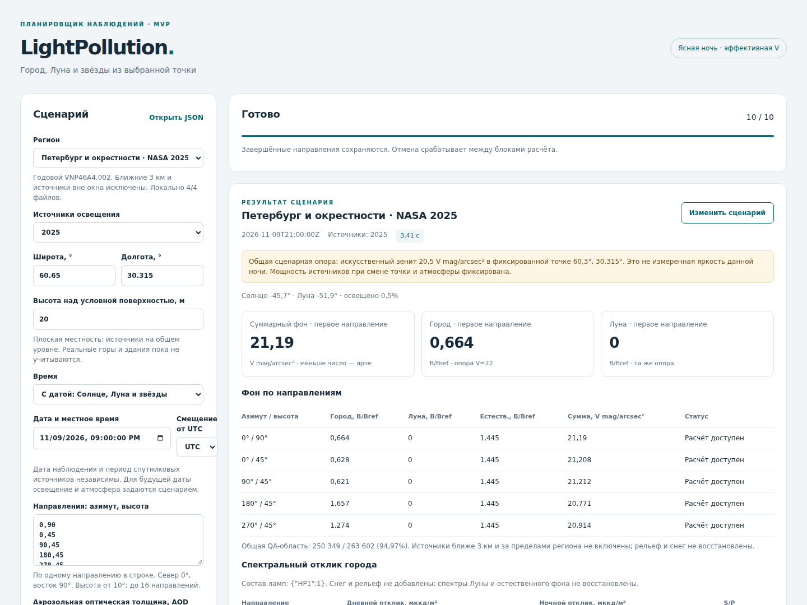
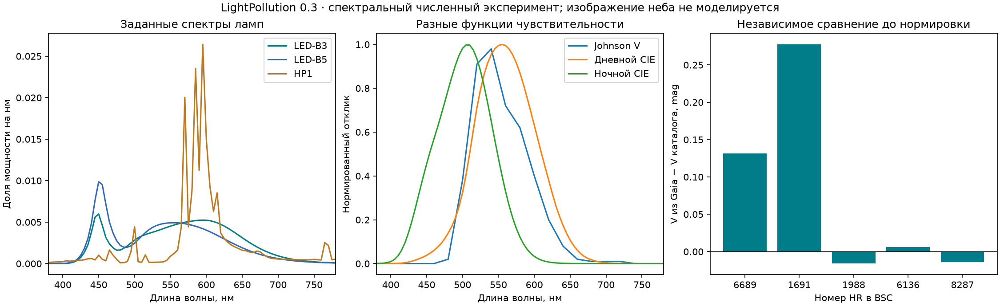

# Этапы 1–2: общая фотометрия и спектральный расчёт
> Дата создания: 2026-11-11

Версия 0.3.0. Выполнены общая региональная нормировка, переносимая
фотометрическая привязка и первый спектральный расчёт города/звёзд.
Это реализация первых двух этапов [плана](../../docs/MODEL_ROADMAP.md).
[Формальная теория](../../docs/PHOTOMETRY_AND_SPECTRA.md) объясняет определения,
размерности, законы и ограничения. Новые снег/сумерки/глаз/сенсор не добавлены.

## 1. Что изменилось для пользователя

- Разные точки одной области сравниваются при одной мощности источников.
  Ближнее исключение больше не повышает мощность оставшихся пикселей.
- Опорный зенит закреплён географически. При перемещении наблюдателя
  его яркость меняется согласно расчёту; она не возвращается к 20,5 mag.
- Калибровка по ясным измерениям сохраняется в отдельный переносимый JSON.
  Настройка и контроль разделены по целым ночам, учитываются площадки.
- Спектральный режим доступен в веб-форме и CLI. Можно задать смесь ламп,
  закон аэрозольного спектра и режим спектров звёзд; сохранить/открыть запрос.
- Выводятся V-фон, городской спектр, дневной/ночной взвешенные отклики,
  S/P, звёздные полосовые потоки и происхождение форм спектра.



Это снимок работающего браузера, не изображение предполагаемого вида неба.
Полный спектр Луны/естественного фона и адаптация глаза не выдумываются.

## 2. Проверка общей пространственной шкалы

Использован прежний годовой источник NASA 2025, одна ROI, общая QA-суша,
базовая атмосфера и одна опора 20,5 V mag/arcsec² в точке 60,300°N, 30,315°E.
Сравнивается точка севернее — 60,650°N, 30,315°E. Обе высоты 20 м над
условной общей поверхностью; реальный рельеф не восстановлен.

| Точка | Искусственная составляющая в зените, V mag/arcsec² |
|---|---:|
| Опорная 60,300°N | 20,5000 |
| Севернее, 60,650°N | 22,3939 |

Коэффициент источников точно одинаков. Искусственная зенитная составляющая
во второй точке примерно в 5,72 раза слабее. Это условный расчёт при выбранной
опоре, не измерение реальных двух ночей и не подтверждённое ранжирование
любых мест. [Численное сравнение](spatial-comparison.json).

Подготовка карты и знаменателя не зависит от наблюдателя. Для каждого
периода вес пикселя равен `Mi Dmi Ai/Sref`; после удаления ближних 3 км
его не делят повторно на оставшуюся сумму. Месячные отношения мощности
сохраняются. Исходная схема `observe` и старые функции остаются совместимыми.

## 3. Настройка и отдельная контрольная ночь

Переиспользованы 18 опубликованных измерений AstMon с прежней ручной
транскрипцией ясных безлунных интервалов из Figure 5/6 Robles et al. 2021.
Облачные флаги не появились в исходном CSV. Новых наземных измерений нет.
В новой модели высота 20 м над условной общей поверхностью, а не фиктивная
разность 650 м между станцией и всеми нулевыми источниками. Плато и плотность
атмосферы над его реальной высотой по-прежнему не восстановлены.

| Выборка | Независимых ночей | Измерений | Средний наблюдаемый V-фон |
|---|---:|---:|---:|
| Настройка, 19.03.2017 | 1 | 9 | 17,70692 |
| Контроль, 19.11.2017 | 1 | 9 | 17,88190 |

Один положительный `C` подобран в линейном свете только на первой ночи.
Контрольная модель дала 17,74495 V mag/arcsec²: остаток **−0,13694 mag**,
то есть **на 13,44% ярче** наблюдаемого. На одной контрольной группе bias,
MAE и RMSE совпадают по модулю; это не три независимых показателя точности.
Нулевой обучающий остаток ожидаем при одном коэффициенте на одном среднем.

[Входные записи](ground-dataset.json), [коэффициент и полный контроль](ground-calibration.json),
[сцена с применённой калибровкой](madrid-calibrated-validation/scene.json).
Независимых контрольных площадок — **0**. Доверительный интервал глобальной
ошибки не получен: для него недостаточно независимых ночей и мест.

## 4. Физическое содержание спектральной модели

Сетка 360–830 нм, шаг 5 нм, **95 длин волн**. На каждом λ считаются
сферический перенос, рассеяние Рэлея, HG-аэрозоли и ослабление Бера на обоих
путях. Молекулярный коэффициент меняется как λ⁻⁴, AOD — по закону Ангстрема
с явно заданным `α=1,3` в примерах. SSA и `g` пока постоянны по λ.

Смесь нормируется на излучённую энергию в принятом диапазоне, не на люмены.
Текущая смесь отделена от опорной LED-B3: сравнение ламп в петербургском
опыте сохраняет **одну видимую мощность источников**, а не подгоняет V заново.

Johnson B/V берутся из SVO с указанным типом energy counter: в интеграле
нет лишнего множителя λ. CIE дневной и ночной отклики считаются отдельно.
Нулевая точка — закреплённый CALSPEC Vega `_stis_011`, B=V=0,03.
В коде раздельны Вт/(м² ср нм) фона и Вт/(м² нм) звёзд.

| Смесь, опорный зенит Петербурга | Дневной отклик города, мккд/м² | Ночной отклик, мккд/м² | S/P |
|---|---:|---:|---:|
| LED-B3 | 716,00 | 1556,89 | 2,174 |
| Натриевая HP1 | 807,62 | 565,54 | 0,700 |
| LED-B5 | 709,69 | 1951,98 | 2,750 |

Это рассчитанные взвешенные световые величины. Они не означают, что человек
субъективно увидит ровно такое отношение яркостей: адаптация/порог ещё впереди.
Состав городских фонарей здесь **задан**, не определён из DNB.
[Полные сравнения](lamp-comparison.json).



График использует данные CIE и распространяется по CC BY-SA 4.0;
атрибуция и DOI приведены в манифесте библиотеки.

### Две спектральные гипотезы для одного V-наблюдения

Отдельно выполнены LED-B3 и HP1 сценарии Мадрида с настройкой каждого
на тех же девяти V-измерениях марта. Это **те же 18 уникальных измерений**,
а не новые независимые выборки при каждом повторе.

| Гипотеза | Остаток на ноябрьской ночи, mag | S/P городского зенита |
|---|---:|---:|
| LED-B3 | −0,13700 | 2,293 |
| HP1 | −0,13677 | 0,737 |

Обе почти одинаково воспроизводят V, но предсказывают разный ночной отклик.
Следовательно, один V-фон не позволяет определить смесь ламп. Коэффициенты
этих двух подгонок разные: это альтернативные гипотезы, а не сравнение при
одной мощности. [Полные результаты](competing-spectral-fits.json).
Поглощение газами, изменение SSA/g по λ и многократное рассеяние не добавлены.

## 5. Звёзды: что измерено и что приближено

Получены исходные CALSPEC Vega/Sirius и пять Gaia DR3 XP_SAMPLED.
Из **9 кандидатов Gaia приняты 5**, четыре не дали единственного подходящего
совпадения с доступным XP. Сопоставление — перенос BSC к J2016, допуск 2″;
отказы сохранены. Проверка на исходных абсолютных потоках XP до нормировки
дала среднее абсолютное отклонение V от BSC **0,08913 mag**, максимум
**0,27751 mag** на пяти звёздах.

Это диагностическое расхождение двух источников. Различаются эпохи и
эффективные полосы; возможны систематики ярких XP-источников и каталога.
Причина максимального остатка отдельно не установлена. Не обрезаем эти
строки ради красивой точности. [Все значения](stellar-validation.json).

В датированной петербургской сцене экспортировано **3830** каталожных звёзд:

- 4/3830 имеют полученную измеренную форму спектра;
- 3594/3830 получили приближённый континуум Планка по B−V;
- 232/3830 не получили спектр, но сохраняют прежнюю серую V-оценку с отметкой.

У доступных спектров масштаб сначала задаётся по каталожной V, затем
атмосферная экстинкция применяется **один раз**. Температура континуума
не называется измеренной эффективной температурой; линии и индивидуальная
переменность не восстанавливаются. Число 3830 не означает видимость глазом.

## 6. Новые данные и ограничения инверсии

В пакет включены небольшие обработанные таблицы с контрольными суммами
и атрибуцией: **14 ламп** CIE, **4 отклика**, B−V BSC и **7 звёздных форм**.
Производные CIE распространяются по CC BY-SA 4.0; код не заимствован из CIE.
[Манифест источников](../../src/lightpollution/resources/spectra/provenance.json).

Дополнительно получен NOAA SNPP DNB RSR: 41 отсчёт 401,99–1002 нм,
снимок отклика на 01.02.2013. Он имеет существенный отклик за 780 нм,
где заканчиваются шаблоны ламп. Одна слабая отрицательная исходная точка
отмечена; функция не включена автоматически в инверсию композитов 2017/2025.
Нужны подходящий по эпохе отклик и реальные ИК-хвосты источников.
[Аудит RSR](dnb-response-audit.json).

**Новых NASA HDF5 — 0; новых наземных измерений — 0.**
Использованы прежние закреплённые карты и прежний AstMon. Токены Earthdata
не запрашивались и в документы/экспорт не добавлялись. Новые спектральные
таблицы получены по публичным адресам без авторизации.

## 7. Проверки, исправления и воспроизведение

Полный pytest — **140/140**, 0 failed, 0 errors, 0 skipped, без предупреждений.
Добавлены 20 тестовых случаев; две старые проверки MVP обновлены по новым
требованиям сравнения точек/мощности. Эталоны схемы 1 сохранены и проходят.
[JUnit](pytest.xml).

Сравнение шага 5 нм с 1 нм: **112/112** случаев (14 ламп × 4 отклика ×
2 направления), максимум **0,69689%**, допуск 1% задан до опыта.
Это выбранные лучи, не весь купол и не физическая точность.
[Заранее заданные условия](predeclared-criteria.json), [значения](spectral-quadrature.json).
Отдельные тесты сопоставляют спектральное ядро со скалярным на 400/550/750 нм.

Настоящий Chromium: **3/3** сценария, межточечное сравнение, сохранение/открытие
спектрального запроса, импорт калибровки, 0 ошибок JavaScript. Мобильный экран
390×844 не переполняет страницу. [Протокол](browser-check.json).

При проверке обнаружен и исправлен отказ загрузки калибровки: браузер
сохранял `22.0` как `22`, а прежняя проверка хеша считала документ другим.
Хеш калибровки теперь одинаково обрабатывает эти числовые записи и знак нуля.
Тип целого коэффициента также нормализуется для сравнения. В идентификатор
фотометрического опыта не входят время выполнения и признаки кэша.
Прежний общий внутренний файловый хеш не заменялся новым протоколом.

В последнем аудите уточнена подпись ограниченной проверки: после применения
наземной калибровки JSON больше не утверждает, что независимых проверок
вообще не было. Вместо этого он явно ограничивает контроль полученными
ночами и площадками. Дополнительная регрессионная проверка прошла;
[три экспорта обновлены](metadata-refresh.json) без новых расчётов переноса,
фон и звёзды численно совпали.

Первый запуск отчётного скрипта завершился после расчётов из-за неверного
имени поля сводки; сохранённые расчёты не потеряны. Поле исправлено,
полный сценарий повторён. Первые 22/24 проверки MVP отражали старое поведение;
два требования исправлены в тестах, остальные проверки сохранены.

Пакет 0.3.0, изолированная установка, локальные ссылки, синтаксис и контрольные
суммы проверены отдельно: [сводная верификация](verification.json),
[установка](installation-check.json). Это локальный исследовательский выпуск,
не production-развёртывание.

```bash
uv sync --locked
uv run lightpollution serve
uv run lightpollution example --spectral --output data/spectral-scene.json
uv run lightpollution plan --scene data/spectral-scene.json --output data/spectral-result
uv run lightpollution fit-photometry \
  --dataset artifacts/photometry-spectra-20261111/ground-dataset.json \
  --output data/shared-calibration.json
```

Для воспроизведения всех численных опытов: `uv run python scripts/run_photometry_spectra.py`
с подготовленными HDF5; спектральные сырые оригиналы нужны только дополнительной
1-нм проверке. Их подготовка — `scripts/prepare_spectral_library.py`.
Стандартный пользовательский расчёт работает с пакетной библиотекой без сети.

Следующие задачи: независимые площадки и больше ясных ночей; исходные
спектры/реестры ламп и дополнительные фотометрические полосы; затем выбор
из сумерек, снега, ближних источников, глаза и сенсора.
