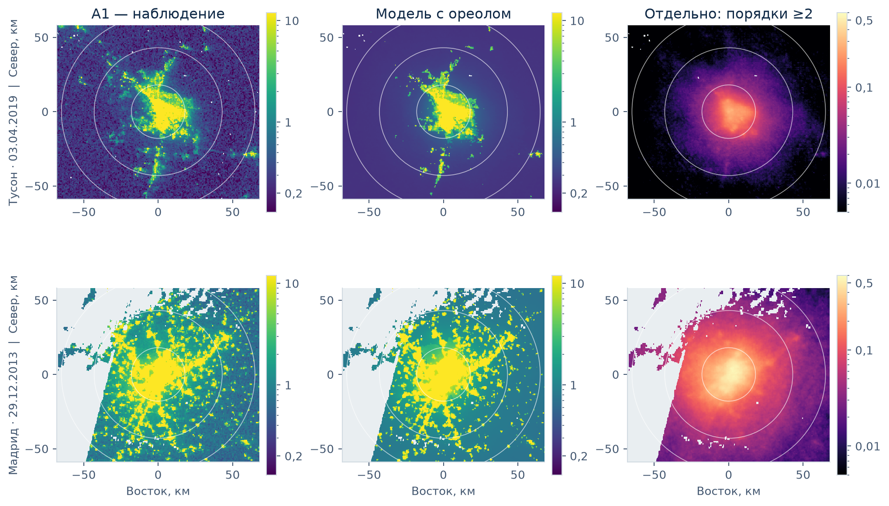
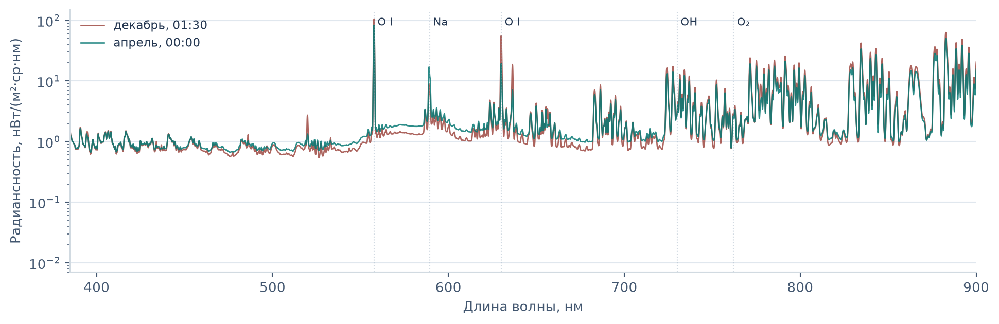

# Суточный VIIRS, ореолы городов и естественное свечение

Проверил семь спутниковых дат для Тусона и Мадрида на 18 фактически полученных
файлах VNP46A1/A2 Collection 2. Шесть сцен прошли отбор. Дополнительно скачал
и открыл две пары нативных VNP02DNB/VNP03DNB. Основной расчёт сопоставляю с
суточной A1 радиансностью на верхней границе атмосферы. Сохраняю вклад
первого и всех следующих рассеяний искусственного света. Отдельно проверил
гипотезу об airglow по наземным остаткам, историческим архивам и опубликованной
модели PALACE.

## Перенос на спутник

Беру ту часть обработки NASA, которая даёт геометрию, калибровку и QA.
В A2 NASA оценивает вклады вдоль луча, применяет пропускание и коррекции
лунного отражения, BRDF и перекрытия крон. Для сравнения читаю слой
`DNB_BRDF-Corrected_NTL`, QA=0 и без заполнения пропусков. Разность A1–A2
включает все поправки. Например, в общих слабых ячейках ореола 7 апреля
у Тусона медиана изменяется с 0,556 до 0,610 нВт/(см²·ср), 3 апреля
с 0,308 до 0,294. Из этой разности нельзя выделить городское рассеяние.
Подробный производственный алгоритм и перечень промежуточных полей доступны
в руководстве. Для автономного варианта есть публичные BRDF, облака, AOD и
поля состояния атмосферы. Точное воспроизведение всех внутренних продуктов
NASA пока не проверял. [Руководство NASA, §§2.2–2.4 и таблицы 1, 2, 5–10](https://viirsland.gsfc.nasa.gov/PDF/BlackMarbleUserGuide_Collection2.0.pdf)

В A1 беру Солнце ниже −18°, Луну ниже −10°, чистый DNB и пиксели одного
пролёта в ±3 минуты. Отсекаю облачность по QA, отмеченные тонкие перистые
облака, снег и аврору. 29 марта в момент пролёта Тусона Луна была −1,7°.
Ядро, ореол 18–43 км, контроль 46–65 км и яркие соседние источники задаю
через валидный месячный A3 NearNadir. Ореол выбираю среди слабых ячеек
(<0,85), вдали от источников с A3 ≥2 нВт/(см²·ср). Городская граница
Мадрида — GISCO Cities 2024 ES001C, Тусона — Census 2019 GEOID 0477000.
Рассчитываю два шаблона радиансности поверхности с одинаковым единичным
восходящим потоком. Это Ламберт и убывающая с высотой над горизонтом
экспонента с масштабом sin 10°. В отдельном слое использую Ламберта для
ярких соседних источников. Ночью каждый коэффициент оцениваю по A1 вместе
с постоянным остаточным фоном при условии неотрицательности.

Использую сферическую атмосферу, 650 нм, AERONET предшествующего дневного
окна, пересчитанный по показателю Ангстрема, и выбранные профили проекта.
Моделирую молекулярное и аэрозольное рассеяние без отсечки по его порядку.
Ядро рассчитываю для медианного зенитного угла пролёта, среднего азимута
и перемещаю по локальной плоскости. В основном прогоне 1 048 576 траекторий
на сцену. Проверка с другим зерном использует тот же бюджет. Проверки
AOD ×0,7 и ×1,5 используют по 524 288 траекторий на сцену. Валидация
откладывает группы около 7 км, внутри групп усредняю радиансность 4×4 клеток
при ≥8 пригодных. Карта A3 задаёт общую структуру источников и может
включать дату пролёта. Это условная пространственная проверка
параметров по A1, которой не требуется независимая карта города.

| Сцена UTC | N усреднений ореола в отложенных группах | MAE, прямой | MAE, Ламберт все порядки | MAE, смесь 1-й | MAE, смесь все порядки |
|---|---:|---:|---:|---:|---:|
| Тусон 31.03.2019 | 291 | 0,075 | 0,067 | 0,054 | 0,053 |
| Тусон 03.04.2019 | 352 | 0,066 | 0,059 | 0,051 | 0,051 |
| Тусон 07.04.2019 | 352 | 0,123 | 0,102 | 0,099 | 0,097 |
| Тусон 08.04.2019 | 352 | 0,075 | 0,066 | 0,055 | 0,055 |
| Мадрид 04.12.2013 | 16 | 0,116 | 0,065 | 0,046 | 0,043 |
| Мадрид 29.12.2013 | 13 | 0,421 | 0,230 | 0,165 | 0,141 |
| Равный вес шести ночей | 1376 | 0,146 | 0,098 | 0,078 | 0,073 |

MAE в нВт/(см²·ср). В `results.json` также есть знаковые ошибки по
всем зонам и условия каждого пролёта. Порядки ≥2 дали 15–25% модельного
рассеянного сигнала внутри слабого ореола. С двумя формами получаю
16–27% модельного восходящего DNB-потока в пределах 10° от горизонта.
Два пролёта достигают границы 27% самой формы. Условные масштабы
от 437 до 2737 кВт экв. DNB интегрирую по маске. Это оптические
эквиваленты в принятой системе масштаба VIIRS, а не полная электрическая
мощность или спектр города.

При переносе параметров 31 марта → 3 апреля и обратно обновляю только
фоновый уровень по обучающим тёмным блокам целевой ночи. MAE ореола
0,053/0,060 против 0,051/0,053 на тех же ночах со своей настройкой.
MAE ядра 3,58/3,01 против 2,70/2,76. Оценки полной мощности разъезжаются
примерно на 22% между двумя ночами с практически одинаковыми уровнями
муниципальных фонарей (683 и 672 кВт электрических). Для 7 апреля
модельная оценка ниже при реальном ярком режиме и более наклонном
ракурсе, что ограничивает восстановление временного ряда.
[Журналы и таблица пролётов Тусона](https://doi.org/10.1177/1477153520958463)

Один канал не разделяет спектральный состав ламп, облака ниже порога
детекции, вертикальный профиль аэрозоля, инструментальное размытие,
альбедо и угловую неоднородность города. Фоновый уровень DNB — остаточная
константа по пролёту, включая естественные вклады и калибровку. Для
количественной оценки городской диаграммы нужны нативные многовременные
ракурсы, форма пятна VIIRS, локальный профиль аэрозоля, рельеф,
спектральные наблюдения и независимые наземные участки. Модель полного
переноса допускает неслучайную путаницу фона и угловой доли. Сопоставил
постановку со [спутниковой проверкой физического ореола](https://doi.org/10.1038/s41598-020-64673-2)
и [обратной задачей по пригоризонтному свету](https://doi.org/10.1029/2025JD045452).

## Airglow и историческая яркость

Повышение наземного естественного фона с 0,17 до 0,25 мкд/м² при
фиксированном искусственном свете даёт у Оракла MAE 22,4% → 7,9%,
у Маунт-Леммона 45,3% → 28,3% и в Танке-Верде 12,0% → 20,8%.
В Мадриде в пределах 15 км это 32,1% → 31,4%, вдали >35 км
55,3% → 47,8%. Приписывание всего ближнего остатка Мадрида фону
потребовало бы медианы 4,94 мкд/м², а в дальней части 0,80.
Это диагностические числа при фиксированном искусственном прогнозе.
Согласованная динамика Оракла и Cosmic Campground и отдельный Event C
подтверждают естественную изменчивость в Тусоне. Поминутные ряды Grauer
распространяются по запросу. У TESS stars19 действительно доступен файл
марта 2019, но 163 записи относятся только к 14 марта. В апреле файла нет.
В открытой папке stars227 самый ранний файл с мая 2019.
[Наземный тест, рис. 9](https://arxiv.org/html/2005.12357#S3.SS5) ·
[Grauer & Grauer, рис. 12](https://doi.org/10.1038/s41598-021-02365-1) ·
[Архив TESS UCM](https://guaix.fis.ucm.es/tess/models)

В Мадриде проверил исторический [AstMon UCM](https://zenodo.org/records/4633001):
около обоих пролётов по 5 значений на полосу B/V/R в ±20 минут,
включая городской и естественный свет. Для ISS-IMAP/VISI проверил
39 файлов геолокации слоя O I 630 нм (250 км). Ближайшие точки к
Мадриду в пределах ±90 минут от двух пролётов находятся в 141/6978 км.
Серия TIMED/SABER даёт профили OH в инфракрасных полосах 1,6/2,0 мкм.
Использовать их как готовую видимую яркость нельзя. Для спектра города
перспективен SAND UCM с 2013 года, открытый ряд нужных ночей не нашёл.
[Проверка VISI](source-audit.json) · [TIMED/SABER](https://saber.gats-inc.com/data.php) ·
[Спектры SAND и мониторинг Мадрида](https://www.mdpi.com/2072-4292/13/8/1511)

Вычислил спектры [PALACE 1.0](https://doi.org/10.5194/gmd-18-4353-2025)
при семи исторических наборах месяца, времени и F10.7. На зените
Paranal воздушное свечение составило 0,125–0,149 мкд/м². Контрольная
замена часа на 20:00 в апреле даёт 0,179. Интеграл опубликованного
контрольного спектра совпадает с запуском в пределах 0,0003%. Давление,
профиль и геометрия стандартного Paranal не являются условиями ночей
наших городов. Отдельно доступны [ESO SkyCalc](https://www.eso.org/observing/etc/doc/skycalc/helpskycalccli.html)
для нескольких компонентов естественного неба и [GLOW](https://www2.hao.ucar.edu/modeling/glow)
для термосферы/ионосферы с входами нейтральной атмосферы, плазмы и
солнечного спектра. Нужен одновременный тёмный контроль со спектром или
с несколькими полосами, временем, направлением, облачностью и пропусканием,
чтобы выделить переменный airglow из полной яркости.

## Материалы для повторения

- [PDF с картами, графиками и таблицами](viirs-airglow-madrid-tucson.pdf).
- [Результаты, условия и ошибки по зонам](results.json) · [Чувствительность и независимое зерно](sensitivity.json) · [Исходный A1 и A2](daily-manifest.json) · [Нативные пролёты и архивы](source-audit.json).
- [Наземный фон, знак и модуль](ground-background.json) · [PALACE в CIE, SQM и TESS](palace-results.json).
- [Скрипт VIIRS](../../scripts/run_viirs_halo_recovery.py) принимает каталоги суточных и месячных плиток с файлами из манифестов, файл границ GeoJSON и выходной каталог. Параметры основного прогона `--samples 1048576 --seed 18115`. Папки месячных карт `tucson-2019-03`, `tucson-2019-04`, `madrid-2013-12`. GeoJSON содержит вершины как в прежнем [опыте городов](../multicity-propagation-20261126/README.md). Для A1/A2 у NASA нужен Earthdata Login. Хеши карт, границ и дата извлечения закреплены. Не храню копии больших HDF/netCDF.
- [Скрипт PALACE](../../scripts/run_palace_airglow_pilot.py) запускаю с `PYTHONPATH=/path/to/PALACE/src uv run --locked --with cython python scripts/run_palace_airglow_pilot.py GFZ.txt palace_test.dat output`. Нужны официальные `PALACE.zip` и `test.zip` из [Zenodo](https://zenodo.org/records/14064023), а также [ASCII GFZ](https://kp.gfz.de/app/files/Kp_ap_Ap_SN_F107_since_1932.txt). Входной F10.7 — наблюдаемый, 27-дневное центрированное среднее. В сравнении с эталоном использую только 350–950 нм.
- Данные NASA из LAADS DAAC. Данные TESS UCM под ODbL 1.0, AstMon и ограничения указаны в карточке Zenodo. PALACE: Noll et al., код GPLv3, табличные данные CC BY 4.0. В репозитории сохраняю производные числа и графики с указанием авторов и источников. [Лицензия GFZ и описание индексов](https://kp.gfz.de/en/data) · [GISCO](https://ec.europa.eu/eurostat/web/gisco/geodata/statistical-units/cities-functional-urban-areas) · [Census 2019](https://www2.census.gov/geo/tiger/GENZ2019/shp/cb_2019_04_place_500k.zip).
