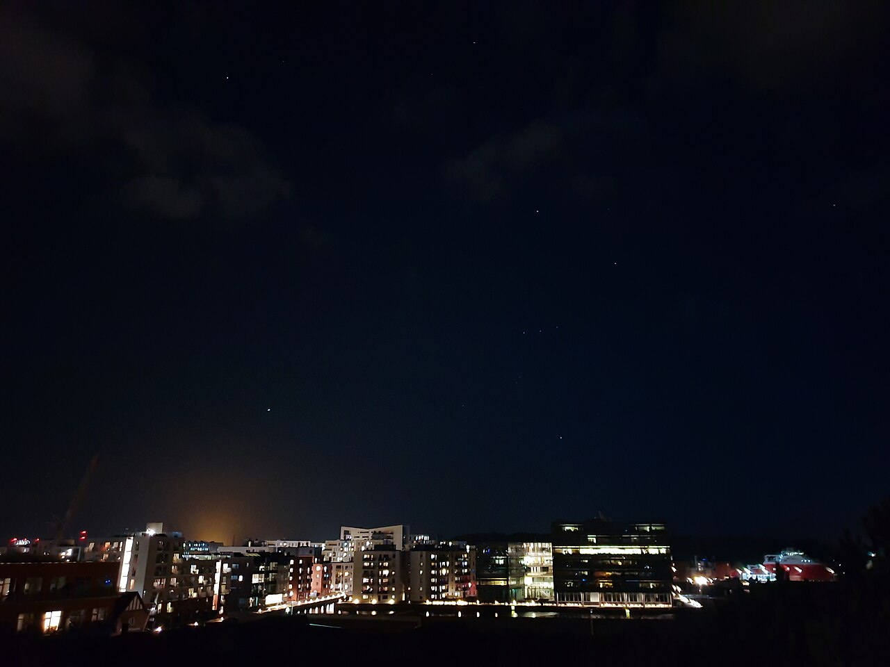
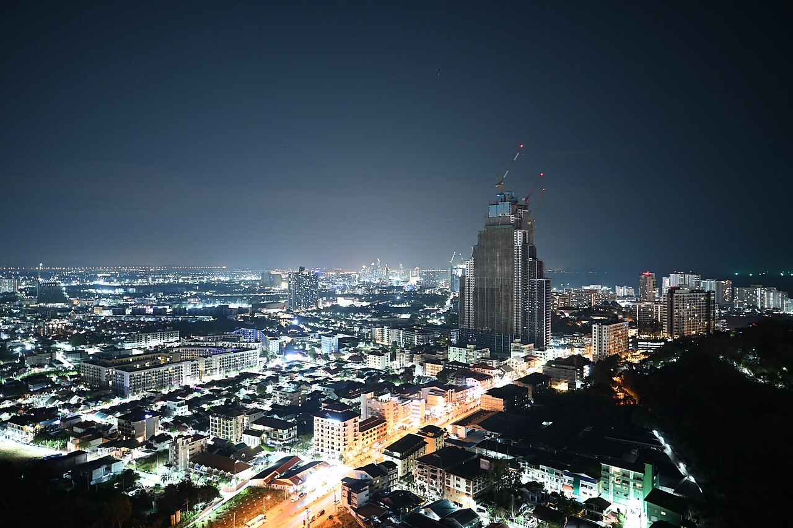
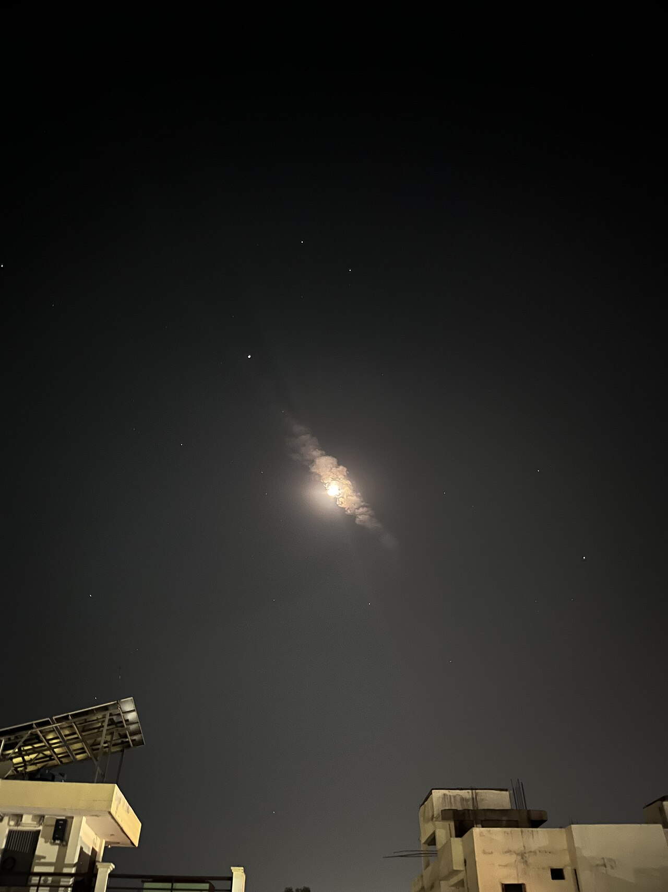

# Поиск обычных фотографий ночного неба
> Дата создания: 2026-11-10

> Я сохраняю этот отчёт как архив конкретного опыта. Его статусы относятся к описанной версии; текущее устройство — в [MODELS](../../MODELS.md), ход развития — в [HISTORY](../../HISTORY.md).

Задача этого этапа — поиск и проверка метаданных. Расчёты из новых точек,
новые рендеры неба и получение новых слоёв NASA не выполнялись.

Предыдущие снимки с выдержками 15–20 секунд не подходят как прямой эталон
обычного зрения. Здесь сохранены короткие экспозиции и отдельно — авторское
сопоставление фотографии с видом глазами. **Ни один файл не подтверждён как
фотометрически точное воспроизведение человеческого восприятия.**

## Основные кандидаты

| Снимок | Координаты камеры, N / E | Параметры | Что полезно и что неизвестно |
|---|---|---|---|
| [Оденсе, 2021](odense-2021.jpg) | 55.410000, 10.386000 | 1/4 с, f/1,5, ISO 800; Samsung SM-G960F | Орион, Сириус и свет у городского горизонта. Есть небольшая облачность; Lightroom указан, характер обработки и сложение кадров не подтверждены. |
| [Паттайя, 2026](pattaya-2026.jpg) | 12.916458, 100.869213 | 1/2 с, f/1,7, ISO 640; Nikon Z fc | Обычная камера, город и световой градиент неба. Состояние дымки/облаков независимо не проверено; калибровки зрения нет. |
| [Варанаси, 2026](varanasi-moon-2026.jpg) | 25.36419167, 82.93828611 | 1/2 с, f/1,6, ISO 1250; iPhone 13 mini | Звёзды, Луна, облака и городской передний план. Это пример дополнительных компонентов, не безлунное ясное небо; ночной режим неизвестен. |

Координаты опубликованы авторами/Commons, это не независимая геодезическая
проверка. Число знаков после запятой не гарантирует такую точность. Времена
сохранены как EXIF без выдуманного часового пояса; расчёт положения неба не делался.

### Оденсе

Автор **Askeuhd**, [CC BY-SA 4.0](https://creativecommons.org/licenses/by-sa/4.0/).
[Оригинальная страница](https://commons.wikimedia.org/wiki/File:Sirius_and_Orion_over_Odense_Harbour_at_night.jpg).
Дата EXIF: 6 апреля 2021, 21:39:16. Это наиболее полезный найденный кандидат
для связи «немного видимых звёзд — городской фон», но утверждения автора
«это точно как глазами» не найдено.

### Паттайя

Автор **PattayaPatrol**, [CC BY-SA 4.0](https://creativecommons.org/licenses/by-sa/4.0/).
[Оригинальная страница](https://commons.wikimedia.org/wiki/File:DFC_4635_Pattaya_lights_sparkle_under_a_clear_night_sky_-_the_city_glowing_with_life_from_street_level_to_skyline.jpg).
Дата EXIF: 9 февраля 2026, 19:30:21. Этот пример полезен прежде всего для
вида городского горизонта; число звёзд по нему не измерялось.

### Варанаси

Автор **Booksandcycle**, [CC BY-SA 4.0](https://creativecommons.org/licenses/by-sa/4.0/).
[Оригинальная страница](https://commons.wikimedia.org/wiki/File:Moonlit_night_sky_with_scattered_clouds_and_stars_over_city_rooftops.jpg).
Дата EXIF: 25 марта 2026, 22:03:41. Свечение нельзя целиком объявить городским:
в кадре есть Луна и облака. Этот снимок не подставляется в старый ясный
безлунный сценарий.

## Дополнительные случаи

### Москва: облака и снег

[Фотография](moscow-winter-2024.jpg), **Ivtorov**,
[CC BY 4.0](https://creativecommons.org/licenses/by/4.0/).
[Оригинальная страница](https://commons.wikimedia.org/wiki/File:2024_Light_pollution_in_Moscow.jpg).
Координаты 55.726150° N, 37.562000° E. EXIF: 3 февраля 2024, 18:12:01;
1/25 с, f/2,4, ISO 1250, iPhone 12 Pro Max. Это короткая экспозиция, но
иллюстрация облачно-снежной городской сцены, а не чистого звёздного неба.

### Лайлай: автор сам сопоставляет с видом глазами

[Фотография с исходной вставкой автора](lailai-author-comparison-2023.jpg),
**Junyu-K**, [CC BY-SA 4.0](https://creativecommons.org/licenses/by-sa/4.0/).
[Оригинальная страница](https://commons.wikimedia.org/wiki/File:The_Night_sky_light_pollution_at_Lailai_geological_zone.jpg).
Координаты 25.004136° N, 122.002305° E, дата съёмки в описании — 24 июня 2023.
Автор указывает Sony ZV-1, f/2,8, 15 с, ISO 3200 и 800; большой кадр — длинная
экспозиция. Малую вставку справа сверху автор описывает как близкую к виду
невооружённым глазом. Это **свидетельство автора**, а не независимая проверка
камеры/зрения. Снимок не записывается в список коротких экспозиций и не
используется как безоблачный эталон.

## Почему одной выдержки недостаточно

Ночное фото телефона может объединять несколько кадров. Такую обработку
[Google описывает для Night Sight](https://research.google/blog/astrophotography-with-night-sight-on-pixel-phones/).
Это не доказательство её применения к каждому из выбранных файлов. Поэтому
значение 1/4 с в EXIF не превращается автоматически в подтверждённое
«как увидел человек». Также остаются чувствительность сенсора, баланс белого,
тоновая кривая, яркость экрана и адаптация наблюдателя.

Точный эталон обычного тёмного безоблачного неба с подтверждённым соответствием
зрению **в этом поиске не установлен**. Найдены более подходящие кандидаты,
а ограничения сохранены вместо обещания точного совпадения.

В процессе отбора исключены: Москва 2018 (на самом фото заметны сумерки),
короткие кадры без координат, а также `夜空-2021-豪豪.jpg`, где автор прямо
указывает ночной режим OnePlus, а на изображении выражены облака и сумеречный
фон. Высоко чувствительный Pixel 9 Pro с кометой и Lightroom тоже не принят
как подтверждение обычного зрения.

## Происхождение копий

Все пять файлов — неизменённые уменьшенные копии Wikimedia. Локального
перекрашивания, усиления, обрезки и генерации ИИ нет. Каждый файл сохраняет
свою указанную выше лицензию. Размещение здесь не означает одобрения проекта
фотографами. Поля EXIF, URL копий, лицензии и SHA256:
[`sources.json`](sources.json).

Ответ на отдельный вопрос о назначении KStars сохранён в
[документе визуализации](https://github.com/WarriorOfTea/LightPollution/blob/52a3604b6603be48e07c4bd0d60a9cf32f0b9f38/docs/OBSERVER_VIEW.md#что-обещает-kstars-проверка-10-ноября-2026).
