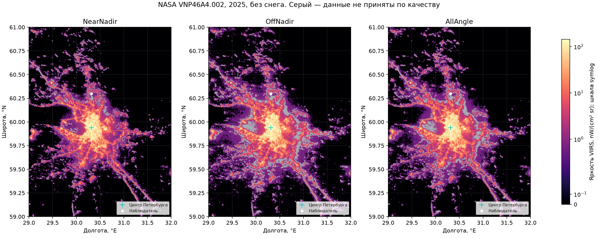

# Доступ NASA и аудит реальных данных Петербурга
> Дата создания: 2026-11-09

## Результат повторной проверки

После настройки профиля LAADS предоставленный ранее Earthdata-токен успешно
загрузил **4 из 4** файлов VNP46A4 Collection 002 за 2025 год. Смена токена
не потребовалась; дополнительных действий пользователя для доступа сейчас нет.
Суммарно получено 650 567 044 байта. Проверены размеры, сигнатуры HDF5,
локальные SHA-256 и внутренние метаданные. Манифест с хешами сохранён в
`artifacts/nasa-2025-catalogue.json`; исходные большие HDF5 находятся вне Git.

Подтверждены продукт, коллекция, период 2025-01-01 — 2025-12-31 и все четыре
тайла: h20v02, h21v02, h20v03, h21v03. Извлечено окно 29–32°E, 59–61°N:
480 × 720 = **345 600 ячеек** на географической сетке 15 угловых секунд.
Радианс: float32, scale=1, offset=0, единицы `nWatts/(cm^2 sr)`; fill=-999.9.
Численные массивы, карта и полная статистика находятся в
`artifacts/petersburg-2025/`.

## Особенность координат и исправление проверки

Первый реальный аудит остановился: проверка ожидала центры пикселей, а NASA
хранит в `lat/lon` верхние левые края. В h20v02 начало lon=20°, lat=70°,
шаг +1/240° по долготе и −1/240° по широте; структурные метаданные HDF-EOS
задают те же внешние границы, размер 2400 × 2400 и верхнее левое начало.

Парсер теперь различает ровно два соглашения: центры и верхние левые края,
сохраняет распознанный вариант для каждого файла и не принимает произвольный
сдвиг. Для интегрирования площадей выводятся центры ячеек. Разница относительно
исходных векторов — половина шага (7,5 угловых секунд), около 232 м по широте
и 116 м по долготе на 60°N. Это учтённая разница соглашений, а не обнаруженная
ошибка радианса NASA. Спутниковый footprint и независимость соседних пикселей
этим не улучшаются.

Источники соглашений: реальные HDF5 и их StructMetadata.0;
[GDAL HDF5/HDF-EOS5](https://gdal.org/en/stable/drivers/raster/hdf5.html),
[GDAL: центры и верхние левые углы](https://gdal.org/en/stable/development/rfc/rfc4_geolocate.html).

## Качество и статистика

Политика принятия: Quality=0, Num>3, конечный неотрицательный радианс.
Столбцы качества в таблице имеют общий знаменатель **345 600**. Единицы
радианса — nW/(cm² sr). Статистика яркости относится только к принятым ячейкам.

| Композит | Принято / всего | Доля | QA=1, исключено | QA=2, историческое |
|---|---:|---:|---:|---:|
| NearNadir | 331 809 / 345 600 | 96,01% | 13 790 | 1 |
| OffNadir | 317 504 / 345 600 | 91,87% | 28 096 | 0 |
| AllAngle | 323 417 / 345 600 | 93,58% | 22 183 | 0 |

| Композит | Медиана | Среднее | 95-й процентиль | Максимум | Медиана Num |
|---|---:|---:|---:|---:|---:|
| NearNadir | 0 | 2,913 | 9,614 | 8 977,428 | 15 |
| OffNadir | 0 | 3,255 | 11,342 | 4 626,388 | 18 |
| AllAngle | 0 | 3,004 | 10,482 | 5 379,057 | 56 |

Для всех трёх композитов: пропущенного/нечислового радианса, отрицательных
значений вне fill и противоречий Quality=0 с Num≤3 — **0 в каждом из 345 600
пикселей**. У принятых ячеек нет отсутствующего или отрицательного Std.
Нулевых принятых значений: 239 051 / 331 809 (NearNadir),
196 454 / 317 504 (OffNadir), 211 519 / 323 417 (AllAngle).
Нули не доказывают отсутствие слабого света: композит обнуляет значения
ниже порога 0,5; подробности — в исходном исследовании и руководстве NASA.

Покрытие поверхности: суша 234 230 / 345 600, внутренние воды
69 141 / 345 600, море 12 857 / 345 600, побережье 29 372 / 345 600.
Неизвестных классов и fill маски в окне нет.

Хорошее качество одновременно у NearNadir и OffNadir имеют
316 030 / 345 600 ячеек. Для 76 289 пар с обоими значениями >0 медиана
OffNadir/NearNadir — **1,192**, 95-й процентиль — 1,861, диапазон 0,0295–11,482.
Этот результат относится именно к отобранным положительным парам; он не
восстанавливает угловую диаграмму фонарей и не является ошибкой измерения.

## Яркие участки и ограничения достоверности

Визуальная проверка выявляет протяжённый центр освещения около координат
Петербурга, пригороды и линейные структуры дорог. Это географическая проверка
правдоподобия, не независимая фотометрическая калибровка.

Максимум NearNadir находится около 59,92708°N, 30,61042°E:
8 977,43, Std=8 038,66, Num=17. В этом же пикселе OffNadir=4 626,39.
Рядом есть несколько очень ярких ячеек. Ещё одна группа около
59,98125°N, 30,19375°E имеет NearNadir=2 913,70 и OffNadir=105,08 при
Std NearNadir=3 791,36. Значения не удалены автоматически: происхождение
конкретных источников и причина различий пока независимо не установлены.

На водных ячейках NearNadir достигает 744,92 при медиане 0 среди
81 460 принятых водных ячеек. Это требует отдельного разбора: реальные огни,
береговое смешение и артефакты нельзя различить одним порогом. Региональный
сценарий по умолчанию исключает воду и отдельно считает её вес.

Quality=0 в композите характеризует прежде всего достаточное число наблюдений;
оно не отменяет большой временной разброс, угловые различия, спектральную
неоднозначность и остаточные ошибки. Данные пригодны для дальнейшего
относительного моделирования источников, но процент абсолютной физической
точности и точная яркость наблюдаемого неба по этому аудиту не установлены.

## Связь с упрощённой моделью и switch

Проверенные данные теперь можно использовать как вход модели; прежняя карта
неба с двумя городами была синтетической и не переименовывается в реальную.
Полный расчёт неба на реальной карте в этой повторной проверке не запускался.
Допущения и пропущенные процессы остаются описаны в `docs/MODEL.md`:
однократное рассеяние, условная опорная полоса 550 нм, сценарная атмосфера,
ламбертовские источники, без естественного фона, рельефа и ближних фонарей.

Проект зарегистрирован для VibeCodex `/switch` штатным
`management/bin/init-repository.py`; результат — `Ready for /switch` для
`/home/myuser/pignity/projects/LightPollution`. Изменять код или перезапускать
бота не потребовалось. Пользователю достаточно вызвать `/switch` заново.

Короткая проверка доступа и статистика не означают завершения всей научной
валидации этапа A: яркие аномалии и независимое сопоставление географии
остаётся исследовать. Большой расчёт, калибровка и интеграция KStars впереди.

Проверки после исправления координат: **40/40 тестов прошли**, 0 ошибок и
пропусков, последний запуск 4,09 с. Реальный аудит всех четырёх файлов успешно
завершён отдельно от тестов; синтетические проверки не выдаются за измерения.
