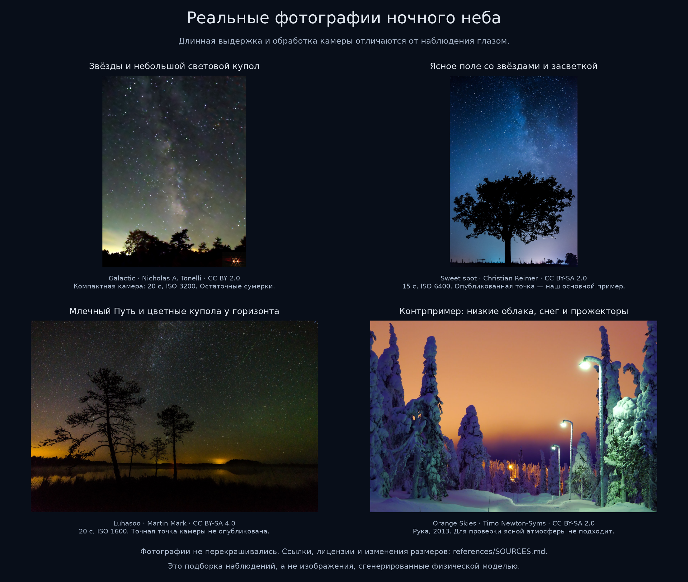
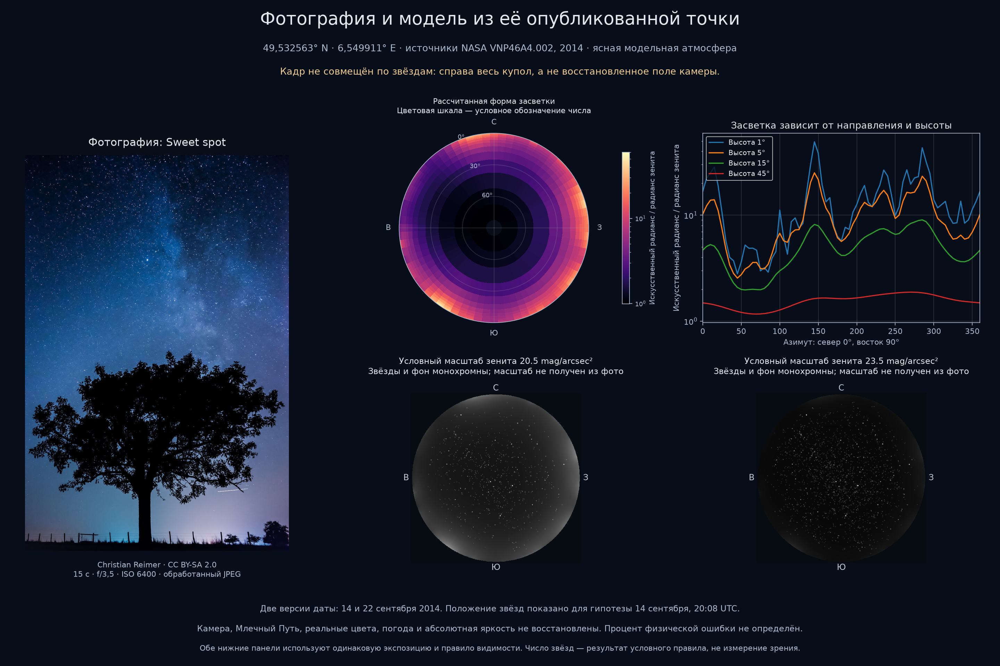

# Фотографии, годовые данные и пределы сравнения
> Дата создания: 2026-11-09

Принятое требование: сохранять развитие моделей и результаты с иллюстрациями
в [HISTORY.md](../HISTORY.md). Для фотографии с опубликованной точкой выполнить
отдельный расчёт; различать наблюдение глазом, камеру и физический радианс.

## Использованные до этого входы

Петербургский опыт использовал годовой snow-free композит VNP46A4.002 за 2025
год, NearNadir, QA=0, Num>3, с исключением отрицательных/пропущенных значений,
воды/неизвестной поверхности и ближайших 3 км. Это реальные обработанные
наблюдения. Они не идеальны: есть пропуски, угловые различия и большой Std
у отдельных ярких участков. Подробности — [DATA_AUDIT.md](DATA_AUDIT.md).

Идеализации находятся в модели: ясная атмосфера с фиксированными параметрами,
ламбертовские источники, одно рассеяние, условные 550 нм и заданный масштаб
зенитной яркости. Политика QA не превращает такую модель в прогноз погоды и
яркости конкретной ночи. Месячные/суточные продукты пока не использованы.

## Основной снимок

`Sweet spot`, Christian Reimer, CC BY-SA 2.0. Публичные координаты:
49,532563° N, 6,549911° E. По API Commons исходный EXIF: Sony ILCE-7,
28 мм, f/3,5, 15 с, ISO 6400, автоматический баланс белого, Lightroom 5.6.
Это обработанный JPEG, не линейный RAW.

Страница сообщает 14 сентября 2014, 22:08; исходный EXIF —
22 сентября 2014, 22:08:19. Обе даты сохранены. Для основной гипотезы
UTC принят как 20:08, при CEST UTC+2. Точность геотега не подтверждена
независимой съёмкой; высота 20 м — параметр сценария над сферической
поверхностью, не измеренная высота камеры или реальный DEM.

Проверка по первой дате: Солнце −21,80°, Луна −7,49°; по второй —
−24,83° и −30,23°. Для точного цвета
и количественного сравнения неизвестны аэрозоли, спектры городских источников,
кривая JPEG, виньетирование и реальная фотометрическая чувствительность.
Независимая метеорологическая проверка облачности не получена. Визуально
звёздное поле свободно от заметных облаков.

## Сравниваемая модель

Вход источников — отдельный проверенный VNP46A4.002 2014 года, тайл h18v04.
Окно: 4,5–9° E, 48–50° N. Физика и единицы прежние, параметры сохранены
в `artifacts/photo-comparison/case.json`. Укрупнение 12 пикселей и измельчение
возле лучей до 5°. Годовой слой не описывает конкретное состояние освещения
в ночь фотографии; внешние источники и реальные спектры остаются неизвестными.

`scripts/run_photo_case.py` рассчитывает 1080 значений и сохраняет 1009
независимых интегрирований с возобновлением через `scratch/`. Исходный HDF5
не включается в Git; выбранный регион и метаданные сохраняются.

```bash
BLACKMARBLE_TOKEN_FILE=.secrets/earthdata-token uv run python - <<'PY'
from pathlib import Path
from lightpollution.download import download_annual
download_annual(Path('data/blackmarble/2014-saarland'), 2014,
    tiles=('h18v04',),
    manifest_path=Path('artifacts/photo-comparison/nasa-2014-catalogue.json'))
PY
uv run python scripts/run_photo_case.py
uv run python scripts/validate_photo_case.py
uv run python scripts/build_photo_comparison.py
```

Проверенный регион `source-grid.npz` включён в Git: для повторного расчёта
и сборки графиков загрузка HDF5 и токен не нужны. Команда загрузки выше нужна
при независимом восстановлении исходного региона. По умолчанию используются
два процесса; лучи кэшируются отдельно от Git в `scratch/photo-case-rays.jsonl`.
При изменении входов/решателя скрипт откажется читать несовместимый кэш:
его нужно перенести перед новым запуском. Сохранённый регион также проверяется
на соответствие году и границам сценария.

## Результаты нового опыта





- NearNadir: приняты 518 265/518 400 ячеек (99,974%), медиана Num=31;
  302 465/518 265 принятых значений равны нулю. QA — политика отбора,
  не процент физической точности. Полная статистика всех композитов:
  [audit.json](../artifacts/photo-comparison/saarland-2014/audit.json).
- 1080 значений поля, 1009 независимых лучей; базово 3253 источника,
  до 7618 после измельчения. Поле конечное, положительное, с единым зенитом.
- На высоте 1° наибольшее значение сетки — у 145°, около 49,19 зенитного
  искусственного радианса; на высоте 15° максимум — у 285°, около 9,03.
  Это результаты модели; направления на фотографии не подтверждены.
- На четырёх контрольных лучах, включая эти два максимума, уточнение квадратур
  даёт до 0,0261% различия, блок 12 → 6 — до 0,4700%.
  [Полные результаты с направлениями и знаменателями сравнений](../artifacts/photo-comparison/saarland-2014/numerical-check.json).
- Визуальные сценарии 20,5 и 23,5 mag/arcsec² дают 744 и 1830 звёзд по
  условному правилу контраста. Масштабы не подогнаны к JPEG и не определены
  спутником. Числа не относятся к человеческому зрению или подсчёту на фото.
- Попытки Astroalign и Tetra3 не дали надёжного совмещения кадра.
  [Настройки и статус последней попытки](../artifacts/photo-comparison/registration-attempts.json).
  Совпадает опубликованная географическая точка; поле камеры не восстановлено.

Первый параллельный запуск завершился `BrokenProcessPool` после сохранения
770/1009 лучей; причина не установлена. Остальные 239 рассчитаны двумя
процессами за 106,76 с. Это время продолжения, не всех вычислений. Итоговый
повторный запуск прочитал 1009/1009 сохранённых лучей; его собственное время
тоже не выдаётся за полное время кампании.

**Вывод:** наличие световых градиентов качественно согласуется с постановкой
задачи, но фотография ещё не проверяет направления и амплитуды куполов.
Млечный Путь, естественные цветные компоненты и камера отсутствуют в модели.
Образец не подтверждает физическую точность и явно показывает, почему
монохромный численный рендер пока нельзя объявить видом глазами или камерой.
Численные результаты сохранены в
[comparison.json](../artifacts/photo-comparison/comparison.json).

## Что может и чего не может подтвердить этот опыт

Совпадение направлений и крупной пространственной формы — полезный внешний
контроль. Статистика астрометрического совмещения, если оно установлено,
относится к координатам звёзд, а не к точности яркости городской засветки.

Без линейного RAW, калибровки и атмосферы нельзя честно вычислить процент
физической ошибки по яркости JPEG. Похожая картинка после выбора экспозиции,
баланса белого или произвольного множителя не является независимой проверкой.
Числа 0,183%/0,504% из петербургского опыта не переносятся на эту новую точку.

Цвета пока **не предсказываются**. Ни серый фон не доказывает серый цвет
реального свечения, ни белые точки — одинаковые спектры звёзд. Годовой VIIRS
даёт одну широкую полосу, а нынешний перенос — одну условную длину волны.
Спектральные и зрительные расширения отмечены в истории как открытые задачи.

## Источники

Авторы, ссылки, лицензии, преобразования и SHA256 копий фотографий записаны
в [SOURCES.md](../artifacts/photo-comparison/references/SOURCES.md) и
`artifacts/photo-comparison/references/sources.json`. Иллюстрации сохраняют
собственные лицензии фотографий; они не объявлены авторской генерацией проекта.
Методические первоисточники перечислены в конце [HISTORY.md](../HISTORY.md).
