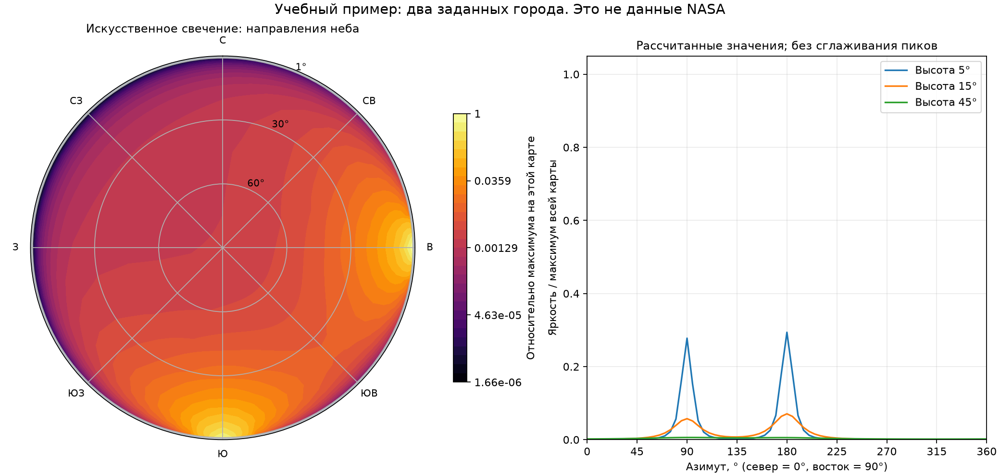
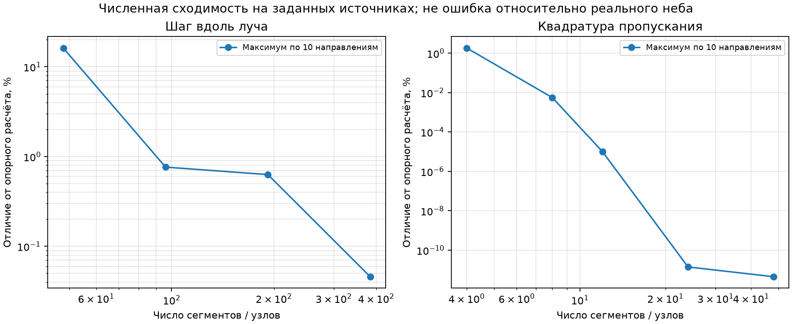

# Проверка README, данных NASA и план первой реализации
> Дата создания: 2026-11-09

## Вывод

Идея проекта научно обоснованна: пространственная карта земных источников и
решение задачи атмосферного рассеяния позволяют рассчитывать направленную
искусственную составляющую неба. Black Marble подходит как вход для такой
задачи, но не определяет однозначно спектр, полную восходящую мощность и
угловую диаграмму городского света. Поэтому первую версию обоснованно делать
как относительный исследовательский расчёт, отдельно от визуализации и KStars.

README прочитан целиком; проверены основные первичные документы и существующие
реализации. Исправлен неверный DOI Гарстанга и дополнен пример фильтра качества
BlackMarblePy. Реализовано независимое ядро однократного рассеяния и
воспроизводимая синтетическая демонстрация. **Реальные HDF5 Петербурга пока не
получены. Их значения и качество не объявляются проверенными.**

## Что удалось получить от NASA

Обращение к открытому каталогу LAADS подтвердило четыре нужных файла продукта
VNP46A4, Collection 002, ArchiveSet 5200 за 2025 год. Имена и размеры сохранены в
`artifacts/nasa-2025-catalogue.json`; у всех `download_verified: false`.

| Тайл | Размер, байт | Время обработки по имени файла, UTC |
|---|---:|---|
| h20v02 | 185 814 570 | 2026-03-17 19:48:41 |
| h21v02 | 165 667 133 | 2026-03-17 22:17:50 |
| h20v03 | 134 024 999 | 2026-03-17 19:49:40 |
| h21v03 | 165 060 342 | 2026-03-17 22:21:51 |

Суммарный опубликованный размер — **650 567 044 байта**, или 650,57 MB
(620,43 MiB). Это размеры каталога, а не успешно скачанные объёмы. Номинальные
~92 MB на странице продукта не являются обязательным размером каждого файла.
2025 — год наблюдений в имени, март 2026 — время обработки; их нельзя смешивать.

Запрос файла с предоставленным Earthdata-токеном вернул HTTP 303 на
`/profiles/licenses/`, затем переходы через `/oauth/login` и Earthdata;
завершился требованием авторизации (HTTP 401). Это не HDF5 и не успешный доступ
к научным данным. Точная причина настроек аккаунта по этим ответам не видна;
нельзя утверждать только на их основании, что токен неверен или истёк.
Пользователю предложено завершить браузерный вход и предложенные настройки
доступа/условия LAADS. Токен не включён в исходники, Git и этот отчёт.

Источник списка файлов: [LAADS API V2](https://ladsweb.modaps.eosdis.nasa.gov/api/v2/content/details/allData/5200/VNP46A4/2025/001).
Правила использования токенов: [официальная инструкция NASA](https://ladsweb.modaps.eosdis.nasa.gov/learn/download-files-using-edl-tokens/).

### Что пока невозможно оценить

- Скачано **0 из 4** научных файлов; проверено **0 реальных пикселей**.
- Окно 29–32°E, 59–61°N должно содержать 480 × 720 = **345 600 ячеек**.
  Это расчёт геометрии сетки, а не число прочитанных измерений.
- Минимум/медиана/максимум яркости, доли Quality, Num, Std, fill/NaN,
  водные аномалии, статистика NearNadir/OffNadir и положение реальных ярких
  участков **не получены из-за отсутствия файлов**.
- Реальной карты ночного освещения Петербурга пока нет. Изображение с двумя
  городами ниже подписано как синтетическая проверочная задача.

## Исправления и важные уточнения README

### Библиография

DOI `10.1086/132933` относится к **Dust and light pollution** (1991, PASP 103,
1109). Для **Model for Artificial Night-Sky Illumination** (1986, PASP 98, 364)
правилен **10.1086/131768**. Исправлены оба вхождения ссылки в README.
Проверены [запись Crossref](https://api.crossref.org/works/10.1086/131768),
[ошибочно указанная работа](https://api.crossref.org/works/10.1086/132933) и
[оригинал 1986 года](https://adsabs.harvard.edu/pdf/1986pasp...98..364g).

### Качество и цензурирование спутниковых значений

Для VNP46A4.002 хорошее качество означает Quality=0 и **Num>3**.
Quality=1 означает не более трёх наблюдений, Quality=2 — историческое
восстановление; их первая версия исключает. В примере BlackMarblePy добавлено
`drop_values_by_quality_flag=[1, 2, 255]`: документированный default класса
исключает только 255 и сам по себе не обеспечивает выбранную политику.
[Документация API BlackMarblePy](https://worldbank.github.io/blackmarblepy/api/blackmarble.html).

Collection 2 использует float32 для яркости с номинальными scale=1 и offset=0.
Реальные атрибуты всё равно читаются из каждого массива; перенос коэффициента
0,1 из примеров Collection 1 недопустим. Fill маскируется до преобразования.
Ненулевой неизвестный offset приводит к явной ошибке, а не выбору соглашения
наугад. Исходный сигнал широкополосный, не `W/(m² sr nm)`.

Алгоритм композита уже заменяет значения ниже **0,5 nW/(cm² sr)** нулями.
Ноль поэтому не доказывает отсутствие слабого света. Std отражает разброс
наблюдений, а не полную неопределённость композита. Земные/водные классы
необходимо читать по VIIRS: 0/1 — суша, 2 — внутренние воды, 3 — море,
5 — побережье. Нельзя подменять эту таблицу кодами другого продукта.
Источник: [NASA Collection 2 User Guide](https://viirsland.gsfc.nasa.gov/PDF/BlackMarbleUserGuide_Collection2.0.pdf),
§2.3, §5.3, таблицы 6, 11–12.

### Что подтверждено в физической постановке

В README правильно разделены радианс спутника, интенсивность источника и
полная мощность; нормировки ламбертовской функции и фазовых функций корректны.
Формула однократного рассеяния имеет правильную структуру. При реализации
важно не перепутать направление взгляда с направлением распространения
рассеянного фотона и не добавить второй проекционный косинус к интенсивности.
Вывод, размерности и определения записаны в [MODEL.md](MODEL.md).

Сферическая геометрия нужна: город за горизонтом может освещать видимую
атмосферу. Одного отсечения по видимости города недостаточно. При этом
большое расстояние до города не гарантирует точность сосредоточенного
источника, если сам луч проходит непосредственно над ним. Это отдельно
оговорено в оригинальной работе Гарстанга и учтено как ограничение укрупнения.

Требования «дата и время» и «годовой snow-free композит» относятся к разным
этапам. Первая версия даёт усреднённый сценарий. Она не описывает конкретный
вечер и не учитывает сезонные сумерки, облака и режим выключения света.
Для Петербурга это особенно существенно: в районе летнего солнцестояния
астрономической ночи нет. Годовая карта не заменяет модель естественного фона.

## Что действительно существует в проектах сравнения

| Проект | Подтверждённый результат | Вывод для LightPollution |
|---|---|---|
| Stellarium discussion #4242 | Предложение smln; обсуждение редкой сетки, интерполяции и сложности LUT. Позднее показан внешний сервис APEX. | Дискуссия не подтверждает готового плагина. Интерполяцию нельзя считать проверенным оптимумом. |
| APEX / DarkSkySites | По описанию автора: VIIRS, воксели, первая стадия переноса, приближённые дополнительные GPU-проходы, raymarching. | Подходит как архитектурный ориентир, не как численный эталон. Исходный научный код и независимая валидация точности не установлены. |
| CalcMySky / ShowMySky | Рабочий код и библиотека для дневного/сумеречного неба, предвычисления в сферически симметричной атмосфере. | Можно изучать тестирование, профили и GPU-подходы; произвольные местные города не становятся поддержанными автоматически. |
| Cinzano–Falchi / LPTRAN | Научная постановка распространения искусственного света с расширенной физикой. | Прямая основа для уравнений и будущего сопоставления; первая версия не выдается за воспроизведение всей LPTRAN. |
| World Atlas 2016 | Рассчитанная и откалиброванная карта зенитной яркости при принятых условиях. | Ориентир для зенита при сопоставимых данных и полосе, не эталон всего купола 2025 года. |

Прочитана [вся доступная дискуссия Stellarium](https://github.com/Stellarium/stellarium/discussions/4242),
включая комментарии и ответы до предложения использовать панорамы APEX.
В ней автор APEX сообщает о доступе к API по запросу; интеграция через этот
API не предполагается без разрешения и ясных условий.

В [описании APEX](https://darkskysites.com/light-pollution-sim-docs) прямо
упомянуты дополнительные параметры формы далёких куполов и низких высот.
Их нельзя считать фундаментальным следствием уравнения переноса. Также DEM
в APEX строит местную маску горизонта (720 азимутов); экранирование путей в
глобальной системе LUMIX — отдельный механизм. Воксельные итерации автора
не являются доказательством полного решения многократного рассеяния.

[README CalcMySky](https://github.com/10110111/CalcMySky) и
[реализация Bruneton](https://ebruneton.github.io/precomputed_atmospheric_scattering/)
позволяют отделить существующие солнечные LUT от нашей задачи распределённых
земных источников. Дневные LUT нельзя просто интерпретировать как ночную карту
городов. Первая версия сохраняет прямой CPU-решатель как понятный контрольный
алгоритм; GPU и воксели откладываются до проверки данных.

## Что реализовано сейчас

- `download.py`: открытый каталог, выбор конкретной обработки, закрепляемый
  манифест, авторизованная загрузка только с LAADS HTTPS, проверки размера,
  сигнатуры и локального SHA-256, возобновление по отдельным файлам.
- `data.py`: чтение четырёх HDF5, проверка метаданных и координат, извлечение
  окна без чтения всех научных слоёв тайла в память, Quality/Num/Std и сводки.
  Проверен на специально созданных HDF5; реальный формат ещё предстоит
  подтвердить интеграционным запуском после доступа NASA.
- `sources.py`: веса пропорционально радиансу и сферической площади,
  нормировка суммы, сохранение веса при укрупнении, адаптивное измельчение
  возле наблюдателя, явный учёт исключённой ближней зоны, воды и неизвестной поверхности.
- `physics.py`: сфера, непрозрачная поверхность, молекулы и аэрозоли,
  Рэлеевская/HG-фазы, поглощение аэрозолем, обе оптические толщины,
  интегрирование одного рассеяния. Формулы и единицы — в MODEL.md.
- CLI: отдельные `catalogue`, `download`, `audit`, `simulate`, `demo`.
  Реальные данные никогда не заменяются тестовыми при ошибке доступа.
- NPZ и CSV сохраняют числовой результат, JSON — единицы и все параметры.
  Нормировка изображения не изменяет числовой массив.
- Тесты, эксперимент сходимости, анализ параметров и демонстрационные графики.

Физическое упрощение: условный опорный перенос на 550 нм, одинаковая диаграмма
источников, однократное рассеяние, без DEM/облаков/Луны/естественного фона.
В спутниковом режиме полная модельная мощность нормируется на единицу;
видимая абсолютная фотометрия не считается известной.

## Численные результаты, полученные в этой работе

### Автотесты

**38 из 38 тестов прошли**, пропусков и ошибок нет; последний запуск — 2,95 с,
Python 3.12.3. Тесты проверяют физические инварианты, четырёхтайловый шов,
масштабирование, качество, авторизацию/целостность, сохранение координат и
происхождения в экспорте. Реальные данные NASA в тесты не входят.

### Два заданных тестовых города

98 эффективных тестовых источников: большой условный город приблизительно
в 40 км к югу, меньший — в 25 км к востоку. Тестовые полные мощности 1 и
0,25 W выбраны для математического примера; это не мощности настоящих городов.
Наблюдатель 60,30°N, 30,315°E, 20 м над модельной сферой. Атмосфера: AOD 0,10,
`g=0.8`, однократное альбедо аэрозоля 0,9; диаграмма источников ламбертовская.

Карта 72 азимута × 13 высот = **936 значений**, 1–90°. Зенит общий для всех
азимутов, поэтому независимых интегрирований 865. На 384 сегментах вдоль луча
и 24 узлах квадратуры оптической толщины расчёт занял **49,32 с** в этом
окружении. Это исследовательское CPU-время, не обещание скорости на другой
машине или на реальной карте из тысяч источников.

Максимум этой сетки: азимут 90°, высота 1°; отклик
`9.20060033e-11 W/(m² sr)` при заданных тестовых мощностях. Более близкий
меньший город может доминировать возле горизонта. Отношение юг/север на высоте
5° — 2338,57, на 15° — 76,16, на 45° — 2,93. Эти отношения характеризуют
выбранную тестовую сцену, а не небо под Петербургом.

### Сходимость и чувствительность

Опорный расчёт того же решателя: 768 сегментов, 64 узла квадратуры,
**10 фиксированных направлений**. Он не объявляется точным аналитическим
решением или независимым физическим эталоном.

| Сегменты вдоль луча | Максимальное отличие от опоры, по 10 направлениям |
|---:|---:|
| 48 | 16,2085% |
| 96 | 0,7632% |
| 192 | 0,6301% |
| 384 | 0,0459% |

Грубая сетка может пропустить узкий купол возле горизонта; сходимость на
промежуточных шагах не обязана быть монотонной. При фиксированных 768 сегментах
12 узлов пропускания отличаются от 64 максимум на 0,0000102% для этих же
направлений. Это не универсальная гарантия для любого источника или атмосферы.

Дополнительно сопоставлены **все 936 значений** карт 192 и 384 сегментов:
максимальное отличие 0,6417%, медиана 0,00684%, относительная норма L2 — 0,3564%.
Максимум находится на высоте 1° к востоку; для высот от 5° максимум 0,00872%.
Эти две проверки имеют разные знаменатели и разные опорные расчёты.

При неизменных источниках и суммарной мощности переход от `eta=0` к
`eta=0.1` меняет значения по 10 направлениям в **1,09–7,74 раза**;
при `eta=0.3` — в 1,27–21,22 раза. Это сравнение гипотез, не измеренная
неопределённость с доверительным интервалом. Уменьшение AOD с 0,10 до 0,03
повышает значения в 1,33–5,97 раза, увеличение до 0,30 даёт 0,00638–0,473
базового значения в этой сцене: ослабление дальнего света может преобладать.
Из этого нельзя заключать, что дымка всегда делает реальное небо темнее:
здесь отсутствуют местные источники и повторное рассеяние.

Главная неопределённость сейчас связана с физическими входами и пропущенными
процессами. Малое численное отличие не означает соответствующую точность
относительно наблюдаемого неба. Физический процент точности **не установлен**.
Все численные таблицы сохранены в `artifacts/numerical-validation/`.

## План реализации и критерии перехода

### A. Завершить проверку реальных входов — ожидает доступа NASA

После завершения настройки LAADS скачать 4 из 4 файлов, проверить внутренний
период и происхождение. Запустить аудит всех 345 600 ячеек окна. Представить
карты трёх угловых композитов, разрезы Quality/Num/Std, пропуски, воду,
отношения OffNadir/NearNadir и координаты аномальных ярких ячеек. Отдельно
проверить совпадение ярких структур с населёнными пунктами и дорогами.
Данные сохранить с манифестом и хешами; исправить парсер при обнаружении
отличий реального HDF5 от спецификации. До этого этап A не завершён.

### B. Подключить минимальный перенос к карте — ядро готово, реальный прогон впереди

Использовать NearNadir snow-free, фиксированный прозрачный сценарий атмосферы,
наблюдателя примерно в 40 км к северу от центра. Рассчитать 1–90° с отдельным
вниманием к низким высотам; проверить направление купола города, не подгоняя
его форму. Сохранить региональные исключения и численную карту. Направление
купола — необходимая качественная проверка, но не доказательство калибровки.

### C. Проверить ошибки дискретизации и гипотез — частично выполнено на тестовой сцене

Сопоставить шаги луча, узлы пропускания и размеры блоков источников. Укрупнение
проверять также возле освещённых городом низких слоёв, не только возле
наблюдателя. Расширять окно источников последовательными кольцами; неизвестный
внешний вклад нельзя объявлять нулевым. Повторить сценарии AOD/g/eta и трёх
композитов на реальной карте. В качестве рабочего критерия предложено отличие
менее 1% на контрольных направлениях при следующем измельчении; для 0–5°
нужна отдельная проверка. Это критерий численной сходимости, не физической ошибки.

Далее нужны независимые сопоставления: опубликованная контрольная задача
переноса/другой решатель и наземная фотометрия с известной полосой, датой,
атмосферой, калибровкой и отделённым естественным фоном. Одного SQM в зените
недостаточно для проверки полного распределения по небу.

### D. Ускорить при контроле потери точности — не начато

Профилировать реальную карту. Базовая стоимость растёт как число направлений ×
сегментов × источников × узлов пропускания. Сначала сравнить дистанционное
укрупнение и кэширование атмосферных интегралов, затем редкую угловую сетку
и положительную интерполяцию с периодическим швом. Бикубическая интерполяция
может давать отрицательные выбросы и требует проверки. Воксельное поле/GPU
вводить только с измеренным выигрышем и сравнением с CPU-ядром.

### E. Подготовить минимальный адаптер KStars — исследованы точки интеграции

Исходники KStars рассмотрены на ревизии
`643a046526da95e521e3209d937d8f987b20df18`. Установлено:

- [SkyPainter](https://github.com/KDE/kstars/blob/643a046526da95e521e3209d937d8f987b20df18/kstars/skypainter.h)
  задаёт интерфейс рисования фона;
- [SkyQPainter::drawSkyBackground](https://github.com/KDE/kstars/blob/643a046526da95e521e3209d937d8f987b20df18/kstars/skyqpainter.cpp)
  сейчас заполняет фон цветом, включая смешивание дневного/ночного режима;
- [SkyGLPainter](https://github.com/KDE/kstars/blob/643a046526da95e521e3209d937d8f987b20df18/kstars/skyglpainter.cpp)
  — отдельный путь рисования, который также потребуется проверить;
- [SkyMapComposite::draw](https://github.com/KDE/kstars/blob/643a046526da95e521e3209d937d8f987b20df18/kstars/skycomponents/skymapcomposite.cpp)
  показывает порядок Млечного Пути, объектов, горизонта и рельефа.

Предлагается отдельный компонент искусственного фона в горизонтальных
координатах и адаптер к обоим путям рисования. Численный перенос остаётся вне
UI; C++ читает согласованный формат сетки и метаданных. Нужны проверка
проекций, шва 0/360°, зенита, земного горизонта, смены места и режима дня,
а также отдельная настройка отображения без изменения численного радианса.
Нельзя обещать корректную видимость звёзд только от добавления цветного фона.
Файлы SkyPainter помечены GPL-2.0-or-later; лицензия нового ядра пока не выбрана.
Код KStars в этой работе не изменялся и не собирался. Патчи и сообщения
разработчикам внешних проектов не отправлялись.

### F. Добавлять физику по результатам сравнения — отложено

Приоритеты: протяжённые ближние источники; спектры и чувствительность DNB;
повторное рассеяние; DEM отдельно для двух участков пути и видимого горизонта;
пространственно меняющаяся атмосфера; облака/снег/Луна/естественное небо;
ночная динамика освещения. Не требуется внедрять всё до проверки пользы.

## Открытые вопросы и принятый объём первой версии

Принято по задаче пользователя: сначала упрощённый проверяемый прототип,
самостоятельный вычислитель и исследование NASA. Все выбранные AOD/eta/спектральные
упрощения — **экспериментальные сценарии**, не окончательная калибровка.

Открыты доступ LAADS и фактическое качество данных, спектры и угловые свойства
источников, величина внешнего и ближнего вклада, достаточность одного рассеяния,
измерительная валидация, DEM, лицензия ядра и окончательный интерфейс KStars.
Абсолютные mag/arcsec², SQM, Bortle и точный внешний вид конкретного вечера
сейчас не входят в реализованный результат.

NASA предоставляет открытые научные данные с указанием собственных условий:
[LAADS data-use guidance](https://modaps.modaps.eosdis.nasa.gov/services/faq/LAADS_Data-Use_Citation_Policies.pdf),
[NASA science data licenses](https://science.data.nasa.gov/about/license).
Условия конкретного выбранного набора и необходимость указания источника
проверяются перед распространением самих файлов. Данные и научные статьи —
разные объекты; доступная статья не означает свободную лицензию её текста.

## Доступность первичных материалов из README

| Материал | Что проверено / ограничение доступа |
|---|---|
| Black Marble, NASA Nighttime Lights, VNP46A4 | Официальные страницы доступны; продукт и Collection 002 подтверждены. |
| Black Marble Collection 2 User Guide | PDF загружен и изучен: радиометрия, композиты, таблицы качества, форматы HDF5. Есть также ссылка PDF через LAADS. |
| Архив NASA | Открытые метаданные доступны; сами четыре HDF5 требуют завершения авторизации. |
| Román et al. 2018 | Название/DOI подтверждены NASA; отдельный полный текст не использовался вместо руководства C2. |
| Wang et al. 2022 | Запись NASA NTRS подтверждает DOI; в NTRS нет полного файла. Угловые категории проверены в документации продукта и руководстве. |
| BlackMarblePy: руководство, примеры, API | Доступны и изучены сигнатуры, коллекция 5200, переменная токена и политика QA; библиотека не включена в зависимости прототипа. |
| Earthdata User Token | Официальная документация доступна; токен используется только локально. |
| Stellarium #4242 | Доступное обсуждение прочитано целиком; это предложение и обсуждение внешних реализаций. |
| APEX / DarkSkySites | Документация автора изучена целиком; независимая точность и закрытые численные детали не установлены. |
| CalcMySky и Bruneton | README, описание реализации и параметры примера изучены; солнце и локальные города различаются геометрией освещения. |
| Cinzano–Falchi | Полный arXiv PDF загружен; изучены постановка, нормировки и ограничения переноса. |
| Garstang 1986 | Оригинал доступен в ADS; библиографическая ссылка исправлена по Crossref. |
| Falchi et al. 2016 | Проверены доступные текст/индексированные разделы о зенитной карте и калибровке; прямой издатель возвращал 403, PMC при повторном открытии требовал проверку браузера. |
| Lightpollutionmap.info | Сайт доступен; реальные слои для Петербурга в этой работе не извлечены и не служат проверкой пикселей. |
| NIST SCATMECH | Документация подтверждает назначение библиотеки BRDF/рассеяния; библиотека не требуется для первого скалярного решателя. |
| KStars: сайт, исходники, get-involved | Официальная инструкция и конкретные файлы изучены; сборка и upstream-предложение ещё впереди. |

Дополнительные первичные ссылки:
[Wang et al., NASA NTRS](https://ntrs.nasa.gov/citations/20220013773),
[Cinzano–Falchi](https://arxiv.org/abs/1209.2031),
[World Atlas](https://doi.org/10.1126/sciadv.1600377),
[NIST SCATMECH](https://pages.nist.gov/SCATMECH/),
[KStars developer entrypoint](https://kstars.kde.org/get-involved/).

## Сохранённые результаты

Код и документация находятся в репозитории LightPollution, development-ветка
`feature/black-marble-prototype`. Исходный технический контекст README сохранён,
изменены только указатель текущего состояния, DOI и политика QA примера.
Разбор физики — `docs/MODEL.md`; запуск — `docs/QUICKSTART.md`;
численные результаты — `artifacts/`; изменения кода — `docs/CODE_CHANGELOG.md`.
Подготовлена PDF-копия этого отчёта для передачи пользователю.
